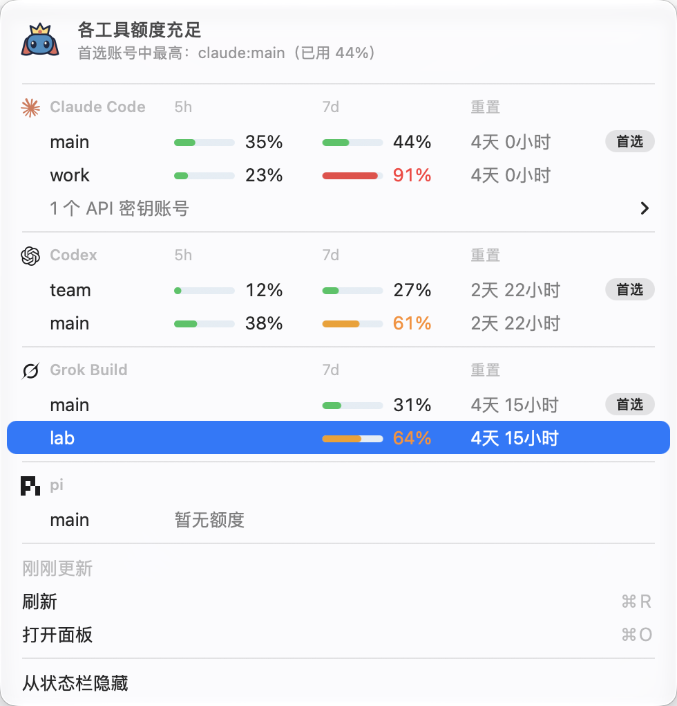

# 使用指南

[English](usage.md) | 中文

← [README](../../README.zh-CN.md)

## 账号

| 家族 | 主账号 | 其他账号 | 选择变量 |
|---|---|---|---|
| claude | `~/.claude` | `~/.claude-<name>` | `CLAUDE_CONFIG_DIR` |
| codex | `~/.codex` | `~/.codex-<name>` | `CODEX_HOME` |
| grok | `~/.grok` | `~/.grok-<name>` | `GROK_HOME` |
| pi | `~/.pi/agent` | `~/.pi-<name>/agent` | `PI_CODING_AGENT_DIR` |

账号从磁盘上自动发现，不用手动登记。名字要匹配 `^[a-z0-9][a-z0-9-]{0,31}$`，`004` 和 `work` 都合法。目录里有 `proxy.env`，或者至少有一个该家族的共享项，才算账号；所以别的工具恰好同名的目录不会被误认，例如 claude-code-router 的 `~/.claude-code-router`。主账号固定叫 `main`，启动时不设选择变量。每次启动前，sideby 会清掉 Hijack Variables（例如全局的 `ANTHROPIC_API_KEY`），避免继承来的变量顶替账号身份。

EMAIL 是账号登录的身份，取自宿主的登录文件（Claude Code、Codex、Grok Build）。sideby 在那里只读这个身份字段，从不读 token（ADR-0003）。

家族插件读取某个账号出错时（例如它的设置文件不是合法 JSON），`list` 照常列出这个账号，把问题打印到 stderr；`list --json` 把它放进该账号的 `problems` 数组。

## 每个账号共享什么

新账号一开始就带着主账号的 skills、hooks、规则和设置。登录、会话和历史都是它自己的，所以两个账号能同时开。`sideby families <family>` 会按你这台机器列出这张表，包括插件家族和你用 [`extraSharedItems`](configuration.zh-CN.md) 加的项。

| 宿主 | 链接到主账号 | 复制或同步 | 账号自己的 |
|---|---|---|---|
| Claude Code | `settings.json`、`settings.local.json`、`skills`、`commands`、`plugins`、`hooks`、`themes`、`CLAUDE.md` | MCP 服务器：账号 `.claude.json` 里的 `mcpServers` 一项，与 `~/.claude.json` 保持一致 | 登录、`.claude.json` 的其余内容、会话（`projects/`）、历史 |
| Codex | `AGENTS.md`、`hooks.json`、`plugins`、`rules`、`skills`；订阅账号的 `config.toml` | — | 登录（`auth.json`）、会话、历史；API 账号的 `config.toml` |
| Grok Build | `skills`、`installed-plugins` | `hooks`、`hooks-paths`，以及订阅账号的 `config.toml`：Grok 不接受这些位置是链接 | 登录（`auth.json`）、`trusted_folders.toml`（复制一次，之后归账号自己）、会话；API 账号的 `config.toml` |
| pi | `AGENTS.md` | — | 登录（`auth.json`）、会话和其他一切 |

- **链接**：在主账号改一次，所有账号都生效。
- **复制或同步**：主账号的改了之后，`sideby doctor --fix` 把副本对齐。
- **API 账号的 `config.toml`** 是它自己的，改它的接口地址或模型不会改到主账号。
- 主账号没有的项，建账号时跳过，Doctor 也不报。

## 在会话里显示是哪个账号

sideby 每次启动账号，都给宿主设两个变量：`SIDEBY_ACCOUNT`（ref，例如 `claude:001`）和 `SIDEBY_LABEL`（启动用的或这个账号拥有的短命令，例如 `cc001`；没有短命令就是 ref）。状态栏或提示符可以显示它们。显示前先核对 `SIDEBY_ACCOUNT` 的家族前缀：在一个宿主里再开另一个宿主，会继承这两个变量。

| 宿主 | 标识放在哪 | 怎么配 |
|---|---|---|
| Claude Code | 状态栏 | 在 `settings.json` 的 `statusLine.command` 指向的脚本里加一行 `case "${SIDEBY_ACCOUNT-}" in claude:*) printf '[%s] ' "$SIDEBY_LABEL" ;; esac`。`settings.json` 是链接，改一次所有账号生效。 |
| Grok Build | 状态栏 | 存一个打印标识的脚本（例如 `~/.grok/statusline.sh`），在 `~/.grok/config.toml` 里加 `[ui.status_line]`，写 `type = "command"` 和 `command = "~/.grok/statusline.sh"`。跑 `sideby doctor grok --fix` 把它复制到订阅账号；API 账号的 `config.toml` 是它自己的，也要改。command 会替换内置的那一行，所以目录、模型、上下文要自己打印（输入里有 `workspace.current_dir`、`model.display_name`、`context_window.used_percentage`）。Grok 在欢迎页隐藏这一行，发出第一条消息后才出现。 |
| Codex | 终端标签页标题 | Codex 的状态栏和标题只能选内置项。在[配置](configuration.zh-CN.md)里设 `"accountTitle": true`：sideby 把标题设成 `[codex002]`，并用 `-c tui.terminal_title=[]` 启动 Codex，让它不改标题；代价是标题里看不到 Codex 自己的转圈。 |

开了 `sideby quota setup claude` 时，状态栏命令是 `sideby statusline-tap --orig-b64 …`：改它运行的那个脚本，不要改这条命令。原来没有状态栏、想加一个时，先 `sideby quota teardown claude`，设好 `statusLine`，再 `sideby quota setup claude --yes`。

Claude Code 2.1.287 及以上不用配这些：sideby 启动它时带上自己的 mod（`--plugin-dir`，不往账号里写东西），提示框上方一行淡色字显示 Session Label（`cc002 · knip cleanup · 61230c3d`），收到[消息](commands.zh-CN.md)时弹提示，并多一个 `/sessions`：右侧面板列出所有正在运行的会话，带「复制给 AI」按钮（完整标签和面板按名字调用 `sideby`，所以要把 sideby 装到终端找得到的地方，不能只靠 npx）。不想要时在[配置](configuration.zh-CN.md)里设 `"claudeMod": false`。

## API 账号

```sh
sideby new claude deepseek --api
$EDITOR ~/.claude-deepseek/proxy.env     # 填好变量；文件权限保持 600
sideby run deepseek
```

`sideby key deepseek` 帮你把密钥输入到 `proxy.env`，屏幕上不显示（`--var <NAME>` 指定别的变量）；`sideby try deepseek` 让宿主回一句很短的话，确认账号能用。不确定该填哪个地址或模型？让你的 AI 照着厂商文档帮你配：面板新建账号对话框里的「让 AI 帮我配」，或者 `sideby ask --task account`（见[让 AI 帮我](panel.zh-CN.md#让-ai-帮我)）。

`proxy.env` 用的是 dotenv 的一个子集：`KEY=VALUE`、可选的 `export ` 前缀、单双引号、`#` 注释，以及 `$NAME` / `${NAME}`。引用只能指向同一文件前面已定义的变量，或 `HOME`、`USER`、`LOGNAME`、`TMPDIR`、`XDG_*_HOME` 这几个位置变量。其他 shell 变量一律不读，也不支持命令替换。里面的变量只进入这次启动的宿主进程。文件权限不是 600 时，sideby 拒绝启动，并提示执行 `chmod 600`。

API 账号不需要登录：登录态是 `not-needed`，在 `sideby list` 的 LOGIN 列显示为 `key`。

pi 是例外。pi 的任何账号都可以放一个 `proxy.env` 来加载 provider key，所以 sideby 启动时会加载它，但这个账号仍按订阅账号处理，用 `/login` 登录。

## 体检（doctor）

```sh
sideby doctor            # 所有账号
sideby doctor work       # 单个账号，也可以是一个家族：sideby doctor grok
sideby doctor --fix      # 执行安全的修复
```

```
✓ claude:work subscription shared 4/4  ~/.claude-work
✗ grok:lab subscription shared 2/3  ~/.grok-lab
    fail hooks must be a real copy, not a link (host says: "Grok hooks directory has wrong type (expected real directory)")
         run `sideby doctor --fix` to replace the link with a copy

1 issue(s) can be fixed with `sideby doctor --fix`.
```

- `shared n/m` 只统计主账号里真有的共享项。主账号没有的项（很多人没有 `commands`、`themes`）直接跳过：不告警，也不计数。
- 链接目标存在、但不是主账号对应的项：报 warn（`link.other-target`），因为这可能是你有意这么链的；如果宿主要求这里是真实文件或副本，任何链接都报 fail（`symlink-forbidden`）。悬空的链接报 fail（`link.dangling`）。sideby 从不改链接的指向，只报告。
- 该放链接的位置是真实文件或目录时，只报告，并给出保留它的命令（`mv <x> <x>.local && ln -s …`），sideby 不替换它。
- 凭据文件（`proxy.env`、`auth.json`、`.claude.json`）只检查类型和权限是否为 600，`--fix` 会把权限改回 600。sideby 从中读取的内容只有 `.claude.json` 的 `mcpServers` 键（用来和主账号保持一致），以及显示为账号邮箱的身份字段（`.claude.json` 的 `oauthAccount.emailAddress` 和 `organizationName`、Grok `auth.json` 条目的 `email`、Codex `id_token` 里的 `email` 声明）；token 从不读出、保存或显示。加 `--force` 后，同步时才允许删掉账号里有、主账号里没有的 server。
- 备份残留（`*.bak*`、`*backup*`、`*.tmp*`）只计数，不处理。

只有 warn 时退出码为 0，有任何 fail 时为 1。

## Claude 额度

Claude Code 只把额度数据交给 status line 命令，所以需要做一次可还原的改动：

```sh
npm i -g sideby                   # status line 每次刷新都会调用 sideby
sideby quota setup claude         # 只展示 diff，不改文件
sideby quota setup claude --yes   # 写入改动
sideby quota                      # 每个账号的 5h / 7d 额度和数据时间
sideby quota teardown claude      # 把原文件逐字节还原
```

`setup` 修改 `~/.claude/settings.json`：把你的 `statusLine.command` 包成 `sideby statusline-tap --orig-b64 <原命令的 base64>`，用 base64 是为了原命令里的引号和空格不被拆坏。原来没有 status line 时，设成 `sideby statusline-tap`，它会输出一行 `5h 72% · 7d 44%` 这样的内容。原始字节存进 sideby 的状态目录。status line 的显示不变；实测多出的冷启动耗时中位数约 82 ms。

Claude Code 每次刷新都会运行这个包装命令，所以 `sideby` 不在 `PATH` 上、或者来自 npx 缓存时，`setup` 会拒绝，并提示先执行 `npm i -g sideby`。

`teardown` 只在文件仍是 `setup` 写入的样子时才还原。如果之后你改过它，`teardown` 会拒绝并给出 diff，请手动把 `statusLine.command` 改回原命令（就是 `--orig-b64` 后面那段 base64），原来没有 `statusLine` 的就整段删掉。

`settings.json` 链接到主账号的账号（默认如此）共用这一次 setup。自己有一份 `settings.json` 的账号，额度显示为未开启，要等它自己的 status line 也这样包装后才有数据。Codex 的额度不用设置，见 [Codex 额度](#codex-额度)。

### 两个目录，同一个登录

有时同一工具的两个账号登录的是同一个 claude.ai 账号，例如 `~/.claude` 和 `~/.claude-001` 的 email 和组织都一样。Claude 只给这个登录算一份额度，但每个目录只记下自己会话看到的数字，所以可能一个显示快用了一半、另一个几乎没用。sideby 会自己认出来（比较它已经显示的 email 和组织），然后：

- 两边显示同一份、最新的额度，并说明读自哪里：`sideby quota` 写 `read from claude:001 (same login)`，面板里鼠标悬停在额度上也会说明；
- 标出来：`sideby list` 里是 `claude:001 = main`；面板里它们合成一行，标着 **2 个目录 · 共用额度**，额度和额度提醒都只显示一次。展开这一行，能看到每个目录各自的短命令、最近使用和 token，以及 **复制启动命令** 按钮；这一行的 **⋯** 菜单里每个目录各有一段；
- 不在它们之间接力：在 sideby 启动的会话里运行 `sideby next` 时，跳过这个登录的另一个目录；自动接力也跳过它，`order` 里写了也一样，并说明原因。

用量（token）仍按目录分别统计。sideby 不移动、不删除任何目录；两个都留着，或者你自己删掉一个。Codex 账号在 email 和 ChatGPT 工作区（workspace）都相同时，也这样合在一起：同一个 email 可能属于几个工作区，各有各的额度，所以 sideby 还会比较每个目录登录的是哪个工作区。它从目录的 `auth.json` 里读这一项只为比较，从不显示也不保存；工作区不同的两个目录分开显示。Grok Build 账号在 email、x.ai 用户和团队都相同时也这样合在一起，同样从 `auth.json` 读来只做比较。

想给其中一个换成别的账号，在面板里它那一行点 **换个账号登录**，或者运行 `sideby login <account>`（例如 `sideby login codex:team`）。在工具里做不到：Codex 没有 `/login`，任务运行时 `/logout` 也被禁用。浏览器通常会直接用已经登录的账号，所以授权前先在浏览器里退出那个账号，或者把登录链接放到无痕窗口打开。sideby 开始前会说这个目录现在登录的是谁，结束后说它有没有换成自己的登录，还是同一个。它不会先退出原来的登录：中途放弃时旧登录还在。

## Codex 额度

sideby 每 15 分钟向官方 Codex CLI 查询当前额度，不创建会话。面板和状态栏的「刷新」会立即再查一次，也可以运行 `sideby quota codex --refresh --json`。用 `sideby quota check codex off --json` 或面板「设置 › 额度查询」关闭；CI 中不查询。

首次查询成功前，本地会话记录作为备用来源。成功后，即使会话又写出旧额度，也不会覆盖查询结果。查询失败会保留上次读数，显示记录时间和原因；按提示更新 Codex 或登录。已用 Codex CLI 0.163.0 验证。

## Grok 额度

Grok Build 在自己的 `/usage` 页面里显示每个订阅本周用了多少 credit。sideby 向 `grok` 命令行要同样的数字，不需要任何设置：

```sh
sideby quota grok             # 每个 Grok 账号的 7d 已用和重置时间
sideby quota grok --refresh   # 现在重新查询，不用上一次的结果
```

- sideby 用这个账号的 `GROK_HOME` 启动 `grok agent --no-leader stdio`，让它查询额度。请求由 Grok 用自己的登录发出；sideby 不读 `auth.json`，自己也不发任何请求，也不会开会话。
- 每个账号最多每 15 分钟查一次。面板开着时会在后台查询，点 **刷新** 会立即重新查询。
- 两次查询之间，sideby 也读 Grok 每次开会话、每轮对话结束时写进这个账号 `logs/unified.jsonl` 的额度，显示较新的那一份。
- 不想查询时，在面板的 **设置** 里把 **Grok Build 额度** 设为 **关**，或在 config 里写 `"quota": { "check": { "grok": false } }`。在 CI 里默认不查。
- 未登录的账号、用 API key 登录的账号不查。查询失败时（Grok 版本太旧、没网），面板会说明原因，并保留上一次的数字。

有了额度，`sideby next grok` 也能给 Grok 账号排序，自动接力也能在 Grok 撞上限之前开始（见下文）。

## 自己排顺序

在面板右上角打开 **设置**，点 **账号顺序与置顶**（也可以在排序菜单最后选 **调整顺序…**）。列表上方出现一条横栏，每行变短：按住把手（⋮⋮）拖动工具分组或账号，或者点 ↑、↓ 按钮。每次移动立即保存；排好后点 **完成**（或按 Esc），提示里的 **撤销** 能回到开始调整前的顺序。用键盘时，Tab 到把手上，按 `↑` / `↓` 移动（`Home` / `End` 移到最前、最后）。

- 调整过之后，排序显示 **我的顺序**；其他排序（按额度、名称、最近使用）照常能用，你排好的顺序会留着。工具分组在任何排序下都按你的顺序。
- 账号只能在本工具里移动。同一登录的两个目录是一行，一起移动。
- 新账号排在本组最后，新工具排在所有分组最后。横栏里的 **恢复默认顺序** 会清掉你的顺序。
- `sideby list` 和 `sideby quota` 也按这个顺序。它存在 config 的 `display` 里，只影响显示：`sideby next` 和自动接力照旧按额度挑账号。

### 置顶账号

打开账号行的 **⋯** 菜单，选 **置顶**；也可以在 **设置 › 账号顺序与置顶** 里改，或者运行 `sideby pin <账号>`。置顶的账号名字前有一个小图钉，不管怎么排序都在本工具最前；`sideby list` 也把它排在最前。每个工具最多 3 个；调整顺序时，置顶的账号只在置顶的几个之间移动。**恢复默认顺序** 不会取消置顶；在同一个菜单里选 **取消置顶** 就取消。置顶不影响 `sideby next` 和自动接力选哪个账号。


CLI 设置（也支持 `--json`）：

- `sideby pin claude:work` / `sideby unpin claude:work`：按 Same Login 整组置顶或取消，每 Family 最多三组。重复操作不改变配置；满了先取消一个。
- `sideby order`：显示 Display Order 并标记置顶。`sideby order claude work main` 设置账号名顺序；`sideby order --families codex claude` 设置 Family 顺序。未知名字报错。`sideby order --reset` 恢复默认顺序，保留置顶。
- `sideby quota check grok on` / `sideby quota check grok off`：保存联网额度开关。`sideby quota --refresh` 刷新每个支持联网查询的 Family，仍遵守关闭设置和 CI 限制。
- `sideby update --auto on` / `sideby update --auto off`：立即保存 Auto Update 开关，本次不查更新、不安装。
- `sideby handoff status --json`：在就绪状态之外返回 `overview.settings`、`overview.takeover` 和 `overview.recent`。

## 模型与 effort

每个账号行会显示它用的模型和 effort，例如 `opus · high`；鼠标悬停能看到来源：sideby 为这个账号设置、最近一次会话，或工具自己的设置（账号还没有会话时才用）。点它（或账号菜单里的 **模型和 effort…**）就能只为这个账号选模型和 effort。sideby 把选择存成这个账号在它自己配置里的启动参数（Claude Code 用 `--model`、`--effort`，Codex 用 `-m` 和 `-c model_reasoning_effort=…`），所以共用同一个 `settings.json` 的账号也能各用各的，工具自己的文件不变。它只影响之后用 sideby 启动的会话（短命令、`sideby run`、`sideby next`、自动接力）；直接敲 `claude` 不受影响。shell 里的 `ANTHROPIC_MODEL`、`CLAUDE_CODE_EFFORT_LEVEL` 和组织下发的设置仍然优先，sideby 看不到它们。在终端里：`sideby model cc002 opus --effort high`（加 `--yes`）；用 `default` 清掉某一项。

## 桌面应用

在 macOS 上，sideby 可以用某个账号打开 Claude Desktop 或 Codex 应用，几个账号的窗口可以同时开着：

```sh
sideby desktop claude:work     # 也可以用短命令：sideby desktop ccw
```

在面板里，在账号的 ⋯ 菜单里选 **打开桌面应用**（这个账号的窗口开着时显示 **桌面应用已打开**，选它会把窗口切到前台）。`sideby list` 多一列 DESKTOP，`--json` 里每个账号多一个 `desktopApp` 字段。

- 主账号照常打开应用。其他订阅账号打开一个新窗口，用这个账号的目录（`CLAUDE_CONFIG_DIR`，Claude Desktop 的 Code 标签页就用这个账号的 Claude Code 设置；`CODEX_HOME`，Codex 应用和终端里的这个账号共用登录）和它自己的数据目录 `~/Library/Application Support/sideby/<家族>/<账号名>/`。
- 这个账号的窗口已经开着时，sideby 把它切到前台，不会再开第二个。它从不关窗口，也不复制或修改应用。
- API 账号不能打开桌面应用：应用只认订阅登录。
- 第一次要在 Claude Desktop 里登录。登录时先关掉其他 Claude Desktop 窗口：浏览器通过 `claude://` 链接把登录结果送回来，可能被别的窗口接走。Codex 一般不用在应用里登录；账号没登录时先运行 `sideby login <账号>`。
- 登录页可能推荐你的主账号，比如 Codex 应用显示「Welcome back」加主账号邮箱。给其他账号登录时不要点它：点了这个账号就登成了主账号。选「使用其他账号」，Codex 也可以先用 `sideby login <账号>` 登录。
- 新账号的数据目录建好时，Claude Desktop 的 MCP 设置 `claude_desktop_config.json` 会链接到主账号那份。`sideby doctor` 会检查这个链接，从不替换那里的文件。Claude Desktop 经常自己建一份（主账号当时还没有这个文件，或者它保存偏好设置时），这没有问题。这时 doctor 只核对里面的 MCP 服务器：和主账号不一样时，`sideby doctor --fix`（或面板里的“全部修复”）把主账号的服务器同步进去，文件其他内容保持不变。

已知限制：所有窗口在 Dock 里的图标一样。主账号没开、别的账号的窗口开着时，点 Dock 图标切到的是那个账号的窗口，这时主账号要从 sideby 打开。应用自动更新后会以主账号重启，其他账号要从 sideby 再开一次。用别的数据目录的窗口不能和 Claude in Chrome 配对。sideby 用应用现在认的设置打开它们（`--user-data-dir`，Codex 还有 `CODEX_ELECTRON_USER_DATA_PATH`），以后的版本可能会改。从 Claude Code 或 Codex 会话里打开的应用不会继承那个会话的环境变量。其他平台和宿主暂不支持。

### Grok Bot 窗口

Grok Bot 用 Cursor 账号登录，和 Grok Build（`grok` 命令）以及上面的任何账号都无关。Grok Bot 自己的账号菜单能保存几个账号，但同一时间只登录一个。sideby 给每个 Grok Bot 窗口起一个名字，几个窗口可以同时开着，各登录一个账号：

```sh
sideby desktop grok-bot:002    # 新名字就开一个新窗口；同一个名字再运行就是打开它
sideby desktop grok-bot        # Grok Bot 自己的默认窗口（grok-bot:main）
```

在面板里，账号下面的 **Grok Bot** 组列出这些窗口：每个是否开着、是否已登录，一个打开或切到前台的按钮，组底部有 **再开一个 Grok Bot**（名字预填下一个空闲的，比如 `002`）。`sideby list` 显示同样的列表。

- 新窗口一开始没有登录。在里面用你想给这个窗口的账号登录，登录时先关掉其他 Grok Bot 窗口：浏览器可能把登录结果送回别的窗口。
- sideby 按 Grok Bot 最后写下的状态显示窗口是否已登录，但不显示登录的是哪个账号：要知道这个就得读登录文件。起一个能分清的名字。
- 每个新窗口的数据放在 `~/Library/Application Support/sideby/grok-bot/<名字>/`。`sideby desktop grok-bot:<名字> --remove --yes`（或面板里的 **删除**）删掉这个目录，也就是退出这个窗口的登录、删掉它在这台 Mac 上的数据。先退出那个窗口。主窗口是 Grok Bot 自己的，不能删。
- sideby 用 Grok Bot 现在认的 `--user-data-dir` 打开它，并清掉会盖过它的 `SAND_DATA_ROOT`、`SAND_USER_DATA_DIR`。以后的 Grok Bot 版本可能会改。

## 在哪个浏览器登录过

账号一多，很容易忘记在哪个 Chrome 浏览器用户（Chrome 里的"工作""个人"这类用户）登录过 claude.ai 或 chatgpt.com。sideby 能把它找出来，并直接在那里打开网站。所有数据都只在本机读取，不会发到任何地方。

在面板里，在账号的 ⋯ 菜单里选 **在浏览器打开**。第一次选，它会说明要读取哪些数据，并提供 **开启** 按钮。开启后，找到了浏览器用户的账号会在邮箱后面显示地球图标和这个浏览器用户在 Chrome 里登录的 Google 账号，比如 **🌐 you@gmail.com**（没有登录 Google 账号时显示它的名字），点一下就能打开。在终端里：

```sh
sideby browser --enable        # 显示会读哪些数据；加 --yes 开启
sideby browser                 # 每个 Chrome 浏览器用户，以及它登录过的账号
sideby browser open cc008      # 用登录过 cc008 的浏览器用户打开 claude.ai
sideby browser open grok:main --profile Work
sideby browser set codex:main "Profile 7"   # 指定就是这个浏览器用户；--auto 改回自动识别
```

- sideby 读取这三样：每个浏览器用户的名字和它在 Chrome 里登录的 Google 账号；claude.ai、chatgpt.com、grok.com 和插件工具声明的官网在 Chrome Local Storage 里存的键名（不读内容）；Claude、Codex、Grok 和插件工具登录文件里的账号 ID，只用来比对。它不打开 Cookie、已存密码和钥匙串，也不改 Chrome。
- "登录过"的意思是：这个浏览器用户的数据里，有以这个账号登录的记录。网站退出登录后不删这些记录，所以一个账号可能出现在好几个浏览器用户里。这时 sideby 只留下 Chrome 里登录的 Google 账号和这个账号登录邮箱相同的那些；哪个都没找到的账号，配上 Google 账号就是它登录邮箱的那个浏览器用户（只有一个时）。
- 还是认错时，在面板账号详情里点它旁边的 **更改**，再在正确的浏览器用户旁点 **就是这个**。sideby 记住你的选择，以后都用它，并标上 **你选的**；**改回自动识别** 可以撤销。只改 sideby 自己的配置，不改 Chrome。
- 目前只支持 Google Chrome：macOS 上的，以及 WSL 里用的 Windows 上装的那个。网站改变存数据的方式后，sideby 会找不到，并直接告诉你没找到。

## 上下文调优

每个宿主在上下文涨过某个阈值后会自动压缩会话。`sideby tune` 用你最近 7 天的本地会话，重放其他阈值，估算哪个最省 token：

```sh
sideby tune                  # 所有账号
sideby tune claude:work      # 一个账号，或一个家族，例如 `claude`
```

这是估算，不是实测：换一个阈值，摘要保留的内容会变，记录里看不出来。Claude 按模型给推荐值（该模型在窗口内至少 200 次调用，且至少记录过一次压缩）。Claude Code 还会在对话安静大约一小时（一小时的 prompt 缓存快过期时）、且上下文达到 200K 以上时自己压缩一次。这和这里的大小是两回事：这个大小只管你在用的时候什么时候压缩；日志里的大多数压缩其实是空闲压缩，页面会告诉你有几次。Claude Code 只接受 100K 到 1M token 的大小，所以 sideby 绝不会建议低于 100K 的值；最省的就是 100K 时，建议的就是 100K（意思是「它允许的最低值」）。Codex 的默认阈值没有公开来源，只展示压缩时上下文有多大。Grok 和 pi 没有来源。

你不点，sideby 就不会改任何东西。打开面板的「上下文调优」页签（或账号菜单里的同名项），点「使用 80K」：sideby 会先告诉你改哪个文件、改什么（以及还有哪些账号共用这个文件），你确认后才写入。它只写一个键，该账号 `settings.json` 里的 `autoCompactWindow`，其余内容原样保留；点一下「撤销」就恢复原来的样子。已经在运行的会话不受影响，新开的会话用新值。在终端里同样可以：

```sh
sideby tune apply claude:work            # 只展示改动，退出码 10
sideby tune apply claude:work 120k --yes # 写入（不写大小就用建议值；写 `default` 就恢复默认）
sideby tune undo claude:work --yes       # 恢复原来的值
```

建议下面，每个 Claude 账号还有一个**大小菜单**（默认、几个常用值，建议值会标出来）：选一个，点「使用这个」，同样先预览、确认，也能撤销。选「默认」就是把这个键删掉。

把 `settings.json` 链到主账号的账号共用同一个文件，所以共用一个设置：面板里它们只显示一张卡（建议值按其中用得最多的模型来定），各账号自己的数字收在「各账号的详情」里，确认页会列出改动会影响的每个账号。为了显示「现在的值」，sideby 只读这一个键（Claude）或 `config.toml` 里的 `model_auto_compact_token_limit`（Codex），文件里其他内容一概不读。

## Remote Control

Claude Code 的 Remote Control 把会话连到 claude.ai/code 和 Claude 手机 App，登录同一个 claude.ai 账号的设备都能看到并继续这些对话。在 `/config` 里打开「Enable Remote Control for all sessions」会在 `settings.json` 里存下 `remoteControlAtStartup: true`；账号一般都把这个文件链接到主账号，所以每个账号都会自动连接。

它开着时，面板顶部会出提示条和 **全部关闭** 按钮。点了先列出每个设置文件、改动（`remoteControlAtStartup true → false`）和用到它的账号，确认后才写入；之后的提示里有 **撤销**。**保持开启** 只在这个浏览器里不再提示。无论哪种，右上角 **设置** 里一直有一行 **Remote Control**，写着当前状态（开、默认、关）。点开是同样的列表和一个开关 **新会话自动打开：开 / 关**：切换后先列出每个文件的改动，点 **确认打开** 或 **确认关闭** 才写入（打开前会提醒：登录这个账号的设备都能看到新会话）；**撤销上次更改** 恢复 sideby 改掉的值。状态为开时，设置按钮带一个橙色圆点。命令行同样可以：

```sh
sideby remote-control            # 每个设置文件的状态：on、default（由 Claude Code 决定）、off
sideby remote-control off        # 只展示改动，退出码 10
sideby remote-control off --yes  # 写入
sideby remote-control on --yes   # 给所有账号重新打开
sideby remote-control undo --yes # 恢复原来的值
```

它只让会话不再自动连接：需要时仍可在会话里运行 `/remote-control` 手动打开。已经开着的会话要重开才断开。sideby 只写这一个键，文件里其他内容不变；链接的文件写到真实文件上；不会新建 `settings.json`（没有这个文件的账号先运行 `sideby doctor --fix` 共享主账号的）。API 账号不登录 claude.ai，提示条不算它们。

## 账号撞上限额时

```sh
sideby next claude              # 选剩余额度最多的账号并启动
sideby next codex --dry-run     # 只看推荐
sideby next claude -- --model opus  # 宿主参数放在 -- 之后
```

`next` 按每个账号「还没重置的窗口里最满的那个」排序，启动最低的那个，并列出其余账号和没选它们的原因：

```
   ACCOUNT        STATE       NOTE
→  claude:work    ready       fullest window 23%
   claude:new     unknown     no quota data yet
   claude:key     api         left out; add --include-api to use it
   claude:main    full        back at 14:30
```

- 有窗口到 85% 的账号算用满；已过重置时间的窗口重新按 0% 算。
- 还没有额度数据的账号排在有余量的账号后面。API 账号按次花钱，加 `--include-api` 才参与。
- 全部用满时什么都不启动，并告诉你哪个账号最先恢复。所有账号都还没有额度数据时也不启动，因为那样的推荐只是猜测：先开启额度（`sideby quota setup claude`），或用 `sideby run` 自己选。
- 新账号会开一个新会话，因为每个账号各存各的会话。可以先让旧会话写一份简短的接力说明，再贴进新会话。
- 支持 Claude、Codex 和 Grok。pi 没有公开额度，`next pi` 会列出账号让你自己选。
- 登录同一个身份的两个目录共用一份额度（见[两个目录，同一个登录](#两个目录同一个登录)）；在 sideby 启动的会话里运行时，`next` 不会选另一个。

sideby 只推荐，账号由你启动；除非你打开下面的自动接力，它从不自己切换或轮换（见常见问题）。面板在每个家族里把同一个推荐账号标成「建议使用」，点它会说明为什么推荐，并给出可复制的命令。

## 自动接力（Auto Handoff）

默认关闭。最简单的开启方式是面板里的 **自动接力** 页面：点 **一键开启**，看清 sideby 要改的东西（它自己的设置、Claude 的额度显示、Grok 的钩子），确认一次即可。之后页面会显示每个账号的任务接下来交给谁、最近的接力记录，缺哪一步也能在页面里补全。同一个工具的账号之间只有勾选了才会互相切换（页面上写明了风险）。在终端里用 `sideby handoff enable`（先展示 config 改动，加 `--yes` 才写入）；`sideby handoff status` 按家族列出还缺什么，以及每一项要运行的命令。功能关闭时，如果某个账号的额度过了阈值，会话结束后 sideby 每天最多提示一次；面板也会显示一条带 **去设置** 的提示。

打开后，sideby 启动的会话（`sideby run`、短命令或 `sideby next`）在额度快用完时，会把任务交给下一个账号：旧会话写好接力说明（Brief），sideby 结束它，下一个账号在同一个终端里开一个新会话，从接力说明接着做。

```sh
sideby handoff status
sideby handoff enable --order claude=codex001,cc002 --yes
sideby handoff enable --same-family --yes   # 也允许 cc001 → cc002；先读下面的风险
sideby handoff disable --yes
```

这些设置都存在 config 文件的 `handoff` 下（见[配置](configuration.zh-CN.md)的 schema）。

- **什么时候。** 最满的窗口到 80%（`prepareAt`）时，会话被要求开始写接力说明并随时更新；某个窗口快用完时，它做完当前一步、更新接力说明、结束这一轮。「快用完」按窗口分别判断（`adaptive`，默认开）：会话跑完一轮后，某个窗口剩下的额度不够最近单轮最大用量的 1.5 倍时就接力，范围在 `prepareAt` 到 99% 之间。5 小时窗口里轻活能用到 97–99% 左右，重活会早一些接力；每周窗口一般在 98–99%。还没跑完一轮时，以及 `adaptive: false` 时，每个窗口都在 95%（`threshold`）接力。提示和终端会写明是哪个窗口，例如「weekly (7d) quota is at 98%, back at Sun 20:00」，不会把每周额度误当成 5 小时额度。接力说明最后一行写 `<!-- handoff brief complete -->` 才算写完；否则会再要求一次，还没写完时 sideby 保留已写的部分，再补上从会话记录里找到的内容。满了的窗口 30 分钟内就重置时（`waitIfResetWithinMinutes`），sideby 选择等待，不接力：会话保留完整上下文，额度恢复后 Claude Code 自己接着做。额度到 95% 时会话里会显示一行说明，真撞到上限时再发一个桌面通知（支持 OSC 9 或 777 的终端，如 iTerm2、WezTerm、Ghostty）。想立刻换号，就在会话里输入 `! sideby handoff ready`：`!` 让命令不经过模型直接运行，额度用完时模型没法回话。只有会话能自己续上时 sideby 才等：Claude Code 要开着「Continue automatically at usage limit」（账号 `settings.json` 里的 `autoContinueAtUsageLimit`，默认开）；写在托管设置或项目设置里的这个开关 sideby 看不到。Codex 和 Grok 从不等。
- **交给谁。** `policy: "order"` 按你写的列表（账号或短命令，可以跨家族）；不写时选本家族余量最多的账号，再补其他家族的 API 账号。一条链里每个账号只用一次，跳过已满和未登录的账号（已经到你设的 `threshold` 的也跳过），也跳过不同组织的账号（先比 organization，没有就比 email 域名），除非它写在 `crossOrganization` 里。和旧账号是同一登录的账号一律跳过，`order` 里写了也跳过：它们是同一份额度。
- **同一家族。** 只开 `auto` 时，会交给 API 账号（任何家族），以及你写进 `order` 的其他家族账号。同一家厂商的两个账号之间接力（cc001 → cc002）还要写 `"sameFamily": true`。厂商可能认为这是在绕过用量限制并处理账号，风险由你承担。
- **接力之前。** 有 10 秒倒计时（`countdownSeconds`）；按回车留下，sideby 会在原账号里续接刚才的会话。
- **手动接力。** 在这类会话里运行 `sideby handoff ready`（或让 agent 运行），可以加 `--brief <file>` 用你自己的接力工具写的说明；这一轮结束后下一个账号启动。自动接力不会回到这条链用过的账号；要把任务交回去（比如第一个账号额度恢复了），运行 `sideby handoff ready --to <account>`。
- **接力说明。** 放在 `~/.local/state/sideby/handoffs/<chain>/`，权限 600，不写进你的仓库；sideby 补上分支、未提交的文件和 diff 统计，从不 commit 或 stash。新会话拿到的是文件路径，不是正文。旧会话没来得及写时，sideby 从会话记录里拼一份，并注明可能不完整。

| 宿主 | 何时发起接力 | 需要 |
|---|---|---|
| Claude Code | 80% / 95%，或某一轮撞上限额失败时 | `sideby quota setup claude`（额度 tap）；hook 由 sideby 用 `--settings` 加上 |
| Codex | 80% / 95% | 每个账号信任一次 sideby 的 hook：在 Codex 里输入 `/hooks`；第一次时 sideby 会提示 |
| Grok Build | 按它命令行查到的额度到达阈值时（见 [Grok 额度](#grok-额度)），以及某一轮撞上用量上限失败时 | `sideby handoff setup grok --yes`，再 `sideby doctor grok --fix`；默认 sandbox（`off` 或 `devbox`）；`workspace`、`read-only` 只能接手；`strict` 和自定义 profile 不参与。macOS 设备管理下发的 sandbox，sideby 看不到 |
| pi | 不发起，可以接手 | — |

headless 运行（`claude -p`、`codex exec`、`grok -p`）、带 `--remote` 的 Codex、不是 sideby 启动的会话，都不会接力。自动接力打开但缺 Claude 额度 tap 或 Grok hook 文件，或 `order` 为空、里面有找不到的账号时，`sideby doctor` 会提醒。`PATH` 上的 `sideby` 不存在、来自 npx 缓存，或版本太旧没有 hook 入口时，这次运行不启用自动接力，并在终端说明。

## 开机启动

`sideby autostart on` 让面板在你登录后自动在后台启动，打开时就是最新额度。它不打开窗口，也不启动任何宿主。它先显示要写的文件（`~/Library/LaunchAgents/dev.sideby.panel.plist`）和 `launchctl` 命令；加 `--yes` 再跑一次就开启，`sideby autostart off --yes` 撤销。`sideby autostart` 告诉你是否开着、是否还指向你正在用的 sideby；`sideby update` 会让它跟着指向新版本。目前只支持 macOS。面板设置里有同一个开关，也可以让你的 AI 帮你开。

## 状态栏额度

在 macOS 上运行 `sideby menubar on`（或在面板「设置」里打开**在状态栏显示额度**），状态栏就会多一个 sideby 小人。各工具额度都充足时只显示小人；某个工具连最合适的账号都用到 60% 以上时，旁边出现工具名和百分比（橙色，85% 起变红），不用打开面板也能一眼看出还能不能继续干活。点开它，第一行写着用得最多的是哪个账号，下面是每个账号的额度条，点任一账号直接在终端启动，或打开面板；菜单里的**从状态栏隐藏…**（或 `sideby menubar off`）会先确认再隐藏；想找回时，在面板里把开关打开，或运行 `sideby menubar on --yes`。在任何地方按 ⌥X 打开菜单，再按一次关上。想换快捷键，在面板「设置」里打开**状态栏图标 ›**，从下拉里选一个（选「自定义…」可以自己按；不知道选哪个，点下面的「让 AI 帮我挑」，AI 会查哪些组合已被占用，推荐几个单手顺手的再替你设好）；或运行 `sideby menubar hotkey ctrl+opt+s`，`off` 关闭，`default` 用回 ⌥X。快捷键要带 ⌥、⌘ 或 ⌃，sideby 会拒绝 macOS 自己在用的组合，比如 ⌘Q、⌥⌘D。别的 App 用了同一组合时，macOS 不会告诉 sideby；按了没反应就换一个。开关是开的却看不到图标：状态栏放不下时，macOS 会把图标收进顶栏的 «（点它就能看到），sideby 的图标被收进去时面板会直接提示；面板说没在运行时，点**重新启动**；其他情况看「系统设置 › 菜单栏」和 Ice、Bartender 这类整理工具。拿不准是哪种，就打开「状态栏图标 ›」点「让 AI 帮我排查」，或运行 `sideby ask --task menubar`。开启前先显示要写的文件（`~/Library/LaunchAgents/dev.sideby.menubar.plist`），加 `--yes` 才生效。



其他设置也都有命令：`sideby config get` 列出全部设置和当前值，`sideby config set panel.theme dark` 改一项（先显示改动）。

菜单底部写的是最近「检查」时间。每个账号的悬停说明保留额度记录时间。记录超过一小时或查询失败，额度条变灰并标为「旧数据」。反复检查不会使旧数据变新。

## 宿主说明

以下版本于 2026-10-05 测试通过。sideby 启动的是 `PATH` 上的官方可执行文件，不修改也不包装它。

| 宿主 | 家族 | 测试版本 | 登录 | 额度 | 用量（近 7 天） |
|---|---|---|---|---|---|
| Claude Code | `claude` | 2.1.289 | `claude auth login` | status line 缓存（先跑 `quota setup claude`） | 本地会话记录 |
| Codex CLI | `codex` | 0.163.0 | `codex login` | 官方 CLI；本地记录备用 | 本地会话文件 |
| Grok Build | `grok` | 1.0.60 | `grok login` | 由 `grok` 命令行查询 | 没有公开来源 |
| pi | `pi` | 1.0.2 | 进入 pi 后执行 `/login` | 没有公开来源 | 没有公开来源 |

用量由 sideby 自己从 Claude Code 的 `projects/**/*.jsonl` 和 Codex 的 `sessions/**/rollout-*.jsonl` 统计，不需要 ccusage。Grok Build 的额度来自它的命令行，没有用量来源；pi 两者都没有。API 账号只显示用量，不显示额度。宿主没装时，`list` 照常列出它的账号并标注「宿主未安装」，`run` 会告诉你去哪里安装。

各宿主的差异：

- **codex**：非 main 账号默认加 `-c cli_auth_credentials_store="file"`，让每个账号的登录存在自己的 `auth.json` 里；你的参数里已经有这个键时不加。
- **grok**：Grok 的沙箱不允许某些路径是 symlink，所以 `hooks`、`hooks-paths` 用复制而不是链接，`trusted_folders.toml` 和 `config.toml` 是账号自己的文件。doctor 发现问题时会引用宿主的原话。
- **pi**：账号目录多一层（`~/.pi-<name>/agent`）。`proxy.env` 只用来加载 provider key，不会让 pi 账号变成 API 账号。
