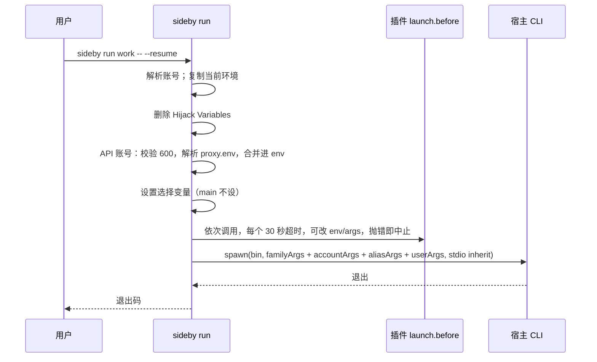
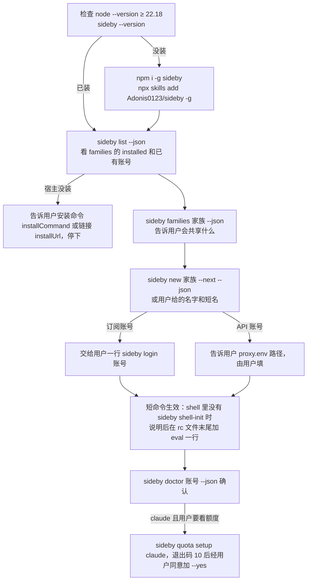

# sideby v0.1 设计

日期：2026-10-05 · 状态：已按 Codex 审核修订（§9） · 术语见 `CONTEXT.md` · 决策见 `docs/adr/`

## 1 目标

让同时持有多个 AI coding 账号的人，在终端里把它们**并排**跑起来，做到四点：不串号；skills、hooks、规则只维护一份；坏了一条命令修好；每个账号的额度和用量一屏看完。

一句话定位：**Run every AI coding account side by side.**

### 1.1 用户与场景

| 用户 | 典型账号组合 | 今天的痛点（证据） |
|---|---|---|
| cc-switch / magpie 用户，想同时开多个账号 | 1 个 Claude 订阅 + DeepSeek/GLM key + 中转 | 切换会改全局配置，同一时间只有一个生效（cc-switch #1105、#1106、#2908） |
| 工作号和个人号分开用 | 2 个 Claude 订阅、2 个 ChatGPT 号 | 手工维护 `CLAUDE_CONFIG_DIR` 和 symlink，时间一长就漂移 |
| 多个 CLI 一起用 | Claude Code + Codex + Grok + pi | 每家的目录约定和坑都不一样 |

### 1.2 体验原则

- **什么都不用额外装。** 只要有 Node 和宿主 CLI 就能用。用量由 sideby 直接读宿主的本地记录。
- **没有数据时要说清楚原因。** 是「还没开过会话」「这个宿主没有公开来源」，还是「格式变了」，每种情况分开提示。
- **每条错误都告诉用户下一步怎么做。** 错误信息里只出现路径和变量名，永不出现凭据的值。

### 1.3 成功标准

- 只装了 `~/.claude` 的新用户，从 `npx sideby` 开始，3 条命令以内让第二个账号并排跑起来。
- 维护者原有的自制多账号脚本，其全部行为在 sideby 里都有对应测试（对照表留在维护者本机，不入库）。
- README 首图是面板截图，显示多个账号的额度。

## 2 范围

### 2.1 v0.1 做

- 四个内置家族：claude、codex、grok、pi，全部以插件形式实现。
- CLI：`list`、`run`、`new`、`login`、`doctor`、`quota`、`ui`、`shell-init`、`plugins`、`quota setup|teardown claude`。
- 本地插件：Family Plugin，以及 `launch.before`、`account.create.before`、`account.created`、`doctor.check` 四类 Hook。
- 面板：账号卡片（额度、用量、健康）、体检加一键修复、新建账号。由 `createPanelHandler` 提供，`sideby ui` 独立运行。
- 额度：Claude 订阅读 statusline 缓存，Codex 读本地 rollout。
- 用量：内置读取 Claude 和 Codex 的本地会话记录，不依赖任何外部工具。
- AI 配套：`AGENTS.md`、`CLAUDE.md` 链接、`--json` 加 JSON Schema、可安装 skill、`llms.txt`。
- 发布：CI 加 tag 触发的 trusted publishing workflow（就绪，但本轮不推送、不发布）。
- 平台：macOS、Linux。

### 2.2 v0.1 不做

| 不做 | 原因 | 何时再议 |
|---|---|---|
| 全局切换、订阅轮换、凭据代理 | ADR-0001 | 不再议 |
| 调用逆向额度接口 | ADR-0003 | 第三方插件可以自行实现 |
| pi 的额度和用量、Grok 的用量 | 没有公开或稳定的本地来源（Grok 额度 2026-10-17 起从它自己的 CLI 读，§3.26） | 宿主提供来源后 |
| cursor 家族 | 只有一个 file-store 槽位，同时用多个号可能被封 | v0.2 |
| 面板里「在终端打开」 | 每种终端的做法不同 | v0.2 |
| 从 npm 安装插件 | 等于运行第三方代码 | 有真实需求再议 |
| 单文件二进制、Homebrew tap | ADR-0002 第二阶段 | Node 成为门槛时 |
| Windows、MCP server、定时体检 | 见 ADR 和 grilling 记录 | 不计划，或 v0.2 再议 |

## 3 架构

### 3.1 仓库与构建

```
sideby/
├── AGENTS.md · CLAUDE.md（内容为 `@AGENTS.md`）· CONTEXT.md · README.md · README.zh-CN.md · llms.txt
├── docs/{adr,specs,plans,verification}/
├── schemas/                  # 由 TypeBox 定义生成的 JSON Schema
├── skills/sideby/SKILL.md
├── src/
│   ├── cli/                  # 参数解析和各子命令（只做 I/O）
│   ├── core/                 # 路径、配置、账号发现、Secret File、Share Mode、doctor、launch、原子写入
│   ├── plugins/              # 加载器、信任校验、事件总线
│   ├── families/{claude,codex,grok,pi}/
│   ├── quota/                # Claude statusline 缓存，Codex rollout 读取
│   ├── panel/                # createPanelHandler 和内联页面
│   └── index.ts              # 库入口：createPanelHandler 和插件类型
├── testing/                  # 假 HOME、假宿主 bin、插件测试工具
├── .github/workflows/{ci,release}.yml
└── scripts/leak-check.sh
```

- **构建**：源码是 `.ts`，用 `tsc` 编译到 `dist/`，开启 `rewriteRelativeImportExtensions`。原因是 Node 拒绝对 `node_modules` 里的 `.ts` 做类型剥离（本机 Node 22.22.3 实测报 `ERR_UNSUPPORTED_NODE_MODULES_TYPE_STRIPPING`）。用户的插件在 `node_modules` 之外，可以直接写 `.ts`。
- **开发和测试**：直接用 `node --test` 跑 `.ts`，不需要先构建。
- **依赖**：运行时只有 `typebox`；开发时有 `typescript`、`@biomejs/biome`、`@types/node`。
- **启动检查**：Node 低于 22.18 时，打印升级提示并以 1 退出。`--help` 和 `--version` 也走这个检查。`package.json` 的 `engines.node` 只让 npm 打出 `EBADENGINE` 警告，拦人的是这里。`statusline-tap` 除外：Claude Code 每次刷新 status line 都会调用它，版本不够时也必须继续执行原来的命令，不能把这次刷新丢掉。

### 3.2 账号模型

| 家族 | Main Account | 其他 Account | 选择变量 | 宿主命令 |
|---|---|---|---|---|
| claude | `~/.claude` | `~/.claude-<name>` | `CLAUDE_CONFIG_DIR` | `claude` |
| codex | `~/.codex` | `~/.codex-<name>` | `CODEX_HOME` | `codex` |
| grok | `~/.grok` | `~/.grok-<name>` | `GROK_HOME` | `grok` |
| pi | `~/.pi/agent` | `~/.pi-<name>/agent` | `PI_CODING_AGENT_DIR` | `pi` |
| agy | `~/.gemini/antigravity-cli` | 无（Main-only Family） | 无 | `agy` |

- **Main-only Family**（2026-10-21 补充，ADR-0047）：宿主没有移动配置目录的变量，或登录只能存在一个固定位置时，FamilyDef 写 `mainOnly: true`，同时不写 `selectVar` 和 `layout.account`；注册时其他组合一律拒绝（漏写 `selectVar` 的插件照旧报 `select-var.missing`）。这样的家族只发现 Main Account，不扫 HOME；启动不设选择变量；`Runtime.createAccount` 在写任何东西之前拒绝，`code: 'family-main-only'`，覆盖 `sideby new`、`new --api` 和 `POST /api/accounts`。`sideby families --json` 和面板 state 的家族信息带 `mainOnly: true`（只加字段，`schemaVersion` 不变）；面板新建账号时把它的卡片置灰并说明原因，账号菜单里没有「照此新建」。
- 账号名 `<name>` 必须匹配 `^[a-z0-9][a-z0-9-]{0,31}$`。现有的 `004` 本身就是合法名字。
- 账号靠通配发现。不符合命名规则的目录、config 里 `ignore` 的目录，以及非目录项，都不算账号。
- 名字符合规则的目录，还必须满足以下之一才算账号：有 `proxy.env`；至少有一个该家族的共享项；或者是空目录（刚建好）。这样能排除别的工具的配置目录，例如 claude-code-router 的 `~/.claude-code-router`。名字看起来像备份（含 `bak`、`backup`、`old`、`tmp`）时，doctor 给一条 warn，建议加进 `ignore`。
- Main Account 的名字固定为 `main`，启动时不设选择变量。不做「某个编号就是主目录」这类特殊映射；需要旧习惯的用户用 config 的 `aliases`（例如 `codex001 → codex:main`）。
- **引用账号**：写 `<family>:<name>`。名字在所有家族里唯一时，可以只写 `<name>`；有歧义就报错，并列出候选。

**API 账号**：账号目录里有 `proxy.env`。

- 解析规则是 dotenv 子集：`KEY=VALUE`、可选的 `export ` 前缀、单引号或双引号、`#` 注释。不经过 shell，所以不支持命令替换。`$NAME` 和 `${NAME}`（不加引号或双引号里）只展开同一文件前面已定义的变量，以及 `HOME`、`USER`、`LOGNAME`、`TMPDIR`、`XDG_*_HOME` 这几个不含凭据的位置变量；其他环境变量一律不读，找不到就报错并给出行号。单引号里原样保留。
- 解析出错时报出行号，不报内容。权限不是 600 时拒绝启动，并提示 `chmod 600 <path>`。

### 3.3 Share Mode

| Mode | 健康 | `--fix` | 绝不做 |
|---|---|---|---|
| `link` | 是 symlink，解析后指向主目录对应项 | 缺失时补 link | 位置上是真文件或真目录时，只报告，并给出 `mv <x> <x>.local && ln -s …` |
| `copy` | 是真文件或真目录，内容与主目录一致 | 缺失或过期时复制；是指向主目录的 symlink 时，先删 link 再复制 | 永远不通过 symlink 写到主目录；类型不一致时不动 |
| `link-or-copy` | symlink，或内容一致的副本 | 副本过期时镜像主目录 | 主目录为空或类型不一致时不动 |
| `link-or-local` | symlink，或任意真文件 | 缺失时补 link | 不比较内容，不覆盖 |
| `local` | 是真文件，不比较内容 | 缺失时从主目录复制一份 | 是 symlink 时只报告 |
| `local-if-api` | 订阅账号按 `link-or-copy` 判断；API 账号必须是自己的真文件 | 只修订阅账号 | API 账号的 symlink 或缺失，只报告 |
| `info` | 不计数 | 不处理 | — |
| `json-key` | 账号自己文件里的某个 JSON 键，与主文件一致 | 只替换这一个键；写入前后比较文件 hash，期间文件被改动就放弃 | 会让账号已有条目减少（包括清空）时，没有 `--force` 就拒绝；文件是 symlink、不是 JSON 对象、该键不是对象时，`--force` 也拒绝 |

通用规则（与旧实现一致，逐条有测试）：

- 主目录里没有的项：没什么可共享，不报告、不计入分母、不自动创建（2026-10-05 面板验收后调整：多数用户没有 `commands`、`themes` 这类目录，报 warn 只是噪音）。
- symlink 永不改指向，分三种情况：
  - 悬空链接：报 fail。
  - 指向别处但目标存在：允许链接的项报 warn（用户有意为之）；宿主不允许链接的项（`copy`、`local`、`noSymlink`）报 fail。
  - 相对路径的链接只要解析后等价，就算健康。
- 共享项路径必须是相对路径，不能含 `..`。每次修复在执行的那一刻都会校验写入位置：解析父目录的真实路径后，必须仍在账号目录内，父目录是指向别处的链接时拒绝。
- 复制时递归处理，保留权限位和隐藏文件，目录里的 symlink 原样复制为 symlink。
- 所有写入先写同目录的临时文件（权限 600），再 rename；凭据文件写完后 chmod 600。
- 条件写入（`json-key`、statusline teardown）会在写入前、以及 rename 前各核对一次 hash。普通文件做不到真正的比较并交换，这只是把和宿主同时写同一个文件的冲突窗口缩到最小。
- 已知限制：写入位置的校验和真正写入之间仍有极短的时间窗，期间父目录理论上可能被换成链接。Node 没有按目录句柄写入的 API（如 `openat`），无法彻底消除；能利用这个窗口的进程本身已经能直接改用户 HOME 下的这些文件，所以不构成新的越权。
- 已知取舍：名字符合规则的空目录会被当作刚建好的账号，偶尔会把无关的同名空目录列出来，用户可以把它加进 `ignore`。
- statusline 的 diff 只展示 `statusLine` 这一个对象的前后变化，`settings.json` 其余内容（常含 `env` 里的 API key）永远不进 diff。
- 凭据文件解析失败时，错误信息不引用文件内容（Node 的 `JSON.parse` 报错会带出输入片段）。
- 凭据文件（`proxy.env`、`.claude.json`、`auth.json`）只检查类型和权限是否为 600，`--fix` 会改回 600。内容只读 `json-key` 指定的那一个键。
- 备份残留（深度 1 下的 `*.bak*`、`*backup*`、`*.tmp*`）只计数，不处理。

### 3.4 内置家族

经过测试的版本：Claude Code 2.1.289、codex-cli 0.160.0、grok 1.0.46、pi 1.0.2（2026-10-05 在维护者本机）。

| 家族 | Hijack Variables | 共享项（Mode） | 登录命令 | 登录态判断（不联网、不读凭据值） |
|---|---|---|---|---|
| claude | `ANTHROPIC_{API_KEY,AUTH_TOKEN,BASE_URL,MODEL,SMALL_FAST_MODEL,DEFAULT_HAIKU_MODEL,DEFAULT_SONNET_MODEL,DEFAULT_OPUS_MODEL}` | `settings.json`、`settings.local.json`、`skills`、`commands`、`plugins`、`hooks`、`themes`、`CLAUDE.md`（link）；`.claude.json#mcpServers`（json-key） | `claude auth login`（已核实） | 账号的 `.claude.json` 里有 `oauthAccount` 键 |
| codex | `OPENAI_API_KEY`、`OPENAI_BASE_URL`、`CODEX_API_BASE_URL` | `AGENTS.md`、`hooks.json`、`plugins`、`rules`、`skills`（link）；`config.toml`（local-if-api）；`auth.json`（info） | `codex login`（已核实） | `auth.json` 存在 |
| grok | `XAI_API_KEY`、`GROK_MODELS_BASE_URL` | `skills`、`installed-plugins`（link）；`hooks`、`hooks-paths`（copy）；`trusted_folders.toml`（local）；`config.toml`（local-if-api，订阅账号在 Grok 下按 copy 判断）；`auth.json`（info，但它是 symlink 时 fail） | `grok login`（已核实） | `auth.json` 是真文件 |
| pi | `ANTHROPIC_API_KEY`、`ANTHROPIC_AUTH_TOKEN`、`ANTHROPIC_BASE_URL`、`OPENAI_API_KEY`、`OPENAI_BASE_URL` | `AGENTS.md`（link）；`auth.json`（info） | 进入 pi 后执行 `/login` | `auth.json` 存在 |
| agy | `GEMINI_API_KEY`、`GOOGLE_API_KEY`、`AGY_ADC_AUTH`、`GOOGLE_GENAI_USE_VERTEXAI`、`GOOGLE_GENAI_USE_ENTERPRISE`、`ANTIGRAVITY_PROJECT_ID` | 无 | 直接运行 `agy`，在浏览器里用 Google 账号登录 | 总是 `unknown`（登录存在系统钥匙串里，sideby 不读） |

其他约束：

- **codex**：非 main 账号默认加 `-c cli_auth_credentials_store="file"`，用户参数里已经有这个键时不加。
- **grok**：hooks 等路径在沙箱里不允许 symlink，doctor 的提示会引用宿主原话。
- **agy**（Antigravity CLI，2026-10-21 加入，agy 1.4.4，ADR-0047）：Main-only Family。数据在 `$HOME/.gemini/antigravity-cli`，登录是 macOS 钥匙串里固定的一项，没有移动它们的变量，所以 sideby 只认主账号，从不改 `HOME`，也不链接 `.ssh`、`.gitconfig` 或 `Library/Keychains`。保留 `GOOGLE_CLOUD_PROJECT` 和 `AGY_ACCOUNT`（后者选的是沙箱里连接的账号，不是 agy 的登录）。AI Task 去掉 `--dangerously-skip-permissions`；`probe` 为 `-p "Reply with OK"`；`settingsFile` 为 `settings.json`。不提供默认短命令 `agy`、会话历史、身份和 Auto Handoff（v1 既不做来源也不做目标）。
- **pi**：账号目录多一层 `agent/`；pi 专属的模板复制等工作交给 pi 侧的插件（通过 `account.created`、`doctor.check`）。
- **个人项**：`statusline-command.sh`、`scripts` 这类属于个人的共享项不进内置清单，用户可在 config 的 `extraSharedItems` 里自己加。
- **宿主未安装**：`list` 照常列出账号，只给该家族标「宿主未安装」；`run` 报错，并给出官方安装文档的链接。FamilyDef 可选 `installCommand`：官方的一行安装命令（pi 为 `curl -fsSL https://pi.dev/install.sh | sh`）。有它时，报错、`list`、`families` 和面板都先给这条命令（面板带复制按钮），再给链接；sideby 只显示，从不自己运行它。
- **安装已损坏**：PATH 上找到了 `bin`，但不能执行（多见于升级中断后悬空的链接），家族信息多一个 `brokenBin`（找到的那个路径），`installed` 仍为 false。面板和 CLI 说「安装已损坏，重新安装即可」，不说「没安装」，并给同样的安装命令或链接。只加字段，`schemaVersion` 不变。

### 3.5 启动



- **账号标识**（2026-10-08 补充）：每次 Launch（`run`、`next`、`login`，以及路由到非主账号的 `resume`）都设 `SIDEBY_ACCOUNT=<ref>` 和 `SIDEBY_LABEL`，给宿主的状态栏、提示符或 hook 显示是哪个账号。`SIDEBY_LABEL` 取法：通过短命令启动时就是那个短命令；否则取该账号的短命令（不带宿主参数的优先，再按名字排序）；都没有就是 ref。两者每次都重设，不沿用继承来的值，在 `launch.before` 之前设好（hook 可以改）。`resume` 原样运行宿主时不设，等于没有 sideby。显示时应先核对 `SIDEBY_ACCOUNT` 的家族前缀，因为在一个宿主里再开另一个宿主会继承这两个变量。各宿主怎么显示见 `docs/guide/usage.md` 的「Show which account a session is」一节。
  - **终端标题**：config `accountTitle: true`（默认关）时，Launch 在终端（stdout 是 TTY）上先写 OSC 0，把标题设成 `[<SIDEBY_LABEL>]`，去掉控制字符。家族的可选字段 `keepTitle: { args, key }` 给出让宿主这次不改标题的参数，加在 `defaultArgs` 之后；用户参数里已含 `key` 时不加。Codex 是 `-c tui.terminal_title=[]`（它的状态栏和标题只接受内置项，这是唯一能常驻显示账号的位置）。Claude Code 和 Grok Build 用状态栏显示，不声明 `keepTitle`。
- **参数顺序**：家族默认参数 → config 里该账号的 `args` → 短命令的 `args`（只在用短命令 `run` 时）→ `--` 之后的用户参数。家族的 `defaultArgs` 把短命令参数和用户参数一起当作用户选择看待。
- **父 shell**：环境永不修改。
- **信号**（macOS 和 Linux）：
  - 子进程运行期间，sideby 忽略 `SIGINT`、`SIGQUIT`。终端会把它们直接发给前台进程组，宿主照常能收到。
  - `SIGTSTP`（Ctrl-Z）保持默认动作：sideby 和宿主一起暂停，`fg` 时一起恢复。（OCR 审查发现：如果忽略它，就只有宿主被暂停，shell 会一直等 sideby。）
  - `SIGTERM`、`SIGHUP` 转发给子进程一次，之后等它退出。
  - 窗口大小变化不用处理，宿主共享同一个 TTY。
  - 子进程退出后，sideby 移除所有监听，不再转发。
- **退出码**：子进程正常退出时，原样返回它的退出码；子进程被信号终止时，返回 `128 + 信号编号`。sideby 自身出错返回 1，用法错误返回 2。
- **危险参数**：不再默认带任何危险参数。旧实现硬编码的 `--dangerously-skip-permissions`，改由 config 给单个账号显式配置。
- **登录**：`sideby login <account>` 用同样的环境运行该家族的登录命令。
- **shell-init**：`sideby shell-init zsh|bash` 输出 shell 函数，包括 config 里 `aliases` 定义的短名（例如 `cc004`）。需要指定账号的命令（`run`、`doctor` 等）也接受这些短名；不带冒号时先查 `aliases`。短名的函数写成 `function <短名> { … }`（zsh 遇到同名 alias 时 `name() {` 会让整份脚本报错，2026-10-19 补充），调用 `command sideby run '<短名>' -- "$@"`，由 `run` 读取 config，所以改了短名的参数不用重新 source。
- **带参数的短命令**（2026-10-05 补充，ADR-0005）：`aliases` 的值可以是账号 ref 字符串，也可以是 `{ "account": "<ref>", "args": ["--model", "…"] }`。它仍然只启动一个账号，不改登录态和会话（`pi-kimi` 与 `pi001` 共用 `pi:main`）。
  - `args` 只在 `sideby run <短名>` 时插入，位置见「参数顺序」。`login`、`doctor`、`quota` 等命令只把短名解析成账号，忽略 `args`。
  - 短命令不能带环境变量。config 不是 600 文件，env 字段容易装进密钥；要改环境的入口留在用户自己的 shell 里，或写 `launch.before` 插件。
  - `account` 必须是 `<family>:<name>`；短名不能指向另一个短名。
- **`sideby alias add|rm`**（2026-10-05 补充）：给已有账号加、删短命令，供用户和 AI 代替手改 config。
  - `sideby alias add <短名> <账号> [-- host args] [--json]`：账号可以写 ref、唯一名字或已有短名，先解析成磁盘上存在的账号，再保存规范 ref。没有 `--` 参数时写成字符串，与 `new --alias` 一致。已有同名且账号和参数都相同时 `status: exists`；不同时拒绝，提示先 `alias rm`。名字不合法或保留名拒绝。
  - `sideby alias rm <短名> [--json]`：删掉这个键；不存在时 `status: absent`，退出码 0。
  - 写入规则与「短命令随新建账号写入」相同（重新读文件、保留键序、原子写、保持权限、链接写目标、hash 变了拒绝）。写完重写每个 `shellInitFile`，结果记入 `shellInitFiles[]`。
- **短命令随新建账号写入**（2026-10-05 补充）：`sideby new <family> <name> --alias <a>` 和面板 `POST /api/accounts { alias? }` 走同一个 `Runtime.createAccount`。
  - 先校验别名（`ALIAS_NAME`、保留名、config 里已指向别的账号即为占用），不合法时返回 `code: 'alias-invalid'`，什么都不建。
  - 再建账号；之后把 `alias → <family>:<name>` 写进 config 的 `aliases`：重新读文件，保留其他键和顺序（含 `$schema`），2 空格 JSON 加结尾换行，原子写入，保持文件权限（新文件 600），config 是链接时写链接目标。文件不是合法 JSON 或不符合 schema 时拒绝写入，原文件不动。
  - 写别名失败时账号保留，结果里 `alias.added: false`，`message` 写明「账号已建，别名没加上」，`ok` 为 false。
- **shell-init 文件**（2026-10-05 补充）：config 可选 `shellInitFile: { zsh?, bash? }`（绝对路径或 `~/`）。每次 `new`（CLI 或面板）之后，sideby 用 `sideby shell-init <shell>` 的同一份输出原子重写每个配置的文件，保持权限（新文件 644）。已存在且首行不是 shell-init 标题的文件不覆盖，相对路径报错；失败记入 `shellInitFiles[]`，`ok` 为 false。`sideby shell-init [zsh|bash] --write` 按需重写；用 `eval "$(sideby shell-init zsh)"` 的用户不需要配置。
- **面板推断短命令**：只看同一家族已有账号的别名。别名以账号名结尾时，去掉账号名剩下的是前缀（`cc001 → claude:001` 得 `cc`）；不以账号名结尾的（`codex001 → codex:main`）忽略。取出现最多的前缀，建议「前缀 + 新名字」，再按别名规则校验；推断不出时字段留空，不填。

### 3.6 插件

**插件等同于本地任意代码**，拥有 sideby 进程的全部权限。README 和 `sideby plugins` 都要写明这一点。

```
my-plugin/
├── plugin.json      # name、version、description、userConfig（带类型的配置项）
├── index.ts         # export default { name, register(api) {…} } satisfies Plugin
└── index.test.ts    # 用 sideby/testing 测试
```

```ts
import type { Plugin } from 'sideby'   // 只允许 import type（ADR-0002）

export default {
  name: 'litellm-gateway',
  register(api) {
    api.on('launch.before', { family: 'claude' }, async (ctx) => {
      // ctx.account、ctx.env（可改）、ctx.args（可改）、ctx.config
      // 网关没起来时：throw api.abort('网关没起来：…')
    })
  },
} satisfies Plugin
```

| 扩展点 | 时机 | 能做什么 | 超时 |
|---|---|---|---|
| `api.family(def)` | 加载插件时 | 注册家族：目录约定、选择变量、Hijack Variables、默认参数、共享项、登录命令、登录态判断、模型、可选的 `logo`、`readQuota`、`readUsage` | — |
| `launch.before` | 每次 `run`、`login` 之前 | 改 env 和 args，或中止 | 30 秒 |
| `account.create.before` | `new`（CLI 或面板）写入任何文件之前 | 用 `api.abort(msg)` 拒绝新建（例如家族只允许一个非 main 订阅账号）；ctx 为 `{ family, name, api, accounts, config }` | 10 秒 |
| `account.created` | `new` 成功后 | 补文件，打印下一步提示 | 30 秒 |
| `doctor.check` | 检查每个账号时 | 返回 Finding，可附 `fix()` | 10 秒 |

**加载与信任**：

- 加载顺序：内置插件 → `~/.config/sideby/plugins/*` → config 里 `pluginDirs` 列出的路径。`pluginDirs` 只接受绝对路径或以 `~` 开头的路径。
- 加载前校验：插件目录和入口文件必须属于当前用户，且不能被组或其他用户写。不满足就拒绝加载，并说明原因。
- 同名插件，后加载的报冲突，不会覆盖先加载的。
- 插件出错时：错误信息标明插件名。加载失败只影响它自己；`doctor.check` 出错转成该账号的一条 fail Finding；`launch.before` 出错就中止启动；`account.create.before` 出错（含 abort、超时）就中止新建，不写任何文件，CLI 退出码 1，面板返回 400。
- sideby 自己的修复都会校验写入位置必须在账号目录内（§3.3）。插件的 `fix()` 和 `api.fs` 属于插件代码，sideby 管不住它写到哪里（ADR-0002：插件就是本地代码），只保证一个 fix 失败不影响其他 fix。

**内置可选插件 `account-script`**（默认关闭）：

- 账号目录里有 `sideby-before-launch` 文件时，启动前运行它。
- 运行条件：文件属于当前用户、可执行、不能被组或其他用户写。
- 工作目录是账号目录，环境是已准备好的启动环境，超时 25 秒（留在 hook 自身 30 秒上限之内，超时时能给出更具体的报错）。
- 失败就中止启动，错误信息显示它的 stderr 末尾 20 行。

### 3.7 额度与用量

| 家族 | 额度 | 用量（近 7 天 token） |
|---|---|---|
| claude 订阅 | 问 Claude Code 自己：`claude -p /usage`（不开模型回合，最多每 15 分钟一次，ADR-0063）；跑过 `quota setup claude` 时再读 statusline 缓存，取较新的一份（§3.26） | 读 `<dir>/projects/**/*.jsonl` 里的 `message.usage`，按 `message.id` 去重 |
| codex 订阅 | 问官方 `codex app-server`（最多每 15 分钟一次）；尚无查询结果时读 rollout 的 `token_count.rate_limits`（§3.26） | 每条 `token_count` 事件记它带来的增量：首条是累计值减去继承来的基线（subagent 会话从父线程的累计值开始），累计值回落的事件开始新的一段、记它的全部累计值，其余记增长。只累加事件时间落在 7×24 小时窗口内的增量；文件修改时间只用来跳过不必读的文件，恢复的老会话里窗口外的轮次不计入 |
| grok 订阅 | 问 Grok 自己的 CLI（`_x.ai/billing`，最多每 15 分钟一次），再读本地日志里的额度行，取较新的一份（§3.26） | 显示「这个宿主没有公开来源」 |
| pi | 显示「这个宿主没有公开来源」 | 同左 |
| agy | 问 agy 自己：`agy -p /usage --output-format json`（不开模型回合，最多每 15 分钟一次，ADR-0048）；每个模型组的每个窗口一行，带组名，所以不计入 Quota Pressure；未登录时提示 `sideby login agy:main` | 显示「这个宿主没有公开来源」 |
| API 账号 | 不显示 | 同所属家族 |

**按天用量和最近活动**（2026-10-05 面板 v2 补充）：`UsageResult`（`ok`）可选带 `daily` 和 `lastActivityAt`，Claude、Codex 内置读取都给出。

- `daily`：`USAGE_DAYS` 条，以本地日历日 `YYYY-MM-DD` 为键，截止到今天，最早的在前，没有记录的日子为 0。每条记录按自己的时间戳落到本地日期，零点整算新的一天。去重规则与总量相同（Claude 按 `message.id` 取最后一行；Codex 每个事件记它带来的增量，见上表）。总量按 7×24 小时滚动窗口算，最早那天的前半段不在任何一条 `daily` 里，所以各天之和可能小于 `totalTokens`。
- `lastActivityAt`：读取时见到的最新一条记录的时间（ISO），晚于当前时间的记录不算。只读窗口内修改过的文件，所以更早的活动不会出现。

**上下文调优**（2026-10-13 补充）：用同一批本地记录估算 Compaction Threshold，见 §3.18。

**Claude statusline 缓存**：

- **setup**：先展示 diff，用户确认后，把主 `settings.json` 的 `statusLine.command` 包成 `sideby statusline-tap --orig-b64 <base64(原命令)>`（base64 保证原命令的引号和空格不被 shell 二次拆分）。同时在 state 目录记录三样东西：原始字节、原始 hash、包装后的 hash。重复 setup 时检测到已包装，直接提示已开启。
- **空闲时也刷新**（2026-10-29 补充，ADR-0056）：Claude Code 只在主会话有事件时跑状态栏，主会话停下来等后台子代理时缓存就不再更新。setup 在 `statusLine` 没有 `refreshInterval` 时一并写上 `refreshInterval: 30`（每 30 秒重跑一次，空闲时也跑）；用户自己写了的值保留不动。已经包装过、但没有 `refreshInterval` 的，重新 setup 时计划为 `ready`、带 `upgrade: true`，diff 只多这一个键；写入同样走 `writeIfUnchanged`，并把备份里的包装后 hash 换成新的（原始字节不变，teardown 仍还原到 setup 之前）。备份不存在或文件在 setup 后被改过时，照样可以加这个键，备份不动，teardown 按已有规则拒绝并说明手动改法。
- **teardown**：只有当前文件的 hash 仍等于包装后的 hash 时，才把原始字节原样写回。否则拒绝，给出 diff，并说明「文件在开启后被改过，请手动把 `statusLine.command` 改回原命令」。
- **statusline-tap**：
  - 读 stdin 的 JSON，取 `rate_limits`，写入 `${XDG_STATE_HOME:-~/.local/state}/sideby/quota/claude/<name>.json`。账号由 `CLAUDE_CONFIG_DIR` 反推，没有这个变量就是 `main`。
  - 不让旧数字盖掉新数字（2026-10-14 补充，2026-10-17 改为按会话判断）：同一账号开着几个会话时，每个会话的状态栏报的是它自己上一次请求时的额度，闲着的会话会一直重复旧数字。状态栏 JSON 带 `session_id`，缓存文件按会话记 `sessions: { <session_id>: { hash, seenAt } }`：`hash` 是这个会话上次报的各窗口（用量和重置时间）的摘要，`seenAt` 是它变化的时间；最多记 32 个会话，超过 8 天没变化的删掉，会话的其他信息一概不存。一份读数的摘要和同一会话上次报的相同，说明这个会话之后没有新请求，忽略它，什么也不写，`observedAt` 保持原来的时间。摘要变了，或这个会话第一次出现，就是一次新请求的结果：它带的每个窗口都采用（最后一份新读数为准，和 Orca 一样），供应商把重置时间提前或推后都跟着变；它没带的窗口保留旧的。没有 `session_id` 的读数按旧办法：两份的重置时间相差不到窗口长度的四分之一算同一个窗口，取用量高的那份；否则采用新数据。旧版本写的、没有 `sessions` 的缓存照常读取。
  - 再把原始 stdin 交给原命令，透传它的 stdout 和退出码。原来没有 statusline 时，输出一行默认内容。
  - 任何解析错误都不能影响透传。
  - 用一个单独的小入口，只 import 最少的模块。
- **自己有一份 `settings.json` 的账号**（不是 link）：面板提示「这个账号的 settings.json 不共享，额度需要单独开启」。

**Codex rollout 读取**：

- 按文件修改时间从新到旧扫描，最多看 20 个文件。
- 每个文件逐行解析，坏行跳过。
- 只接受结构完整的 `rate_limits`：`used_percent` 是数字，`window_minutes` 是正数，`resets_at` 是秒。
- 按事件里的 `timestamp` 取最新的一条。窗口按 `window_minutes` 归类：300 是 5h，10080 是 7d，其他值原样显示。
- 结果里记录来源文件和事件时间。

**显示规则**：

- 每个额度都标注数据时间，例如「5h 已用 42%，14:30 重置，12 分钟前的数据」。
- 已过 `resets_at` 的窗口，显示「已重置，等下次会话更新」。
- 没有数据时，区分三种原因：未开启（Claude）、还没有会话、格式无法识别。
- 颜色按窗口长度分（2026-10-30，ADR-0062）：短窗口 60% 起黄、85% 起红，长窗口 85% 起黄、95% 起红，规则见 §3.26「短窗口与长窗口」。

**读取缓存**（2026-10-05 补充）：内置用量和额度读取器按文件记住解析结果（`core/file-memo.ts`），文件的大小、mtime、ctime、inode 都没变就复用，聚合仍按当前时间重算，所以结果与完整重读一致。实测真实 HOME（18 个账号）：`/api/state` 原来每次约 1.56 秒；现在服务启动后第一次约 1.77 秒，之后每次 0.08–0.10 秒。

**读取缓存存盘**（2026-10-08 补充）：门户的面板 worker 在 skm-web 重启、sideby 重装或切换语言后都是新进程，每次都要重新解析日志（实测 343 个文件约 2.6 秒）。带 `persist` 的缓存（Claude 用量、Codex 用量、Codex 额度；身份不存）写到状态目录的 `cache/file-memo.json`（约 6 MB，读回约 10 毫秒）。第一次读取前加载一次；每次读取后在最后一次读取 2 秒后写回，两次写入至少隔 60 秒，定时器不拖住 CLI 进程。文件格式号或某个缓存的版本号对不上、JSON 坏了，都整份忽略、照常解析。缓存值的形状或含义变了就把那个缓存的 `version` 加一。文件只有 token 数、会话 id 和日志路径，不含凭据，原子写、权限 600。

**账号身份**（2026-10-05 补充，ADR-0003 修订）：`FamilyDef.identity` 返回 `{ email?, org? }`，只读登录文件里的身份字段，失败时返回空，不记为账号问题，同样按文件签名缓存。

| 家族 | 来源 | 读取的字段 |
|---|---|---|
| Claude Code | `.claude.json`（主账号在 HOME） | `oauthAccount.emailAddress`；`organizationName` 不是个人默认（`…'s Organization`）时作为组织名 |
| Codex | `auth.json` | `tokens.id_token` 的 payload 段做 base64url 解码后取 `email`，不校验签名，token 本身和其他声明一概不保留 |
| Grok Build | `auth.json` | 唯一一个顶层条目的 `email`；多个条目时不显示 |
| pi | — | 无 |
| Antigravity CLI | — | 无 |

`sideby list` 增加 EMAIL 列，`list --json` 和面板 state 的账号带可选 `identity`。

### 3.8 面板

- **库入口**：`createPanelHandler({ basePath, allowedHosts, readOnly?, runtime?, theme?, lang? })` 返回 `(req, res) => Promise<boolean>`。
  - `allowedHosts` 是 Host 头允许的取值，例如 `['127.0.0.1:17420', 'localhost:17420']`；嵌入门户时由门户传入自己的主机名。
  - 每个 handler 实例在内存里生成自己的随机 token，注入到它返回的页面中。
  - 写请求的 `Origin` 必须等于 `http://<请求的 Host>`，并且这个 Host 在 `allowedHosts` 里。
  - 独立运行和嵌入门户共用同一套规则，各有一个集成测试。
- **独立运行**：`sideby ui [--port]` 只监听 `127.0.0.1`，默认端口 17420。
  - 端口被另一个 sideby 面板占着：直接打开那个面板。
  - 被别的程序占用：顺延到下一个空闲端口，并打印最终地址。
  - 启动后自动打开浏览器；打不开就只打印地址。
- **后台运行**（ADR-0004）：`sideby ui --background` 把面板交给一个脱离终端的子进程（`sideby ui --serve-detached`，内部选项），命令本身打开浏览器后退出。
  - 状态目录里的 `panel.json` 记录 pid、端口、地址、随机实例 id 和进程启动时间（`ps -o lstart=`），日志写到 `panel.log`（超过 1MB 轮转一份）。后台面板的 `/api/health` 额外返回实例 id 和 pid。
  - 已有后台面板，或默认端口上已有同一用户的 sideby 面板：直接复用，不再起第二个。并发启动用 `panel.lock` 串行。
  - **只复用自己的**（2026-10-18 补充）：独立服务器的 `/api/health` 带 `owner`，是系统用户 id 和 HOME 的 SHA-256 前 16 位，不含路径。端口上的 sideby 面板报出别的 `owner`，说明是同一台电脑上另一个用户的，当作端口被占，换下一个端口；没有 `owner` 的旧版面板仍当作自己的。以前只看 `app: "sideby"`，第二个系统用户执行 `sideby ui` 会打开第一个用户的面板，自己的却没启动。
  - **换新代码**（2026-10-05 补充）：`pnpm build` 写 `dist/build.json`（随机构建 id），`buildId()` 是「版本 + 构建 id」，同版本重装也不同；从源码运行是 `<版本>+source`。`/api/health` 和 `/api/state` 都带 `build`，页面启动数据也带。
    - `ui --background` 复用前比对：pid 文件指向的后台面板确认是自己的、但 `build` 不同（或没有这个字段，说明更旧）时，先按 `--stop` 的规则停掉它，再启动新的，输出注明替换了旧面板。别的进程在端口上起的面板不碰。
    - 页面每次读到 state 时比对 `build`：和页面加载时不同，说明服务端换了代码，页面在用户不忙时（没有打开的菜单、对话框、输入焦点、选中文字，也没在体检或修复）自动刷新；忙时先提示「sideby 已更新，你操作完后页面会自动刷新」。更新对话框和版本弹层例外：它们写的是旧版本号和旧结果，里面也没有要填的东西，开着时直接刷新，免得旧版本和旧报错一直留在屏幕上；正在更新、体检或修复时照样等（2026-10-28 补充）。
    - 嵌入方（门户）在进程里加载了 sideby，要自己发现包变了并重启进程；页面会随后自动刷新。
  - 后台进程的 Runtime 用登录 shell 的 PATH：`$SHELL -ilc` 在标记之间打印 PATH，5 秒超时，合并到当前 PATH 前面；拿不到就用当前 PATH。这样从 Finder 启动时，`~/.local/bin` 等目录里的宿主不会显示「未安装」。
  - `sideby ui --stop`：只在 pid 仍存活、启动时间与 pid 文件一致、命令行带 `ui --serve-detached`，且记录端口上的面板返回同一实例 id 和 pid 时才发 SIGTERM；任何一项对不上就只删掉过期的 pid 文件。进程看起来对但端口不应答时不发信号、退出 1，提示用 `kill <pid>`。
- **桌面入口**（ADR-0004）：`sideby app install [--url <url>]` / `sideby app uninstall`。
  - macOS 写 `~/Applications/sideby.app`（`CFBundleIdentifier` 为 `dev.sideby.panel`，`Contents/MacOS/sideby` 是 shell 启动脚本，`AppIcon.icns` 由纯 Node 绘制的 PNG 经 `iconutil` 生成，失败时自己写 ICNS）。
  - Linux 写 `~/.local/share/applications/sideby.desktop`、`~/.local/share/sideby/sideby-launcher` 和 hicolor 下的 SVG、256px PNG 图标（遵守 `XDG_DATA_HOME`）。
  - 启动脚本记录安装时的 `process.execPath` 和 sideby 入口的绝对路径，执行 `ui --background`；路径失效时退回登录 shell 里的 `sideby`，再失败就弹窗提示重新安装。安装时设置了 `XDG_CONFIG_HOME`、`XDG_STATE_HOME` 就一并写进脚本。
  - `--url` 时只打开这个地址（嵌入面板的门户），不启动面板。
  - 每个生成的文件都带 `sideby-app-install` 标记（Info.plist 的 `SidebyInstalledBy`、脚本注释、PNG 的 tEXt、SVG 注释、`.desktop` 的 `X-Sideby-Installed-By`）。重装就地更新；安装和卸载都拒绝碰没有标记的同名文件。
  - 重装不带 `--url` 时，沿用已有启动脚本里记录的 `URL='…'`（只认带标记的脚本、不跟随链接、必须是 http(s) 地址），并提示「沿用了上次的地址」；要改回启动面板，先 `sideby app uninstall` 再 `sideby app install`（2026-10-16 补充）。
  - Update 成功后，装了应用（主文件带标记）就由新代码按名字跑一次 `sideby app install --json`，应用记录的 Node、入口和图标随之更新；`sideby update` 之外升级 Node 或换了安装方式时仍要自己重跑（2026-10-16 补充，§3.23）。
- **页面实现**：原生 HTML、CSS、JS，全部内联，跟随系统切换深色和浅色。
- **顶栏**（2026-10-16 收敛）：右上角只有「设置」和「刷新」，有新版本时多一个「更新」。设得少、改得少的东西都进「设置」弹层：语言（English / 中文，宿主固定语言时不显示）、主题（跟随系统 / 浅色 / 深色，宿主固定配色时不显示）、Remote Control、自动交接；后两项是一行链接，写当前状态，点开各自的对话框或页面。弹层里一项都没有时不显示「设置」。
- **需要处理说清是谁、为什么**（2026-10-08 补充）：分组标题的标签只有一个账号需要处理时写「账号名 · 原因」，例如「001 · 5h 已用 62%（60% 起提醒）」，点击滚动到这一行并闪一下；多个时写数量，悬停逐个列出「账号: 原因」，点击只看这些账号（和汇总卡一样）。原因取 `attentionReasons` 最严重的一条；额度过线时取超过提醒线的最满窗口（提醒线按窗口长度分：短窗口 60%，长窗口 85%，2026-10-30 起，ADR-0062）。额度过线的行另加一条黄色说明；读取失败、缺工具、未登录、体检问题在行里本来就有显示，不重复。

**页面内容**：

| 区块 | 内容 | 空数据 | 出错 | 慢加载 |
|---|---|---|---|---|
| 账号卡片 | 家族、名字、登录邮箱（可选组织名；「隐藏邮箱」开关把它显示成 `a•••@域名`）、订阅或 API、模型、登录态、5h 和 7d 额度条（列表视图里每个窗口固定一列，缺少的窗口显示 `—`，列头一行）、近 7 天 token、健康徽标。列表视图默认安静（2026-10-16 修订，原来每行三行字加健康列、额度横幅，太杂）：每行只有名字（和标签）、邮箱 · 🌐 浏览器用户、每个额度窗口一列、最近使用、⋯ 菜单。需要看一眼的账号在名字后有一个橙点或红点（额度达到提醒线、体检有问题），悬停说原因；不再在行下放「额度已用 N%」横幅，读取失败和宿主未安装的提示照常显示。点一行（或最左边的箭头）展开详情：运行方式（ref、模型、effort、同一登录）、近 7 天 token 和缓存命中、健康徽标；再点收起。展开状态存在这个浏览器的页面偏好里，只影响显示，不写任何文件。卡片视图照旧显示全部。工具栏只放搜索、工具筛选、排序（按额度、按名称、按最近使用、我的顺序，§3.25）、「显示」和新建账号；「显示」弹出面板里是额度显示方式（已用/剩余）、视图（列表/卡片）和「隐藏邮箱」 | 没有任何账号时，显示「新建第一个账号」引导 | 单个账号读取失败，只把那张卡片标红并写明原因 | 先出骨架，额度和用量异步填充 |
| 自动刷新 | 页面可见时每 20 秒重新读取 state；开启额度后 3 分钟内每 5 秒一次，分组标题显示「等待第一次状态栏刷新」；任何写操作和体检之后立即刷新；切回页面或窗口获得焦点时立即刷新。菜单、对话框、提示、输入框获得焦点或正在选中文字时，后台刷新的结果等到用户操作结束再渲染；只替换有变化的行，保留滚动位置、焦点和分组折叠状态 | — | 刷新失败时顶部提示并保留旧数据 | 后台刷新不转动刷新按钮。读取时间放在「账号 N 个账号」标题后面，紧挨它说明的数据：「● 刚刚读取 · 每 20 秒自动刷新」，1 分钟内一直是「刚刚」，不按秒跳动；超过 1 分钟（断连、页面隐藏或刷新失败）才显示「N 分钟前 / 小时前 / 天前读取」。圆点绿色表示在自动刷新，断连或读取失败时变橙色；悬停说明读的是额度、用量和健康状态，以及具体时间（2026-10-16 修订：原来放在页头右上角、写作「刚刚更新」，离数据远，又和版本更新混淆） |
| 体检 | 上次体检时间、Finding 列表、「一键修复」 | 显示「全部健康」 | 修复失败的条目逐条列原因 | 按钮显示进行中 |
| 新建账号 | 选家族、填名字、勾选是否 API 账号、可选短命令（按已有别名推断预填，可改可清空） | — | 名字或短命令非法、已存在时就地提示；别名没写进 config 时成功页说明账号已建 | — |
| 上下文调优 | 顶栏下的页签「账号 / 上下文调优」切到专门的页面（地址带 `#tuning` 时直接打开它）。设置在 `settings.json` 里，而账号常常共用同一个文件，所以**按设置文件分组，每组一张卡**：当前值、建议值（取这组里用得最多的模型，写明依据哪个模型、哪个账号）、预计省多少、一个「使用 80K」按钮、一个大小菜单、撤销；卡里写明是哪几个账号共用。各账号、各模型自己的数字收进「各账号的详情」折叠区，只是信息，没有按钮。Codex 账号没有设置，只在详情里观测。账号菜单里的「上下文调优」打开同一内容的单账号对话框（§3.18） | 没有任何账号有会话：「还没有会话记录」 | 读取失败写明原因，带重试 | 先出「正在计算」，进入页面时才请求，有刷新按钮 |
| 额度引导条 | Claude 额度未开启时，只在家族分组标题给一个「开启额度显示」按钮，旁注「对所有 Claude Code 账号生效」（展示 diff 后确认，可撤销）；账号行和卡片只显示「额度未开启」和 `?` 说明 | — | — | — |

**安全**：面板是「本机受信应用」，不防本机上的恶意进程，只防网页发起的请求。

- 只监听 `127.0.0.1`。每个请求校验 `Host` 必须在 `allowedHosts` 里，用来防 DNS rebinding。
- 写接口必须带 `x-sideby-token`（handler 实例的随机 token，只存在内存里），`Origin` 必须存在且与请求的 Host 同源。
- 请求体上限 64KB。写操作全局串行，同一时间只执行一个。
- 新建订阅账号后，面板只给出 `sideby login <account>` 的复制按钮。
- `POST /api/quota/teardown { family }` 撤销额度开启，返回 `{ family, result: { ok, message, diff? } }`。它是写接口：校验同上，只读面板拒绝（403），进同一个串行队列。
- `/api/state` 的账号带可选 `aliases`：config 里指向这个账号的短名，排好序；指不到任何账号的短名不出现。带参数的短名另记在可选 `aliasArgs`（短名 → 参数数组），页面在短名标签的悬停提示里显示参数，搜索也匹配参数。state 还带可选 `configAliases`（短名 → 账号 ref，带参数的短名也只给 ref），页面用来判断短命令是否已占用；别名规则（`aliasPattern`、`reservedAliases`）随页面的 boot 数据下发。

**嵌入其他本地页面**：别的本地 Node 网页可以用约 10 行调用 `createPanelHandler`，把面板挂在自己的路径下。嵌入方传入自己的 `allowedHosts`，handler 负责 token 和 Origin 校验。

**嵌入方主题**（2026-10-05 门户嵌入后补充）：嵌入方用 `theme` 让面板和自己的页面一致。

- 形状：`{ colorScheme?: 'auto' | 'light' | 'dark', header?: 'plain' | 'bar', light?: PanelThemeTokens, dark?: PanelThemeTokens }`。token 是一组有类型的名字（字体、字号、字重、颜色、圆角、控件高度、内容宽度、页边距），清单与含义在 `src/panel/theme.ts`；页面所有组件只读这些 CSS 变量，不传 `theme` 时外观与 `sideby ui` 相同。
- 写入位置：在页面自带的 nonce `<style>` 里，按「默认浅色 → 嵌入方浅色 → 默认深色 → 嵌入方深色」的顺序写成 `:root` 上的自定义属性。CSP 不变。默认深色会重设所有颜色 token，所以嵌入方的浅色不会漏进深色；字体、尺寸、布局 token 两种模式共用。
- 校验：创建 handler 时检查。未知 token、非字符串、空值、超过 200 字符、含字母数字空格和 `# % ( ) , . + - / ' " _` 以外的字符（即不允许 `;` `{` `}` `<` `\` `*` `:`）、含 `url(`、括号或引号不成对，一律抛出写明 token 名的 `TypeError`。这样值无法结束声明、跳出 `<style>` 或加载外部资源。

**嵌入方语言**（2026-10-08 补充，ADR-0006 修订）：嵌入方用 `lang: 'auto' | 'en' | 'zh'` 让面板语言和自己一致，默认 `auto`。

- 规则同 `theme.colorScheme`：`en` 或 `zh` 优先于用户在面板里保存的选择，并隐藏面板自己的语言切换按钮；用户保存的选择不被改写，回到 `auto` 时照常生效。`auto` 保持原顺序：本地保存的选择 → 浏览器语言（`zh` 开头为中文，其余为英文）。
- 值随页面的 boot 数据下发；`<html lang>` 首屏就按它写（`zh` 为 `zh-CN`，其余为 `en`），切换按钮在 `en` / `zh` 时首屏即带 `hidden`。
- 校验：创建 handler 时检查，其他值抛出列出可选值的 `TypeError`。
- 只是创建时的选项。Portal 运行中切语言就重建 handler；不提供按请求的选项，也不读查询参数。

**家族标志**：`FamilyDef.logo = { path, color?, title?, fillRule?, gradients? }`，24×24 视图框里的一条 SVG path。多色标志（2026-10-21 补充，Antigravity CLI）用 `gradients` 在底色上叠最多 4 层颜色：每层 `{ from: [x, y], to: [x, y], color }`，从 `from` 处的 `color` 沿直线渐变到 `to` 处透明。内置家族的标志在 `src/families/logos.ts`，由各自的 `FamilyDef` 引用；面板只读 `/api/state` 里家族携带的 `logo`，`list --json` 不输出它。插件注册家族时校验：`path` 只能含 SVG path 命令字母、数字、空格、逗号、点、`+`、`-`（最多 20000 字符），`color` 为十六进制颜色，`title` 最多 80 字符，`fillRule` 为 `nonzero` 或 `evenodd`，`gradients` 最多 4 层，坐标是 -24 到 48 的数字，颜色是十六进制。不合法时丢弃 logo、记一条插件错误，家族照常注册，面板显示首字母。面板用 DOM API（`setAttribute('d', …)`）绘制，不拼接标记；菜单栏拼的 SVG 里只放校验过的数字和十六进制颜色。

**只走运行时**：面板和 CLI 只通过 `src/runtime.ts` 调用。体检记录由运行时 `doctor()` 写（只读面板传 `persist: false`）；额度开启通过 `quotaSetups()` / `quotaSetup(family)`；用户造成的错误统一是 `UserError`，面板映射为 400，CLI 映射为退出码 1（2026-10-05 架构加固第 1 轮）。

### 3.9 CLI 与 JSON 契约

| 命令 | 退出码 |
|---|---|
| `sideby`（等同于 `list`） | 0 |
| `sideby run <acct> [-- args]` | 宿主的退出码；被信号终止时为 128+n；sideby 自身出错为 1 |
| `sideby new <family> <name>\|--next [--api] [--alias <a>]` | 0；名字或别名不合法、目录已存在、部分失败或别名没写进去为 1；缺参数、名字和 `--next` 同时给为 2（`--next` 见 §3.16） |
| `sideby login <acct>` | 宿主的退出码 |
| `sideby doctor [acct\|family] [--fix] [--force]` | 0 健康；1 有问题；2 用法错误 |
| `sideby quota [acct\|family] [--refresh]` | 0；`--refresh` 不管新旧都重新问联网的额度来源（§3.26） |
| `sideby quota setup claude [--yes]` | 不加 `--yes`：有变更待确认时只展示 diff 和下一步命令，退出码 10（2026-10-05 补充）；已开启、没有变更时为 0。加 `--yes` 成功为 0；拒绝或失败为 1 |
| `sideby quota teardown claude` | 0；拒绝或失败为 1 |
| `sideby next <family> [--dry-run] [--include-api] [-- args]` | 启动时为宿主的退出码；`--dry-run`、`--json` 有推荐且 `hasQuota` 为 true 时为 0；没有任何额度数据（`hasQuota: false`，即使有推荐）、没有可选账号、家族没有额度来源或没有账号为 1；缺参数为 2（§3.13） |
| `sideby resume <family> [-- args]` | 宿主的退出码；家族不存在或不支持路由为 1；缺参数为 2（§3.15） |
| `sideby ui [--port n] [--no-open]` | — |
| `sideby ui --background [--port n] [--no-open]` | 0；启动失败为 1 |
| `sideby ui --stop` | 0（包括没有在运行）；停不掉为 1 |
| `sideby app install [--url <url>]` / `sideby app uninstall` | 0；不支持的平台、`--url` 非法、目标被其他文件占用为 1；卸载时跳过了没有标记的文件为 1 |
| `sideby alias add <a> <acct> [-- args]` | 0（含 `exists`）；名字不合法、账号不存在、同名已指向别处或 config 写不了为 1；缺参数为 2 |
| `sideby alias rm <a>` | 0（含 `absent`）；config 写不了为 1 |
| `sideby alias add <a> --pick <family> [--yes]` | 0（含 `exists`）；名字和 PATH 上的命令重名且没有 `--yes` 为 10；名字不合法、已是短命令、是宿主命令名或家族不存在为 1（§3.13） |
| `sideby alias list` | 0 |
| `sideby shell-init setup [zsh\|bash] [--yes\|--undo]` | 0（含已加载、没有可撤销的）；没有 `--yes` 的预览为 10；rc 不是普通文件或读写之间被改为 1；参数不对为 2 |
| `sideby shell-init zsh\|bash` | 0 |
| `sideby shell-init [zsh\|bash] --write` | 0；没配置 `shellInitFile` 或有文件没写成为 1 |
| `sideby plugins` | 0；有加载失败的插件时为 1 |
| `sideby tune [acct\|family]` | 0；账号或家族不存在为 1；多给参数或未知选项为 2（§3.18） |
| `sideby families [family]` | 0；家族不存在为 1；多给参数为 2（§3.16） |
| `sideby desktop <acct>` | 0 已启动或已切到前台；不是 macOS、家族没有桌面应用、API 账号、应用没装、`open` 失败为 1；缺参数为 2（§3.20） |
| `sideby ask [text] [--task …] [--account …] [--terminal …] [--print]` | 0 已打开终端或已打印；终端打不开、没有可用账号为 1（`--json` 里 `opened: false` 并给出要粘贴的命令）；未知任务为 2（§3.28） |
| `sideby ask --run <task-id> [--state-dir <dir>]` | 宿主的退出码；任务不存在、已失效或状态目录不安全为 1 |
| `sideby ask --spec - [--print] --json` | 0 已打开终端或已打印；终端打不开、没有可用账号、Task Spec 不合法或过大、`bad-cwd` 为 1；`specVersion` 不认识、命令行多给参数为 2（§3.28「Portal 交来的任务」） |
| `sideby ask --choices --json` | 0；多给参数为 2（§3.28） |
| `sideby terminal [--set <id>\|--unset]` | 0；不认识的终端为 1；多给参数为 2（§3.28） |
| `sideby key <acct> [--var <NAME>]` | 0；不是 API 账号、不是终端输入、写不了为 1；缺参数为 2（§3.28） |
| `sideby try <acct> [--model <m>] [--yes]` | 不加 `--yes` 为 10；加 `--yes` 时宿主成功为 0，失败、家族没有 `probe`、`--model` 给了不能选模型的家族或不合法的名字为 1（§3.28） |
| `sideby plugins new <id>` / `sideby plugins check <id>` | `new`：0；名字不合法、目录已存在为 1。`check`：0 全部通过；有问题为 1。缺参数为 2（§3.28） |
| `sideby autostart [on\|off] [--yes]` | 不带参数为 0；`on`/`off` 不加 `--yes` 有变化时为 10、没变化为 0；加 `--yes` 成功为 0；被拒绝或失败为 1（§3.29） |
| `sideby config get\|set\|unset …` | `get` 为 0；`set`/`unset` 不加 `--yes` 有变化时为 10；校验不过、键不能改为 1；缺参数为 2（§3.29） |

- 退出码规则：命令行形状错误（缺参数、未知命令或选项）为 2；账号、家族不存在或操作失败为 1；命令展示了变更、等用户确认后加 `--yes` 重跑时为 10（`quota setup`、`handoff setup`、`update`、`browser --enable|--disable`、`try`、`autostart`、`config set|unset`）。`doctor` 不用 10：它只在有 fail 时退出 1。
- **出错时的 `--json`**（2026-10-05 补充）：带 `--json` 的命令出错时，stdout 输出 `{ schemaVersion: 1, error: "<说明和下一步>", code: "<原因>" }`。`code` 取 `UserError.code`（如 `alias-invalid`、`no-quota-source`），用法错误为 `usage`，其他为 `error`。`error` 保持字符串，只新增 `code`，所以 `schemaVersion` 不变。
- 除 `run`、`resume`、`login`、`ui`、`shell-init` 外，所有命令（包括 `app`、`families`）都支持 `--json`，输出带 `schemaVersion: 1`。 只有 `--` 之前的 `--json` 才算 sideby 的选项。`plugins --json` 只给出插件配置的键名（`configKeys`），不输出值。
- 版本规则：只新增字段时 `schemaVersion` 不变；删除字段、改名或改语义时加 1。
- 所有输出、日志、错误信息里都没有凭据值（key、token、密码）。模型名不算凭据：API 账号的 `ANTHROPIC_MODEL` 这类非密钥变量可以显示。

### 3.10 配置与状态

- **配置**：`${XDG_CONFIG_HOME:-~/.config}/sideby/config.json`，可以不存在，schema 在 `schemas/config.json`。字段：`accounts.<ref>.args`、`aliases`、`ignore`、`pluginDirs`、`plugins.<name>`（含 `enabled` 和 userConfig）、`extraSharedItems`、`shellInitFile`、`resumeRouting`（§3.15）、`accountTitle`（§3.5）、`handoff`（§3.17）、`update`（§3.23）、`display`（§3.25）、`quota.check`（§3.26）、`terminal`、`ask`（§3.28）。sideby 对 config 只写十二个键：`aliases`（新建账号时追加，以及 `sideby alias add|rm`，§3.5）、`handoff`（`sideby handoff enable|disable`，§3.17，2026-10-09 补充）、`accounts.<ref>.args` 里的模型、effort 参数（`sideby model`，§3.19，2026-10-14 补充）、`update.auto`（面板的自动更新开关，§3.23，2026-10-16 补充）、`browser.signIns`（`sideby browser --enable|--disable`，§3.24）、`display`（面板拖拽排序，§3.25）、`quota.check.<family>`（面板的额度查询开关，§3.26）（2026-10-17 补充）、`terminal.preferred`、`terminal.custom`、`ask.account`（首选终端、自定义终端命令和 AI Task 用的账号，§3.28）、`panel.theme` 和 `panel.language`（主题和语言，§3.29）；`sideby config set|unset`（§3.29）是例外，可以改 schema 里除插件配置外的任意键。这些写入用同一套写法：保留其他键和顺序，原子写，文件在读写之间被改过就拒绝。
- **状态**：`${XDG_STATE_HOME:-~/.local/state}/sideby/`，存放额度缓存（含联网查到的额度 `quota/<family>/<name>.fetched.json`，§3.26）、日志解析缓存（`cache/file-memo.json`，§3.7 读取缓存存盘）、上次体检结果、statusline 原始备份，以及后台面板的 `panel.json`、`panel.log`、`launcher.log`，检查更新的 `update.json`、`update.lock` 、运行中会话的 `running/<pid>`（§3.23），以及 AI Task 的任务文件 `ask/<task-id>.json` 和工作目录 `ai/`（§3.28）。
- **不写宿主目录**：sideby 不往宿主账号目录写自己的文件。唯一例外是 `quota setup claude` 在用户确认后修改主 `settings.json`。

### 3.11 AI 配套

- **AGENTS.md**：写明命令、目录地图、不变量。不变量包括：§3.3 每种 Mode 的「绝不做」、不泄露凭据、不写宿主目录、插件即本地代码。
- **`pnpm check`**：依次跑 `tsc --noEmit`、biome、`node --test`、`leak-check`。任何一项失败都输出文件和修法。
- **测试隔离**：测试一律用 `testing/` 提供的假 HOME 和假宿主 bin。检测到真实 HOME 就失败。
- **测试文件**：每种 Mode、每个家族一个测试文件。
- **skill 与 llms.txt**：
  - `skills/sideby/SKILL.md` 教 agent 用 `list --json`、`doctor --json` 诊断，以及何时该让用户自己去登录。安装方式：`npx skills add Adonis0123/sideby -g`。
  - **只有一个 skill**（2026-10-05 补充）：sideby 的命令少，不学飞书拆成「shared 底座 + 多个域 skill」。`SKILL.md` 是路由页：硬规则、退出码与确认规则、「想做什么 → 跑哪条命令 → 读哪个 reference」的表；只在某类任务里才需要的细节放 `skills/sideby/references/*.md`（安装与首次配置、共享什么、账号标识、诊断信号表、建号与短命令、Claude 额度、Handoff），只往下一层，不互相引用。description 写明中英文触发说法（「配置一个新账号」「cc002」「这些账号共享了什么」）；frontmatter 的 `metadata` 另有 `requires.bins: [sideby]` 和 `cliHelp: sideby --help`（2026-10-08 补充，§3.16）。
  - **版本**：frontmatter 的 `metadata.version` 等于 `package.json` 的 `version`。`npm version` 的 `version` 脚本同步它，测试校验两者一致。
  - **Doctor 检查已装 skill**：对本次检查的每个家族（指定单个账号时就是它的家族），读这个宿主会读的位置：主账号的 `skills/sideby/SKILL.md`；Codex 另读 `~/.agents/skills/sideby/SKILL.md`（`npx skills add -g` 的安装位置，也是 Codex 读用户 skill 的位置）。同一家族里同一个真实路径只看一次；一个文件被两个宿主读，就各报一条，结果不随本次检查了哪些家族而变。版本比当前 CLI 旧（含没有版本）时给一条 general warn（2026-10-28 修订：比 CLI 新不报。`npx skills update` 总是装最新的 skill，skill 新于 CLI 说明该更新的是 CLI，不是 skill），`code: skill.outdated`，记在该家族主账号名下，hint 是重新安装的命令；没装不报。只读，不修。
  - `llms.txt` 是命令、JSON 契约和插件 API 的索引。

### 3.12 分发与发布

- 包名 `sideby`，命令 `sideby`，`engines.node >=22.18`。`files` 只包含 `dist`、`schemas`、`skills`、README、LICENSE。
- **`ci.yml`**：触发条件是 `push` 和 `pull_request`，权限 `contents: read`。跑 `pnpm check` 和 build，并用 `npm pack --dry-run` 检查发布内容。
- **`release.yml`**：只在推送 `v*` tag 时触发。
  - `publish` job：使用 environment `npm`，权限 `contents: read` 加 `id-token: write`。不用任何 cache。action 全部固定到 commit SHA，checkout 设 `persist-credentials: false`。安装用 `pnpm install --frozen-lockfile --ignore-scripts`。先校验 tag 等于 `v<version>`，再跑测试、构建，然后 `npm publish`（npm ≥11.5.1，provenance 自动生成）。
  - `github-release` job：权限 `contents: write`，用 changelogithub 生成发布说明。它能解析 emoji 前缀的 commit。
- **首发**：npm 要求包已存在才能配置 trusted publisher，所以 0.1.0 必须在本机手动发布一次。之后按 `docs/release.md` 的清单配置 trusted publisher、关闭 token、加 tag 保护。**这一步等作者确认后再做。**
- **日常发版**：`npm version <x> -m "🔖 chore(release): v%s"`，然后 `git push --follow-tags`。

### 3.13 Handoff（2026-10-05 补充）

一个账号的额度快用完时，`sideby next` 推荐同一家族里 Quota Pressure 最低的账号，由人启动。它不轮换、不代理、不读凭据（ADR-0001），只用已有的本地额度数据（ADR-0003）。

- **命令**：`sideby next <family> [--dry-run] [--include-api] [--json] [-- host args]`。
  - 默认打印每个账号的状态和推荐理由，然后像 `sideby run <推荐账号>` 一样启动；`--` 之后的参数交给宿主，不带短命令的参数。
  - `--dry-run`、`--json` 只给推荐，不启动。agent 用这两种模式，把启动命令交给用户。
- **Quota Pressure**：`core/quota-levels.ts` 的 `quotaPressure(quota, now)`。额度可用时，取还没过 `resetsAt` 的窗口里最大的 `usedPercent`，窗口全部已重置为 0；不可用或没有窗口为 `null`。面板按额度压力排序用同一规则：`page-logic.ts` 的函数要保持自包含（由 `toString()` 嵌入页面），由测试保证两者结果一致。
- **Limit Use**（2026-10-30 补充，ADR-0062）：`quota-levels.ts` 的 `limitUse(quota, now, limits)`。每个未重置、计入的窗口算「已用 ÷ 它自己的 Takeover Limit」，取最大的那个，保留一位小数，并记下是哪个窗口：每周 87%、上限 95 是 91.6；5 小时 43%、上限 85 是 50.6。`ready` 账号、Last Resort 和状态栏都按它排，不再按 Quota Pressure。Quota Pressure 本身不变，`pressure` 字段照旧。
- **每个账号的状态**，按表中顺序排序：

| state | 条件 | 能否被选 |
|---|---|---|
| `ready` | 订阅账号，不是 `logged-out`，每个未重置的窗口都低于它自己的 Takeover Limit（短窗口 `threshold − 10`，默认 85；长窗口 `threshold`，默认 95。2026-10-21 起跟随 `threshold`，ADR-0046，原来固定为 `QUOTA_FAIL_PERCENT`；2026-10-30 起按窗口长度分，ADR-0062） | 能；Limit Use 升序，相同时主账号在前，再按名字 |
| `unknown` | 订阅账号，不是 `logged-out`，没有额度数据 | 能；排在 `ready` 之后 |
| `api` | API 账号 | 只在 `--include-api` 时能，排在 `unknown` 之后；否则只列出 |
| `full` | 订阅账号，不是 `logged-out`，有未重置的窗口达到它自己的 Takeover Limit | 只作 Last Resort（见下）；`resetsAt` 取这些窗口里最晚的重置时间；按它升序，没有可读时间的排最后 |
| `logged-out` | `loginState` 为 `logged-out` | 不能 |

  判定顺序（`core/handoff.ts`）：`api` → `logged-out` → `unknown` → `ready` → `full`，先命中的为准；所以已退出登录、额度也满的账号是 `logged-out`。登录态为 `unknown` 的订阅账号照常参与。
- **Last Resort**（2026-10-30 补充，ADR-0046 修订）：`sideby next`、Pick Command、面板的「下一个」标记和 AI Task 的自动选号都是用户要求的启动，不是自动接手，所以 Takeover Limit 不该把它们挡住。没有 `ready` 或 `unknown` 的订阅账号时，取压力还低于 100%（没有窗口用完）的 `full` 订阅账号里 Limit Use 最低的那个；同一登录（`sameLoginAs`）和 `logged-out` 的不选。它排在 `unknown` 之后、`api` 之前（`--include-api` 时订阅账号仍然优先），在 `accounts` 里也排在其余 `full` 之前，按 Limit Use 升序。JSON 里它仍是 `full`，计划多一个 `tight: { limit, longLimit }`（短窗口和长窗口的 Takeover Limit）。文本输出：`Next: claude:008 (every claude account is past its limit (85% of a 5-hour window, 95% of a weekly one); this one has the most left, 5h 88% of 85%).`；表格里压力低于 100% 的 `full` 账号显示为 `low`，注释 `past its limit: 7d 96% of 95% (limits 85% for 5-hour, 95% for weekly windows); resets <时间>`，窗口用完的显示 `full`，注释 `used up; back <时间>`（时间写法同 §3.31 的 `resetWhen`：`in 4h 20m`、`tomorrow 4:59 PM`、`Wed 4:59 PM`）。在这种计划里，窗口用完的账号 `resetsAt` 取用完的那些窗口里最晚的重置时间（它这时才能再启动），`earliestReset` 跟着变。Auto Handoff（§3.17 `selectNext`）不用 Last Resort，Takeover Limit 不变。`hasQuota: false` 时照旧不启动：Last Resort 需要有额度数据。
- **没有任何额度数据**：所有账号都是 `unknown`（或 API、未登录）时，推荐只是猜测，而且常常就是刚用完的主账号，所以 `next` 不启动，退出码 1，提示开启额度（家族有可用的 `quota setup` 时）或自己用 `sideby run` 选一个。`--json` 照常给出 `pick`，并带 `hasQuota: false`。有账号已满、另一个账号没有数据时照常推荐那个没有数据的账号。
- **没有可选账号**：不启动，退出码 1。每个已登录的订阅账号都有窗口用完时说明 `every signed-in <family> account has used up its quota; <ref> is back <时间>`（最早能再启动的账号）；有未登录账号时提示 `sideby login <ref>`。
- **家族没有额度来源**（pi，或既没有 `readQuota` 也没有 `fetchQuota` 的插件家族；Grok 2026-10-17 起有，§3.26）：`UserError`（`code: no-quota-source`），列出这个家族的账号，让人用 `sideby run` 自己选。家族下没有账号：`code: no-accounts`，提示 `sideby new`。
- **会话**：不复制会话。新账号开新会话；输出提示用户先让原会话写一份交接说明。要复制会话并 `--resume`，先单独验证宿主是否接受、Usage 和 Codex 额度会不会被重复计入，再另写 ADR。
- **文本输出**（2026-10-30 起，ADR-0062）：注释写离自己上限最近的那个窗口，`ready` 为 `closest to its limit: 7d 87% of 95%`，推荐理由为 `furthest from its limits, 5h 43% of 85%`。
- **`--json`**：`{ schemaVersion: 1, family, pick: <ref> | null, accounts: [{ ref, kind, state, pressure: number | null, limitUse: number | null, window?: { label, usedPercent, limit }, resetsAt?, observedAt? }], hasQuota, tight?: { limit, longLimit }, earliestReset?: { ref, at } }`，退出码同上（`hasQuota` 为 false 时也是 1）。`observedAt` 是该账号额度的记录时间。`window` 是离自己 Takeover Limit 最近的那个窗口（`limit` 是它的上限），没有未重置的窗口时不给。
- **`--dry-run` 给出的命令**带上用户写在 `--` 之后的宿主参数（需要时加引号）。漏写 `--` 时的未知选项错误提示把宿主参数放到 `--` 之后。
- **Pick Command**（2026-10-19 补充，ADR-0035）：绑定到一个家族的短命令（如 `cc`），每次启动时按本节规则挑选，再像 `sideby run` 一样启动，把参数交给宿主。
  - 配置：`pickCommands: { "<短名>": "<family>" }`，与 `aliases` 共用一套名字；名字规则同短命令，不能是宿主命令名（`claude`、`pi`）。默认关闭。
  - 命令：`sideby alias add <短名> --pick <family> [--yes] [--json]`；没有 `--yes` 时只预览，不写入，`status: confirm`，退出码 10；名字和 PATH 上已有的命令重名时（macOS 的 `cc` 是 C 编译器），预览里带 `shadows: <路径>` 并明确提示。`sideby alias rm <短名>` 两类都能删；`sideby alias list [--json]` 列出两类（`kind: pick | account`）。写完重写每个 `shellInitFile`，`shell-init` 为它生成 `function <短名> { command sideby run '<短名>' -- "$@"; }`；用户自己有同名 shell alias 时 alias 优先，要先删掉它。
  - 挑选：有额度数据时取 `pick`；家族没有任何额度数据（`hasQuota: false`，或家族没有额度来源）时启动主账号（必须是能启动的订阅账号，未登录时改用 `pick`），这一点与 `next` 不同；所有账号都过了 Takeover Limit 时按上面的 Last Resort 选（`reason: tight`）；没有可启动的账号（窗口都用完、未登录或只有 API 账号）时不启动，退出码 1，说明最早恢复的账号或提示登录。API 账号在任何情况下都不选。启动前往 stderr 打印一行：`cc → claude:work (5h 12% used, the most room)`（写的是离自己上限最近的那个窗口）、`cc → claude:main (no quota data yet; …)`、Last Resort 时 `cc → claude:008 (every claude account is past its limit, 85% of a 5-hour window or 95% of a weekly one; this one has the most left, 5h 88% used)`（黄色），或被选账号自己没有数据而其余已满时 `(no quota data for it yet; the accounts with data are full)`，不显示百分比。面板「启动最空的账号」的提示同样说明是 Last Resort（`/api/pick/start` 带 `reason: tight`、`pressure`、`window`、`limit`、`longLimit`）。
  - 默认名：家族已有带编号的短命令时取它们共同的字母前缀（`cc001`、`cc008` → `cc`），否则 Claude `cc`、Codex `cx`、Grok `gk`；pi 不给（`pi` 是宿主本身）。
  - 主动提议：某家族有了第二个订阅账号、还没有 Pick Command 时，`sideby new` 的输出提示一次（`--json` 为 `pickCommandOffer: { name, command, shadows? }`）。
  - 面板：`/api/state` 增加可选 `pickCommands`（名 → 家族）和 `pickOffers: { <family>: { name, shadows? } }`（至少两个订阅账号且还没有的家族）。家族标题行有 Pick Command 时显示「启动最空的账号」按钮（`/api/pick/start`：在首选终端运行这个 Pick Command 本身，终端里同样打印选了谁；页面提示是哪个、为什么）；没有时显示添加链接，默认名不可用（被占用或 pi）时名字留空让用户填。「自动选最空的账号」对话框（标题行链接和设置里都能打开）是预览：添加（`/api/pick/add`，名字不遮住任何命令时直接带 `confirm: true` 再发一次；遮住时先显示会遮住哪个命令，再点「仍然添加」）、改名（先加新名再删旧名）、删除（`/api/pick/remove`）；shell-init 文件没写成时明确提示。
  - 终端加载（2026-10-19 补充，ADR-0036）：短命令要靠 shell rc 里的一行才能在新终端里用。`sideby shell-init setup [zsh|bash] [--yes|--undo] [--json]`：没有 `--yes` 时显示要追加到 `$ZDOTDIR/.zshrc`（否则 `~/.zshrc`）或 `~/.bashrc` 的带标记的三行（中间是 `eval "$(sideby shell-init <shell>)"`），退出码 10；`--yes` 追加；`--undo` 只删这一段原文。rc 里已经出现 `sideby shell-init`，或配置了该 shell 的 `shellInitFile` 时算已加载，不写（`status: loaded`）。文件不存在就新建（644）；是链接时写到真实文件，保持链接；其他行不变；读写之间文件变了就不写。shell 取自 `$SHELL`，默认 zsh。面板 `/api/state` 带 `shellSetup: { shell, rc, loaded, added, block }`；在添加短命令或 Pick Command 的地方、还没加载时，显示这一行和文件，按钮即确认（`/api/shell-init/setup`，`undo: true` 撤销），提示里带「撤销」。
- **面板**：`/api/state` 增加可选 `handoff: { <family>: <ref> }`，只含有额度来源、至少两个订阅账号、有额度数据（`hasQuota`）并且有推荐的家族；规则与 `next` 相同（同一 Takeover Limit，含 Last Resort），不含 API 账号。被推荐的账号在列表和卡片里显示「下一个 / Next」标记；标记可以点击，复制 `sideby next <family>`，悬停时说明推荐理由。
- **同一登录**（2026-10-14 补充，§3.21）：额度按同一登录共享；从 sideby 启动的会话里运行时（`SIDEBY_ACCOUNT`），和当前账号同一登录的账号带 `sameLoginAs`，不会被选。
- **不做**：主动提醒（Claude Code 撞限额时自己会提示；`statusline-tap` 不能改原命令的输出）、自动切换、复制会话。自动交接后来由 §3.17 Auto Handoff 补上（默认关闭，ADR-0010）；`sideby next` 本身仍只推荐和启动。

### 3.14 参考 Tool 与 Portal（2026-10-06 补充）

作者本机还有几个本地工具（skills 管理、todo、blog 阅读、项目面板），以后可能开源。它们要照 sideby 的样子做，sideby 因此成为「参考 Tool」；把这些页面放在一起展示的本地网关叫 Portal。决定与理由见 ADR-0006，这里只记对 sideby 的约束和待办。

- **契约**：`PanelHandlerOptions` 的全部字段（`runtime` 可以是实例或按请求调用的工厂、`basePath`、`allowedHosts`、`readOnly`、`version`、`theme`、`lang`），handler 返回 `Promise<boolean>`（不在 `basePath` 下返回 `false`，交给 Portal 的后续处理），`token` 属性，`PanelTheme` 的全部字段（`colorScheme`、`header`、`light`、`dark`）与 `PanelThemeTokens` 的键名（背后的 CSS 变量名属于内部实现），`/api/health` 的 `app` 与 `version`。按 `--json` 的规则演进：只加；删除、改名或改变含义都要另写 ADR。
- **挂载**：Portal 在自己的服务进程里把 handler 挂到一个路径（如 `/panel`），再在**同一 host:port** 的页面里用 iframe 显示这个路径，两者同源；放在别的 host 上的顶栏框不住面板。面板的 CSP（含 `frame-ancestors 'self'`）不放宽；不支持跨 origin 嵌入独立运行的 `sideby ui`。Portal 不往面板里注入标记；Portal 自己的顶栏、「在其他应用中打开」不属于契约。
- **Portal 要满足**：用 plain `http`，`allowedHosts` 写上它服务的 `Host`。所有 `POST` 都要求 `Origin` 为 `http://<Host>`，用 https 或会改写 `Host` 的反向代理时，面板能读到状态，但所有操作都会被拒，包括运行 Doctor 和预览 quota setup。
- **换新代码时不切断请求**（2026-10-18 补充，ADR-0006 修订）：Portal 发现面板代码变了要换新 handler 时，新请求交给新的，旧的等手上的请求答完再结束（可以给一个以分钟计的上限，不要几秒）；旧的已经联系不上时回 5xx，页面会读状态判断改动有没有生效。sideby 这边也不靠它：更新和切换装完新包就回应，skill 由新代码在后台补，后台 Panel 最后才重启。
- **信任边界是 origin**：同源的任何页面（包括 Portal 自己的页面）都能取到 token 并做修改。Portal 若还托管不受信的代码，应给面板单独一个 host。
- **CLI 优先**：新功能先有 CLI 命令和 `--json`；面板只展示或调用同一份 core 函数，不加 CLI 没有的写操作。
- **skill 粒度**：保持一个 skill（§3.11），不拆 shared skill。
- **共享库（Kit）**：第二个 Tool 需要时，从 sideby 复制加载器、主题 token、i18n、handler 检查，沿用 sideby 的 token 名；sideby 暂不依赖它，等第二个 Tool 不改接口地用稳后再迁。
- **已实现**：`createPanelHandler` 的 `lang`（2026-10-08），规则见 §3.8「嵌入方语言」。Portal 运行中切语言靠重建 handler，不加按请求的选项或查询参数。
- **待办（未实现）**：
  1. `--json` 输出加可选 `_notice`，只用于提示已装 skill 的版本和 CLI 不同（与 Doctor `skill.outdated` 同一检查，按相等比较），让 agent 不跑 `doctor` 也能看到。只读已装 `SKILL.md` 的 front matter；错误信封是否也带，实现时再定。加字段不升 `schemaVersion`，需同步 `schemas/` 与 `llms.txt`。
- **不做**：`doctor --fix` 和 `new` 不加 `--dry-run`。`doctor` 不带 `--fix` 本身就是预览。`new` 会写东西（Shared Item 的链接和复制、`json-key` 条目、API 账号的 `proxy.env`、短命令和 shell-init 文件），但它拒绝已存在的目录，插件能在 `account.create.before` 里在写任何东西之前拒绝，`--json` 列出每一步，撤销就是删掉新目录，有短命令就 `sideby alias rm <短命令>`，没有就 `sideby shell-init --write`（插件 `account.created` hook 做的事由插件负责）。

### 3.15 会话路由（2026-10-08 补充）

终端管理器（例如 Orca）会记下宿主会话的 id，重开时在 shell 里敲裸命令恢复：`claude --resume <id>`、`codex resume <id>`、`grok --resume <id>`。命令不带账号目录，宿主只在主账号里找，于是报 `No conversation found`。会话路由让这条裸命令落到存有该会话的账号。决定与理由见 ADR-0007。

- **命令**：`sideby resume <family> [-- host args]`。
  - 家族的 `resumedSession(args)` 从宿主参数里取出按 id 恢复的会话；取不到（新会话、按标题或 `--last` 恢复）时原样运行宿主。
  - 取到 id 时，对家族的每个账号调用 `sessionWrittenAt(account, id)`；存有该会话的账号里，取最近写过的那个。
  - 落在非主账号：与 `sideby run <ref> -- <args>` 完全相同地启动（账号的 config `args` 照加），启动前在 stderr 打一行 `sideby: session <id> is in <ref>; starting it there`。
  - 哪个账号都没有会话文件，但有账号起过这个会话（`sessionStartedAt` 返回时间，取最近的那个）：会话启动后没发过消息，宿主从没保存它，按 id 恢复注定失败。这时用家族的 `withoutResume(args)` 去掉按 id 恢复的参数，在起过它的账号开一个新会话：非主账号同 `run` 启动，主账号原样运行宿主、只去掉这几个参数。启动前在 stderr 打一行 `sideby: session <id> was never saved; starting a new session in <ref>`。决定与理由见 ADR-0009。
  - 其他情况（落在主账号、哪个账号都没有也没起过、环境里已设了家族的选择变量）：原样运行宿主，环境和参数都不改，等于没有 sideby。宿主自己报找不到会话。
  - 落在主账号而 config `handoff.auto` 打开时（2026-10-29 补充，ADR-0059）：不再原样运行，与 `sideby run <主账号> -- <args>` 完全相同地启动，Auto Handoff 照 `run` 的条件开启；启动前在 stderr 打一行 `sideby: session <id> is in <ref>; starting it there with Auto Handoff`。会话没保存过、只在主账号起过时同理，按 `run` 开新会话。环境里已设了家族的选择变量时仍原样运行。`handoff.auto` 关着时行为不变。
  - 退出码同 `run`。家族不存在或不支持路由为 1，缺家族为 2。不支持 `--json`。
- **家族接口**（`FamilyDef`，都可选，只读本地文件，不读凭据）：`resumedSession(args): string | undefined` 只认 UUID 形式的 id；`sessionWrittenAt(account, id): Promise<number | undefined>` 返回会话文件的修改时间（毫秒）。
  - Claude：`--resume <id>`、`--resume=<id>`、`-r <id>`；会话在 `projects/*/<id>.jsonl`。
  - Codex：第一个 `resume` 之后的第一个 UUID；会话在 `sessions/**/rollout-*-<id>.jsonl`（不含归档）。
  - Grok：同 Claude 的写法；会话是目录 `sessions/*/<id>/`。
  - 三家都只看 `--` 之前的参数。pi 不支持。
  - 没保存的会话（可选，只 Claude 提供）：`sessionStartedAt(account, id): Promise<number | undefined>` 返回账号起过这个会话的时间；`withoutResume(args): string[]` 返回去掉按 id 恢复参数后的宿主参数，其余参数和顺序不变。Claude 的启动痕迹是 `session-env/<id>/` 目录：Claude Code 在会话启动、跑 SessionStart hook 时建它，会话没发消息也会建（2.1.292 实测）。这是 Claude Code 的内部布局，没有这个目录时按“哪个账号都没有”处理。Codex 和 Grok 没找到同样的痕迹，不提供。
- **shell 函数**：config `resumeRouting: true`（默认关）时，`shell-init` 为每个支持路由、并且至少有一个非主账号的家族，额外生成一个与宿主同名的函数：

  ```sh
  function claude { local a; if [ -z "${CLAUDE_CONFIG_DIR-}" ]; then for a in "$@"; do case $a in ????????-????-????-????-????????????|--resume=????????-????-????-????-????????????) command sideby resume 'claude' -- "$@"; return;; esac; done; fi; command claude "$@"; }
  ```

  - 用 `function name {` 写法，因为 zsh 在 `name() {` 的定义处会展开同名 alias（许多人有 `alias claude='claude --dangerously-skip-permissions'`）。alias 仍然生效：先展开，再进函数。
  - 只有选择变量没设、并且某个参数长得像会话 id（36 个字符、连字符在 UUID 的位置，或 `--resume=` 加这样的 id）时才调 `sideby resume`；其他情况直接调宿主。所以平时敲裸宿主命令不多花时间，`sideby run` 启动的宿主、以及宿主里再开的子 shell 也不会被二次路由。
  - 宿主名或选择变量名不是合法的 shell 名字时不生成；与某个 Alias 同名时也不生成，Alias 优先。
  - 代价：按 id 恢复时多起一次 sideby，实测约 140 ms（`dist`，21 次中位数，含加载全部家族和发现账号）。
- **不做**：复制或移动会话；按标题、`--continue`、`--last` 路由（宿主按当前目录挑，sideby 不猜）；改 Orca 等终端管理器的配置；为了找起过会话的账号去读 `.claude.json` 等凭据文件。

### 3.16 交给 AI 安装和配置（2026-10-08 补充）

多数用户不读文档，而是对自己的 AI agent 说「帮我装 sideby」「帮我配置一个 cc00x」。目标：agent 能做的都由 agent 做；只有必须由用户本人做的步骤（在浏览器里登录、往 `proxy.env` 填密钥）交给用户，并且只给一行命令。sideby 负责两件事：给 agent 确定的命令输出，给 agent 写好引导文字。决定见 ADR-0008。

- **入口**：
  - README 的「Set up with your AI agent」放一句可复制的提示词，指向 `llms.txt`。
  - `llms.txt` 的「Set up sideby for a user」和 skill 的 `references/setup.md` 写同一份步骤，见下面的流程图。
  - `sideby --help` 末尾的「For AI agents」段指向 skill 和 `llms.txt`。



- **`sideby families [family] [--json]`**：从 FamilyDef 和 config 的 `extraSharedItems` 输出每个已加载家族（含插件家族）的事实，文档里的共享项表照它核对。字段：`FamilyInfo` 的全部字段（`id`、`title`、`bin`、`installUrl`、`installCommand?`、`installed`、`brokenBin?`、`plugin`），加上：
  - `layout`：`{ main, account }`，相对 HOME，例如 `.claude`、`.claude-<name>`。
  - `selectVar`：选择账号目录的环境变量。
  - `login`：`{ args, hint }`，`args` 为 null 表示在宿主里登录（pi）。
  - `quota`、`usage`、`quotaSetup`：有没有对应的读取器或一次性配置。
  - `shared[]`：`path`、`mode`，可选 `key`、`mainPath`、`credential`、`noSymlink`，`source`（`family` 或 `config`），`meaning`（一句固定英文，说明这一项在账号里是什么样，由 Share Mode 和标记决定）。
  - 人读输出在共享项表之后加一句：账号目录里其他内容（登录、会话、历史）都是账号自己的。
- **`sideby new <family> --next`**：不写名字，由 sideby 选。
  - 名字用面板的 `suggestName`：已有纯数字名字时，接着最大的编号、保持位数（`001`…`007` → `008`）；否则 `work`、`work2`……
  - 没给 `--alias` 时，用面板的 `suggestAlias` 按已有短名的规律给出短名（`cc001` 对 `claude:001` → `cc008`）；看不出规律就不加。建议的短名不能用（被占用、保留字）时不加，原因写在结果里，账号照建。给了 `--alias` 就用给的。
  - `--json` 多一个可选字段 `suggestion: { name, alias?, aliasProblem? }`，只在 `--next` 时出现。
  - `--next` 和名字同时给是用法错误（退出码 2）。
- **面板体检交给 AI**（2026-10-17 补充）：体检里有不能自动修复的发现时，体检区在「全部修复」旁边多一个「复制给 AI 修复」按钮（只读面板也有，它不写任何东西）。点了把这些发现拼成一段提示词复制到剪贴板，用户粘贴给自己的 AI agent。
  - 提示词用面板当前语言，内容只有：一句说明（逐条按提示修好，会删改文件前先问用户，用法看 `sideby` skill 或 `llms.txt`）、当前列出的不能自动修复的发现（账号、项、级别、说明、提示）、还有能自动修复的发现时加一句先运行 `sideby doctor --fix`，最后让 agent 运行 `sideby doctor` 确认。
  - 发现本身不含凭据值（见 Invariants），提示词也就不含；只按某个账号筛选时，只带这个账号的发现。
  - 面板自己能修的发现不进提示词，直接给按钮：sideby skill 版本落后（`skill.outdated`）且更新计划说 sideby 可以更新它（§3.23 `skillUpdate.canRun`）时，这条发现旁边有「更新 skill」，打开更新对话框，看过要做什么后一键更新；更新成功后体检自动重跑。只剩这类发现时，「全部修复」不可用的说明改成「点每条旁边的按钮修复」。
  - 拼装在 `page-logic.ts` 的 `fixPrompt`，哪些发现由面板直接修在 `panelFixes`，测试覆盖。
- **分命令帮助**：`new`、`alias`、`login`、`doctor`、`families` 的 `--help`（也可以 `sideby help <command>`）打印该命令自己的帮助：用法、2–3 个示例、会写哪些文件、哪一步需要用户本人。其他命令仍打印总帮助。
- **不做**：
  - 一条命令装好一切的引导命令（例如 `npx sideby setup` 去装 skill）。它要让 sideby 调 npm、访问网络，违背「sideby 不调用远程服务」。
  - 替用户登录。像飞书 CLI 那样由 agent 在后台跑登录、取出授权链接发给用户，留作后续调研：各宿主在非终端环境下会不会打印链接，还没逐个验证。

### 3.17 Auto Handoff（2026-10-09 补充，ADR-0010 待实测后生效）

一个正在跑的会话额度快用完时，由它自己写好 Handoff Brief，sideby 结束它，在同一个终端里按 Handoff Order 启动下一个账号，开一个新会话接着做。默认关闭。术语见 `CONTEXT.md`「Limits」，取舍见 ADR-0010（部分推翻 ADR-0001）。

**边界**：不读凭据、不代理请求、不合并登录、不改全局生效的账号、不调私有额度接口（ADR-0001、ADR-0003）；不复制会话。只对 sideby 启动的交互会话生效（`sideby run`、短命令、`sideby next`）：直接敲 `claude` 不触发，headless 运行（`claude -p`、`codex exec`、`grok -p`）也不触发。

#### 配置

`config.json` 新增 `handoff`，全部可选：

```json
{
  "handoff": {
    "auto": false,
    "sameFamily": false,
    "prepareAt": 80,
    "threshold": 95,
    "adaptive": true,
    "waitIfResetWithinMinutes": 30,
    "countdownSeconds": 10,
    "crossOrganization": ["claude:003"],
    "otherFamilies": false,
    "familyOrder": ["claude", "codex"],
    "api": false,
    "families": {
      "claude": { "policy": "order", "order": ["cc002", "cc003", "codex001"] }
    }
  }
}
```

- `auto`：打开 Auto Handoff。只开它时，只交给写进 `order` 的其他家族订阅账号（2026-10-21 起不再包括 API 账号，ADR-0046）。
- `otherFamilies`（2026-10-21 补充，ADR-0046）：默认 `false`。为 `true` 时，本家族没有能接手的账号，就交给其他家族的订阅账号，按 `familyOrder` 一个家族一个家族试，每个家族里剩余额度多的在前。
- `familyOrder`：其他家族的先后，家族 id 的列表；没列出的家族按加载顺序排在后面。只在 `otherFamilies` 为 true 时有用。
- `api`（2026-10-21 补充，ADR-0046）：默认 `false`。为 `true` 时 API 账号（任何家族，按次付费，不绕过哪一家的限额，所以不受 `sameFamily` 限制）排在所有订阅账号之后接手。sideby 不限制花费，开启时页面和 CLI 都写明，并让用户确认一次。
- `sameFamily`：另外允许交给同家族账号（例如 cc001 → cc002）。封号风险最高的一种，README 和 guide 写明。
- `prepareAt`、`threshold`：Quota Pressure 的预备档和 Handoff Threshold，整数百分比，`prepareAt < threshold ≤ 100`。
- `adaptive`（2026-10-18 补充，ADR-0032）：默认 `true`，每个窗口按自己的消耗速度定交接点（见「交接档」）。`false` 时所有窗口都用 `threshold`，同 2026-10-18 之前。
- `waitIfResetWithinMinutes`：满了的窗口在这么多分钟内重置时，留在原账号等，不交接。`0` 表示从不等。
- `countdownSeconds`：交接前的倒计时；`0` 表示不倒计时。
- `crossOrganization`：可以从不同组织的账号接手的账号（ref 或短命令）。组织是否相同按三级判断，用 Identity（ADR-0003）：两边都有 organization 时比 organization；否则两边都有 email 时比 email 域名（`work.dev` 与 `gmail.com` 不同）；都没有时视为相同。不同就跳过，除非接手方列在这里。
- `families.<family>`：`policy` 为 `pressure`（默认，规则同 §3.13）或 `order`。`order` 列出账号（ref 或短命令），可以包含其他家族的账号；没列出的账号不参与。没有这一项时用 `pressure`，只在本家族内选，再按 `auto` 的规则补上 API 账号。
- 写错（阈值越界、`prepareAt` 不低于 `threshold`、未知的键或 `policy`）时 config 校验报错，指出键名和修法。账号是从磁盘发现的，加载 config 时还不知道有哪些，所以 `order` 里找不到的账号或短命令由 Doctor 报 `handoff.order-unknown`，交接时跳过；不能接手的家族（没有 `handoff` 成员）在选号时跳过。

#### 各宿主能做到什么

| 宿主 | 发起 | 额度信号 | 注入 hook 的方式 | 接手 |
|---|---|---|---|---|
| Claude Code | 80% 预备、95% 交接、撞墙兜底 | `statusline-tap` 缓存（需先 `quota setup claude`） | 启动时加 `--settings <状态目录>/handoff/claude-settings.json` | `claude --add-dir <链目录> "<首条 prompt>"` |
| Codex | 80% 预备、95% 交接；没有撞墙兜底（Codex 没有 `StopFailure`，也没有任何限额 hook） | rollout 文件（§3.7），只读当前会话（hook 输入的 `transcript_path`）；额度是缓存后写入的，可能滞后，不保证只滞后一轮（写入时间不等于采样时间），要容忍缺失和写了一半的行 | 启动时加 `-c 'hooks.PostToolUse=[…]' -c 'hooks.Stop=[…]'`（0.162.0 源码里 SessionFlags 配置层是 hook 来源）；只在实测不通过时改用 `sideby handoff setup codex --yes` | `codex --add-dir <链目录> "<首条 prompt>"` |
| Grok Build | 80% 预备、95% 交接、撞墙兜底（2026-10-17 起，§3.26；之前没有额度来源，只有撞墙兜底）。hook 能把内容交给模型（1.0.50 的 `PostToolUse` 支持 `additionalContext`，`Stop` 支持 `block`） | 存下的 `_x.ai/billing` 结果（最多 15 分钟前）和 `$GROK_HOME/logs/unified.jsonl` 末尾的额度行（每轮结束时 Grok 自己写），取较新的一份 | 交互 `grok` 没有启动参数能加 hook，`GROK_CONFIG` 也不能：`sideby handoff setup grok --yes` 写主账号 `hooks/sideby-handoff.json`（`StopFailure` 显式设较长的 `timeout`：观察型 hook 默认只有 5 秒，不够拼 Brief；`PostToolUse`、`Stop` 默认 600 秒，不用改），Doctor 按 copy 模式复制到各账号；`$GROK_HOME/hooks/*.json` 始终可信，没有信任提示 | `grok "<首条 prompt>"`（`--help` 已确认是交互会话的首条 prompt） |
| pi | 不发起 | 无 | — | 带首条 prompt（待实测） |

#### 流程

1. `sideby run` 在 `handoff.auto` 为 true、家族能发起、会话是交互式时，给宿主进程设 `SIDEBY_HANDOFF_RUN=<run id>`、`SIDEBY_HANDOFF_FAMILY=<family>`、`SIDEBY_HANDOFF_DIR=<链目录>`，并按上表注入 hook。sideby 加的参数（hook、链目录、`eligibility.args`）插在用户参数里第一个 `--` 之前，否则用户自己写的 `--` 会让它们变成 prompt 文字。启用前先确认 `PATH` 上的 `sideby` 能用：不在 PATH、来自 npx 缓存，或 `sideby handoff-hook --check` 不回答 `ok`（旧版本没有这个入口，每次 hook 都会失败），就关闭这次运行的 Auto Handoff 并说明。注入的 hook 都是同步的 command hook，命令是固定文本 `sideby handoff-hook <family> <event>`，变化的值都放在环境变量里：Codex 的信任按 hook 来源和内容记录，命令一变就要重新信任。父进程一直等到宿主退出（`spawn`，`stdio: inherit`，已有行为）。
2. `sideby handoff-hook <family> <event>` 由宿主在 `PostToolUse`、`Stop`、`StopFailure` 时调用；Claude 还在 `SessionStart` 调用（2026-10-15 补充）：返回 `additionalContext`，告诉 agent 它在哪个账号、用户要把任务换到别的账号时先写 Brief、再运行 `sideby handoff ready --to <account>` 并结束这一轮，不要让用户自己去启动。没有这句，agent 只会把启动命令交给用户。Codex、Grok 只从第二跳的首条 prompt 得到这句。没有 `SIDEBY_HANDOFF_RUN`，或 `SIDEBY_HANDOFF_FAMILY` 不等于命令里的 `<family>` 时，立即退出 0、不输出。前者让写进主账号的 hook 不影响 sideby 之外的会话；后者防止串家族：Grok 默认（`compat.claude.hooks`）也执行 `~/.claude/settings.json`、`~/.claude/settings.local.json` 和项目 `.claude/settings.json`、`.claude/settings.local.json` 里的 hooks（项目级的要文件夹被信任后才执行）。它和 `statusline-tap` 一样只能 import Node 内置模块和叶子模块，不 import `runtime.ts`、家族 index 或 `core/accounts.ts`。
3. **预备档**（压力 ≥ `prepareAt`，每个会话一次）：`PostToolUse` 返回 `{"hookSpecificOutput": {"hookEventName": "PostToolUse", "additionalContext": "…"}}`，要求 agent 按 Brief 模板写到 `<链目录>/<n>-<ref>.md`，之后每完成一步就更新它。
4. **交接档**（任一窗口到了它的 Hand-over Level）：Hand-over Level 按窗口分别算（2026-10-18 补充，ADR-0032）。一轮是两次 `Stop` 之间；hook 在每次 `Stop` 记下每个窗口的用量，和上一次 `Stop` 相比得到这一轮的增量（窗口重置过的不算），每个窗口留最近 5 轮。Level = `100 − 1.5 × 最近 5 轮里最大的单轮增量`，向下取整，不低于 `prepareAt`、不高于 99；这次运行还没有这个窗口的增量时用 `threshold`。`adaptive: false` 时 Level 一律是 `threshold`。选号和「等」仍用 `threshold`：已到 `threshold` 的账号算满。给模型的话、终端里的交接说明和 `chain.json` 写明是哪个窗口（`5h`、`7d`）、用了多少、几点重置。先看选号结果（下一节）。结果是「等」或「没有可接的账号」时，只在终端说明，不打断会话。否则 `PostToolUse` 要求 agent 做完当前一步、最后更新 Brief、结束这一轮。`Stop` 再查一次额度（一轮里没有工具调用时只有这一次）：Brief 已更新就通知父进程；没更新就返回 `{"decision": "block", "reason": "…"}` 再要求一次，每个会话最多一次（Codex 还要看输入里的 `stop_hook_active`，避免循环），之后改由 sideby 拼 Brief。
5. **撞墙兜底**（只有 Claude 和 Grok）：只认额度用完，不认临时限流：Grok 文档写明 `rate_limit` 也包括 503/529 过载，重试耗尽的 429 大概也在其中（推断，Claude 同理）。
   - Claude：`StopFailure` 的 `rate_limit`，并且 tap 缓存里的压力 ≥ `threshold`，或者报错文字说的是用量上限。
   - Grok：`StopFailure` 不按 `error` 过滤（它只有 `rate_limit`、`authentication_failed`、`invalid_request`、`server_error`、`max_output_tokens`、`unknown` 六类，额度用完没有单独一类）。只在 `errorDetails` 或 `lastAssistantMessage` 含下列子串之一时才算：`You hit your weekly limit`、`You hit your free usage limit`、`reached your free Grok Build usage limit`、`usage limit reached`、`out of credits`、`usage balance exhausted`、`spending cap`、`credit limit for your plan`、`free-usage-exhausted`、`status 402`；`status 403` 只在和其中一条同时出现时才算（单独的 403 可能是拒绝访问）；只出现 `rate limit` 不算，包括带「try again later」的 `You’ve hit the rate limit for your plan` 和 `You’ve hit your team’s API rate limit. Ask a team admin to purchase more credits…`；「try again later」只排除这两句，`You’ve reached your free Grok Build usage limit for now…try again later` 含名单子串，仍算额度用完。名单取自 1.0.50 二进制，放在 Grok 家族代码里，宿主升级后复核。带 `subagentType` 的是子 agent 的失败，忽略。
   - 命中后 sideby 从会话记录拼 Brief，然后通知父进程。`StopFailure` 的输出会被宿主忽略，所以通知只能写文件。
6. **通知**：hook 在链目录写 `ready.json`（mode 600），父进程监听这个文件。
7. **父进程交接**：
   0. 先选号。结果不是 `pick`（没有可接的账号，或该等待）时不结束宿主：删掉 `ready.json`，会话照常进行，结束后在终端说明原因。手动入口和撞墙兜底不经过 `plan.json`，所以这一步不能省。结果是「等」时（2026-10-16 补充）父进程写 `waiting.json`（`runId`、`until`、`trigger`），并继续监听 `ready.json`：等待期间用户的手动入口照样交接。撞墙（`trigger: limit`）后结果是「没有可接的账号」时（2026-10-30 补充）也写 `waiting.json`：宿主停在额度上限，到重置前不会结束任何一轮，request 等不到 `Stop`。`until` 取 `ready.json` 里那个窗口的 `resetsAt`（宿主到这时自己续上）；没有窗口或它已过去时取现在加 5 小时（最短的额度窗口）。到阈值（`trigger: threshold`）后没有可接的账号时不写：会话还在一轮轮进行，手动入口照常等这一轮结束。之后的 `Stop`（正常结束的一轮）说明宿主已续上，钩子删掉 `trigger: limit` 的 `waiting.json`；`trigger` 不是 `limit` 的不删。
   1. 给宿主发 SIGTERM，最多等 10 秒让它退出（留出 `SessionEnd` hook 的时间）。10 秒内没退出就放弃这次交接，在终端说明，不发 SIGKILL。
   2. 宿主退出、终端交还给 sideby 后，终端有人值守（stdin 是 TTY）时显示倒计时，`Enter` 取消。先结束再倒计时，避免两个进程同时读键盘。
   3. 取消时，sideby 在原账号里续接刚才那个会话（用家族的续接参数，如 `claude --resume <id>`），这条链本次不再自动交接。
   4. 不取消就像 `sideby run <下一个账号>` 一样启动，首条 prompt 见下文。
8. 下一个账号也在同一条链里，带同一个 chain id，到阈值时继续往下交。

**主会话等后台任务时**（2026-10-29 补充，ADR-0056；只有 Claude）：

1. **只对主会话说话**：hook 也在子代理（和 agent team 的 teammate）里运行，`PostToolUse` 输入这时带 `agent_id`，`additionalContext` 会交给调用工具的那个子代理。带 `agent_id` 的 `PostToolUse` 一律不输出、不记任何「已发送」（预备档、交接档、等待提示都不发），由主会话下一次工具调用或 `Stop` 处理。
2. **叫醒等待中的主会话**：Claude 的 `--settings` 文件在 `Stop` 下再加一个 hook：`sideby handoff-hook claude IdleWatch`，`asyncRewake: true`，`timeout: 18000`（5 小时）。Claude Code 在后台跑它，它以退出码 2 结束时，即使会话空闲也会立刻开始新一轮，并把它的 stderr 交给模型（2.1.312 实测）。
   - 启动时先在链目录写 `watch-<run id>.json`（`id` 为本次随机值），替掉上一个 watcher；再看 `Stop` 输入的 `background_tasks`：不是数组或为空就退出 0。
   - 否则每 15 秒读一次 tap 缓存，直到以下任一情况就退出 0：`watch-<run id>.json` 的 `id` 不是自己（新的 `Stop` 已接班）；`plan.json` 不在或 `runId` 变了；`ready.json` 已存在；run 状态里已有 `thresholdSentAt`（主会话自己处理了）；父进程已不在（`ppid` 变成 1）；离启动超过 4 小时 55 分。
   - 某个窗口到了它的 Hand-over Level（同第 4 步）且 `plan.json` 是 `pick`：在 run 状态记 `thresholdSentAt`、`thresholdWindow`，往 stderr 写交接消息，退出 2。消息说明这是会话启动时打开的 sideby Auto Handoff，哪个窗口用了多少、几点重置，要求 agent 写好 Brief（写明还在跑的后台任务各在做什么、改动在哪里，sideby 结束会话时它们也会停）、以完成标记结尾，然后结束这一轮，不再启动新的后台任务。之后照第 4 步：`Stop` 时 Brief 写好就交接，没写好就再要求一次，仍没有就由 sideby 拼。
   - 计划是 `wait` 或 `none` 时不叫醒（等待由 Claude 自己在重置时续上）。
   - 和 `handoff-hook` 一样只 import Node 内置模块和叶子模块，出任何问题都退出 0、不输出。
3. **额度读数要新**：第 2 条靠 tap 缓存，所以要求状态栏带 `refreshInterval`（§3.7「空闲时也刷新」）。Auto Handoff 打开、Claude 的 tap 已开但没有 `refreshInterval` 时，Doctor 给 warn `handoff.quota-refresh`，`sideby handoff status` 在 Claude 的 `problems` 里说明、`nextSteps` 列 `sideby quota setup claude`，面板的一键开启计划包含这一步。

**手动入口**：`sideby handoff ready [--to <account>] [--brief <file>] [--json]`。只能在 sideby 启动的会话里运行（有 `SIDEBY_HANDOFF_RUN`），作用是写 `ready.json`，父进程在这一轮结束后按第 7 步交接。父进程在 `plan.json` 里写 `acceptsTo: true`；带 `--to` 而本次运行的 `plan.json` 没有它时（父进程是 0.9.3 之前的版本，会忽略 `--to` 另选账号），报 `parent-too-old`，不写 `request.json`。成功时说出接手的账号（`--json` 里是 `next`），agent 照这个告诉用户，不要拿 `sideby next` 的结果代替：后者不知道这条链用过哪些账号。`--to`（2026-10-15 补充）指定接手的账号（账号或短命令），可以是本链已经用过的账号，比如交回额度已恢复的原账号；只放开「本链已经用过」这一条，选号的其他条件照旧，不能接时报 `no-pick` 并说明原因，不改成选别的账号。自动交接（阈值、撞墙）仍不回到用过的账号，避免两个账号来回切；例外是它当初交出去时记下的额度窗口已经重置（见「选号」第 3 步，ADR-0060）。`--brief` 可以指向用户自己的 `/handoff` 等工具写的文件，sideby 把它复制进链目录。不在 sideby 启动的会话里时报错，提示用 `sideby next`。手动入口也需要 `handoff.auto`：只有这时 sideby 才注入 hook、设环境变量（否则每次启动都要多一层 hook，Codex 还会对所有人要求信任）；仍受 `sameFamily` 限制。

#### 等待要看得见、能跳过（2026-10-16 补充，ADR-0018）

用户反馈：cc008 撞到上限后没有换号，看起来像坏了。实际是按第 1 条选了「等」：额度 26 分钟后恢复，Claude 自己续上了。问题是等待时用户看不到 sideby 的决定，也没有办法改成立刻换号。

1. **提前说**：压力 ≥ `threshold` 且 `plan.json` 的决定是 `wait` 时，`PostToolUse` 或 `Stop` 在输出里带 `systemMessage`（显示给用户，不给模型），每次运行一次（run 状态记 `waitNoticeSentAt`）：哪个账号、额度几点恢复、到时原地等着自己续上、要现在换号就在会话里输入 `! sideby handoff ready`。`plan.json` 的 `wait` 带 `until`（恢复时间）供 hook 使用。
2. **撞墙时再提醒**：`StopFailure` 只认 `terminalSequence`（Claude Code 只放行 OSC 0/1/2/9/99/777 和 BEL），所以 `plan.json` 是 `wait` 时，hook 返回一条桌面通知（OSC 9 和 OSC 777 各一份，覆盖 iTerm2、WezTerm、Ghostty 等），内容同上。终端不支持时什么也不显示，第 1 条仍在。
3. **不用模型也能换号**：额度用完后模型不能回话，在会话里说「换号」没用。Claude 的 `!` 前缀直接在会话的 shell 里运行命令，不经过模型，并继承 `SIDEBY_HANDOFF_*` 环境变量。`sideby handoff ready` 在本次运行有 `waiting.json` 且现在早于 `until` 时，直接写 `ready.json`（`trigger: manual`，带 run 状态里的会话 id），不写 `request.json`：等待中不会再有 `Stop`，request 永远不会被处理。父进程照第 7 步交接，输出写「现在交给 X」。等待包括「该等待」和撞墙后「没有可接的账号」两种（见「选号」0）。过了 `until`，或钩子在续上后的 `Stop` 删掉了 `waiting.json`，视为会话已续上，回到 request 流程，输出写「这一轮结束时交给 X」。
4. **只在能续上时才等**：见「选号」第 1 条。

#### 选号

在 §3.13 的状态和排序之上，按顺序判断：

1. 原账号满了（或将满）的窗口在 `waitIfResetWithinMinutes` 内重置：等。Claude 交给官方的 `autoContinueAtUsageLimit`；sideby 不自己轮询重启。
   - 只在会话能自己续上时才等（2026-10-16 补充，ADR-0018）：家族的 `handoff.resumesAtReset(account)` 返回 true。Claude 读账号 `settings.json` 顶层的 `autoContinueAtUsageLimit`，没写按官方默认 `true`，只有写成 `false` 才不等（只读这一个键；托管设置、项目设置和 `--settings` 里的同名键读不到，guide 写明这个缺口）。Codex、Grok 和插件家族没有这个能力：等于 `waitIfResetWithinMinutes: 0`，一满就交接，否则「等」就是停在那里没人续。
   - 手动入口（`sideby handoff ready`，不带 `--to` 时）不等：用户已经说了要换，选号跳过这一条。
   - 「满了」：用量已到 `threshold` 的窗口。真正交接时（`ready.json` 之后）只看这些。
   - 「将满」（2026-10-14 补充）：提前算好的结果，也就是每 60 秒刷新的 `plan.json` 和面板「接下来会交给谁」，回答的是「最满的窗口到了 `threshold` 时会怎样」。所以这两处把最满的那个窗口也算进去，前提是它已到 `prepareAt`。否则额度刚过 `threshold` 时，钩子读到的还是不到 `threshold` 时算的「交接」，会先要求 agent 收尾，而真正选号时却是「等」。
2. 候选（2026-10-21 改，ADR-0046）：`policy: order` 时取 `order`；否则先取本家族订阅账号（按 Limit Use，2026-10-30 起，ADR-0062），`otherFamilies` 为 true 时再按 `familyOrder` 补其他家族的订阅账号（每个家族内按 Limit Use），最后是所有家族的 API 账号（本家族在前）。
3. 去掉（手动入口带 `--to` 时候选只有那一个账号，且不按「本链已经用过」去掉）：与原账号同一登录的账号（§3.21，`order` 里写了也跳过，结果的 `skipped` 和终端写明原因）、本链已经用过的账号（2026-10-30 改，ADR-0060：这个账号在 `chain.json` 里最近的一跳记了让它交出去的 `window`，而且该窗口的 `resetsAt` 已到或已过，就重新算作候选，照下面各条照常判断；没记 `window` 的一跳（手动交接、旧版本写的链）只在这个账号自己的额度数据显示 `ready`（已知压力低于 Takeover Limit）时才算作候选，`unknown` 和 API 账号都不算，这时放进 `skipped` 写明「本链用过且额度未知」；防来回交接靠的是 Takeover Limit：账号在 `threshold` 交出去，要低于它 10 个点才会被接回（只对短窗口；长窗口的 Takeover Limit 就是 `threshold`，ADR-0062，这份余量没有了）；只知道 ref 的（调用方没给跳信息）仍然去掉；原账号本身任何时候都去掉）、`full`（有窗口到了它自己的 Takeover Limit：短窗口 `threshold − 10`，默认 85%；长窗口 `threshold`，默认 95%。接手的账号要留出干活的余量，否则它很快又要交接）、`logged-out`、组织不同（见 `crossOrganization`）且没列出的账号、`sameFamily` 为 false 时的同家族订阅账号（API 账号不受影响）、宿主没装的账号、`api` 为 false 时的 API 账号、`otherFamilies` 为 false 时不在 `order` 里的其他家族订阅账号。
4. 取第一个 `ready` 或 `unknown`；没有就取第一个 `api`。都没有时：不交接，旧会话照常结束，终端打印最早恢复的账号和时间（同 §3.13 的 `earliestReset`），原因里点名用户可以放开的设置（`handoff.sameFamily`、`handoff.otherFamilies`、`handoff.api`，只列有账号会因此能接手的那几项），不让「没有可接的账号」成为死路。

#### Handoff Brief

- 位置：链目录 `${XDG_STATE_HOME}/sideby/handoffs/<chain>/`，Brief 为 `<n>-<ref>.md`，目录 mode 700、文件 mode 600，不写进项目仓库。链目录另有 `chain.json`：每一跳的账号、时间、触发方式（`prepare`、`threshold`、`limit`、`manual`）、Brief 来源（`agent`、`sideby`、`user`）。
- 模板（hook 注入时完整给出，不依赖任何 skill）：任务目标；已完成；剩下的步骤；关键决定和原因；相关文件。已经写进 spec、ADR、commit、diff 的内容只给路径不复述；列出建议下一个 agent 使用的 skill；不写 key、密码、个人信息。
- 完成标记（2026-10-18 补充，ADR-0032）：Brief 最后一行写 `<!-- handoff brief complete -->`。`Stop` 时 Brief 在要求之后改过、并且有这一行，才算 agent 写好了；否则按第 4 步再要求一次。还是没有时，sideby 保留 agent 写的部分，在下面补上从会话记录拼的内容并注明。用户用 `--brief` 给的文件不查这一行。
- sideby 补的部分（不调模型）：工作目录、当前 git 分支、未提交的文件列表、`git diff --stat`。不 commit、不 stash。不是 git 仓库时省略。
- sideby 拼的 Brief（兜底）：从旧会话记录里取第一条用户消息、最后几轮对话的文字部分和改过的文件路径，再加上面的 git 部分，开头注明「由 sideby 机械生成，可能不完整」。会话记录不是凭据文件；只取文字，不取工具输出的大段内容。
- **首条 prompt 只传路径**：一句「这是从 <账号> 交接来的任务（写明原因：额度快满、额度用完或用户要求交接），先读 `<Brief 路径>` 再继续」，再加一句：用户要把任务换到别的账号时，运行 `sideby handoff ready --to <account>` 并结束这一轮。正文不进启动参数：同机其他用户能用 `ps` 看到参数，兜底 Brief 可能带进聊天里贴过的内容，长正文也会刷满终端。发起方和接手方都要能用链目录：发起方要写 Brief，接手方要读。Claude 和 Codex 启动时加 `--add-dir <链目录>`：只在 `handoff.auto` 打开时加，不是危险参数。sandbox 模式和 approval 策略照用户的设置；Codex 的 `--add-dir` 是额外可写目录，`workspace-write` 下只把本链目录加进可写范围。Codex 用 `read-only` 沙箱时（来自 `-s`/`--sandbox`、`-c sandbox_mode=…` 或账号 `config.toml` 的 `sandbox_mode`；profile 里的设置不读）agent 写不了 Brief，跳过预备档，到阈值时由 sideby 拼 Brief。Grok 的 hook 是 grok 的子进程，继承它的 sandbox：默认 `off` 和 `devbox` 能读能写链目录，可以发起，也可以接手；`workspace`（只能写当前目录、`~/.grok/` 和临时目录）和 `read-only` 能读不能写，hook 写不了 `ready.json`，只能接手。sideby 按 Grok 的配置层算出生效的 profile：`requirements.toml`（`$GROK_HOME/` 和 `/etc/grok/`，`sandbox.profile` 是 pin，压过其他一切）、命令行 `--sandbox`、`GROK_SANDBOX`、账号 `config.toml`、`managed_config.toml`（`/etc/grok/` 和 `$GROK_HOME/`）。同一层有两份时：`requirements.toml` 以 `/etc/grok/` 为准，`managed_config.toml` 以 `$GROK_HOME/` 为准。算出 `off`、`devbox`：可发起可接手；`workspace`、`read-only`：只能接手；其他值、文件读不了或无法判断：两边都不做，启动时说明原因。macOS MDM（`ai.x.grok`）下发的值 sideby 读不到，guide 写明这个缺口。`cli.use_leader` 用同一套生效值，启动参数 `--leader`、`--no-leader` 优先；`allow_managed_hooks_only` 为 true 时 sideby 的 hook 不会运行，Grok 不能发起。正文任何时候都不进启动参数。

#### 启动参数

同家族接手时沿用用户这次写在 `--` 之后的宿主参数和短命令参数，由家族去掉续接和旧会话的参数；其他家族只带该账号在 config 里的 `args`。每一跳启动前都重新读 config 的 `accounts.<ref>.args`：交接链可能跑好几个小时，期间改的账号参数（例如给某个账号加上跳过权限确认的参数）在它下一次接手时生效（2026-10-28 补充）。每个家族要去掉的：

| 家族 | 去掉 | 保留 |
|---|---|---|
| Claude | `--resume`/`-r` 及其值、`--continue`/`-c`、`--fork-session`、`--session-id` 及其值、旧的首条 prompt | 其他参数 |
| Codex | `resume`、`fork` 子命令及其会话 id 或名字、`--last`、`--all`、`--include-non-interactive`、旧的首条 prompt | `-c` 配置覆盖（Codex 里 `-c` 不是续接）、profile、工作目录等 |
| Grok | `--continue`/`-c`、`--resume`/`-r` 及其值（会话 id 或标题，可以省略）、`--session-id`/`-s` 及其值、`--fork-session`、`--restore-code`、旧的首条 prompt | 其他参数 |

sideby 自己不加任何危险参数，包括 Codex 的 `--dangerously-bypass-hook-trust`。Codex 的信任记在每个账号自己的 `config.toml`（`hooks.state`，key 含来源路径），`hooks.json` 是软链也不共享信任，所以每个 Codex 账号第一次带 hook 启动时都要在 `/hooks` 里信任一次；sideby 在该账号第一次带 hook 启动前打印一行说明。

#### 命令与输出

- `sideby handoff setup <family> [--yes] [--json]` / `teardown`：只用于没有启动参数能注入 hook 的家族（这一期是 Grok；Claude、Codex 只在实测不通过时启用）。规则同 `quota setup`：不带 `--yes` 只展示变更、退出码 10；写入走原子写；teardown 只在文件 hash 等于 setup 写入时还原，否则报错并说明手动删哪一项；`sideby` 不在 PATH 或来自 npx 缓存时拒绝。
- `sideby handoff ready`：`--json` 输出 `requested: true`、`next`、`brief`，等待中直接交接时加 `now: true`（2026-10-16 补充）。退出码 0；不在 sideby 会话里（`code: not-in-handoff-run`）、读不了 `--brief`（`brief-unreadable`）、现在没有可接的账号或 `--to` 指定的账号不能接（`no-pick`，先选号，不写 `request.json`）为 1。
- `--json` 输出都带 `schemaVersion: 1`；新 schema 进 `schemas/`。
- Doctor：`handoff.auto` 为 true 而 Claude 没开额度 tap 时，给一条 warn（`handoff.no-quota-tap`），hint 是 `sideby quota setup claude`；tap 已开但状态栏没有 `refreshInterval` 时给 `handoff.quota-refresh`，hint 相同（2026-10-29 补充）；主账号的 `hooks/` 里还没有 sideby 的文件时，给一条 warn（`handoff.setup-missing`），hint 是 setup 和 `sideby doctor grok --fix`；其他 Grok 账号缺文件由已有的 `copy.stale` 报。`order` 为空（`handoff.order-empty`）或有找不到的账号（`handoff.order-unknown`）时各给一条 warn。

#### 交给 AI 开启（2026-10-09 补充）

多数用户会让 agent 去开启（§3.16、ADR-0008），所以 CLI 给出确定的命令和输出，skill 只负责编排：

- **`sideby handoff status [--json]`**（只读）：一次给出就绪情况。`auto`、`sameFamily`、`prepareAt`、`threshold`；`sideby`：`PATH` 上的 `sideby` 能否响应 hook（同启用前的检查）；`families[]`：每个有账号的家族的 `family`、`starts`（`quota`、`limit`，空表示只能接手）、`ready`（这个家族能否发起）、`problems[]`、`notes[]`（例如 Codex 每个账号要在 `/hooks` 里信任一次，sideby 读不到信任状态）、`order`（`policy`、`order`、`unknown`）。`nextSteps[]`：按顺序列出还要跑的命令（`sideby handoff enable`、`sideby quota setup claude`、`sideby handoff setup grok`、`sideby doctor grok --fix`）。退出码 0。
- **`sideby handoff enable [--same-family] [--other-ai|--no-other-ai] [--ai-order <family,family…>] [--api|--no-api] [--order <family>=<acct,acct…>] [--yes] [--json]`**：把 `handoff.auto` 设为 true，`--same-family` 设 `sameFamily: true`，`--other-ai` / `--no-other-ai` 设 `otherFamilies`，`--ai-order` 设 `familyOrder`，`--api` / `--no-api` 设 `api`（开启时输出写明按次付费、sideby 不限制花费），`--order` 设该家族 `{ policy: "order", order }`；其他已有设置不动。`order` 里的账号或短命令必须能解析，否则报错并列出可用账号。不带 `--yes` 只展示 config 改动，退出码 10；已经是要求的状态时退出码 0、不写。带 `--yes` 写入后，输出同 `status` 的 `nextSteps`。
- **`sideby handoff disable [--yes] [--json]`**：把 `auto` 设为 false，其余设置保留，方便再开；规则同上。
- `--json`：`enable`/`disable` 输出 `{ schemaVersion, applied, file, diff, settings, nextSteps }`。
- **开启提示**：`handoff.auto` 为 false 时，`sideby run` 的交互会话结束后，如果这个账号的 Quota Pressure 已到 `threshold`、家族能发起交接，stderr 打一行指向 `sideby handoff status` 的提示，每天最多一次（时间记在 `<状态目录>/handoff/hint.json`）。`sideby next` 的输出末尾也加一行同样的指引。
- **面板**：顶栏「设置」菜单里有「自动交接 / Auto Handoff」一行，显示开关状态（2026-10-16 起，原来是顶栏单独的按钮）。`/api/state` 带 `autoHandoff: { settings, starters }`（只读 config，不起子进程）。功能关闭、某个能发起交接的订阅账号压力到阈值时，显示一条横幅，带「去设置」和「暂不」（暂不：本浏览器 24 小时内不再显示）。对话框里可以改总开关、`sameFamily`（附风险说明）、四个数值和每个能发起交接的家族的顺序（按剩余额度，或按自己的顺序：上移、下移、移除、添加），下方是 `/api/handoff/status` 的就绪情况和可复制的下一步命令。「查看改动」调 `/api/handoff/configure`（不带 `confirm`，只返回 diff），「应用」带 `confirm: true` 才写；只读面板拒绝写入。两个接口都调用 CLI 用的同一份 core 函数（§3.14「CLI 优先」），`configure` 只接受白名单里的字段。
- **skill**：用户要开启时，agent 先跑 `status --json`，说明风险（同家族接力），跑 `enable` 拿到退出码 10，问过用户再加 `--yes`，然后按 `nextSteps` 逐条做，其中会改宿主文件的 setup 同样遵守退出码 10 的确认规则。`--same-family`、`--other-ai`、`--api` 只在用户明确要求时才加；`--api` 前先说明按次付费、sideby 不限制花费。用户问「接力规则是什么」「什么时候会换号」时跑 `sideby handoff rules --json`，按 `rules` 逐条转述。

#### 页面与一键开启（2026-10-14 补充，ADR-0013）

对象是不懂这个功能的新用户：第一屏只有一句话和一个按钮，开启要做的事全由 sideby 做完，先预览、再确认、可关闭；数字、顺序这些放在点开之后。

- **页面**：顶栏页签「账号 / 自动交接」（有上下文调优时三个，地址 `#handoff` 直达）。「设置」菜单里的「自动交接」打开这个页面；原对话框保留，入口是页面里的「高级设置」。
- **关闭时**：一句话说明（额度快用完时，自动换到下一个账号接着做），一个「一键开启」按钮，下面是「接力规则」（见下节，同工具接力的开关在里面，默认关，开启时写明供应商条款风险并确认一次）和「如果现在开始交接」每个账号会交给谁。（2026-10-21 起，原来的三步说明和单独的勾选由规则列表代替。）没有任何可发起交接的账号时说明原因，不给按钮。
- **开启预览**：点按钮只调 `/api/handoff/enable`（不带 `confirm`），页面列出会做的每一步：`config.json` 里的 `handoff`；Claude 的额度显示（`quota setup`，已开则不列）；Grok 的钩子文件（`handoff setup`），以及把这一个文件复制到其他 Grok 账号自己的 `hooks/` 里（只写这个文件，账号里的其他文件不动；已有同名文件的账号不覆盖；链接或共用同一目录的账号跳过；只写预览里列出的账号；没有 Grok 则不列。teardown 只删主账号的文件，副本留着，在没有 sideby 交接时什么都不做，要删自己删）。每一步默认只显示一句话，点开看 diff。无法替用户做的事（Codex 每个账号在 `/hooks` 里信任一次，`PATH` 上的 `sideby` 不可用）单独说明；`sideby` 不可用时整体阻止，并给出 `npm i -g sideby` 这一条命令。「确认开启」带 `confirm: true`，按顺序执行，每一步报告成功或原因；中途失败就停，已完成的保留，页面显示还差什么。已经全部就绪时直接返回 `alreadyOn`，不写。确认时带上预览的 `key`（`expect`）：执行前重新生成的计划和预览不一样（预览之后有别的地方改了文件或设置）时一项都不写，返回新计划和 `changed: true`，页面说明「设置在这期间变了」，让用户再看一遍、再确认。复制钩子文件后仍有账号缺文件时，报告哪些账号缺，并说可以重试。
- **开启后**：状态条「已开启」和「关闭」按钮（只把 `auto` 设为 false，其他设置保留；额度显示、钩子文件留着，各有自己的 teardown）。下面每个能发起交接的订阅账号一行：当前已用百分比，以及「到 {threshold}% 会交给 X」（只在撞到用量上限才发起的家族，如 Grok，写「撞到用量上限时交给 X」）「会等到 hh:mm 重置，不交接」「现在没有可接的账号」，数据来自 `rt.handoffDecision`（与真正交接同一套选号，按「将满」算，见「选号」第 1 条）。等待规则写在「接力规则」里（2026-10-21 起，原来写在状态条和关闭时的三步说明里）。「最近交接」最多 5 条：`旧账号 → 新账号`、时间、原因（额度到达交接线 / 撞到用量上限 / 手动）。就绪检查有缺口（`problems`）时显示「还差一步」和「补全」按钮，走同一个开启流程。固定一句说明：只有用 sideby 启动的会话（短命令、`sideby run`）才会交接，直接敲 `claude` 不会。
- **只读面板**：能看，按钮都不可用，说明用 CLI。
- **接口**：`/api/handoff/overview`（只读，不起子进程：`settings`、`takeover[]`、`recent[]`）；`/api/handoff/enable`（`sameFamily?`、`confirm?`；`sameFamily` 不写就保持现有设置，写 true 或 false 就设成那个值；不带 `confirm` 只返回计划 `{ alreadyOn, blocked?, steps[], manual[], sameFamily, key }`，`sameFamily` 是应用后的值，`key` 标识这份计划，带 `confirm` 时可附 `expect: key`；带 `confirm` 才写，返回 `{ plan, results[], changed? }`）。已开启时「补全设置」不带 `sameFamily`。把同工具交接从关改成开，需要在页面上单独确认一次（风险说明加一个确认按钮）；从开改成关直接生效。`recent` 来自 `<状态目录>/handoffs/*/chain.json` 最近的 40 个目录，只取每一跳的 `ref`、`startedAt`、`trigger`、`briefSource`，不读 Brief，也不返回 Brief 路径。
- **提示文字**：预备档（80%）的消息不再说「另一个账号可能很快接手」，改为只要求写 Brief 并继续任务、不要向用户宣布切换；交接档（95%）的消息不变。切换时由 sideby 自己的倒计时行告诉用户（`sideby: starting cc002 in 10s; press Enter to stay in cc001`）。
- **不做**：自动安装或升级 `sideby`、替用户在 Codex 里信任钩子、检测用户是否直接敲了 `claude`、默认勾选同家族交接。

#### 接力规则（2026-10-21 补充，ADR-0046）

用户要在一个地方看清「什么时候交接、交给谁」，并就地修改。规则由 `core/handoff-rules.ts` 的 `handoffRules(settings, ctx)` 生成，CLI 和面板用同一份 id 和参数，各自措辞，不会说法不一。

- **规则**（按顺序，只列当前生效的说法）：
  1. `when`：从 `prepareAt` 起写交接说明；`adaptive` 时先在 `threshold` 交接，量过这个会话的消耗速度后在 `prepareAt` 到 99% 之间定，最近用得多就早些；否则固定在 `threshold`。
  2. `windows`：宿主给的每个额度窗口都算（5 小时、每周、计费周期），会话最满的那个窗口到了上一条的用量就交接。没有哪个宿主有日额度，sideby 不自己编一个。交接时所有窗口用同一个阈值。
  3. `takeover`（2026-10-30 改，ADR-0062）：Takeover Limit 按窗口长度分。短窗口用到 `threshold − 10`（默认 85%）、或长窗口用到 `threshold`（默认 95%）的账号不接手，好让接手的账号有余量。一个 5 小时窗口只占一周额度的五分之一左右（Claude Code 约 19%），所以每周 87% 仍够好几个 5 小时窗口干活。能接手的账号里 Limit Use 最低的先接。参数 `{ limit, longLimit }`。不单独设置。
  4. `wait`：满的窗口在 `waitIfResetWithinMinutes` 内重置、且会话会自己续上（Claude Code）时原地等；Codex、Grok 直接换。
  5. `sameFamily`、`otherFamilies`（附 `familyOrder`）、`api`、`organization`（`crossOrganization` 的例外列在句子里）：谁可以接手。
  6. `order`：每个 `policy: order` 的家族一条，列出它的顺序；上面的开关对它同样生效。
  7. `countdown`：开始下一个账号前的倒计时，回车取消。
- **CLI**：`sideby handoff rules [--json]`。文本输出逐条编号，每条下面一行「change: `sideby config set handoff.<key> …` 」（固定规则不给），然后是「If a handoff started now:」每个能发起交接的账号会交给谁（同面板，`handoffOverview` 的 `takeover`）。`--json`：`{ schemaVersion, auto, rules[{ id, params, settings, text }], apiUndecided, takeover[] }`。`sideby handoff status` 末尾指向这条命令。
- **面板**：自动交接页的「接力规则」，开和关时都显示，每条规则一行，后面是改它的控件：开关（开/关）、其他工具的先后（上下箭头）、或「修改」打开高级设置对话框并定位到那一项。改动立刻写入，弹出带「撤销」的提示，撤销还原被替换的值。打开会多花钱或有供应商风险的开关（`api`、`sameFamily`）前，先在行内说明并确认一次。`/api/handoff/overview` 带 `rules` 和 `apiUndecided`。高级设置对话框新增「可以从其他组织接手的账号」（`crossOrganization`，勾选账号）。
- **升级提示**：`auto` 为 true、有 API 账号、config 里没有 `api` 键时（`apiUndecided`），API 账号按新默认不接手，面板每一页顶部显示一次性提问（「不让它们接手」写 `api: false`，「让它们接手」写 `api: true`，都可撤销），`handoff status` 和 `handoff rules` 打印同样的提示和两条命令。写入任一答案后不再出现。
- **`sideby next`**：同样用 Takeover Limit 判断 `full`（§3.13）；但它是用户要求的启动，所有账号都过了这条线时仍按 Last Resort 启动 Limit Use 最低、没有窗口用完的账号（2026-10-30 起）。自动交接不这样做。

#### 插件契约

`FamilyDef` 新增可选成员 `handoff`，包含：怎样注入 hook（启动参数或 setup 写入的文件）、怎样从 hook 输入读出事件和额度用完、怎样从会话记录拼 Brief、续接时去掉哪些参数、怎样带首条 prompt 启动、怎样让 Brief 目录可读。没有这个成员的家族不能发起，也不能接手。这是公开契约的新增，只加不改。插件家族这一期只能接手：hook 入口和 `statusline-tap` 一样只能引入叶子模块，只加载内置家族的读取器（`src/families/<id>/handoff-hook.ts`）。`eligibility` 还可以返回 `args`（这次运行需要的宿主参数，例如 Grok 每个账号自己的 leader socket）和 `agentBrief: false`（会话写不了 Brief，例如 Codex `read-only` 沙箱：没有预备档，到阈值时只要求结束这一轮，Brief 由 sideby 拼）。

#### 实现前的实测（顺序执行；哪个宿主不过就降级，不拖住其他宿主）

已经从源码或宿主文档确认、不用再单独实测的：Codex 的 SessionFlags 层是 hook 来源（0.162.0 `codex-rs/hooks/src/engine/discovery.rs`）；Codex 没有 `StopFailure`；Grok 1.0.50 的 `PostToolUse`、`Stop` 能把内容交给模型、`StopFailure` 的 error 类型（`~/.grok/docs/user-guide/10-hooks.md`）；`grok "<prompt>"` 是交互首条 prompt（`grok --help`）。下面这些要在 demo HOME 里用真实宿主二进制跑：

1. Claude：`--settings` 文件里的 hooks 与账号 `settings.json` 的 hooks 合并生效。不过：改用 `handoff setup claude` 写主 `settings.json`，并补进 ADR-0010（第 2 步的家族检查保证它不在 Grok 里起作用）。
2. Claude：一轮结束后收到 SIGTERM，会话记录完整、`SessionEnd` hook 跑完、能 `--resume`；`--add-dir` 后读 Brief 不弹确认；撞上用量上限时 `StopFailure` 的报错文字。不过：SIGTERM 不行就等宿主空闲一段时间再发；文字认不出就只靠 tap 压力。
3. Codex：`-c` 注入的 hooks 在 TUI 里运行；信任流程；`additionalContext` 和 `Stop` 的 `block` 实际生效；`workspace-write` 加 `--add-dir` 后能在项目外的链目录创建和更新 Brief，`read-only` 下按上文降级。不过：先试 setup；hook 本身不生效就降为只能接手。
4. Codex：SIGTERM 后 rollout 完整、能 `codex resume`；共享 daemon 模式下结束 TUI 是否结束会话、hook 能否看到 sideby 设的环境变量。不过：降为只能接手。
5. Grok：撞上每周额度时 `StopFailure` 是否触发，`errorDetails` 和 `lastAssistantMessage` 里是否出现上面列的文字。不过：Grok 只能接手。
6. Grok：SIGTERM 后会话能 `--resume`；默认 sandbox 下 hook 能写 `ready.json`、接手方能读 Brief。`--help` 写明默认 leader socket 是 `~/.grok/leader.sock`，不随 `GROK_HOME` 变：生效的 `cli.use_leader` 为 true 时 sideby 启动加 `--leader-socket <账号目录>/leader.sock`，实测确认这样多个账号互不干扰。
7. Grok：Doctor 的 copy 模式能否把 `hooks/` 里新加的文件同步到各账号。
8. pi：启动时能否带首条 prompt。

实测不在真实 HOME 上跑 setup。结果见 `docs/verification/2026-10-09-auto-handoff.md`（2026-10-09）：第 1 项通过（两个来源的 hook 都触发）；第 3 项的加载部分通过，没信任的 hook 不运行也不提示；第 7、8 项通过（Doctor 的 copy 模式报 `copy.stale` 并同步新文件；Grok、pi 都能带首条 prompt）。另外确认：Claude 的 `--add-dir` 会吞掉后面的位置参数，所以首条 prompt 一律放在 `--` 之后。需要登录、真实对话或撞上限额的项仍是 UNVERIFIED，文档里写了用户自己验证的步骤。

#### 不做

Grok 用 strict 的会话（`--sandbox strict`、`GROK_SANDBOX=strict`、`[sandbox] profile = "strict"`：只能读当前目录、系统路径和 `~/.grok`，读不到链目录也写不了 `ready.json`）和用自定义 profile 的会话（授权由 `extends`、`read_write`、`deny` 决定，这一期不解析），既不发起，也不作为接手方，启动时说明原因、Codex 带 `--remote` 的会话（连的是远端 app server，换本地账号目录换不了远端账号，本地 Brief 路径在远端也未必存在；既不发起，也不作为接手方，启动时说明原因）、面板展示交接链、燃烧速度预测（先要攒额度历史）、多条链之间的协调（两条链同时交给同一个账号时并行运行）、复制会话或 `--resume` 另一个账号的记录、headless 会话的交接、pi 发起交接、Grok 的预备和交接档（等它有公开额度来源）、Codex 的撞墙兜底（等它有限额 hook）。

#### 文档同步

README 两份（一句话加风险提示）、`docs/guide/usage*.md` 的 Handoff 一节、`skills/sideby/references/handoff.md`（手动交接流程；委派时先用 `sideby next <family> --json` 找有余量的账号，默认示例是同家族账号，并写明同时用两个同厂商订阅的风险）、`llms.txt`、`schemas/`、AGENTS.md 的 Invariants（Host directories 的例外、`sideby next` 一条、`statusline-tap` 同级的 hook 入口限制）。

### 3.18 上下文调优（2026-10-13 补充，ADR-0011）

用账号自己最近的会话记录，估算每个模型的 Compaction Threshold（Host 在上下文涨到多大时自动压缩）设成多少最省 token，给出 Tuning Suggestion。分析本身只读；用户点「使用」才写入 Host 的设置，写什么先展示、写完可撤销（ADR-0012）。

**范围**

| 家族 | 第一版 |
|---|---|
| claude（订阅和 API 账号） | 观测 + 推荐值 |
| codex（订阅和 API 账号） | 只观测，不给推荐值：默认阈值和 scope 没有一手来源，推荐会建立在未证实的前提上。等有来源再加 |
| grok、pi | 「这个宿主没有公开来源」，和额度、用量一致（ADR-0003） |

时间窗固定 `USAGE_DAYS`（7 天），按账号、按模型分别算，不同账号的会话不合并（账号是身份边界）。

**数据来源**（全部本地，不联网，不读凭据值）

| | Claude | Codex |
|---|---|---|
| 逐轮上下文大小 | assistant 行的 `message.usage`：`input_tokens + cache_read_input_tokens + cache_creation_input_tokens`；按 `message.id` 去重（同 §3.7）；`isSidechain` 的行不进重放，subagent 有自己的上下文 | `token_count.info.last_token_usage.input_tokens` |
| 模型 | `message.model` | `turn_context.model` |
| 窗口大小 | 从记录推断（见下） | `token_count.info.model_context_window` |
| 压缩事件 | `type:"system", subtype:"compact_boundary"` 的 `compactMetadata`：`trigger`（`auto`/`manual`）、`preTokens`、`postTokens` | 顶层 `type:"compacted"`；压缩前取之前最近一条 `token_count` 的 `last_token_usage.input_tokens`，压缩后取之后第一条 |
| 当前配置值 | 该账号 `settings.json` 的 `autoCompactWindow`（tokens） | 该账号 `config.toml` 的 `model_auto_compact_token_limit` |

- **读 Host 配置的边界**：这是 sideby 第一次为用量类功能读账号 Host 配置里的值（此前只有 statusline setup 读写主 `settings.json` 的 `statusLine.command`，Doctor 读 `json-key` 指定的那一个键）。读的只有「自动压缩大小」这一项设置：Claude 是 `settings.json` 顶层的 `autoCompactWindow`，加上 `modelSettings` 下各模型自己保存的 `autoCompactWindow` 数字（官方的 `/autocompact` 把大小存在这里，对那个模型优先于顶层键）；Codex 是 `config.toml` 顶层的 `model_auto_compact_token_limit`。文件里其他值一概不读、不返回、不进缓存；文件缺失、不可解析或没有这项设置，当前值就是「默认」。环境变量（`CLAUDE_CODE_AUTO_COMPACT_WINDOW` 优先于一切，sideby 看不到你 shell 里设了什么）和 `proxy.env` 不读。Codex 的键名取自 DeepWiki 对 codex 的描述，没有官方文档原文，所以 Codex 只观测。
- **`autoCompactWindow` 的含义（官方文档，2026-10-13 核对）**：它是「上下文涨到多满才压缩」，也就是压缩阈值本身，文档没有提缓冲或余量（https://code.claude.com/docs/en/model-config#set-the-auto-compact-window）。取值 100K 到 1M token，不会超过模型的上下文窗口；没设时 Claude Code 在模型窗口处压缩，但原生 1M 窗口的模型（Fable 系列、Sonnet 5 及以后、Haiku 5.5、Opus 4.7 及以后）默认在约 967K 压缩，Sonnet 4.6 和 Opus 4.6 没开扩展上下文时在 200K。优先级：环境变量 `CLAUDE_CODE_AUTO_COMPACT_WINDOW` 高于 `--autocompact`，高于 `/autocompact` 存的 `modelSettings`，高于顶层 `autoCompactWindow`。所以 sideby 写顶层键，对「自己保存了大小的模型」和「设了环境变量的会话」不生效，确认页对前者会列出来。
- **模型窗口和阈值的关系**：Claude 的有效阈值是设置值与模型窗口取较小者（从二进制字符串推断，未读源码）；界面据此显示「你设置的是 500K，但模型的 200K 优先」，推断不成立时这句话不显示。
- **模型的局限**：重放只给 token 算成本，不给压缩丢掉的上下文定价，也不含压缩后重读被丢内容的开销（在作者本机日志里实测约为被丢 token 的 2%，所以忽略）。`<synthetic>`（Claude Code 自己写的占位行）不是模型，不计入。
- **空闲压缩（作者本机日志和 Claude Code 2.1.296 的代码核对，2026-10-13）**：Claude Code 除了到阈值才压缩，还会在会话空闲时**提前压缩**：缓存期是 1 小时，空闲到约 90%（54 分钟）、上下文不小于 200K 时就压缩，不管当时多大；是否启用由服务端实验开关决定（`mode` 为 `off`/`log`/`compact`，默认 `off`），用户设置里还有一个 `idleCompaction`（默认开）。作者本机 31 次自动压缩里 30 次都是在安静 54–55 分钟之后发生的，压缩前最小 202K，只有一次（967K，等于原生 1M 模型的默认阈值）是阈值触发。`autoCompactWindow` 管不到空闲压缩。所以：
  - 解析时记下每次压缩前的静默时长，静默 ≥ 50 分钟的自动压缩记为 `idle`；`compactions.idle` 是它们的个数。
  - 只要记录里出现过 `idle` 的压缩，重放就也模拟它：相邻两轮间隔 ≥ 54 分钟、且上下文 ≥ 200K 时压缩一次，对基线和每个候选阈值一视同仁。这样「调阈值能省多少」只算阈值真正能改变的那部分。
  - 基线（「现在」在起作用的阈值）依次取：配置值、官方默认触发点（原生 1M 约 967K，其余等于窗口）、观测到的非空闲自动压缩中位数。不再用「所有自动压缩的中位数」，因为它几乎全是空闲压缩，不是阈值。
  - 界面在建议旁说明「这几次压缩是 Claude Code 在会话空闲约一小时后自己做的，这个设置改不了」。
- **窗口和已知模型**：记录里没有窗口大小，所以从记录推断：模型在窗口内出现过超过 200K 的上下文（或压缩前超过 200K），按 1M 窗口算，否则按 200K。一个实际是 1M 窗口、却从没用到 200K 以上的模型，会被当成 200K 窗口，推荐值因此偏低；界面不隐藏这一点，只写「估算」。「已知模型」目前是模型 ID 以 `claude-` 开头；其他模型（例如经网关的第三方模型）不给推荐值，因为成本倍率只对 Anthropic 的计价成立。倍率常量带取值日期（2026-10）写在 `core/tuning.ts`。

**重放口径**（估算，界面和 JSON 都标 `estimate`）

1. 每个会话取有序的轮次：上下文大小 `c`、本轮输出、cache 写入（5m、1h 分开）。
2. 候选阈值：模型窗口的 4%、5%、6%、7%、8%、9%、10%、12%、15%、20%、25%、30%、35%、40%、50%、60%、70%、80%、90%、95%（常量 `CANDIDATE_PERCENTS`），再加上 Claude Code 允许的最小值 100K，只保留 100K 到 min(窗口, 1M) 之间的。低于 100K 的值 Claude Code 不接受，所以最省点落在 100K 时，推荐的就是 100K，意思是「Claude Code 允许的最低值」。作者本机 1M 窗口的账号里，估算的最省点在 80K–120K，范围只到 40% 时会把它整个截掉。
3. 对每个候选阈值 `T` 逐轮重放：上下文按历史增量增长；增长到 `T` 时压缩一次，压缩后回落到该模型历史 `postTokens` 的中位数，下一轮按 cache 重建计价。
4. 成本是相对权重：input 为 1，cache read 0.1，cache write 5m 1.25、1h 2，output 5（Anthropic 公开的倍率；表里只存倍率，不存美元，因为价格会变而 sideby 不联网取价）。压缩那次调用按「压缩时的上下文按输入权重 + 摘要长度按输出权重」估，摘要长度取历史 `postTokens` 中位数。
5. 取成本最小的 `T` 为推荐值。相对当前有效阈值（见下面「基线」）节省不足 1%，给「已是最省」，不推荐改。基线依次取：配置值（不超过窗口，且在 100K–1M 内）、官方的默认触发点（原生 1M 模型约 967K，其余等于窗口）、观测到的非空闲自动压缩点中位数；三者都没有时没有基线：仍给推荐值，但 `savedPercent`、`savedWeighted` 为 null，界面不写节省，`reason` 仍是 `suggested`。
6. `reason` 的取值：`suggested`（有推荐值）；不给推荐值时：`insufficient-calls`（该模型窗口内调用不足 200 次）、`no-compactions`（窗口内没有任何压缩记录，压缩后剩多少无从估）、`no-optimum`（模型窗口低于 100K，Claude Code 允许的值一个也放不下）、`unknown-model`（不是 `claude-` 开头的模型，成本倍率不适用）、`already-best`、`observe-only`（Codex）。

**为什么只能是估算**：换阈值后摘要内容和 `postTokens` 无法重现，只能用历史分布；压缩那次调用的真实花费记录里没有；不同阈值对 cache TTL 命中的影响只能建模；没有对照实验，不能说因果。界面写「估算」，不说「会省」。

**公开契约**

- `FamilyDef.readTuning?(account, ctx): Promise<TuningResult>`，可选成员，只增不改。`TuningResult` 是 `ok`（`days`、`estimate: true`、`models[]`；`estimate` 恒为 true，表示整份结果是估算，供 JSON 消费者区分）或 `unavailable`（`reason`: `no-source` / `no-session` / `unrecognized`）。每个模型项带 `model`、`calls`、`contextWindow`、`configured`（number 或 null）、`compactions`（`total`、`auto`、`manual`、`idle`、`preTokensP50`、`preTokensMax`；`total` 含 Host 不记录触发方式的压缩，Codex 的 `auto`、`manual` 恒为 0）、`effective`（生效的阈值或 null）、`suggestion`（`{ threshold, savedPercent, savedWeighted }` 或 null）和 `reason`。`reason` 每个模型项都有：有推荐值时是 `suggested`（`suggestion` 非 null），其余取值时 `suggestion` 为 null。
- `Runtime.tuning(account)`：无 `readTuning` 的家族返回 `unavailable/no-source`；读取异常转 `unavailable/unrecognized`（带 `detail`）。出错只有这一个去向：调优不走 `/api/state`，错误不写进 `AccountStatus.problems`，也不中断其他账号。
- `sideby tune [acct\|family]`：不带参数时列出全部账号（和 `quota` 一致），带参数时只列那个账号或家族。不带 `--json` 时打印表；`--json` 输出 `{ schemaVersion: 1, accounts: [{ ref, family, tuning }] }`。账号或家族不存在为 1，多给参数或未知选项为 2，其余为 0。家族存在但没有账号时，列表为空、退出码 0，文字输出说明怎么新建。`json-schemas.ts` 加 `tune`，`llms.txt` 加一行。
- 面板：`POST /api/tuning` 是只读路由（`writes: () => false`，只读面板也可用），但和其他 POST 一样校验 Host、Origin 和 token，进同一个串行队列。返回 `{ minCalls, accounts: [{ ref, family, tuning }], groups: [{ id, file, members, target, current, pick, undo }] }`：`groups` 按真实设置文件分组（Claude；符号链接指向同一个文件的账号在一组），`file` 用 `~` 缩写，`current` 直接读设置文件里那一个键（没有会话数据时也准确），`pick` 是这组里用得最多、且有建议的模型 `{ ref, model, threshold, savedPercent, calls }`，`target` 是发起写入和撤销时用的账号（`pick` 来自的那个，没有就是第一个成员），`undo` 同下。带 `{ account }` 时返回这个账号、与它共用文件的账号，和它所在的那一组。CLI 的 `sideby tune apply` 缺省值用同一个 `pick`。重放比 `/api/state` 重，所以只在打开页面或对话框时请求，不进自动刷新。`FamilyInfo` 新增 `tuning: boolean`，`list --json` 和 `families --json` 的家族条目都带它。
- 页面和对话框共用同一段渲染：每组设置一张卡（当前值、建议值及依据、预计省多少、「使用 80K」按钮、大小菜单、撤销，以及确认时的说明），各账号各模型自己的数字收进「各账号的详情」折叠区，只是信息。不再给任何可复制的配置片段，用户不必知道文件在哪。带 `{ account }` 时 `accounts` 也包含和它共用文件的账号，所以从没有会话的账号打开，也看得到所在组的卡片和依据。空数据、出错（带重试）、慢加载各有显示。中英文案进 `i18n.ts`，颜色走主题 token。页面的页签是 `role="tablist"`，当前页用 `aria-selected` 标出。

**应用与撤销**（2026-10-13 补充，ADR-0012）

- 推荐值旁有「使用 80K」按钮（只有 Claude；Codex 没有推荐值，所以没有）。点了先展示：要改的文件、改前和改后的值、共用这个文件的其他账号；用户确认才写。写完说明「新开的会话生效」，并给「撤销」。用户不必知道设置文件长什么样，也不必自己复制任何内容。
- 除了推荐值的按钮，每个 Claude 账号下还有一个「自动压缩大小」设置：下拉菜单（默认 / 几个常用值 / 当前值 / 建议值，建议值标「建议」）加「使用这个」按钮，走同一套「先展示、确认、可撤销」。选「默认」就是把这个键删掉。用户不用复制任何内容，也不用知道文件在哪。
- 只写一个键：账号 `settings.json` 的 `autoCompactWindow`（整数 token，100000 至 1000000，与官方一致）。其他键原样保留，缩进沿用文件原来的，保留末尾换行。
  - 文件不存在：新建，权限 600，只含这一个键。
  - 文件是软链（和主账号共用设置的常见情形）：写它指向的真实文件，确认页写明「会同时影响：账号列表」。绝不创建、替换或改变任何软链。
  - 不可解析、不是 JSON 对象、指向不存在的文件：不写，说明原因和下一步；错误里不含文件内容。
  - 用 `writeIfUnchanged` 写：读和写之间文件被改过就放弃并说明；写完文件权限不变。
  - `env` 等其他键的值不进任何输出、错误或状态记录。
- 撤销：写之前把「这个键改之前的值（没有记为无）」和写入的值，连同文件路径和时间，记在状态目录 `tune/<文件路径的 hash>.json`。撤销只在这个键仍等于当初写入的值时才改回去（改回旧值，或原来没有就删掉这个键）；用户之后自己改过就不动，说明原因。
- CLI：`sideby tune apply <acct> [tokens|default] [--yes] [--json]`：不带 `--yes` 只展示改动并退出 10；`tokens` 缺省取推荐值，写 `default` 就是恢复默认（删掉这个键）；`tokens` 可写 `160000`、`160k`、`1m`。`sideby tune undo <acct> [--yes] [--json]` 同理。成功为 0；不是 Claude 账号、没有推荐值又没给 `tokens`、被拒绝为 1；用法错误为 2。
- 面板：`POST /api/tuning/apply { account, value, confirm }`（`value` 是整数 token，或 `null` 表示恢复默认），不带 `confirm` 只返回计划（只读面板也可用），带 `confirm: true` 才写（只读面板 403）；`POST /api/tuning/undo { account }` 总是写。`/api/tuning` 的 `groups[].undo` 是 `{ value, previous } | null`（`value` 为 `null` 表示当时是恢复默认），让页面知道要不要显示「撤销」。
- 界面措辞按「把用户当小白」写：不出现 token 加权、Host 这类词，只说会发生什么、能得到什么。

**读取缓存**：每个文件的逐轮摘要放进单独的、带 `persist` 的缓存（`claude-tuning`、`codex-tuning`；摘要的形状或含义变了就把版本加一，`claude-tuning` 因压缩补记模型已是 2），按文件签名复用，聚合和重放按当前时间在缓存之外重算。摘要只含 token 数、模型名、时间和会话 id，不含对话内容和凭据。只留 `USAGE_DAYS` 内的轮次，大日志流式读，坏行跳过。Claude 用量缓存的 `Entry` 不动，避免已有缓存失效。

**不做**：Codex 推荐值（也就没有 Codex 的「使用」）、应用后自动追踪效果、提示缓存的调优、模型间的比较、跨账号合并、联网取价或取默认阈值。

**文档同步**：两份 README（一句话）、`docs/guide/usage*.md` 和 `commands*.md`（中英成对）、`skills/sideby/` 的相关 reference、`llms.txt`、`schemas/`、`CONTEXT.md`（Compaction Threshold、Tuning Suggestion）、AGENTS.md 的 Invariants（读 Host 配置只取一个键；`tune` 只读）。

### 3.19 模型与 effort（2026-10-14 补充，ADR-0014）

账号行显示这个账号现在用的模型和 effort，点开可以按账号改。改动写进 sideby 自己的配置（这个账号的启动参数），不碰宿主的设置文件，所以共用同一个 `settings.json` 的账号可以各用各的。

**显示**（面板账号行、`sideby model <账号>`）：
- 模型和 effort 各自按这个顺序取第一个有的：sideby 为这个账号设的（`accounts.<ref>.args` 里的模型、effort 参数）→ 最近一次会话实际用的（Claude：最后一条 assistant 记录的 `message.model` 和 `effort`；Codex：最后一个 `turn_context` 的 `model`、`effort`）→ 宿主配置（Claude：`settings.json` 的 `model`；effort 取 `modelSettings.<模型>.effortLevel`，没有再取顶层 `effortLevel`。Codex：`config.toml` 顶层的 `model`、`model_reasoning_effort`）。都没有就不显示。最近会话排在宿主配置前面（2026-10-15 调整）：订阅账号常共用同一个 `settings.json`，按它显示会让每个账号都一样，看不出各自实际在用什么。
- 鼠标悬停说明来源：「sideby 为这个账号设置」「来自 Claude 设置」「最近一次会话」。显示的是最近会话、而宿主配置的值不同时，同一行再写「新会话默认是 …（来自 Claude 设置）」。
- 只读 `model`、`effortLevel`、`modelSettings.*.effortLevel`（Claude）和 `model`、`model_reasoning_effort`（Codex）这几个键；文件里的其他值不进入任何输出。API 账号照旧显示 `ANTHROPIC_MODEL`，不提供修改（模型由 `proxy.env` 决定）。
- 看不到的覆盖：shell 里的 `ANTHROPIC_MODEL`、`CLAUDE_CODE_EFFORT_LEVEL`（后者优先于 `--effort`），以及组织下发的设置。界面和 guide 写明。

**修改**：
- 选项：模型（「默认」、宿主别名 Claude `fable`/`opus`/`sonnet`/`haiku`，加上最近用过的模型，也可以手填；名字只允许字母、数字和 `._:/[]-`）；effort（「默认」，Claude `low`/`medium`/`high`/`xhigh`/`max`，Codex `minimal`/`low`/`medium`/`high`/`xhigh`/`max`/`ultra`，按 Codex 文档可用档位随模型变化）。「默认」表示 sideby 不加这个参数。
- 写入：只改 config 的 `accounts.<ref>.args`，去掉原有的模型、effort 参数（Claude `--model`/`--effort`，含 `=` 写法；Codex `-m`/`--model`、`-c model_reasoning_effort=…`），保留其他参数，再按选择追加（Claude `--model <m> --effort <e>`；Codex `-m <m> -c model_reasoning_effort="<e>"`）。参数变空就删掉这个账号的条目。写法同 §3.10 的 config 写入（原子写、读写之间被改过就拒绝）。
- 生效：只影响之后用 sideby 启动的会话（`sideby run`、短命令、`sideby next`、自动交接接手方）；正在跑的会话不变，直接敲 `claude` 不受影响。账号参数在短命令参数和用户参数之前，后两者里再写 `--model` 时以宿主的解析为准（后写的生效）。
- 面板：账号菜单「模型和 effort…」，也可以点账号行里的模型文字打开。对话框先显示改动（config 的 diff），确认才写；「恢复默认」清掉 sideby 设的两项。只读面板不能改。
- CLI：`sideby model <账号> [--json]` 只读，列出三个来源和生效值；`sideby model <账号> [<模型>|default] [--effort <级别>|default] [--yes] [--json]` 不带 `--yes` 只展示改动、退出码 10。
- 插件契约：`FamilyDef` 新增可选 `modelChoice`（可选 effort、建议模型、读宿主配置、选择 ↔ 参数互转）；`UsageResult` 新增可选 `lastModel`、`lastEffort`。只加不改。

### 3.20 桌面应用（2026-10-14 补充，ADR-0015；Grok Bot 见下文「Grok Bot 窗口」，ADR-0019）

有些家族还有桌面应用（Desktop App）：Claude Desktop、Codex 应用。sideby 能为一个账号单独打开它，多个账号的窗口同时开着、互不影响。sideby 只用启动参数打开应用，不复制、不修改、不重新签名 `.app`（ADR-0015）。

**范围**：只支持 macOS，只给内置的 claude、codex 家族；其他平台、其他家族说清楚「还不支持」。桌面应用的定义留在内部（`src/families/<id>/desktop.ts`），不进 `FamilyDef` 公开契约。只有订阅账号能打开；API 账号拒绝并说明原因（桌面应用只认订阅登录）。

**找应用**：在 `/Applications`、`~/Applications` 里按 bundle id 找（Claude `com.anthropic.claudefordesktop`，常见名 `Claude.app`；Codex `com.openai.codex`，常见名 `ChatGPT.app`、`Codex.app`），读 `Contents/Info.plist`（二进制 plist 用 `plutil` 读）；按名字找不到再用 `mdfind` 按 bundle id 找。都没有就报错，给下载地址。

**App Data**：主账号用应用默认的数据目录，不加数据目录参数，但也用 `open -n`：不带 `-n` 时 `open` 只会把已经在跑的实例（常常是别的账号的窗口）提到前台。前面已经确认主账号没在跑，所以不会开出第二个主账号实例。其他账号用 `~/Library/Application Support/sideby/<家族>/<账号名>/`，第一次打开时建（权限 700）。它不在宿主账号目录里，sideby 照旧不往宿主账号目录写任何东西。

**启动**：`/usr/bin/open`。启动 `open` 的环境照 §3.5 清掉 Hijack Variables、选择变量和 `SIDEBY_*`，另外清掉调用方所在 agent 会话给子进程设的变量（`CLAUDE_CODE_SESSION_ID`、`CLAUDE_CODE_MESSAGING_TOKEN`、`CLAUDE_CODE_ENTRYPOINT`、`CLAUDE_CODE_CHILD_SESSION`、`CLAUDECODE`、`CLAUDE_PID`、`CLAUDE_PLUGIN_DATA`、`CODEX_COMPANION_*`、`CODEX_THREAD_ID`、`CODEX_SANDBOX*`），免得从 Claude Code 或 Codex 会话里打开的应用继承那个会话；从 Dock 打开的应用本来也拿不到它们。`sideby run` 不变。再按账号加：

| 家族 | 主账号 | 其他账号 |
|---|---|---|
| claude | `open -n -a <Claude.app>` | `open -n -a <Claude.app> --env CLAUDE_CONFIG_DIR=<账号目录> --args --user-data-dir=<App Data>` |
| codex | `open -n -a <ChatGPT.app>` | `open -n --env CODEX_HOME=<账号目录> --env CODEX_ELECTRON_USER_DATA_PATH=<App Data> <ChatGPT.app> --args --user-data-dir=<App Data>` |

- Claude 的 Code 标签页认 `CLAUDE_CONFIG_DIR`，所以用的是这个账号自己的 Claude Code 配置；签名版忽略 `CLAUDE_USER_DATA_DIR`，不用它。
- Codex 用 `CODEX_HOME`，和终端里的这个账号共用 `auth.json` 登录；只给 `--user-data-dir` 会被应用自己的 JS 覆盖，所以照应用自带的「Codex Demo」做法同时设 `CODEX_ELECTRON_USER_DATA_PATH`。这些是应用内部变量，可能随版本变，文档写明。

**已经开着**：先用 `ps -axo pid=,command=` 找这个账号的实例（应用主进程 `<名字>.app/Contents/MacOS/<可执行文件>`；其他账号看参数里有没有 `--user-data-dir=<App Data>`，主账号看主进程有没有 `--user-data-dir`）。找到了就不再启动，用 `osascript -l JavaScript` 像点 Dock 图标那样把它提到前台：先给这一个进程发「重新打开」事件（`aevt/rapp`），窗口都被关掉时应用会重新开一个窗口，再用 `NSRunningApplication.activateWithOptions` 激活（都不需要「自动化」权限；2026-10-14 实测只激活时，关掉了窗口的 Codex 应用会变成前台却什么都不显示）；提不到前台就只说「已经开着」。`ps` 失败时看不出主账号是否在跑，主账号就退回不带 `-n` 的 `open -a`，免得开出第二个主账号实例。sideby 从不结束任何进程。

**第一次登录**：Claude 账号的 App Data 是新的（刚建或只有 sideby 放的链接）、同时还有别的 Claude Desktop 在运行时，提示：登录时先关掉其他 Claude 窗口，因为浏览器回跳的 `claude://` 链接可能被另一个实例接走。只提示，不关任何窗口。Codex 一般不用在应用里登录；账号没登录时提示先 `sideby login`。实测（2026-10-14）：新账号的 Codex 登录页会显示「Welcome back」和主账号的邮箱（这个状态存在 App Data 之外，可能来自系统或浏览器的登录记录），点了就把这个账号登成主账号；提示和文档都要求选「使用其他账号」，或先 `sideby login`。Claude 的登录提示同样写明用这个账号自己的身份登录，不要点它推荐的其他账号。

**共享 `claude_desktop_config.json`**：它是 Claude Desktop 的 MCP 配置，放在 App Data 里。新 App Data 第一次打开时，如果主账号默认 App Data（`~/Library/Application Support/Claude/claude_desktop_config.json`）有这个文件，就建一个指向它的链接；那里已经有东西就不动。Doctor 对已经存在的 App Data 按 §3.3 的 `link` 规则检查它（真文件只报告，从不替换；缺了可以 `--fix` 补链接，只写 App Data），Finding 的 item 是 `app-data/claude_desktop_config.json`，不计入 `shared.total`。这类额外检查自己出错时只给本账号一条 `warn`（`extra-check.error`），不中断整次 Doctor。例外：那里是真文件时不算问题，改按 §3.3 的 `json-key` 规则只核对 `mcpServers` 这一个键（Finding 的 item 是 `app-data/claude_desktop_config.json#mcpServers`）：和主账号一致就没有 Finding；不一致时 `--fix` 只把这个键同步进 App Data 里的这份文件，其他键（Claude Desktop 自己的 `preferences` 等）原样保留，会删掉账号已有条目时同样要 `--force`。原因：主账号第一次打开时还没有这个文件，Claude Desktop 会自己建一份；它保存偏好设置时也会把链接换成真文件（2026-10-16 实测），重新建链接还会被换掉。这不是用户做错了什么，用户真正要共享的是 MCP 设置。`sharedFiles` 里没有 `key` 的文件，真文件仍只给 `warn`（`link.real-file`），并给出改成共享主账号那份的命令。

**入口**：
- CLI：`sideby desktop <账号|短命令> [--json]`。退出码：0 已启动或已在前台；1 不是 macOS、家族没有桌面应用、API 账号、应用没装、`open` 失败（`code` 分别为 `not-macos`、`no-desktop-app`、`api-account`、`app-not-installed`、`open-failed`）；2 缺参数。`sideby app` 已经是面板启动器，所以用 `desktop`。
- 面板：订阅账号所在家族有桌面应用、而且装了时，账号的 ⋯ 菜单里有「打开桌面应用」（正在运行时是「切到桌面应用」）。2026-10-20 起账号行尾、终端按钮左边也有一个显示器图标按钮（正在运行时变成强调色，悬停说明是打开还是切到前台），放在操作列，不挤占邮箱和模型；同一登录的分组行也有这个按钮：同一个登录用哪个目录打开都一样，所以直接打开，不让用户选；已有一个目录的应用在运行就把它切到前台，否则用这一行显示名对应的目录打开。只读面板不显示也拒绝。`/api/account/desktop` 带 `account`。
- `sideby list --json` 和面板状态里每个可用账号多一个 `desktopApp: { app, installed, running }`（只在 macOS、只给有桌面应用的家族的订阅账号；只加字段，`schemaVersion` 不变）。

**已知问题**（文档写明）：Dock 里几个实例图标一样；主账号没开、别的账号开着时，点 Dock 图标切到的是那个账号的窗口，主账号要从 sideby 打开；应用自动更新后重启的那个窗口回到主账号，需要从 sideby 再开一次；Claude 非默认数据目录下 Claude in Chrome 的本地配对不可用；登录回跳可能被其他实例接走（见上）。

**不做（v1）**：自动更新后的看门狗、每个账号一个带颜色图标的启动器 `.app`、公开插件接口、和 Handoff / Auto Handoff 联动。

#### Grok Bot 窗口（2026-10-16 补充，ADR-0019）

Grok Bot（`Grok Bot.app`，bundle id `com.anysphere.sand`）是 xAI 的桌面应用，用 Cursor 账号登录（官方：https://docs.x.ai/grok-bot/get-started ），和 grok 家族（Grok Build，`grok login`）的登录、目录、额度都无关。它的账号菜单能保存几个账号，但同一时间只登录一个。用户要的是几个 Grok Bot 同时开着、各登录一个账号，所以 sideby 把每个 Grok Bot 窗口当成独立的 App Profile（应用配置），不挂在任何 Account 下。

**App Profile**：
- ref 是 `grok-bot:<名字>`，名字规则同账号名（`ACCOUNT_NAME`）。`grok-bot` 和 `grok-bot:main` 是 Main Profile，用应用默认的数据（`~/.grokbot`、`~/Library/Application Support/Grok Bot/`），sideby 不建、不删。
- 其他 Profile 的数据目录是 `~/Library/Application Support/sideby/grok-bot/<名字>/`（权限 700），这里的目录就是 Profile。它不在任何宿主账号目录里。
- 启动：Main 是 `open -n -a <Grok Bot.app>`，其他是 `open -n -a <Grok Bot.app> --args --user-data-dir=<数据目录>`。0.71.2 的代码里这是应用自己的「隔离数据目录」模式：userData 放到那里，数据根目录（会话、本地执行进程、`host.lock`）放到 `<数据目录>/sand-data`，跳过从 `~/.grokbot` 的旧数据迁移。`SAND_DATA_ROOT`、`SAND_USER_DATA_DIR` 会压过这个参数，所以 `open` 前清掉它们，并照 §3.20 清掉 `SIDEBY_*` 和 agent 会话变量。这些是应用内部行为，可能随版本变，文档写明。
- 找应用、已经开着时切到前台、`ps` 失败时 Main 退回不带 `-n` 的 `open -a`、从不结束进程、从不改 `.app`，都和 §3.20 相同。
- 登录状态：读应用自己写的 `desktop-status.json` 的 `signedIn`（其他 Profile 在数据目录里，Main 在 `~/Library/Application Support/Grok Bot/`）。这个文件只有版本、pid、启动时间和这个布尔值，不是凭据；应用关掉后它停在最后的状态。读不了或格式不对就是未知（字段不出现）。登录的是哪个 Cursor 账号本地读不到，不显示；用户靠 Profile 名字区分。

**入口**：
- `sideby desktop grok-bot[:<名字>] [--json]`：Profile 不存在就建数据目录再打开（`createdAppData: true`），开着就切到前台。输出和退出码同 §3.20 的 `desktop`（`ref` 是 Profile 的 ref，`family` 是 `grok-bot`）；名字不合法 `code: invalid-name`。新建的 Profile 给登录提示：用这个窗口要用的账号登录；同时还有别的 Grok Bot 在运行时，先关掉它们再登录（浏览器回跳可能被别的窗口接走）。
- `sideby desktop grok-bot:<名字> --remove [--yes] [--json]`：删掉这个 Profile 的数据目录，也就是退出这个窗口的登录、删掉它的本地数据。不带 `--yes` 只说明会删什么，退出码 10（`--json` 输出 `{ ref, appData, removed: false }`）；带 `--yes` 删除后 `removed: true`。Main 不能删（`code: main-profile`）；窗口开着时拒绝（`code: app-running`）；目录不存在（`code: no-profile`）；数据目录是链接或不是目录时拒绝（`code: app-data-invalid`），不跟进链接。不是 macOS 同样 `not-macos`。删除只发生在 `~/Library/Application Support/sideby/grok-bot/` 之内。
- `sideby list`：表格下方多一段 Grok Bot，每行 ref、开着、已登录；`--json` 顶层多一个 `appProfiles: [{ ref, app, name, isMain, appData?, installed, running, signedIn? }]`，Main 在前，其他按名字排。只在 macOS，且装了 Grok Bot 或已有 Profile 时有内容；只加字段，`schemaVersion` 不变。
- 面板：账号分组后面一组「Grok Bot」，每行名字、开着 / 已登录状态和「打开」（开着时「切到窗口」），非 Main 行有「删除」（确认框写明会退出这个窗口的登录、删掉它的本地数据；开着时不能删）。组底部「再开一个 Grok Bot」：名字预填下一个空闲的三位数（`001`、`002`…），可改，建好立刻打开。只读面板只显示状态。没装 Grok Bot、也没有 Profile 时这一组不出现；家族筛选选了某个家族或只看需要处理时也不出现；搜索按名字和「Grok Bot」匹配。接口 `/api/app-profile/open`（`ref`）、`/api/app-profile/remove`（`ref`，删除即确认过）。
- grok 账号没有桌面应用：`sideby desktop grok:<名字>` 报 `no-desktop-app`，提示改用 `sideby desktop grok-bot:<名字>`。

**不做**：读出 Grok Bot 登录的邮箱（要读凭据）、把 Profile 和 grok 账号关联、迁移 Grok Bot 账号菜单里保存的账号、改 Profile 名字（删了再建）。

**测试**：`open`、`ps`、`osascript`、`plutil`、`mdfind` 都经过一个可注入的执行函数，测试从不启动真实应用。断言每个家族主账号和其他账号的 `open` 参数与环境、已在运行时只激活不启动、API 账号和非 macOS 拒绝、没装应用的报错、链接从不覆盖真文件、宿主账号目录快照无差异。

### 3.21 同一登录（2026-10-14 补充，ADR-0016）

同一家族的两个以上订阅账号，用同一个身份登录（例如 `~/.claude` 和 `~/.claude-001` 都登录了同一个 claude.ai 账号和组织），是 Same Login（同一登录）。目录、会话、Usage 各自独立，但供应商只算一份 Quota。sideby 自己认出来，不迁移、不删除、不合并目录，Doctor 不报。

**判定**（`core/same-login.ts`）：
- 同一家族、两边都是订阅账号、两边都有 email 且相同（不分大小写）。
- 组织：两边都有且相同（不分大小写），或两边都没有。一边有、一边没有不算同一登录。
- Codex（2026-10-18 补充，ADR-0028）：email 相同之外，两边的 Login Key 也要相同。Login Key 是 `auth.json` 里 `tokens.id_token` 的 auth claim 中 `chatgpt_account_id`（工作区）和 `chatgpt_user_id` 合起来的 SHA-256，取前 16 位十六进制，只在分组时比较，不进入任何输出、错误、日志、缓存或面板；token 和其余 claim 读完即丢。任一边没有 Login Key 就不算同一登录。Claude 仍按 email 加组织判定。
- Grok（2026-10-20 补充，ADR-0037）：同 Codex，email 相同之外 Login Key 也要相同。Login Key 是 `auth.json` 里唯一那条登录项的 `team_id`（没有或为 null 时当作空）和 `user_id` 合起来的 SHA-256，取前 16 位十六进制，同样只在分组时比较；token 和其余字段读完即丢。`auth.json` 里有多条登录项时没有 Login Key。
- 没有 email 的账号（API 账号、已退出登录）不参与。
- 参与的家族：claude、codex（ADR-0028）、grok（ADR-0037）。开关在内部，不进 `FamilyDef`。
- 身份只来自已有的身份读取器（§3.7「账号身份」），不读任何凭据。

**额度**：组里每个账号显示组内最新的一份额度（`observedAt` 最晚；相同时用自己的）。借来的结果带 `from: <ref>`，表示读自哪个账号，`observedAt` 是那份数据的时间。组里没有任何一份可用额度时，各自显示自己的原因。Usage 不共享，仍按目录统计。`rt.quota()` 统一做这一步，所以 `sideby quota`、面板、`sideby next`、Auto Handoff 看到的是同一份。

**输出**：
- `sideby list --json` 和面板状态的账号带 `sameLogin: string[]`（同组其他账号的 ref，只在有时出现）。`sideby list` 文本在账号名后面加 `= main` 这样的标记，表格下方说明一次「= 表示同一登录，共用一份额度」。
- `sideby quota --json` 的 `quota` 带 `from`；文本在数据时间后加「read from claude:001」。
- 只加字段，`schemaVersion` 仍为 1。

**Handoff**：
- 排序用共享后的额度，所以同一登录的账号压力相同，满了一起满。
- `sideby next` 从 sideby 启动的会话里运行时（环境里有 `SIDEBY_ACCOUNT`，且是这个家族的账号），这个账号就是当前账号：`--json` 带 `from`；和它同一登录的账号带 `sameLoginAs: <当前账号>`，照常列出、不会被选，文本里注明「same login as …」。
- Auto Handoff（§3.17「选号」）去掉与原账号同一登录的账号。`policy: order` 里写了这样的账号时同样跳过，选号结果带 `skipped: [{ ref, reason }]`，终端说明原因；`sideby handoff status` 在 `notes` 里说明哪些账号是同一登录。
- 面板「下一个」标记用共享后的额度排序（面板没有当前账号）。

**面板**（2026-10-17 再改，ADR-0026）：列表视图里，同组且都在当前筛选结果里的账号合成**一行**，放在组里排序最靠前的成员的位置。
- 这一行的名字是组里排序第一的成员（主账号在前，再按名字），后面跟它的短命令，再跟一个灰色小标签「2 个目录 · 共用额度」（悬停写「这几个目录登录的是同一个账号，额度一起算」）。邮箱、「用浏览器打开」、额度（组内最新的一份）都只显示一次。「最近使用」取成员里最新的一次。
- 「下一个」：任何成员是 `sideby next` 的选择时，标在这一行上。
- 展开后，先写一句「这几个目录登录的是同一个账号，额度一起算」，下面每个目录一行：名字、短命令、各自的「最近使用」、近 7 天 token、健康、按钮「复制启动命令」（`sideby run <ref>`）和它自己的「…」菜单。
- 这一行的「…」菜单（2026-10-20 修订）：和单个账号的菜单一样，按显示名那个目录列出（置顶对整组生效，§3.25）；共用的操作（用浏览器打开、登录、复制邮箱、新建同类账号）只出现一次。最后一段「同一登录的其他目录」，每个其他目录一项（名字和短命令），点进去在同一个菜单里列出只属于它的操作（复制启动命令、短命令、桌面版、目录、模型、上下文调优、settings 文件、体检），带「返回」。原来每个目录一段，同样的操作在菜单里出现两遍。
- 额度提醒（名字后的圆点、关注计数、家族标题的关注标记）每组只出现一次，在这一行上；关注计数仍只算额度读自自己的那个成员。成员自己的问题（体检、未登录）在展开后的目录行上标圆点。
- 筛选后只剩一个成员时照常显示单行，展开后写「与 main 同一登录」。卡片视图和列表一样合成一张卡片（2026-10-20 修订，原来每个目录一张卡，同一个号的额度重复出现）：名字取第一个目录，名字后有链接图标；邮箱和运行方式下面一行「同一登录」列出其余目录和它们的短命令；额度只显示一次，底部 token 是几个目录的合计（按天相加），最近使用取最新的一个；⋯ 菜单和列表合并行同一份，按目录分段。筛选后只剩一个成员时照常显示单张卡片，名字后带链接图标。
- 额度的悬停说明在借来时写「与 001 同一登录；额度读自 001，X 分钟前」。额度数据过时（§3.6）时不另起一行，在百分比后放一个时钟图标，悬停写「截至 X 前」；进度条保持该级别的颜色、变淡，和数字颜色一致。显示组织名时去掉末尾多余的逗号、句号。

- 显示哪个目录的名字（2026-10-17 补充）：用「我的顺序」里排在最前的那个目录；都没排过时用主账号，再按名字。展开后每个目录一行，当前显示的那个标「显示名」，其余有「设为显示名」，点了把它在 `display.accounts.<family>` 里挪到当前显示名前面（不新增配置项）。CLI 同样做：`sideby order claude 001`。「恢复默认顺序」后回到主账号。

（2026-10-17 上午的版本是每个目录一行、左边竖线连成一组、其余行写「与 main 共用额度」。读起来像两个账号，额度画两次也让人以为有两份；改成一行，见 ADR-0026。）

**换个账号登录**（2026-10-20 补充）：用户发现两个目录登录的是同一个号，想给其中一个换号。宿主内做不到（Codex 0.163.0 没有 `/login`，任务运行中 `/logout` 被禁用），重新跑宿主的登录命令时浏览器又常常直接用已登录的旧号，结果还是同一登录。所以 `sideby login` 在宿主登录前后各读一次账号状态（只读身份字段和同一登录的账号，不读凭据），并说明结果：
- 登录前（已登录且有 email 时）：stderr 一行「<ref> 现在登录的是 <email>（与 X 同一登录）；要换号，先在浏览器退出它，或把登录链接放到无痕窗口打开」。
- 登录后：换成了自己的登录时说「现在是 <email>」，原来有同一登录的再说「不再与 X 共用额度」；仍是同一登录时说明浏览器用了原来的号、下一步怎么做（同上），并让用户再跑一次 `sideby login <ref>`；变成未登录时说一句。读不到身份时不说。
- 不先退出：中途放弃登录时原来的登录保留。宿主登录命令覆盖已有登录（`codex login`、`claude auth login`、`grok login` 都是宿主自己的流程）；pi 在应用内登录（`login.args` 为 null），不做核对。退出码仍是宿主的。
- 面板：同一登录展开后每个目录一行加「换个账号登录」，单行的「与 X 同一登录」后面也有；它和菜单里的登录一样，在用户的终端里运行 `sideby login <ref>`。已登录账号的菜单项叫「重新登录或换账号」。
- 不加新命令、新参数或 `--json` 字段；agent 照旧把 `sideby login <ref>` 交给用户运行，登录后用 `sideby list --json` 的 `sameLogin` 核对。

### 3.22 Remote Control 默认关闭（2026-10-15 补充，ADR-0017）

Claude Code 的 Remote Control 把本机会话连到 claude.ai/code 和 Claude 手机 App，登录同一个 claude.ai 账号的设备都能看到并继续这些对话。`/config` 里的「Enable Remote Control for all sessions」把它存成用户 `settings.json` 的 `remoteControlAtStartup`：`true` 每个交互会话都自动连接，`false` 不自动连接，没有这个键时跟随组织或 Claude Code 的默认值（可能是开）。来源：https://code.claude.com/docs/en/remote-control 。

sideby 帮用户一键把所有 Claude 账号改成不自动连接，会话里仍可手动 `/remote-control`。

**读**（`core/remote-control.ts`）：每个 Claude 账号的 `settings.json` 按真实文件分组（链接到主账号的共用一组，同 §3.18 的做法），每组只读 `remoteControlAtStartup` 一个键：
- `on`：值为 `true`。
- `default`：没有这个键（跟随默认值，可能自动连接）。
- `off`：值为 `false`。
- `missing`：账号没有 `settings.json`。
- `blocked`：文件不是普通文件、不是 JSON 对象、太大，或是指向不存在文件的链接；附原因。

**关闭**：`on` 和 `default` 的组写成 `false`，经 `writeIfUnchanged`，其他键、缩进、文件权限原样；链接写到真实文件，说明还影响哪些账号，不新建、替换或改指链接。`missing` 不新建文件（`settings.json` 是 link 类共享项，新建真实文件会造成 Drift），提示先运行 `sideby doctor --fix`。`blocked` 跳过。每组在状态目录 `remote-control/<文件哈希>.json` 记原值，撤销只在键仍是 sideby 写的值时还原（原来没有就删掉键）；记录里 `wrote` 存写入的值，旧记录没有这个字段时按 `false`。已经开着的会话不受影响，要重开；输出这么说。

**命令**：
- `sideby remote-control [--json]`：每组的文件、账号、状态。
- `sideby remote-control off [--yes] [--json]`：不带 `--yes` 只显示计划，退出码 10；带 `--yes` 写。
- `sideby remote-control on [--yes] [--json]`（2026-10-16 补充）：把 `off` 和 `default` 的组写成 `true`，规则同「关闭」；预览里写明打开后登录这个账号的设备都能看到新会话。sideby 只在用户要求时打开，从不自己打开。
- `sideby remote-control undo [--yes] [--json]`：同样先预览。
- 没有要改的文件时（2026-10-20 补充）：三个动作都只按刚读到的状态回答，不写任何文件，`ok` 为 false，说明「已经是开/关，没改动」或「没有 sideby 可撤销的」，退出码 1；不带 `--yes` 的预览路径从不写入。

**面板**：有 `on` 的组时，顶部出提示条「Remote Control 会自动开：claude.ai 和 Claude 手机 App 能看到这些账号的对话」，按钮「全部关闭」打开确认框，列出要改的文件、从什么改成什么、涉及哪些账号；确认后 toast 带「撤销」。「不再提示」只记在本浏览器。只读面板不显示按钮。顶栏「设置」菜单里常驻一行「Remote Control」（有 Claude 账号就显示），写当前状态：有订阅账号的组是 `on` 为「开」，否则有 `default` 为「默认」，否则「关」（只含 API 账号的组不算，它们连不上 claude.ai）。点开对话框列出每组的文件、状态和账号；对话框里有一个开关「新会话自动打开：开 / 关」（按钮状态就是汇总状态，`default` 时两边都不按下）；切到另一边后，列出会变的每个文件（从什么改成 `true` 或 `false`），切到「开」时加一条警示（其他设备上登录这个账号的人都能看到并继续对话），点「确认打开」或「确认关闭」才写，「取消」退回；sideby 改过的组给「撤销上次更改」。状态是「开」时，「设置」按钮带一个橙色圆点。关掉提示条或点过「保持开启」后，仍从这里看状态、关闭。（2026-10-16 修订：原来面板只能关，要开得去会话里的 `/config`，新手找不到。）

面板写入的规则（2026-10-21 补充）：`/api/remote-control/off|on` 和 `/api/messages/inbound/accept` 不带 `confirm: true` 只返回要改的文件（`files`，显示为 `~/...`），不写；带 `confirm` 时还要带页面展示过的 `files`，和服务端此刻算出的文件不一致就不写，返回 `changedSince: true`，页面提示「预览之后有变化，请再看一遍」并重新读取。撤销只需 `confirm`，因为它只恢复 sideby 自己写过、且仍是那个值的文件。只读面板拒绝带 `confirm` 的请求。

**不做**：不写 `disableRemoteControl`（会连手动开启也禁掉，用户选了只关自动）；不改 sideby 启动参数（没有关闭用的参数，见 ADR-0017）；不碰 `~/.claude.json`；不结束正在运行的会话。

### 3.23 检查更新与更新（2026-10-16 补充，ADR-0021）

- **CLI 补充**：`sideby update --auto on|off [--json]` 直接保存 Auto Update 开关，保留其他 update 配置；本次不查更新、不安装。JSON 带 `auto`、`changed`，成功退出 0。

**检查**（`core/update.ts`）：每 24 小时最多一次，`GET <registry>/-/package/sideby/dist-tags`（默认 `https://registry.npmjs.org`，`SIDEBY_UPDATE_REGISTRY` 可换镜像），5 秒超时，只取 `latest`。Node 自带的 `fetch` 不认代理变量，所以 `https://` 源被 `HTTPS_PROXY` / `ALL_PROXY`（按 `NO_PROXY` 排除）覆盖时，经这个 `http://` 代理用 CONNECT 发同一个 GET，和 npm 自己走的路一样（2026-10-28 补充；复用网络检查的 `core/egress.ts`，报错不带代理地址和密码）。不带账号、路径、身份。结果写 `$XDG_STATE_HOME/sideby/update.json`（`checkedAt`、`triedAt`、`latest`、`notified`、`auto`、`autoTriedAt`），CLI 和所有 Panel 共用。失败不提示；`triedAt` 让下一次尝试至少隔一小时，离线时 CLI 和面板都不会每次刷新都起请求。`SIDEBY_UPDATE_REGISTRY` 只接受 http/https；消息里显示时去掉 URL 里的用户名和密码。

关闭：`NO_UPDATE_NOTIFIER` 或 `SIDEBY_NO_UPDATE_NOTIFIER` 有值、config `update.check: false`、CI（`CI`、`CONTINUOUS_INTEGRATION`、`BUILD_NUMBER`）、本地构建（`dist/build.json` 有 `local: true`，见下文「本地构建」）。关闭后不发请求、不提示；用户自己运行 `sideby update` 仍会查。

**CLI 提示**：命令结束后在 stderr 打一行 `sideby 0.12.0 is available (you have 0.11.0) · sideby update`，同一版本每天最多一次。条件：stderr 是终端、没有 `--json`、命令不是 `statusline-tap`、`handoff-hook`、`shell-init`、`update`、`ui --serve-detached`、`update-check`，也不是 `handoff ready`。`run`、`next`、`resume` 在 Host 退出后才打印。缓存超过 24 小时，同样条件下另起分离的 `sideby update-check` 进程去查，本次不等。

**JSON 提示**（2026-10-17 补充，参照 lark-cli 的 `_notice`）：agent 经 skill 调用时用 `--json`，又不是终端，看不到上面那行。所以带 `--json` 的命令（`update`、`update-check`、`shell-init`、`ui --serve-detached`、`handoff ready` 除外）在输出里多一个 `_notice`，成功和出错的输出都带：
- `_notice.update`：缓存里的最新版本比当前新，`{ current, latest, command: "sideby update", message }`。
- `_notice.skill`：`~/.agents/skills/sideby/SKILL.md` 或 `~/.claude/skills/sideby/SKILL.md`（同一真实文件只算一次）的 `metadata.version` 比当前版本旧（2026-10-28 修订：新的不算），`{ installed（没有版本时为 null）, current, command: "sideby update", message }`（2026-10-17 修订：和 CLI 同一个更新入口）。
- 只读缓存和这两个文件，不联网；检查关闭（变量、config、CI、本地构建）时不带。缓存超过 24 小时，同样另起分离的 `sideby update-check`，只靠 agent 用的机器也能拿到新版本。每次都带（不按天去重），由 skill 规定每次对话只提一次。
- skill（`references/update.md`）：先做完用户的事，最后用一句话提有更新并主动问要不要帮忙；同意后 `sideby update --json`（退出码 10）→ 用户确认 → `--yes`；不能自己更新的安装方式把命令交给用户；`_notice.skill` 在时，用户同意后同样走 `sideby update --json` → `--yes`。

**安装方式**（Install Method），按本包所在真实路径判断：

| 路径 | 方式 | Update 执行 |
|---|---|---|
| `dist/build.json` 有 `local: true` | `local` | 只给 `pnpm local --off`（在 sideby 仓库里运行，回到 npm 版） |
| 含 `/_npx/` | `npx` | 只给 `npx sideby@latest` |
| 含 `/.volta/` | `volta` | 只给 `volta install sideby@<v>`（Volta 自己管理全局包，绕开它会破坏它的记录） |
| `<prefix>/lib/node_modules/sideby` | `npm` | `npm install -g --prefix <prefix> sideby@<v>` |
| 含 `/pnpm/global/` 或在 `PNPM_HOME` 下 | `pnpm` | `pnpm add -g sideby@<v>` |
| 含 `/.bun/install/global/` | `bun` | `bun add -g sideby@<v>` |
| 其他 `node_modules/sideby` | `project` | 只给 `npm install sideby@<v>` |
| 不在 `node_modules` 下 | `source` | 只给 `git pull` |

**本地构建**（Local Build，2026-10-16 补充，ADR-0024）：维护者在仓库里运行 `pnpm local`，让全局 `sideby` 和 Portal 里的面板马上用上工作树的代码。
1. 把工作树编译到 `$XDG_DATA_HOME/sideby-dev`（默认 `~/.local/share/sideby-dev`）下的新目录，带 `package.json`、`schemas`、`skills`、README、`LICENSE` 和指向仓库 `node_modules` 的链接；`dist/build.json` 写 `{ id, local: true, commit, dirty, builtAt }`。
2. `tsc` 成功、`node dist/src/cli/main.js --version` 输出包版本，才切换；否则旧版本不动，退出 1。
3. 切换是两次改名：`pkg` 移到 `old/<id>`，新目录改名为 `pkg`。全局 `sideby` 解析到的目录一直是 `pkg`，Portal 读到新的 `build.json` 就换新代码；`old/` 留最新 3 个。
4. 第一次运行把 npm 全局包 `<prefix>/lib/node_modules/sideby` 换成指向 `pkg` 的链接（原包移到 `sideby-dev/npm`），并保证 `<prefix>/bin/sideby` 指进去。只支持 npm 全局安装；pnpm、bun、Volta 时停下说明。
5. 有后台 Panel 在跑就从新代码重启；打开的页面和 Portal 照常自己重新加载。
- `pnpm local --back`：和最新的 `old/` 互换。`pnpm local --off`：删链接，放回原 npm 包（没有就 `npm install -g sideby`）。
- 本地构建不检查更新、不提示、不自动更新；面板版本胶囊显示 `v<版本>-dev · <commit>`，工作树有未提交改动时后面加 `+`，弹层里写构建时间。
- **在面板和 CLI 里切换**（2026-10-17 补充，ADR-0024 修订）：维护者不用回到仓库敲命令，就能在本地构建和 npm 正式版之间来回切。
  - `sideby local [on|off] [--yes] [--json]`：不带参数只看状态：全局 `sideby` 现在跑的是本地构建还是 npm 包（`running`）、留着的本地构建（`local`：commit、是否有未提交改动、构建时间）、放在一边的 npm 包版本（`kept`）。`on` 切回 `sideby-dev/pkg` 里最近一次 `pnpm local` 的构建，不重新编译；`off` 做 `pnpm local --off` 的切换部分（留着的 npm 包不比 `latest` 旧就放回，否则 `npm install -g sideby@<latest>`）。先预览、退出 10，`--yes` 才执行。只支持 npm 全局安装；没有本地构建时 `on` 退出 1，提示先在仓库运行 `pnpm local`。
  - 执行时和 Update 共用 `update-install.lock`；安装失败就把链接接回本地构建，全局 `sideby` 不会没有。切完有后台 Panel 就由新代码按名字重启。`off` 切到 npm 后由 npm 的代码按名字跑一次 `sideby update --skill --yes`，skill 落后就一起补上（结果 `skillSynced`，失败不影响切换）；`pnpm local --off` 也走这一步。面板里不等它：skill 要联网拉取，可能要几分钟，比 Portal 等回应的时间长，所以 `/api/local` 切完就返回，同步在后台单独跑（`skillSyncStarted`），它自己拿安装锁，跑完前再切换会提示稍候。请求被切断时页面怎么确认，见下文面板一节「请求被切断时」。
  - 面板：状态 `update.localSwitch`（字段同上，另有不能切换时的 `reason`），只有本地构建在跑、或留着一份本地构建时才有，普通 npm 用户看不到。版本弹层里一个按钮：本地构建在跑时是「切换到正式版」，否则是「切换到本地构建 <commit>」并写构建时间。点了显示「正在切换…」，`/api/local` 带 `{ to, confirm: true }`；切完页面等服务端换成新 build 就自动刷新，20 秒没等到（前台 `sideby ui`、启动后不再查包的 Portal）就提示并给「刷新页面」按钮。只读面板不显示按钮，`updates: false` 时 `/api/local` 返回 403。

设了 `SIDEBY_UPDATE_REGISTRY` 时，安装命令带同一个 `--registry`，装的就是检查看到的那个源。npm 的 `<prefix>/lib/node_modules` 或 `<prefix>/bin` 不可写时，也只给命令（多半要换 Node 版本管理器或 `sudo`，sideby 不替用户提权）。

**`sideby update [--yes] [--json]`**：查一次 registry（不看开关），列出当前版本、最新版本、安装方式、要执行的命令。已是最新：退出 0。能执行时不带 `--yes` 退出 10；带 `--yes` 执行，输出命令的 stdout/stderr 原样转给用户，然后重启后台 Panel（有的话）；装了桌面应用（`sideby app install`，主文件带标记）就从新代码按名字跑一次 `sideby app install --json` 并等它结束，让应用记录新的 Node 和入口、换上新图标，失败不影响 Update 成功（`--json` 的 `refreshedApp`，面板 `/api/update` 同名字段；2026-10-16 补充）；没装就不跑。提示前台 `sideby ui` 要重启、正在运行的会话下次启动才用新版本、已装的 sideby skill（`~/.agents/skills/sideby`、`~/.claude/skills/sideby`）版本不对时一起更新（2026-10-17 补充）：计划里列出 `skillUpdate`（`installed`、`outdated`、`command`、`canRun`、`reason`），CLI 装完后跑 `npx -y skills update sideby -g -y`（沿用安装时选的 agent），失败不影响 Update，结果写 `skillUpdated`；CLI 已是最新而 skill 旧时，`sideby update` 只更新 skill（同样先预览、退出码 10）；skill 所在目录在 git 仓库里（比如 dotfiles 克隆）、而 skills 工具的安装记录里没有它时不动它，写明原因和命令 `npx skills update sideby -g`，由那个仓库负责；安装记录见下文「skill 与 CLI 一起更新」。只能给命令的方式退出 1，说明原因和命令。

**同一时间只跑一个 Update**：`sideby update --yes`、面板按钮和自动更新共用 `update-install.lock`（内容是 pid 和时间）。持有者还在运行、锁不到一小时、且两分钟内碰过锁文件（持有期间每 15 秒更新一次修改时间）才算被占用，后来者立即失败并提示稍后再试；空锁一分钟内也算占用（对方可能正在写）。两分钟没碰的锁即使 pid 还在也算释放：Portal 在 worker 线程里跑面板，worker 半路被换掉时进程还活着，锁不会自己消失（2026-10-18 补充）。锁的规则在 `core/lock.ts`，后台 Panel 的启动锁 `panel.lock` 也用它：内容同样是 pid 和时间，持有者每 5 秒刷新修改时间，pid 已退出（含僵尸进程）或 30 秒没人刷新就可接管，等超过 20 秒无论如何接管；释放时只删仍是自己内容的锁。判断和删除过期锁、释放时删除，都要先拿到一秒内的守卫锁 `<锁>.guard`，两个接管者不会删掉对方刚建的锁；拿不到就不删，等它过期。守卫锁自己被遗弃时按 5 秒回收，这一步仍是「先判断再删」：纯 Node 没有跨进程的原子锁，要彻底消除得引入原生依赖，而触发它要同时满足主锁已遗弃、守卫锁正好被崩溃留下、两个进程同时接管，所以接受这个限制。

**装完之后的顺序**（2026-10-18 补充，`core/after-install.ts`，Update 和本地构建切换共用）：先按新代码重写已装的桌面应用和登录项；再处理 skill，就地更新时仍持有安装锁，交给新代码时在放开锁之后跑 `sideby update --skill --yes`（面板让它在后台自己跑，终端等它跑完）；最后才重启后台 Panel，因为新 Panel 一启动就会停掉旧进程，排在它后面的步骤会被一起停掉。

**`sideby update --skill [--yes] [--json]`**（2026-10-18 补充）：只更新已装的 sideby skill，目标是正在运行的这个版本；从不安装 CLI，也不请求 registry。上次 Update Check 记下更新的 sideby 时，说明 CLI 要另跑 `sideby update`。不带 `--yes` 只预览，退出码 10。后台补 skill 都用它，所以用户确认之后 registry 再出新版本，也不会顺带装上没确认过的版本。

**自动更新**：config `update.auto`，默认关。命令结束后，检查到期，或缓存里有还没装过的新版本（从没试过，或上次失败已过一天），就起后台检查。后台检查同时满足以下条件才执行 Update：安装方式是 npm/pnpm/bun 且可写；`$XDG_STATE_HOME/sideby/running/` 下没有还在运行的 pid（`run`、`next`、`resume` 运行时各写一个，退出时删，死掉的 pid 跳过并删除）；主版本号不变（`0.11` → `0.12` 可以，`0.x` → `1.0`、`1.x` → `2.0` 只提示）。被正在运行的会话挡住时记 `autoTriedAt`，一小时内不再起后台检查。用户不处理就不会消失的阻塞（这种安装方式不能自己更新、大版本）记成一次失败的 `auto`：提示一次原因，一天后再看。被手动 Update 占着锁时不算失败。结果记在 `update.json` 的 `auto`，下一次命令打一行 `sideby updated itself to 0.12.0` 或失败原因，只打一次；失败的版本一天后再试（镜像可能还没同步）。

**skill 与 CLI 一起更新**（2026-10-17 补充，ADR-0021 修订）：用户只认一个「sideby 版本」。agent 读的 sideby skill 是这个版本的一部分，CLI 和 skill 的 `metadata.version` 都等于当前版本才算「已是最新」。
- 谁能更新 skill：skill 真实目录上两级（`~/.agents/skills/sideby` → `~/.agents`）有 skills 工具的安装记录 `.skill-lock.json`，且其中 `skills.sideby.source` 是 `Adonis0123/sideby`，就由 sideby 跑 `npx -y skills update sideby -g -y`，即使目录在 git 仓库里（改动会出现在那个仓库的 `git status` 里，由用户决定提交）。只读这一个键。没有这条记录又在 git 仓库里时不动，给出 `npx skills update sideby -g`。Doctor 的 `skill.outdated` hint 用同一规则。
- 自动更新打开时：后台检查发现 CLI 已是最新（缓存里没有更新的版本）而 skill 落后、sideby 能更新它，就只更新 skill，不等 CLI 出新版本；结果记在 `update.json` 的 `skillAuto`（`to`、`at`、`ok`、`message`、`shown`），下一次命令打一行，只打一次；失败一天后再试。CLI 自动更新时同样带上 skill（之前后台计划漏了 skill）。CLI 有新版本却不能自动装时，不单独更新 skill：skills 工具拉的是仓库默认分支，会比 CLI 新。
- 终端提示：自动更新关闭、skill 落后时，命令结束后打一行 `the sideby skill agents read is for 0.13.1 (this sideby is 0.14.0) · run \`sideby update\``，同一 CLI 版本每天最多一次（`skillNotified`）；条件同 CLI 提示。
- 原因代码：安装方式和 skill 计划带 `reasonCode`（`local-build`、`npx`、`volta`、`not-writable`、`project`、`source`、`skill-in-git`），需要路径时另带 `reasonAt`；检查关闭带 `checksOffCode`（`local-build`、`env`、`config`、`ci`）。`reason` 英文原样保留，面板按语言显示代码对应的文字。
- `pnpm local --off` 切回 npm 版后跑一次 `sideby update --skill --yes`，skill 落后就一起补上；`pnpm release` 收尾时经它同样补上。本地构建期间不提示 skill。
- 已知风险：skills 工具从 GitHub 默认分支拉取，两次发版之间可能教还没发布的命令；暂不按 tag 安装。

**面板**：
- 标题「sideby」右边一直有一个版本胶囊 `v0.12.0`（页脚另有一个），点开同一个对话框；有新版本时胶囊变成主题色并带一个圆点，更新完就恢复。对话框里有「检查更新」：立刻查一次 registry（和 `sideby update` 一样不看开关、不等 24 小时），查完显示「已是最新版本（刚刚检查）」或新版本。有新版本时按钮不显示，版本号让位给下面的标签。只读面板不显示这个按钮。
- 有新版本时，页头「刷新」左边出现标签「新版本 0.12.0」；点开对话框：当前和最新版本、发布说明链接（`https://github.com/Adonis0123/sideby/releases/tag/v<v>`）、一行灰字「agent 用的 sideby skill 会一起更新」（装了且能更新时）、主按钮「更新到 0.12.0」；要执行的命令收在「手动更新」折叠区。只能给命令时，一块提示写原因，下面是命令和「复制」。更新完成后：后台 Panel 自己换成新代码，页面检测到新 build 自动刷新；前台 `sideby ui` 提示重启；Portal 里提示刷新页面；分别说明 CLI 和 skill 的结果（2026-10-17 修订）。面板里 skill 不在这个请求里更新：skill 要联网拉取，可能要几分钟，而 CLI 装完后 Portal 会换到新代码、后台 Panel 会由新代码重启，都会切断还没回应的请求。所以 `/api/update` 装完 CLI、放开安装锁后就回应，由新代码按名字在后台跑 `sideby update --skill --yes` 补 skill（`skillSyncStarted`），对话框写「sideby skill 正在后台更新」（2026-10-18 补充）。
- 请求被切断时（2026-10-18 补充，Update 和本地构建切换共用）：连接断开（后台 Panel 重启）或 5xx（Portal 换新代码）时，页面每 1.5 秒重读一次状态，最多 20 秒，结束时再读一次。只有状态显示新版本已在运行（切换时是 `localSwitch.running` 已是目标）才说成功，等待期间只写「正在确认」；状态显示没变就报原错误；始终读不到就说「没能确认，请刷新页面」并给刷新按钮。页面一旦检测到新 build 就直接刷新。
- CLI 已是最新而 skill 落后、sideby 能更新它时（2026-10-17 补充）：版本胶囊同样带圆点，页头标签写「更新 skill」；弹层写「agent 用的 sideby skill 还是 0.13.1」和主按钮「更新」，对话框主按钮「更新 skill」，`/api/update` 带 `{ confirm: true, skill: true }` 只更新 skill（同一把锁，结果 `skillUpdated`）。不能更新时只写原因和命令。
- 让 AI 帮我修（2026-10-28 补充）：检查更新或更新出错时，报错下面一行链接「不知道怎么办？让 AI 帮我修」，开 AI 任务 `update`（`sideby ask --task update`），上下文带面板上的报错。它先跑 `sideby update --json`，连不上就查代理（`HTTPS_PROXY`）和镜像（`SIDEBY_UPDATE_REGISTRY`，写进 shell 配置前先问），能更新时给预览、用户同意后 `--yes`，不能自己更新时把 `command` 交给用户。
- 本地构建时对话框只有一块：「你在用本地构建，<v> 已发布。在 sideby 仓库运行 `pnpm local --off` 切回 npm 版，skill 会一起同步」加复制按钮；不提 skill，不显示自动更新开关，改成一行灰字「本地构建不自动更新」。
  - 面板能自己切回 npm 时（状态里 `update.localSwitch.running` 是 `local`、面板可写，2026-10-17 修订）：对话框写「你在用本地构建，<v> 已发布。切换到正式版就会用上它，skill 也会一起同步」，主按钮「切换到正式版 <v>」，命令收进「手动更新」折叠区；弹层不再给「更新…」，切换按钮变成同名主按钮。一个问题只给一条路。
- 高级设置里加「自动更新」开关，改的是 config `update.auto`，先预览再写，和 `handoff` 一样。
- 可写的面板读取状态时，检查到期就在进程内触发一次（不等结果，同时只跑一个）；只读面板只显示缓存，不发请求、不写文件，`/api/update` 也拒绝。
- 「更新」按钮把对话框里显示的版本一起提交；registry 这时给出的版本不同（或已没有更新的版本）就不安装，返回新计划（`changed: true`），对话框据此刷新，不会把没执行的更新显示成成功。
- `createPanelHandler({ updates: false })`：不显示以上内容，`/api/update*` 返回 403。只读 Panel 只显示标签和命令，不显示按钮和开关。
- `GET <basePath>/icon.svg`：完整标志，两个小伙伴（透明底，ADR-0022）；`GET <basePath>/favicon.svg`：小尺寸版，只有蓝色小伙伴，页面用它做 favicon（ADR-0006 修订）。页面的链接带标志版本 `favicon.svg?v=<FAVICON_SVG 的 sha256 前 10 位>`：浏览器会无视 `no-cache` 一直留着旧 favicon，换了标志链接就变；路由只看路径，带查询照样返回（2026-10-16 补充）。

**不做**：不自动提权；不在 Host 运行期间替换代码；不支持预发布频道。

### 3.24 浏览器里登录过哪个账号（2026-10-16 补充，ADR-0023）

账号多了，用户会忘记在哪个 Chrome 用户（Browser Profile）里登录过哪个 claude.ai 或 chatgpt.com 账号。sideby 从本机浏览器数据里找出对应关系（Browser Sign-in），并能用那个浏览器用户直接打开官网。全部在本机完成：不联网、不上传、不解密。

**范围**：v1 只做 macOS 的 Google Chrome（`~/Library/Application Support/Google/Chrome`）。匹配：Claude、Codex、Grok（2026-10-20 补充）。pi 没有自己的官网，不参与。其他 Chromium 浏览器以后只加目录。

**插件家族的网站**（2026-10-20 补充，ADR-0043）：插件在 `FamilyDef.website` 里声明 `{ url, match? }`，它的订阅账号就和内置家族一样有「在浏览器打开」和「选择」。
- `url`：打开的地址，必须是 `https://`，主机名只含字母、数字、`.`、`-`，路径只含字母、数字和 `._~/-`，不带查询和片段，最长 200 字符（它会进 `open` 和 WSL 的 `cmd.exe /c start`）。
- `match`：`{ origin, signInId(account) }`。`origin` 是存 id 的网站来源（不带路径）；`signInId` 由插件从宿主自己的登录文件读出 id。sideby 只在内存里和键名比对，不显示、不返回、不记日志、不缓存；短于 8 个字符的 id 不用；读取抛错只记一条「<账号>: the <family> family could not read its sign-in id」，不带错误原文。
- 没有 `match`：按 Google 账号邮箱对上，或由用户选。
- 不合法的 `website` 由加载器丢掉并记插件错误，家族照常加载；`sideby plugins check` 报 `website.invalid`。
- 内置家族的网站仍写在 `families/browser.ts`，插件不能覆盖。
- `sideby browser --json` 和面板状态多一个 `sites`（家族 → 地址），面板按它显示网址。
- 例：Cursor CLI 的 `cli-config.json` 里 `authInfo.authId` 在 `|` 之后的部分（WorkOS 用户 id），cursor.com 的键名里有它（2026-10-20 用 cursor-agent 2026.10.19 试过）。

**WSL**（2026-10-16 补充）：WSL 里的 sideby 读 Windows 那一侧的 Chrome，因为 WSL 用户的浏览器装在 Windows 上。判断是 WSL：`process.platform` 是 `linux`，且有 `WSL_DISTRO_NAME` 或 `/proc/sys/kernel/osrelease` 含 `microsoft`。
- 找目录：经 `DesktopDeps.exec` 跑 `/mnt/c/Windows/System32/cmd.exe /d /c echo %LOCALAPPDATA%^|%ProgramFiles%^|%ProgramFiles(x86)%`，把 `X:\...` 换成 `/mnt/x/...`，进程内记住。cmd.exe 失败时扫 `/mnt/c/Users/*/AppData/Local/Google/Chrome/User Data/Local State`，只有恰好一个时才用，多个不猜（进 `problems`）。Chrome 数据在 `<LOCALAPPDATA>/Google/Chrome/User Data`，读法与 macOS 完全相同。
- 找 Chrome：依次 `<ProgramFiles>`、`<ProgramFiles(x86)>`、`<LOCALAPPDATA>` 下的 `Google/Chrome/Application/chrome.exe`；都没有就给下载页。
- 打开：`cmd.exe /d /c start "" "<chrome.exe 的 Windows 路径>" --profile-directory=<dir> <url>`，`start` 立即返回，不等 Chrome 退出。Windows 路径含 `"%&|<>^` 时拒绝。
- 文字不标「Windows」：WSL 用户只有这一个 Chrome。
- 原生 Linux 的 Chrome 和 `sideby desktop` 不在此列。

**读浏览器**（`core/browser-profiles.ts`，只读）：
- `Local State`：只取 `profile.info_cache` 里每个 profile 的目录名（如 `Profile 7`）、显示名（`name`），和它在 Chrome 里登录的 Google 账号邮箱（`user_name`，是邮箱时才取；2026-10-16 补充：用户要的是"哪个 Google 账号"，显示名常常只是 adonis1 这样的昵称）。不取 `gaia_id`、头像或其他字段。面板显示这个邮箱（没有时显示名字），「隐藏邮箱」同样遮住它；`--profile` 也接受这个邮箱。
- `<profile>/Local Storage/leveldb`：解析 `.log` 和 `.ldb`（含 Snappy 解压，自写，不加依赖），只保留来源为 `https://claude.ai`、`https://chatgpt.com`、`https://grok.com` 的键名。`.ldb` 的数据块整块 Snappy 压缩，键和值在一起，所以整块解压进内存，取完键名就丢掉；值的字节只是跳过，不转成文字。键格式是 `_<origin>\0` 后跟 `\x01`（Latin-1）或 `\x00`（UTF-16）编码的键名；值不解码、不保留、不比较。单个文件超过 64 MB 跳过，记一条问题。
- 不打开 `Cookies`、`Login Data`、IndexedDB、Keychain；不写、不锁、不复制任何 Chrome 文件；Chrome 运行时照样读（leveldb 文件只追加或整体替换，读到半截的记录丢掉）。
- 每个文件的解析结果按 mtime 和大小记住，文件不变不重读（`core/file-memo.ts`）。

**读 Host**（扩充 §3.7「账号身份」，只用于匹配）：
- Claude：`.claude.json` 的 `oauthAccount.accountUuid`。
- Codex：`tokens.id_token` 里 `https://api.openai.com/auth` 下的 `chatgpt_user_id`，没有时取 `user_id`。解码方式和取 email 相同，token 和其他 claim 丢掉。不用 `tokens.account_id`（它是工作区 ID，键名里没有）。
- Grok（2026-10-20 补充，ADR-0043）：`auth.json` 里唯一那条登录记录的 `user_id`（与 Login Key 读的是同一条，`grok/login-key.ts`）。grok.com 的键名里有它，如 `dismissed:<x>:<user_id>`（2026-10-20 在 Grok Build 的两个账号上试过）。token 不读。
- 这个 ID 只在内存里比较，不进 `AccountIdentity`、任何输出、错误、日志或缓存。测试断言它不出现在 `--json` 和面板状态里。

**匹配**：Host 的完整 ID 作为键名里的一整段出现（以 `.`、`/`、`:`、`-`、`_`（2026-10-20 补充，ADR-0043）或首尾为界；Codex 的 `user-<id>` 原样比较，不增删前缀），就算一次 Browser Sign-in。网站会给当前登录的账号存好几个 key，退出或切换账号后常留下一两个旧 key。所以只留最强的痕迹：一次匹配的 key 数，至少是同一个 ID 在所有浏览器用户里最多那次的一半，也至少是同一个浏览器用户里同一网站最多那个 ID 的一半，否则不算。剩下的全部列出，按该 profile 的 Local Storage 最后修改时间排序，最近的在前。Same Login 的账号 ID 相同，会一起对上，这是对的。

**按 Google 账号收窄**（2026-10-20 补充）：网站退出登录后不删 Local Storage（[OWASP WSTG 浏览器存储测试](https://owasp.org/www-project-web-security-testing-guide/latest/4-Web_Application_Security_Testing/11-Client-side_Testing/12-Testing_Browser_Storage)），换过号的浏览器用户会同时留着新旧两个账号的键，键数相近。也试过用写入顺序（LevelDB 序号）判断谁是当前登录：2026-10-20 在一台用了几个月的 Chrome 上实测，旧账号的键反而写得更晚，网站会更新旧账号的键，这条不可靠，不用。可靠的信号是 `Local State` 里已经在读的 `user_name`（浏览器用户在 Chrome 里登录的 Google 账号），和账号身份读取器给的登录邮箱（§3.7）。按键名匹配之后：
- 一个账号对上了几个浏览器用户，其中有 Google 账号等于它登录邮箱的（不分大小写），只留这些。
- 一个账号哪个都没对上，而恰好一个浏览器用户的 Google 账号等于它的登录邮箱，就算对上它。有两个以上时不猜。这条也让没有 `match` 的插件家族账号能对上。
- 不多读任何东西：邮箱来自已有的身份读取器，Google 账号来自已经在读的 `Local State`。

**手动指定**（2026-10-20 补充）：本地数据只能推断，总有认错的时候，用户要能直接改，改了就记住、自动识别不再覆盖，并能一键改回自动（同 Choosy、Velja 这类按网址选浏览器用户的工具：规则由用户定）。
- config `browser.choices`：账号 ref → 浏览器用户目录名（如 `Profile 7`）。有它时，这个账号只出现在那个 profile 的 `signIns` 里，`open` 不带 `--profile` 时用它（查找关闭时也用，只读 `Local State`）。目录已不在 `Local State` 里时跳过，在 `problems` 里写明，并按自动识别处理。
- `sideby browser set <account> <folder|name|email> [--json]` 写入，`sideby browser set <account> --auto [--json]` 删掉。只写 sideby 自己的 config，不碰 Chrome；和置顶一样直接生效，不要 `--yes`（`--auto` 就是撤销）。名字解析同 `open --profile`：先目录名，再显示名，再 Google 账号；同名多个时拒绝（`profile-ambiguous`），找不到（`profile-unknown`），账号没有网站（`no-website`）。输出 `{ ref, profile: { dir, name } | null, changed }`，新 schema `schemas/browser-set.json`。
- `sideby browser --json` 加 `choices: { ref: dir }`（只含仍有效的）；文本表格在用户选的账号后标 `(chosen)`，末尾提示 `sideby browser set`。
- 面板：账号详情里「网页登录」那一项后面加「更改」，打开浏览器弹窗（原来只对上一个时，点按钮直接打开 Chrome，没有机会改）。弹窗开头写「这是 sideby 根据本机 Chrome 的数据判断的，可能不对」；每个浏览器用户一行，除「打开」外有「就是这个」，点了即写 config；用户选的那一行标「你选的」，顶部有「改回自动识别」。详情里用户选的账号也标「你选的」。

**措辞**：只说「浏览器用户 adonis2 登录过」/「Signed in from Chrome: adonis2」，不说「当前登录」。悬停说明：「根据本机 Chrome 的数据判断，退出登录后可能仍会显示。数据只在本机读取，不会上传。」

**开关**：config `browser.signIns`，默认 `false`。关闭时不读任何浏览器文件。打开前先显示会读什么（上面两类文件、只看键名、不碰 Cookie 和密码），确认后写 config，和其他 config 改动一样先预览。只读面板不能打开。

**打开**：macOS 用 `/usr/bin/open -na "Google Chrome" --args --profile-directory=<dir> <url>`（WSL 见上），网址 Claude `https://claude.ai`、Codex `https://chatgpt.com`、Grok `https://grok.com`。只启动 Chrome，不改任何 profile。`<dir>` 必须是 `Local State` 里列出的目录名，否则拒绝。所有程序经可替换的 `exec`（同 §3.20 的 `DesktopDeps.exec`），测试不启动真浏览器。没有装 Chrome 时说明并给出下载页。

**命令**：
- `sideby browser [--json]`：每个浏览器用户和它登录过的账号；关闭时提示 `sideby browser --enable`。
- `sideby browser --enable [--yes]` / `--disable [--yes]`：不带 `--yes` 显示计划，退出码 10。
- `sideby browser open <account> [--profile <dir|name>]`：只有一个对应时直接打开；多个或没有时列出可选的浏览器用户并退出 1，提示加 `--profile`。
- `--json` 带 `schemaVersion: 1`，profile 只有 `dir`、`name`、`signIns: string[]`（账号 ref）、`changedAt`；新 schema `schemas/browser.json`。

**面板**：
- Claude、Codex、Grok 的订阅账号，⋯ 菜单里有「在浏览器打开」。对上了浏览器用户的账号，邮箱后面还有一个链接「🌐 <浏览器用户名字>」（悬停说明是 Chrome），点了直接用它打开；空间不够时先截短邮箱，不截这个名字。没对上的账号行里不放按钮。只读面板不显示。
- 关闭时：按钮写「在浏览器打开」。点开的对话框说明会读什么、数据只在本机、不碰 Cookie 和密码，再给一个「开启」按钮；点了就写 config（对话框本身就是预览）。
- 开启后：只对上一个浏览器用户时，按钮写「Chrome：Work」，点一下直接打开；对上多个时写「Chrome：Work 等 2 个」，点开对话框选。对话框先列登录过的浏览器用户，再列其他浏览器用户，每个都有「打开」按钮，底部有「关闭查找」。没对上时说明原因，并列出所有浏览器用户；没有 `match` 的插件家族说明它的官网没有可比对的信息。
- 浏览器用户的名字跟着身份遮蔽开关一起遮住（名字本身可能是邮箱）。
- 读取出错（Chrome 没装、目录读不了、文件损坏）进 `problems`，不影响其他内容。

**已知限制**：键名是网站内部的，改版后会失效，失效时显示「没找到」，不报错；退出登录后留下的旧键仍算登录过（Google 账号能收窄的除外）；同一 Chrome 用户里切换过多个账号会都列出来。

**不做**：不解密 Cookie、不读 Keychain、不调网站接口、不用 DevTools 调试端口、不装浏览器扩展、不读键的值。

### 3.25 显示顺序（2026-10-17 补充）

- **CLI 补充**：`sideby pin|unpin <account|short command> [--json]` 按 Same Login 整组操作，每 Family 最多 3 组，新置顶排最后，重复操作不改变顺序；第四组报错并提示先 unpin。`sideby order [--json]` 显示每 Family 的实际顺序并标注置顶；`sideby order <family> <name>...`、`sideby order --families <id>...` 保存顺序，未知名字报错；`sideby order --reset` 清除 Family 和账号顺序，保留置顶。写入时去掉已不存在的名字，沿用原子配置写入。以下原有“没有 CLI”描述由本补充取代。

用户在面板里拖出来的 Family 和账号顺序（Display Order，见 `CONTEXT.md`），面板上叫「我的顺序」。它只管显示：Handoff Order、`sideby next` 和 Auto Handoff 的选号都不看它。

**配置**：`config.json` 新增可选的 `display`：

```json
{ "display": { "families": ["codex", "claude"], "accounts": { "claude": ["003", "main", "001"] }, "pinned": { "claude": ["work"] } } }
```

- `families`：Family id 的顺序。`accounts.<family>`：这个 Family 里账号名的顺序（名字，不是 ref，也不是短命令）。`pinned.<family>`：置顶的账号名（见下文「置顶」）。
- 没写进去的 Family 排在写了的后面，按原来的顺序（内置的 claude、codex、grok、pi，再按插件加载顺序）。没写进去的账号排在这个 Family 写了的账号后面，按原来的顺序（主账号在前，再按名字）。所以新建的账号、新装的插件排在最后，不打乱已有顺序。
- 写了但已经不存在的名字直接忽略，不报错，Doctor 也不报；下一次写入时去掉。
- 校验：每个值都必须是字符串数组，不能重复；写错时 config 报错，指出键名和修法。
- sideby 只在面板里写这个键：移动或置顶后整份替换 `display`；「恢复默认顺序」删掉 `families` 和 `accounts`，保留 `pinned`。写法同 §3.10 的其他键（保留其他键和顺序，原子写，读写之间文件被改过就拒绝）。没有 CLI 命令；手写 config 也可以。

**哪里用它**：

- `sideby list`（文本和 `--json`）按它排：先排 Family，再排每个 Family 里的账号。
- 面板的分组在任何排序模式下都按它排。排序下拉框新增「我的顺序」，选它时组内账号也按它排；「按额度」「按名称」「按最近使用」只重排组内账号，手动顺序保留不变。默认模式仍是「按额度」，没拖过的用户看到的和以前一样。
- `/api/state` 带 `display: { families, accounts, pinned }`（config 原样，没写时是空对象），页面用它排序。

**置顶**（Pinned，2026-10-17 补充）：`display.pinned.<family>` 是这个 Family 里置顶账号的名字，按显示的先后。
- 置顶的账号在任何排序模式下都排在本组最前，按 `pinned` 的先后；其余账号照常按当前排序。`sideby list` 同样把它们排在本组最前，`--json` 的账号带 `pinned: true`（只在置顶时出现）。
- 只管显示：`sideby next`、Auto Handoff、「下一个」标记都不看它。
- 每组最多 3 个（同一登录的一组算一个）。满了时菜单项变灰，写「每组最多置顶 3 个」。
- 同一登录（§3.21）一起置顶、一起取消。
- 入口（2026-10-18 改）：每行「…」菜单最上面的「置顶 / 取消置顶」，和「设置」里「账号顺序与置顶」（排序模式）每行的「置顶 / 取消置顶」文字按钮。行尾不放图钉按钮（列表、卡片、排序模式、只读面板都一样）：放在 `>_` 和「…」旁边，用户觉得突兀。置顶的行在名字前显示一个小的灰色描边图钉（12px，不是按钮，读屏读「已置顶」）。满 3 个时菜单项变灰并写「每组最多置顶 3 个」，排序模式里点按钮提示同一句话。
- 「恢复默认顺序」不清除置顶，按钮旁写「置顶会保留」。

**面板里怎么排**（2026-10-17 改：从常驻把手改为排序模式）：
- 平时不显示拖拽把手。两个入口进入排序模式：顶栏「设置」里的「账号顺序与置顶」（右边写「默认」或「已调整」），和排序下拉框最后一项「调整顺序…」；在还没排过顺序时选「我的顺序」也会进入。进入后排序切到「我的顺序」，页面滚到横栏。（2026-10-17 补充：只放在排序下拉框里时，用户找不到。）
- 排序模式里，列表上方一条横栏：「拖动或用 ↑ ↓ 调整顺序，改动立即保存」，右边「恢复默认顺序」和「完成」。分组变紧凑：每行只有把手、图标、名字和短命令（同一登录一行写「2 个目录」）、上移和下移按钮、「置顶 / 取消置顶」文字按钮；额度、邮箱、最近使用都收起。卡片视图在排序模式里也显示成这种紧凑列表。
- 分组标题有把手，拖它移动整个 Family。有自己窗口的桌面应用（Grok Bot，id `grok-bot`）也是一个分组：它在 `display.families` 里占一个位置（默认排在各工具后面），组内窗口按 `display.accounts.grok-bot` 排（默认主窗口在前），排序模式里同样能拖、能上下移动，没有置顶。`sideby order --families` 和 `sideby order grok-bot <name>...` 也认这个 id，`sideby list` 按它列出窗口。账号只能在本 Family 里移动，拖到别的 Family 上不生效，松手时提示「只能在 Claude Code 里调整」。置顶的账号只在置顶区里移动（改 `pinned` 的先后），其余账号只在置顶区下面移动。
- 键盘：把手是按钮，聚焦后 `↑` / `↓` 移动一位，`Home` / `End` 到区内最前或最后；上移、下移按钮在到头时变灰。读屏软件读出「claude:003，第 2 个，共 4 个」。
- 有筛选或搜索时，看不到的账号保持它们之间原来的相对位置。
- 每次移动立即写入。点「完成」退出，toast「已保存顺序」带「撤销」，撤销回到进入排序模式时的顺序（置顶也恢复）。退出时如果没有任何手动顺序，排序回到进入前的那一种（进入前就是「我的顺序」时回到「按额度」）。按 Esc 也是「完成」，但菜单、弹出面板或对话框先处理掉的 Esc 不算。
- 不在排序模式时拖不了，也不会因为别的操作悄悄切到「我的顺序」。
- 只读面板没有「调整顺序…」，也没有置顶菜单项。
- 写入一个接一个进行；失败时回到配置最后一次确认保存的样子，并提示原因。

**接口**：`POST /api/display-order { display: { families?, accounts?, pinned? } | null }`，写接口（token、Origin、串行队列同 §3.8，只读面板 403）。`null` 删掉整个键；「恢复默认顺序」发只含 `pinned` 的对象，所以置顶保留。返回写入后的 `display`。

**隐藏**（Hidden，2026-10-22 补充，见 `CONTEXT.md`）：用户可以把一个 Family 或一个账号从列表里收起来，免得一次显示太多。
- **配置**：`display.hiddenFamilies` 是隐藏的 Family id；`display.hidden.<family>` 是这个 Family 里隐藏的账号名。同一登录（§3.21）一起隐藏、一起取消。新 Family、新账号默认显示。写了但已经不存在的名字照 `pinned` 的规则忽略。
- **只管显示**：隐藏的账号照常能 `sideby run`、能被 Session History 搜到，`sideby next`、Auto Handoff 和 Handoff Order 照常能选它；不想让它接班，在 Handoff Rules 里排除。它和 `plugins.<plugin>.enabled: false`（整个 Family 不加载）不是一回事。
- **不显示的地方**：面板账号总览、菜单栏（列表和图标旁的百分比都不算它）、`sideby list` 的文本输出。`sideby list --all` 列出全部，隐藏的标 `(hidden)`；文本末尾写「N hidden; sideby list --all shows them」。`sideby list --json` 照常返回全部账号，隐藏的带 `hidden: true`（只在隐藏时出现），`families` 里隐藏的 Family 也带 `hidden: true`。
- **照常显示**：Session History 搜索结果、Sessions 页、Handoff Rules、健康检查和 `sideby doctor`。Handoff Rules 的接班名单里，隐藏的账号标「已隐藏」。
- **提醒**：隐藏账号的问题不进总览的提醒和计数；总览底部一行「已隐藏 N 个 · 显示」，其中有账号需要处理时，这一行带一个红点。`sideby doctor` 照常检查全部账号，退出码不变。
- **面板入口**：每行「…」菜单的「隐藏这个账号」「隐藏整个 <Family>」，隐藏的行上是「取消隐藏」；排序模式里分组标题和每行有眼睛按钮。总览底部「已隐藏 N 个 · 显示」展开后，隐藏的分组和行带「已隐藏」标记，可以在菜单里取消隐藏，再点「收起」回到原样。展开只在本次打开的页面里有效。所有东西都隐藏时，总览写「所有 AI 工具都已隐藏」和「显示」按钮，不显示新建账号的空白页。只读面板没有隐藏和取消隐藏的入口，但照样不显示隐藏的东西。
- **CLI**：`sideby hide <family|account|short command> [--json]` 和 `sideby unhide …`。参数是 Family id 时隐藏整个 Family，否则按账号解析；重复操作不报错，`changed: false`。`sideby order` 的结果里，隐藏的 Family 和账号带 `hidden: true`，文本标 `(hidden)`。`sideby order --reset` 保留隐藏。
- **接口**：`/api/display-order` 和 `/api/state` 的 `display` 多了 `hiddenFamilies` 和 `hidden`，规则同上。

### 3.27 面板体验调整（2026-10-17 补充）

Codex、Grok Build 和 Claude Code 三方按同一份题目独立审查整个面板，并对照 GitHub 上的同类工具（CodexBar、ccusage、Claude-Code-Usage-Monitor 等）和设计系统（Primer、shadcn/ui、Carbon）。下面只收至少两方一致的改动。

- **额度格**：窗口名写白话（「5 小时额度」「每周额度」，英文 5-hour / Weekly），列头加「· 已用」或「· 剩余」；重置时间写成「1小时47分后重置」。数据超过 1 小时时颜色不变（颜色只表示用了多少），在额度条下面写一行「1 小时前的数据」。
- **建议使用**：原「下一个」标签改名。点击打开说明卡片：为什么推荐、sideby 不会自己切换，以及「复制启动它的命令」（`sideby next <family>`）；不再点了直接复制。
- **需要关注**：名字后不再只有彩色圆点，改为带字的小标签：「快用完」「需要修复」「看一下」，悬停写原因。顶部「需要处理」下面写第一个账号名，多于一个时加「等 N 个」（两个名字在窄格子里会被截断），不再列两种互相重叠的计数；快用完的标签和分组标题上的标签跟额度条同色：用量到危险线（条变红）时标签也变红；格子里写明「只看这些账号」。
- **行上的操作**：每行末尾依次是「复制启动命令」（有短命令时复制短命令）、「…」（2026-10-18 起行尾不再有置顶图钉，见下面「账号行」）。「…」菜单按「打开」「复制」「管理」分组。
- **菜单和弹出面板**（2026-10-18 补充：同一登录的「…」菜单每个目录一组，比窗口还高，滚动去点下面的项时菜单会关掉）：放在按钮下方，整个放得下才放下方，否则上方放得下就放上方，都放不下就放在空间更大的一侧，高度限制在那一侧的可用空间，菜单内部滚动；窗口太小、两侧都不到 120px 时占满窗口高度。在菜单里滚动不会关掉它，也不会带着后面的页面滚；滚动页面时菜单跟着按钮移动，按钮移出窗口才关掉。键盘上下移动时，聚焦的项自动滚到可见处。
- **健康检查**：已知的问题代码（`link.real-file`、`symlink-forbidden`、`missing`、`copy.stale`、`credential.mode`、`json-key.drift` 等）先写一句白话，能自动修的写「点「全部修复」就能修好」；检查原文和要运行的命令放在「详情」里。没有对应白话的代码照旧显示原文。
- **空状态**：没有账号时只显示空状态（统计条和健康检查都不显示），主按钮只有「创建第一个账号」。
- **新建账号**：第一屏只问工具和名称；短命令、API key 选项和目录预览放在「更多选项」里（勾选过、填过或出过错时自动展开）。API 选项写成「用 API key 付费（不用订阅登录）」。
- **上下文调优**：有建议时只有一个主按钮「使用 100K」；手动选大小放在「自己选一个大小」里。
- **自动接力**：按钮写「开启自动接力」。界面、中文 README、指南里 Handoff 的中文统一叫「接力」（自动接力、接力阈值、接力说明），本 spec 和以前的计划里仍写「交接」，指的是同一件事（2026-10-18，和介绍动画的字幕一致）。
- **设置**：Remote Control 写成「远程控制（Remote Control）」，没设置时的状态写「由 Claude Code 决定」。显示面板里列表 / 卡片的按钮带文字。
- **手机宽度**（560px 以下）：每个额度窗口单独一行，重置时间不截断；统计条只留「需要处理」和「下一次额度重置」；行尾按钮点击区 36px。
- **让 AI 帮你操作**：「设置」里常驻一行「让 AI 帮你操作」，点开说明面板能做的事装上 sideby skill 后都能让编程助手做，给出安装命令（`npx skills add Adonis0123/sideby -g`，已安装时改为一句「已安装」）和几句可以直接说的话（点一下复制）。排序模式的横栏和空状态里各有一个入口。面板上的每个功能都有对应的 CLI 命令和 skill 说明（AGENTS.md）。

**账号行（2026-10-18 补充）**：列表和卡片里的账号格只留最要紧的信息。下面几条取代 §3.21 里的「2 个目录 · 共用额度」标签、§3.24 里邮箱后面的浏览器用户链接，以及 §3.25 里填色的图钉。

- 第一行：名字（粗体），后面是短命令，用等宽字体的灰色文字，不加底色和边框；有多个短命令时只显示第一个，悬停列出全部和各自的附加参数。
- 第一行最多一个状态标签，按优先级取一个：需要修复 > 快用完 > 其他需要处理的标签（未登录、工具缺失或损坏、看一下）> 建议使用 > API。读取出错不占标签，行下的说明照旧。其余信息在展开的详情或悬停里。
- 同一登录（§3.21）：名字后一个描边的链接图标，悬停和读屏写明哪些目录共用一个登录、额度一起算；不再有「N 个目录 · 共用额度」标签。展开后的详情不变。
- 第二行：只写登录身份（邮箱，组织名照旧在悬停里），完整显示；格子太窄时末尾截断，悬停看全文。
- Chrome 网页登录（§3.24）从第二行移到展开的详情里，自成一项「网页登录」（英文 Web sign-in），文字和点开的「在浏览器中打开」不变；卡片视图里单独一行。
- 卡片视图（2026-10-20 修订，原来是列表行内容的堆叠，长邮箱会溢出、两个额度窗口高低不齐、少了行尾按钮）：所有内容一条左对齐线。顶部一行是图标、名字（同一登录合成一张卡，带链接图标，见 §3.21）、状态标签和 ⋯；下面是邮箱 · 最近使用、运行方式；额度每个窗口三行（名称和百分比、进度条、重置时间），两列对齐；网页登录一行，浏览器用户是强调色链接（太长截断，悬停看全），后面是「更改」，开了网页登录但没对上时写「— 选择」；底部左边是近 7 天 token，右边是打开桌面应用、复制启动命令（体检的警告或问题由名字后的状态标签表示，点它同样筛出这个账号，底部不再重复），和列表行尾同一套按钮。同一排卡片等高，底部一栏贴底，分隔线和按钮对齐；置顶图钉是徽标右上角的小圆角标（置顶时用强调色；没置顶时只在悬停卡片时淡淡出现，点它置顶），名字和徽标的距离在每张卡上一样。
- 同一轮其他修订（2026-10-20，三位调研者实测后至少两位提到的问题）：读取失败直接写出原因和「按上面的原因修好后点刷新」，原因里提到工具的设置文件时给「打开 settings.json」，另有「让 AI 帮我修」；主按钮保留浅蓝底和蓝字，底色加深一档、边框用中蓝、字重 650，和白底灰边的普通按钮一眼分开（暗色同理）；「在状态栏显示额度」横幅只在账号页出现；分组标题里的「添加 cc」只写短名，说明放在悬停提示；页头「刷新」同时刷新当前页，上下文调优和自动接力页不再各有一个刷新；手机宽度下行尾只留 ⋯（桌面应用和复制启动命令在菜单里）；空状态和下面的 Grok Bot 分组之间留出间距。
- 同日第二批：卡片加大留白（内边距 18px、卡片间距 16px、最小宽 300px），额度名称在卡片里用短写「5 小时」「每周」，运行方式那行更小更淡。`/api/state` 每个账号最多等 2 秒（`readBudget`）：读得慢的账号先带 `pending: true` 返回（带上它的同一登录，分组不散），读取继续进行，下一次取状态时用上它的结果（结果最多留 30 秒）；读了 60 秒还没结束，这个账号改报「读取超过 60 秒，刷新再试」，下次重新读；任何修改操作之后丢掉进行中的读取，免得显示改动前的结果。还在读的账号不参与「建议使用」。页面在这一格写「正在读取 X…」，有这种账号的前 30 秒每 1.5 秒再取一次，之后回到平常的节奏。上下文调优在没设置时，只对原生 1M 窗口的 Claude 模型写出默认值（「默认（约 967K）」，出自 `families/claude/tuning.ts` 引用的官方模型文档）；其他模型和其他工具的值是按窗口估算或观察出来的，仍只写「默认」。⋯ 菜单里「复制启动命令」始终在一级菜单，其余复制命令超过两条时折成「复制…」，点开在同一个菜单里列出，顶上「返回」（→ 进入，← 或 Esc 返回，焦点回到「复制…」）；菜单能滚动时，有更多内容的那一边渐隐。没安装工具的账号，行尾复制按钮变灰，悬停和点击都说「先安装 X」。没有账号时「会话」标签照样显示，会话页写「先添加一个账号」并给「新建第一个账号」按钮。Grok Bot 窗口行在图标前留出展开箭头的位置，和账号行对齐；打开或切到窗口用同款显示器图标按钮。
- 展开的详情（2026-10-20 修订）：名字下方一个带边框、浅底色的面板，左边和账号名对齐，不跟上面的表头列。面板里四格并排：运行方式、网页登录、Tokens · 近 7 天、健康，每格标签在上、值在下，各行格宽相同。本地记录有会话、但没有 token 数时，Tokens 这一格显示会话个数，下面写「本地记录里没有 token 数」；最近使用仍取这些会话里最新的一条。token 数为 0 且没有会话时，仍显示没有会话。每个账号都有这四格：API 账号也显示运行方式；开了网页登录但这个账号没对上时写「—」，可识别的家族旁边有「选择」打开浏览器弹窗。没开网页登录时只有三格。中等宽度和窄屏排成两行两格，手机一项一行、标签在前。邮箱太长时截断，「更改」不被挤走。
- 图钉（§3.25，2026-10-18 改）：行尾没有图钉按钮。图钉只在名字前那一个位置：置顶的行一直显示 12px 的描边图钉（`--faint`），点它取消置顶；未置顶的行在鼠标悬停或键盘聚焦到这一行时，同一位置出现更浅的图钉，点它置顶（每组满 3 个时提示「每组最多置顶 3 个」）。它是带读屏文字的按钮（「置顶」「取消置顶」）；只读面板只显示置顶标记，不能点。置顶和取消置顶也在「…」菜单和排序模式里。
- 右键菜单：在账号行（或卡片）上按右键，打开和「…」一样的菜单，出现在鼠标位置，放置规则同「…」菜单（不超出窗口、太长时在菜单内滚动）；在输入框、链接和按钮上右键保留浏览器自己的菜单。键盘上的菜单键和 Shift+F10 在聚焦的行上也打开它（焦点在输入框或链接上时保留浏览器的菜单，在行里的按钮上照常打开行菜单）。

### 3.26 联网查额度与 Grok 额度（2026-10-17 补充，ADR-0025）

**Codex 主动查询补充（2026-10-20，ADR-0038）**：

- Codex 也通过官方 CLI 查询：`codex app-server` 完成 `initialize` / `initialized` 后，仅调用 `account/rateLimits/read`。不创建 thread 或 turn，不调用模型，不直接请求私有接口，不读取或输出 token。已验证 Codex CLI 0.163.0。
- 每个订阅账号使用自己的 `CODEX_HOME`；非主账号固定使用文件凭据存储，避免取到主账号的系统登录。沿用 Hijack Variables 清理、15 分钟间隔、20 秒超时、CI 禁用、`quota.check.codex` 开关和现有手动刷新入口。
- 优先取 `rateLimitsByLimitId.codex`，仅在没有多桶映射时兼容 `rateLimits`；其他额度桶不能充当 Codex 通用额度。仅保留窗口、百分比、重置时间和套餐名。
- `QuotaFetch.localFallbackOnly?: boolean` 默认为 false。Codex 设为 true：有主动查询结果后，本地会话记录不再覆盖它，即便会话事件的时间更晚。Codex 会重放缓存额度，事件时间不是服务端观测时间。失败时保留上次查询结果并显示失败原因；没有成功查询时才使用本地记录。同一登录的多个目录也遵守此优先级，另一目录的新会话事件不能覆盖官方查询。
- 菜单栏每个额度行输出 `observedAt` 和 `stale`。额度记录超过 1 小时、时间不可读或最近查询失败时显示旧数据提示，额度条变灰；反复生成菜单快照不能使其变新。例外（2026-10-22，ADR-0051）：超过 1 小时、但这个登录在本机最新一次会话（本账号和同一登录账号的用量 `lastActivityAt`）不晚于记录后 10 分钟时，不算旧数据，悬停写数据时间和「之后这台电脑没用过这个账号 · 网页或其他电脑上的用量不在内」；读不到用量时照旧算旧数据。Panel 用同一规则（`quotaIsStale`）。没有 `fetchQuota` 的家族点「刷新」拿不到新数（Claude Code 2026-10-30 起有了，ADR-0063），旧数据的提示改成「在这个账号开一次会话就会更新」；旧数据全来自这类家族时，菜单顶部卡片也这样写。悬停显示数据时间和查询失败原因。菜单底部改为“刚刚检查”，表示检查时间；手动刷新调用主动查询，仍遵守开关。
- Panel、CLI 和 shipped skill 使用同一查询能力。测试覆盖无会话、账号隔离、额度归零、旧会话重放、多个额度桶、查询失败/超时/取消、禁用/CI、限频和菜单过期状态。

**Claude Code 主动查询补充（2026-10-30，ADR-0063）**：

- 原来 Claude 的额度只来自 statusline 缓存：要先 `quota setup claude`，而且账号没开会话时数字就不更新，菜单栏「刷新」对它也没用。现在也问 Claude Code 自己（`families/claude/quota-fetch.ts`，`everyMinutes: 15`）。
- 命令：`claude -p /usage --no-session-persistence --output-format json --settings '{"disableAllHooks":true}' --strict-mcp-config`，用该账号的启动环境（非主账号设 `CLAUDE_CONFIG_DIR`）。后两个参数让用户的 hook 不运行、不启动 MCP 服务器。工作目录是 sideby 自己的 `<state>/quota/claude-run`（用户自己的真实文件夹、别人不能写，`ownedFolder`），不会在用户的项目里启动。实测 Claude Code 2.1.314（2026-10-30）：`num_turns` 0、`total_cost_usd` 0、`local_command` 为 `"usage"`，约 4 秒，不写会话记录。
- 只解析三种行：`Current session:` 是 5 小时窗口（`5h`，300 分钟），`Current week (all models):` 是每周窗口（`7d`），`Current week (<模型>)` 是以模型命名的每周窗口（带 `name`，不计入 Quota Pressure）。0% 且没有重置时间的窗口不列。
- 重置时间没有年份（`Oct 30 at 8:30pm (Asia/Singapore)`）：按文中的时区，取窗口长度之内（留几分钟余量）下一次出现的那个时刻。
- 任何一行 `Current …` 解析不了，就整份不用，报查询失败并提示更新 sideby，不做部分猜测。不是本地命令的应答（开了模型回合，或没有 `local_command`）提示更新 Claude Code；未登录提示 `sideby login <ref>`；用 API key 的提示没有订阅额度。
- 只保留窗口、百分比、重置时间和记录时间。正文的其他部分（请求数、会话、skill、subagent、MCP 服务器）不保存、不记日志、不返回，错误信息不复述 Claude Code 的原文；不读 stderr；输出超过 512KB 不读。超时或取消时只结束这个查询进程。
- 和 statusline 缓存比 `observedAt`，显示较新的一份（`shownQuota`，`localFallbackOnly` 为 false：会话里的缓存每轮都是新的）。Auto Handoff 仍然只读 statusline 缓存（`handoff-hook` 不调用 `fetch`），所以它还需要 `quota setup claude`；只是看额度不再需要。
- 开关同其他家族：config `quota.check.claude: false` 或 CI 时不问；`sideby quota claude --refresh`、面板和菜单栏的「刷新」立刻再问。

- **CLI 补充**：`sideby quota check <family> on|off [--json]` 通过 Runtime 保存该 Family 的联网额度开关；只支持有 `fetchQuota` 的 Family，不影响本地额度读取，CI 仍不联网。

Grok 订阅有每周的 credit 额度。sideby 从 Grok 自己的 CLI 问额度，不读 token，也不自己发请求。

**插件约定**：`FamilyDef.fetchQuota?: { everyMinutes, summary, fetch(account, ctx) }`，和本地的 `readQuota` 并列。

- 由 sideby 决定什么时候调用 `fetch`：每个账号上一次的结果存在状态目录 `quota/<family>/<name>.fetched.json`，只有百分比、重置时间、套餐名和记录时间，原子写、权限 600。结果比 `everyMinutes` 旧，或者用户要求刷新，才再问一次。
- `fetch` 收到的 `ctx` 带 `signal`，20 秒后中止。超时或出错时保留上一份结果，同时记下这次的原因：没有上一份就显示原因；有上一份就照常显示，并标出数据时间。
- 同一时间每个账号最多一个 `fetch`；同一进程里，多个读取方共用同一个进行中的请求。
- 显示的是 `readQuota` 和 `fetch` 结果里较新的一份（按 `observedAt`）。本地读数较新时，`fetch` 结果里本地读数没有的模型组窗口（带 `name` 的窗口，如 Claude 的 Fable）照样保留，免得模型组那一行随哪份更新时有时无（2026-10-31）。
- 有 `fetchQuota` 的 Family 也算有额度来源（`next` 不再报 `no-quota-source`，`families` 输出 `quota: true`）。
- 不调用 `fetch` 的地方：`statusline-tap`、`handoff-hook`（只读存下的结果）、API 账号、`loginState` 为 `logged-out` 的账号。
- 关闭：config `quota.check.<family>` 为 `false`，或在 CI 里（`CI`、`CONTINUOUS_INTEGRATION`、`BUILD_NUMBER`）。关闭后不再调用 `fetch`，本地的 `readQuota` 照常读；两边都没有数据时显示「额度查询已关闭」，原因为 `not-enabled`。
- 谁会触发：
  - CLI（`list`、`quota`、`next`、Auto Handoff 选号）：结果过期就并行去问，等它回来（最多 20 秒）。
  - `sideby quota --refresh [acct|family]`：不管新旧都重新问。
  - 面板：读 `/api/state` 时，过期的账号在后台去问，这次先返回旧数据，下一次自动刷新（20 秒）就拿到新的。面板开着时，每个账号大约每 15 分钟问一次。顶栏「刷新」按钮调用 `POST /api/quota/refresh`（写接口，只读面板 403），不管新旧都重新问，等回来后再刷新页面。

**Grok 的 `fetch`**（`families/grok/quota.ts`，`everyMinutes: 15`）：

- 用和 Launch 一样的环境启动 `grok agent --no-leader stdio`：设该账号的 `GROK_HOME`（主账号不设），清掉 Hijack Variables，加 `GROK_DISABLE_AUTOUPDATER=1`，工作目录是系统临时目录。
- 发一行 JSON-RPC 请求 `{"jsonrpc":"2.0","id":1,"method":"_x.ai/billing","params":{}}`。不发 `initialize`，也不建会话。
- 读到 `id` 为 1 的应答后关闭 stdin；进程 10 秒内不退出就结束它。超时、提前退出、找不到 `grok` 都按失败处理。
- 换算方法：
  - 已用百分比取 `result.config.creditUsagePercent`（也接受顶层的同名字段）。
  - 重置时间取 `config.currentPeriod.end`，没有时取 `billingPeriodEnd`。
  - 窗口长度按 `currentPeriod.start` 到 `end` 计算，取整到分钟。每周（`USAGE_PERIOD_TYPE_WEEKLY`）是 `7d`；其他长度按天数写成 `<n>d`。
  - 没有百分比但 `currentPeriod` 是每周时，按 0%；有 `used.val` 和 `monthlyLimit.val` 时，按两者之比算。
  - 套餐名取 `subscription_tier`（或 `subscriptionTier`），例如 `SuperGrok Heavy`。
- 失败原因写清下一步：
  - `-32601`：这个 Grok 版本不会报额度，先更新 Grok。
  - 要求登录：运行 `sideby login grok:<name>`。
  - 用 API key 登录：没有订阅额度。
  - 超时、读不懂应答：写明原因，下次再试。
- 错误信息里只有错误码和 sideby 自己的说明，不带应答原文。

**Grok 的 `readQuota`**（本地，`families/grok/quota-log.ts`，叶子模块）：

- 读 `<账号目录>/logs/unified.jsonl` 里最新一条 `msg` 恰好等于 `billing: fetched credits config` 的行，取 `ctx.config` 里的额度字段和 `ctx.subscriptionTier`，`observedAt` 是这一行的 `ts`，换算同上。
- 从文件末尾往前读，一块 64KB：CLI 和面板最多读 8MB（Grok 自己在 5MB 时截掉一半），`handoff-hook` 最多读 512KB。
- 这个文件的其他行带用户 id 和 token 尾段：先按 `msg` 字符串整行筛，再解析；只保留上面这些字段，其余内容不进入输出、错误、日志或缓存，测试会断言。

**Grok 换号**：Grok 的 `handoff.starts` 改为 `['quota', 'limit']`。`handoff-hook` 的 Grok 读取器按 `GROK_HOME` 认出账号，取存下的 `fetch` 结果和日志末尾里较新的一份算 Quota Pressure，于是到 `prepareAt`、`threshold` 就会预备、交接；额度用完那一轮失败的兜底照旧。`sideby next grok` 按额度挑账号。

**带名字的窗口**：`QuotaWindow.name?` 是这一档额度只管哪一组模型，例如 Cursor 的「Other models」。

- 有名字的窗口不计入 Quota Pressure：用完它还能换别的模型。所以 `next`、Auto Handoff 和面板的提醒都不看它；面板照常显示它的用量条和提醒色。
- 面板的额度列按「名字，没有名字就用 `label`」分列；CLI 写成 `Other models 51%`。
- 内置家族里，agy 的每个窗口带模型组名（ADR-0048），Claude Code 只给某个模型的每周窗口带模型名（ADR-0063）。

**短窗口与长窗口**（2026-10-30 补充，ADR-0062）：

- 窗口长度取 `windowMinutes`，没有时从 `label` 读（`5h`、`7d`、`90m`）。一天（1440 分钟）及以内是短窗口，更长的是长窗口（每周、计费周期）。目前没有宿主设日额度。规则在 `quota-levels.ts` 的 `isLongWindow`；面板的 `page-logic.ts` 有一份自包含的 `longWindow`，测试保证两者一致。
- 颜色：短窗口 60% 起黄、85% 起红（`QUOTA_WARN_PERCENT`、`QUOTA_FAIL_PERCENT`）；长窗口 85% 起黄、95% 起红（`QUOTA_LONG_WARN_PERCENT`、`QUOTA_LONG_FAIL_PERCENT`）。`sideby quota`、面板和菜单栏都按每个窗口自己的长度着色（`windowLevel`），一个账号的颜色取它各窗口里最严重的那个。
- 原因：Claude Code 一个用满的 5 小时窗口只占每周额度的五分之一左右（约 19%），每周 87% 仍够好几个 5 小时窗口干活，原来一律 85% 变红会让人以为账号已经不能用了。参考：claude-meter（5 小时 75%、每周 90% 提醒）、ClaudeUsage（每周 90% 橙、95% 红）；Claude Code 自己的状态栏输入也把 `five_hour` 和 `seven_day` 分开给。
- Takeover Limit 同样按窗口分（§3.13、§3.17「接力规则」）：短窗口 `threshold − 10`，长窗口 `threshold`。

**面板**：

- 「设置」弹层新增「额度查询」一项，每个有 `fetchQuota` 的 Family 一个开关，旁边写上 `summary`（Grok：「让 Grok 每 15 分钟查一次各账号的额度」）。关掉时写 config `quota.check.<family>: false`，打开时删掉这个键。sideby 会写的 config 键见 §3.10。
- 账号的额度悬停说明写「Grok 自己查询，X 分钟前」或「读自 Grok 的本地记录，X 分钟前」。查询失败时，额度格旁边显示原因。

**不做**：读 `auth.json` 的 token、自己请求 `cli-chat-proxy.grok.com`、开会话、发 `initialize`、改 Grok 的配置。

### 3.28 让 AI 帮我（AI Task，2026-10-17 补充，ADR-0027）

目标：面板上能做、或者用户卡住的任何事，点一下就交给用户自己的 AI 去做。sideby 打开用户的终端，用用户自己的一个账号启动宿主，带上写好的提示词；AI 按 sideby skill 干活。术语见 `CONTEXT.md` 的「Asking AI」：AI Task、Task Prompt、Preferred Terminal。

**分期**：

- 第一期：本节全部内容，终端只做 macOS（Terminal、iTerm2、Ghostty、Orca、WezTerm、kitty、Alacritty）。
- WSL（2026-10-19 补充）：Windows Terminal 和装在 Windows 上的 Orca，见下面「启动方式」。自定义终端命令在 Linux 上也能用。
- 紧跟：Linux 桌面（`xdg-terminal-exec`，再依次试 gnome-terminal、konsole、xfce4-terminal、kitty、alacritty、ghostty）和原生 Windows（`wt`，没有就 `cmd`）。
- 第二期：插件给面板加内容的声明式扩展点（插件返回数据，面板按固定样式渲染，不注入 HTML 或脚本），另写 ADR。
- 暂不支持：Warp（URL 只能开目录，不能跑命令）、VS Code、Cursor（不装扩展就不能在内置终端跑命令）。

#### 入口

| 入口 | 位置 | 任务 |
|---|---|---|
| 通用输入框 | 顶栏「让 AI 帮我」按钮，以及「设置」里原「让 AI 帮你操作」一行 | 用户写什么都行 |
| 体检 | 不能自动修复的发现旁边，替换原「复制给 AI 修复」 | `fix`：带上这些发现 |
| 额度 | 额度格显示没有数据或出错时 | `quota`：带上账号和原因 |
| 新建账号 | 新建对话框第一屏底部「让 AI 帮我配」 | `account`：订阅账号，或「我有一个 API 地址或文档链接」 |
| 工具没列出 | 新建对话框的工具选择最后一项「其他工具……」 | `host`：加一个 sideby 还不支持的宿主 |
| 插件 | 「设置」里「让 AI 写插件」 | `plugin`：写插件或 hook |

确定性操作（全部修复、开启额度、调优「使用」、自动交接开关等）保留原来的按钮，不经过 AI。原「让 AI 帮你操作」说明面板里的示例句子改成点击后直接填进通用输入框。

#### 用哪个账号

- 默认按 `sideby next` 的排法，从所有家族里挑：已登录的订阅账号，Quota Pressure 最低的那个；没有额度数据时挑主账号。API 账号不参与默认挑选，但可以手选。
- 打开前的确认框写明「在 Orca 中打开，并在那里启动 claude:work」，主按钮「在 Orca 中打开」，账号和终端都能改。手选过的账号（API 账号也算）存进 config `ask.account`，手选过的终端存进 `terminal.preferred`（同 `sideby terminal --set`），下次默认用它；这个账号不存在或已登出时回到默认挑法。
- 没有可用的账号（都没登录、都用完、一个账号也没有）：按钮不变灰，确认框改成「复制提示词」，提示用户贴给任何 AI；一个账号也没登录时先引导「登录主账号」。

#### Task Prompt

- 用面板当前语言，短：要做的事、上下文、规则、结尾的贡献邀请。「怎么做」写在 skill 的 `references/ai-tasks.md`，提示词不重复。
- 上下文只放 sideby 已经能输出的事实：账号 ref、家族、发现的 code 和说明、额度原因、面板语言、sideby 版本。不放凭据值、身份信息以外的 Host 文件内容。
- 规则段固定三句：先用 `sideby` skill（没装就先问用户，同意后运行 `npx skills add Adonis0123/sideby -g`）；会改文件的命令先看预览，`--yes` 要用户同意；不要替用户登录，不要让用户把密钥发给你，密钥用 `sideby key`。
- 结尾一句：做好之后，问用户愿不愿意把这次的改进（新宿主、修好的问题、更好的提示）贡献给 sideby，同意后按仓库的 `CONTRIBUTING.md` 提 PR，提交前去掉用户自己的账号名、路径和邮箱。
- 用户在输入框写的话原样放进「要做的事」，但先检查：像密钥的串（`sk-`、`xai-` 等前缀的长串，或 32 个字符以上的无空格随机串）删掉，并在输入框下提示「密钥请用 sideby 的密钥输入，不要发给 AI」。
- 拼装在 `page-logic.ts` 的 `taskPrompt`，CLI 和面板共用，测试覆盖每种任务和密钥删除。

#### 每个入口的提示（2026-10-18 补充）

对话框按入口换标题、输入框提示语和示例；示例点一下填进输入框，用户可以改。从入口带进来的上下文（账号、发现、额度原因）照旧放进 Task Prompt，输入框可以不填。

| 任务 | 标题 | 提示语 | 示例 |
|---|---|---|---|
| `free` | 让 AI 帮我 | 你想让 AI 做什么？ | 现有的通用示例 |
| `account` | 让 AI 帮我配账号 | 比如：我有一个 DeepSeek 的 API key | 加一个 Claude 订阅账号；我有一个 API 地址或文档链接 |
| `fix` | 让 AI 修复 | 想补充什么？可以不填 | 帮我修好这些问题；先解释一下再修 |
| `quota` | 问 AI 为什么 | 想补充什么？可以不填 | 为什么看不到额度；帮我开启额度显示 |
| `host` | 让 AI 支持一个新工具 | 你想用哪个工具？ | 我想用 Gemini CLI；我想用 OpenCode |
| `plugin` | 让 AI 写插件 | 你想让插件做什么？ | 启动前自动切换代理；新建账号时复制我的配置 |
| `terminal` | 让 AI 帮我配终端 | 你用的是什么终端？ | 我用 Warp；我用的终端没被认出来 |

- 英文版同样一组，意思相同。提示语、示例和标题写在 i18n，按任务取；新任务没有自己的一组时用 `free` 的。
- **`terminal` 任务**（新增）：入口在「首选终端」对话框的自定义命令旁边（「不会写？让 AI 帮我配」），以及 `sideby ask --task terminal`。Task Prompt 让 AI：问清用户用的终端；只看这个终端的官方文档和 `--help`，找出「在指定目录新开窗口运行一条命令」的写法；写成带 `{cmd}`、`{cwd}` 的模板；用 `sideby terminal --custom '<模板>'` 保存（会改 config，先问用户）；让用户在面板点一次「让 AI 帮我」试一下。跑通后照例邀请把它做成内置终端提 PR（`src/core/terminal.ts` 的终端表加一行和测试）。

#### 附件（图片和视频，2026-10-17 补充）

用户卡住时常常只有一张截图。通用输入框和其他入口的对话框都能带附件。

- **怎么加**：在输入框里粘贴、把文件拖进对话框，或点「添加图片或视频」。缩略图显示在输入框下面，可以逐个删掉。
- **限制**：图片 png、jpeg、gif、webp，单个最大 20MB；视频 mp4、mov、webm，单个最大 200MB；一次最多 5 个。类型按文件开头的字节判断，不看扩展名和浏览器给的类型；不认识的类型拒绝，说明支持哪些。
- **暂存上限**：面板上传后、发出任务前，文件先放在暂存区，最多 20 个、共 400MB；超出时返回 507，提示先发出任务或删掉待发的文件。每次上传前清掉超过 1 天的暂存文件，没发出的不会一直留着。用户在对话框里删掉一个文件时，面板同时删掉它的暂存副本（`POST /api/ask/attach/remove`），配额马上空出来。
- **目录检查**：从状态目录往下的 `ai`、`ai/attachments`、暂存区和任务目录，每一级都必须是本人所有、别人不能写的真目录（不是链接），否则拒绝；清理只删 sideby 自己起名的文件和目录，删之前确认真实路径还在附件目录里。
- **存放**：`$XDG_STATE_HOME/sideby/ai/attachments/<task-id>/`（目录 700，文件 600），文件名由 sideby 起（`1.png`、`2.mp4`），不用原文件名。超过 7 天的附件目录在下一次写任务时清掉。附件不进任务文件，任务文件只记它们的路径。
- **交给 AI**：Task Prompt 多一段「Attached files」，每行一个绝对路径和类型；视频另加一句「需要看内容时用 ffmpeg 抽几帧再看」。家族可声明 `FamilyDef.imageArg`（Codex：`--image`），图片还会以 `--image=<path>` 逐个加在宿主参数里；其他家族靠提示词里的路径读图。
- **提醒**：对话框里有附件时写一句「图片会和你的话一起发给 AI，先确认里面没有密钥或密码」。密钥过滤只处理文字。
- **接口**：`POST /api/ask/attach`，请求体是文件本身（`Content-Type` 只作参考），单独的大小上限，写接口，token、Host、Origin 检查照旧；返回 `{ id, kind, bytes }`，`/api/ask` 带 `attachments: [id…]`。只读面板不能上传。
- **CLI**：`sideby ask "<text>" --attach <file>`，可写多次；文件被复制进附件目录，同样的类型和大小检查。`--print` 也列出附件路径。

#### 打开终端

- **选哪个终端**：config `terminal.preferred`（「设置」里的「首选终端」下拉框，只列本机装了的）。没设置时，看面板进程启动时的 `TERM_PROGRAM`（`Apple_Terminal`、`iTerm.app`、`ghostty`、`WezTerm`、`Orca`）和 `KITTY_WINDOW_ID`、`ALACRITTY_WINDOW_ID`；对不上就用 Terminal.app，WSL 上装了 Windows Terminal 时用 Windows Terminal。后台面板（`ui --background`、桌面 app 打开）记下的是启动它的那个终端，可能为空。
- **终端里只跑一条固定命令**：`sideby ask --run <task-id> --state-dir <状态目录>`，写成当前 Node 和 sideby 入口文件的绝对路径，加上面板写任务的状态目录的绝对路径（三者都单引号转义；任一路径带反斜杠或控制字符就不放进命令，改为让用户粘贴），不靠新终端的 PATH 和环境变量：用 zsh、nvm 的用户在 `/bin/sh -l` 里找不到 `sideby` 和 `node`，新终端也可能没有面板用的 `XDG_STATE_HOME`。入口在 npx 缓存里时不打开，提示先 `npm i -g sideby`（同 `handoff setup`）。命令失败时窗口不立刻关闭，按回车再关。面板先把任务写进 `$XDG_STATE_HOME/sideby/ask/<task-id>.json`（原子写，权限 600，目录 700）：账号 ref、工作目录、Task Prompt，以及面板用的 HOME、配置目录和状态目录。`--run` 从 `--state-dir` 读任务（没给就用当前环境的状态目录）；这个目录和其中的 `ask` 必须是当前用户自己的真实目录、别人不能写（`ask` 是 700），否则拒绝。读出后删掉文件，用任务记下的 HOME、`XDG_CONFIG_HOME`、`XDG_STATE_HOME` 建 Runtime，然后像 `sideby run` 一样启动宿主（只有一处不同：去掉跳过权限检查的参数，见下面「权限检查」），宿主看到的账号目录和配置与面板一致，Task Prompt 作为宿主的第一个位置参数（Claude Code、Codex、Grok Build 都会带着它开始交互会话）。任务文件 1 小时后失效，`--run` 拒绝并说明重新点一次。`task-id` 是 16 位随机十六进制。
- **启动方式**（全部经 `DesktopDeps.exec`，参数分开传；需要一整条命令字符串的地方只放上面那条固定命令，路径和 id 用单引号转义）：

| 终端 | 方式 |
|---|---|
| Terminal | `osascript`：已在运行就 `do script` 到新窗口，没在运行先 `launch` 再 `do script`，避免多出一个空窗口（照 cc-switch 的写法） |
| iTerm2 | `osascript`：`activate` 后一律 `create window with default profile`，往这个新窗口 `write text`。不用「当前窗口」：它可能是 iTerm2 的更新窗口或设置窗口（2026-10-18 实测 iTerm2 3.6.11 出现过），刚启动的 iTerm2 也可能没有窗口 |
| Ghostty | `open -na Ghostty --args --working-directory=<dir> -e /bin/sh -lc <cmd>`。不用 AppleScript：它要 Ghostty 1.3 以上，还会触发自动化授权；代价是每次多一个 Ghostty 进程 |
| Orca | `orca terminal create --worktree active --command <cmd> --title sideby --focus`。`path:<dir>` 只认 Orca 已加过的仓库，`sideby/ai/` 这类目录会报 `selector_not_found`（Orca 1.4.227，2026-10-17 实测），所以用 `active`，工作目录由 `ask --run` 自己切。`--command` 会被打进 Orca 的登录 shell，命令必须单引号转义 |
| WezTerm | `wezterm start --cwd <dir> -- <cmd>` |
| kitty | `kitty --single-instance --directory <dir> <cmd>` |
| Alacritty | `open -na Alacritty --args --working-directory <dir> -e <cmd>` |
| Windows Terminal（WSL） | `wt.exe -w 0 new-tab --title sideby wsl.exe -d <发行版> --cd <dir> -e <shell> <cmd>`：在用户自己的 zsh 或 bash 里以交互登录 shell 跑（`-lic`，同 Terminal.app），这样 nvm 等写在 rc 文件里的 PATH 也在，宿主能按名字找到 `sideby`；其他 shell 用 `/bin/sh -lc`。发行版取 `WSL_DISTRO_NAME`，没有（后台服务）就从 `wslpath -w /` 推出。命令或目录里有 `;` 或 `"` 时不打开，改为复制命令：`wt.exe` 在 `;` 处拆命令行，`wsl.exe` 会再去掉一层 `"`（Windows Terminal 1.24，2026-10-18 实测） |
| Orca（WSL，装在 Windows 上） | Windows 版 CLI 只按自己的当前目录解析 `--worktree active`，所以 sideby 从 `orca worktree list --json` 里取这个发行版（`\\wsl.localhost\<发行版>\`）下 `lastActivityAt` 最新的工作树，加 `--shell wsl.exe`，命令打进 WSL 的登录 shell。Orca 里没有这个发行版的项目时不打开，说明先在 Orca 里打开一个（Orca 1.4.229，2026-10-19 实测） |

- **在 WSL 上找终端**：`wt.exe`、`orca.exe` 先在 PATH 里找；后台服务的 PATH 没有 Windows 目录，就到当前 Windows 用户的 `%LOCALAPPDATA%` 下找（`Microsoft/WindowsApps`、`Programs/orca/resources/bin`），这个目录由一次 `cmd.exe /c echo %LOCALAPPDATA%` 得到（`core/windows-dirs.ts`，同 §3.24 找 Chrome）。`cmd.exe` 不回答时，`C:\Users` 下只有一个用户装了这个终端才用它，几个用户都装了就不猜。
- **工作目录**：`ask --run` 启动宿主前自己切到这个目录，不依赖终端的参数。配置类任务（`fix`、`quota`、`account`、通用输入框）用 `$XDG_STATE_HOME/sideby/ai/`（目录 700，不存在就建），AI 不会顺手读用户某个项目。`host`、`plugin` 也从这里开始，由 AI 在会话里问用户要把插件写在哪、要不要克隆 sideby 仓库（默认 `~/sideby`）。
- **打不开时**：终端不在列表里、`osascript` 被拒（macOS 的 Automation 权限）、命令退出码非 0：面板把 `sideby ask --run <task-id> --state-dir <状态目录>` 复制到剪贴板，提示「粘贴到你的终端回车」；Automation 被拒时再写一句去「系统设置 → 隐私与安全性 → 自动化」打开。「设置」里还有「自定义终端命令」：一个模板，`{cmd}` 和 `{cwd}` 由 sideby 按参数填入（不经过 shell）。
- **接口**：`POST /api/ask`（`{ task, text?, context?, account?, terminal? }`），返回 `{ opened, terminal, account, command }`；`POST /api/login`（`{ account }`）。两者都算写接口，走面板现有的 token、Host、Origin 检查；只读面板返回 403，前端改成复制命令。

#### 权限检查（2026-10-18 补充，ADR-0031）

AI Task 是点一下就开始的，点的人常常不是行家；提示词也只是「请」AI 改文件前先问。很多用户在账号参数（config `accounts.<ref>.args`）里放了跳过权限检查的参数，AI Task 不能跟着跳过。目标：不打断日常操作，但有风险的操作一定先过检查。

- **范围**：`ask --run` 跑的 `prompt` 任务，也就是面板的每个 AI Task、`sideby ask` 和 Portal 交来的 Task Spec；这个任务里 Auto Handoff 换到的每个账号也一样。`sideby run`、`sideby next`、普通的 Auto Handoff、登录、`sideby try` 都不变。
- **家族契约**：`FamilyDef.aiTaskArgs?(args): string[]`（公开插件契约，新增可选字段）。sideby 把宿主要拿到的全部参数（家族默认参数、账号参数、任务参数）交给它，用它的返回值启动；`launch.before` hook 跑完后再过一次，hook 也加不回来。没有这个字段的家族照旧启动。
- **Claude Code**：去掉 `--dangerously-skip-permissions`、`--allow-dangerously-skip-permissions`、值为 `bypassPermissions` 的 `--permission-mode`（两种写法都算）；参数里没有别的权限模式时，在最前面加 `--permission-mode auto`。auto 模式不弹日常确认，由分类器默认拦下下载并执行代码、外发敏感数据、不可恢复地删掉会话前已有的文件、force push、`git reset --hard` 等操作；命令行参数也压过 settings 里的 `permissions.defaultMode`。会话用不了 auto 模式时（模型不支持、设置关掉等），Claude Code 自己退回 Manual，逐项询问。参数里已选了别的模式（如 `plan`、`acceptEdits`）就保留，不加 auto。`--` 后面的内容不动。依据：Claude Code 文档「Choose a permission mode」，2026-10-18 读，Claude Code 2.1.301。
- **Codex**：去掉 `--dangerously-bypass-approvals-and-sandbox` 和它的别名 `--yolo`，不加别的参数，审批和沙箱按用户自己的 Codex 配置。`-c approval_policy=…`、`--sandbox danger-full-access` 等写法不处理。
- **Grok Build、pi**：仓库里没有一手资料说明哪些参数会跳过权限检查，暂不处理，照旧启动；有了来源再补。
- **Antigravity CLI**（2026-10-21，agy 1.4.4 `--help`）：去掉 `--dangerously-skip-permissions`，不加别的参数。agy 不接受位置参数形式的提示词（报 `unexpected argument`，只认 `-p`、`-i` 或 stdin），所以家族声明 `FamilyDef.promptArg?: string`（公开插件契约，新增可选字段）为 `--prompt-interactive`，AI Task 用 `--prompt-interactive=<Task Prompt>` 代替最后那个位置参数；`=` 写法让以 `-` 开头的提示词也不会被当成选项。
- **告诉用户**：面板 AI 对话框的确认行、`sideby ask` 打开终端后的那一行，对有 `aiTaskArgs` 的家族多一句「它的权限检查保持开启，有风险的操作会先经过检查」。面板状态里这样的家族带 `aiTaskSafe: true`。提示词不变（快照测试照旧）。

#### 登录

- 账号行的「…」菜单和未登录提示里的「登录」不再只复制命令：用同一套方式在首选终端里跑 `sideby login <ref>`，不经过 AI；打不开时照旧复制。
- AI Task 从不替用户登录（ADR-0008）。`account` 任务建好订阅账号后，AI 告诉用户点面板上的「登录」，或者运行 `sideby login <ref>`。

#### 加 API 账号

- 不内置厂商、端点或模型名清单，事实只从厂商和宿主的官方文档、`--help` 来（ADR-0027）。skill 的「加 API 账号」一节写要找什么，以及常见错误：套餐端点和按量端点填混、key 放错变量（例如 `ANTHROPIC_AUTH_TOKEN` 写成 `ANTHROPIC_API_KEY` 会让 Claude Code 要求登录）、接口格式和地址对不上、拉模型列表被网站防火墙拦住却报成 key 无效、切回订阅后残留。
- AI 用 `sideby new <family> --next --api` 建账号，写 `proxy.env` 里除密钥外的变量。
- **`sideby key <acct> [--var <NAME>]`**：sideby 自己收密钥。在终端里不回显地读一行，写进该账号 `proxy.env` 的这个变量（默认用家族的密钥变量），其他行原样保留，原子写、权限 600。只用于 API 账号，以及 `secretFileMeansApi: false` 的家族（pi）。不打印、不返回值；`--json` 只回 `{ account, var, written }`。面板对应「填写密钥」对话框（`type=password`，`POST /api/key`，写接口）。
- **`sideby try <acct> [--yes]`**：让宿主自己发一次很短的非交互请求，确认账号能用。不加 `--yes` 先说明会花少量 token、运行哪条命令，退出码 10；这一步只算出命令，不运行 `launch.before` hook 和 account-script，也不读 Secret File。加 `--yes` 才准备一次 Launch（hook 只跑这一次），显示的命令就是实际运行的那条。sideby 只看退出码，以及宿主输出的前 2KB 交给用户和 AI 看（宿主自己不打印密钥；sideby 仍按 Secret File 里的值把输出中出现的值替换成 `***`）。家族通过 `FamilyDef.probe?: { args: string[] }` 声明这条命令（Claude Code `-p "Reply with OK"`、Codex `exec "Reply with OK"`、Grok Build `-p "Reply with OK"`（`--single`），pi `-p "Reply with OK"`；Claude Code 2.1.301、Codex 0.163.0、Grok Build 1.0.60、pi 1.3.0 的 `--help`，2026-10-17）；没有 `probe` 的家族报「这个工具不支持试一下」。这是公开插件契约的新增字段。
  - **指定模型和短命令**（2026-10-26 补充）：`<acct>` 也可以是短命令，它的参数和 `sideby run` 一样加在 probe 参数前面（比如短命令里选的模型），`account` 仍报它对应的账号。`--model <m>` 只这一次换模型：家族在 `probe.model?: { flags: string[]; args(model): string[] }`（公开插件契约，新增可选字段）里写明选模型的宿主参数和带模型的 probe 参数；sideby 先把 probe 参数之前（家族默认、账号、短命令的参数）里这些 `flags` 全部去掉，再用 `args(m)` 代替 probe 参数，hook 加的参数不动，宿主只收到一个模型。Codex 的 `exec` 只认自己后面的 `-m`，所以模型放在 `exec` 之后。模型名只能用字母、数字和 `._:/[]-`（`model-invalid`）；家族没有 `probe.model` 时报 `no-model-choice`。不写任何配置。JSON 多一个 `model` 字段。依据：Claude Code `--model`、Codex 0.163.0 `exec -m`、Grok Build 1.0.70 `-m, --model`、pi 1.4.0 `--model <pattern>`（`provider/id[:thinking]`）、agy 1.4.7 `--model` 的 `--help`，2026-10-26。面板「试一下」不加模型输入框：它试的就是账号自己的设置；`POST /api/try` 接受可选的 `model`。

#### 加一个新宿主

- AI 先在本机写一个 Family Plugin，当天能用；跑通后再问要不要把它变成内置家族提 PR。
- **`sideby plugins new <id> [--json]`**：在第一个 `pluginDirs`（默认 `~/.config/sideby/plugins/`）下建 `<id>/`：`plugin.json`、`index.ts`（一个 `api.family(def)` 骨架，必填字段带 TODO 注释）、`index.test.ts`，目录 700、文件 600，能直接通过 loader 的信任检查。目录已存在时拒绝。
- **`sideby plugins check <id> [--json]`**：确定性校验，每条问题写明怎么修。查：FamilyDef 字段齐全、`selectVar` 存在、Shared Item 路径相对且不含 `..`、logo 合法、只 `import type` sideby；插件目录通过 loader 的信任检查（所有者、写权限）后，才在一个子进程里加载它，HOME 和 XDG 目录都指向临时的假 HOME，跑一遍发现账号、启动环境、doctor；子进程 20 秒不结束就整组结束，输出最多 64KB。信任检查不通过时只做静态检查，绝不加载。这只是让检查自己写的文件落在临时目录里，不是沙箱：插件仍是用户权限下运行的本地代码。再对插件目录跑 leak-check（真实 HOME 路径、邮箱、token 形状的串）。全部通过退出 0，有问题退出 1。CI 对每个内置家族跑同一套检查。
- AI 要查清并写明来源的事实：宿主二进制名、安装命令或链接、隔离配置目录的环境变量、主目录和账号目录的布局、Hijack Variables、登录命令、只看文件是否存在的登录状态规则、每个 Shared Item 和它的 Share Mode、是否拒绝链接、有没有本地额度或用量文件（没有就不写读取器）、logo 来源和许可证。证据写成「工具 X 版本，日期」。
- 提 PR 时按 AGENTS.md 的「Adding a family」，并遵守新增的 `CONTRIBUTING.md`：一个宿主一个 PR；写明测试用的宿主版本和日期；在自己机器上实测过；按「Write for every user」去掉个人信息。不要求先开 issue。仓库另加 issue 模板（「支持一个新工具」）和 PR 模板（上述清单）。

#### Portal 交来的任务（Task Spec，2026-10-18 补充，ADR-0030）

Portal 在它显示的每个页面都能发起 AI Task。别的 Tool 的 Task Prompt 由 Portal 按那个 Tool 的声明来写，sideby 只负责开始任务：挑账号、收附件、打开首选终端。sideby 自己的八种任务仍由 sideby 写提示词，逐字不变。术语见 `CONTEXT.md` 的 **Task Spec**。

- **`sideby ask --spec - [--print] --json`**：从 stdin 读一个 JSON 对象（Task Spec，最大 1MB，超过就停止读取并报错）。用户的文字只经过 stdin 和任务文件，不经过 shell。两种写法：
  - `{ specVersion: 1, prompt, cwd?, lang?, account?, terminal?, remember?, files? }`：别的 Tool 的任务。`prompt` 再过一次 `stripSecrets`（删过就 `removedSecrets: true`）；有 `files` 时照 `--attach` 复制进任务，在末尾追加附件段，写法与 sideby 自己的「Attached files / 附件」段相同（同一个 `attachedSection`），提示词里有 Markdown 标题（`## `）时附件段用同一级标题。`cwd` 必须是 HOME 里已存在的目录（按真实路径判断，链接到 HOME 外也算外面），宿主从这里开始；否则退出码 1，`code` 和 `reason` 都是 `bad-cwd`，不复制附件、不写任务。任务文件记下目录的真实路径（`cwdInHome: true`）。挑账号、探测终端要花时间，目录可能在这期间被换成指向 HOME 外的链接（本身或某一级上级目录），所以写任务文件前立刻再查一次：真实路径必须不变、仍在 HOME 里、仍是目录，否则同样报 `bad-cwd`，不写任务、不开终端。`ask --run` 切进这个目录后，按进程当前所在的真实位置再查一次，不对就拒绝、不启动宿主，提示目录在准备任务之后变了，检查后重新开始。不给 `cwd`（或为 `null`）时用 sideby 自己的任务目录 `ai/`，对应声明里的 `"cwd": "engine"`。
  - `{ specVersion: 1, native: { task, text?, context? }, lang?, account?, terminal?, remember?, files? }`：sideby 自己的任务，`task` 是八种之一，`context` 的字段和面板 `/api/ask` 一样（同一个校验）。走原来的 `startAiTask`，提示词与面板、`sideby ask --task` 逐字相同（快照测试 `src/core/fixtures/native-prompts.json`）。`native` 不带 `cwd`。
  - 其余字段：`lang` 为 `en` 或 `zh`（不给时按 locale）；`account`、`terminal` 是用户选的（同 `--account`、`--terminal`）；`remember: true` 把它们存成下次的默认（同面板手选）；`files` 最多 5 个绝对路径。不认识的字段、`prompt` 和 `native` 都给或都不给、JSON 不合法：退出码 1，`code` 为 `spec-invalid`。超过 1MB：`spec-too-large`。`specVersion` 不是 1 的数字：退出码 2，`code` 为 `spec-version`，提示 `sideby update`，Portal 据此提示升级 sideby。这些错误的 `--json` 是 `{ schemaVersion, error, code, reason }`，`reason` 与 `code` 相同。
  - 输出同 `sideby ask --json`（`startAiTask` 的结果）。`--print` 只返回 `{ schemaVersion, prompt, removedSecrets }`：不写任务、不复制附件（附件段列出原路径）、不开终端。
- **`sideby ask --choices --json`**：Portal 的对话框打开前要显示的选择。`{ schemaVersion, account, accounts, terminal, terminals, reason, detail }`：`account` 是现在会挑的账号（同 `pickTaskAccount`），挑不出时为 `null`，`reason` 是 `no-accounts` / `none-signed-in` / `all-full`，`detail` 是下一步；`accounts` 是 `{ ref, label, signedIn }`，已登录的订阅账号在前，再是 API 账号，最后是未登录的订阅账号，各按 ref 排，`label` 和面板下拉框一样（API 账号加「 · API」）；`terminals` 是本机装了的、sideby 支持的终端 `{ id, label }`，`terminal` 是任务会打开的那个（首选终端，没有就是猜的）。
- **面板的 `ask` 选项**：`createPanelHandler({ ask: { bridge: 'postMessage' } })`。给了这个选项、并且页面加载时确实在 iframe 里，面板脚本隐藏顶栏「让 AI 帮我」按钮（服务端返回的 HTML 不隐藏，单独打开的面板保留它）；每个 AI Task 入口（额度「问 AI 为什么」、体检「让 AI 修复」、配终端、新建账号、其他工具、写插件、自动接力、设置里的「让 AI 帮你操作」）不再打开面板自己的对话框，而是向 `window.parent` 发 `{ type: 'local-tools:ask', version: 1, preset: <任务>, native: { task, text, context }, text }`，`targetOrigin` 是面板自己的 `location.origin`。面板不在 iframe 里时照旧打开自己的对话框。不给选项时什么都不变。CSP（含 `frame-ancestors 'self'`）和 Host、Origin、token 检查一律不变。其他值在创建时抛 `TypeError`。
- **`ai-tasks.json`**：包根目录随包发布，供 Portal 读取。页面 `accounts`：`skill: "sideby"`、`skillInstall`（同规则里的安装命令）、`cwd: "engine"`（sideby 的任务目录跟着 `XDG_STATE_HOME` 走，写不成固定的 `~/…`，由 sideby 自己定）、`contribute`（仓库地址和 `CONTRIBUTING.md`），以及除 `free` 外每种任务一个 `native: true` 的预设，`title`、`placeholder`、`examples` 中英两套，照抄 `src/panel/i18n.ts`，测试保证两边一致。`free` 是 Portal 自己的全局按钮，不声明。

#### CLI

- **`sideby ask [<text>] [--task fix|quota|account|host|plugin] [--account <ref>] [--terminal <id>] [--print] [--json]`**：生成 Task Prompt、写任务文件、打开首选终端。`--print` 只打印提示词，不写文件、不开终端。`--json` 输出 `{ schemaVersion, task, account, terminal, opened, command }`；打不开终端时 `opened: false`，`command` 是要粘贴的命令。
- **`sideby ask --run <task-id> [--state-dir <dir>]`**：给终端用，见上。
- **`sideby ask --spec -`**、**`sideby ask --choices`**：给 Portal 用，见上一节。
- **`sideby terminal [--set <id>|--unset] [--json]`**：列出支持的终端、本机装了哪些、当前首选和猜测来源；`--set` 写 config `terminal.preferred`。
- `sideby key`、`sideby try`、`sideby plugins new|check` 见上。
- skill：`SKILL.md` 的路由表加「让 AI 做一件 sideby 的事」「加 API 账号」「加新工具」三行，指向新文件 `references/ai-tasks.md`（每种任务的步骤、加 API 账号的常见错误、加新宿主要查的事实、贡献清单）。`llms.txt` 补上这些命令。面板「让 AI 帮你操作」的示例句子加「帮我加一个 DeepSeek API 账号」「帮 sideby 支持一个新工具」。

#### 不做

- sideby 自己拿密钥调模型、拉模型列表或测端点（ADR-0001）。
- `sideby://` 一类的导入链接；URL 里带密钥会留在浏览器历史。
- 让 AI 自动 fork、提交或开 PR；都要用户先同意。
- 把用户写的文字、路径拼进 shell 或 AppleScript。
- 插件往面板注入 HTML 或脚本（ADR-0006 的 CSP 不放松）。

### 3.29 设置都能让 AI 改（2026-10-18 补充，ADR-0029）

对照 cc-switch 的设置（Claude、Grok Build、Cursor 里的 Codex 模型三方独立调研，2026-10-18），sideby 只借开机启动；代理、路由、云同步、供应商预设、改宿主登录状态都不做。目标是面板上的每一项设置，用户的 AI 也能用命令改。

**开机启动**（ADR-0029）：

- `sideby autostart [on|off] [--yes] [--json]`：不带参数报告状态（`off`、`on`、`stale`：记录的路径已不存在、`foreign`：同名文件不是 sideby 写的）。`on`、`off` 先列出要写或要删的文件和内容，退出码 10；加 `--yes` 才做。
- macOS：`~/Library/LaunchAgents/dev.sideby.panel.plist`，`RunAtLoad` 为 true，`KeepAlive` 为 false，`ProgramArguments` 是当前 Node 和 sideby 入口的绝对路径，加 `ui --background --no-open`；写完 `launchctl bootstrap gui/<uid> <plist>`，关闭时 `launchctl bootout gui/<uid>/dev.sideby.panel` 再删文件。文件里有 sideby 的标记注释，只替换、删除带标记的文件；没有标记的同名文件报告 `foreign`，不动。
- Linux 和 WSL（2026-10-28 补充，ADR-0055）：
  - 普通 Linux 写 XDG autostart `${XDG_CONFIG_HOME:-~/.config}/autostart/dev.sideby.panel.desktop`（644），`Exec` 是 Node、sideby 入口加 `ui --background --no-open`；只有桌面会话登录时会运行它，页面和命令都这样说明。
  - WSL 写当前 Windows 用户启动文件夹里的 `sideby-panel.vbs`（路径来自 `cmd.exe` 给出的 `%APPDATA%`），登录 Windows 时隐藏窗口运行 `wsl.exe -d <发行版> --exec <node> <sideby> ui --background --no-open --wait`。`--wait` 让这个 `wsl.exe` 在后台面板运行期间一直挂着，防止 WSL 空闲时关掉发行版；面板停了它就退出。
  - 两种文件都带 sideby 标记和一行 `sideby-args`（记录的参数，JSON），只改带标记的文件。`on`、`off` 不运行任何程序，下次登录生效；`sideby ui --background` 现在就能启动。WSL 下路径含 `"`、`%` 或非可打印 ASCII 字符时拒绝。
  - `--json` 新增 `mechanism`：`launchd`、`xdg`、`wsl-startup`。
- 拒绝（说明下一步）：入口在 npx 缓存或临时目录里（提示 `npm i -g sideby`）、路径含控制字符、Windows 原生（「这个系统暂不支持」）；菜单栏项仍只支持 macOS。
- `sideby update` 和 `pnpm local` 发现已开启时重写 plist，让它指向正在用的 sideby。
- `--json`：`{ schemaVersion, state, path, programArguments? , changed? }`。

**通用配置命令**：

- `sideby config get [<key>] [--json]`：读 config 里的值；`<key>` 是点号路径（`handoff.threshold`、`panel.theme`）。没有 key 时列出所有能改的键、当前值和一句说明。
- `sideby config set <key> <value> [--yes] [--json]`、`sideby config unset <key> [--yes]`：值按 JSON 解析，解析不了就当字符串；改动后的整份 config 必须通过 `schemas/config.json`。先显示改动前后，退出码 10，加 `--yes` 才写；写法和其他会写 config 的命令一样（保留其他键和顺序，原子写，读写之间文件变了就拒绝）。`plugins.<name>` 下插件自己的配置不能用它改（插件配置可能含密钥）；`accounts.<ref>.args` 只接受模型和 effort 参数，同 `sideby model`。
- 专门命令（`handoff`、`quota check`、`terminal`、`model`、`order`）照旧保留，给新手和 skill 用；`config` 是兜底，保证每个键都有命令。

**主题和语言进 config**：新增 `panel.theme`（`system`、`light`、`dark`）和 `panel.language`（`auto`、`en`、`zh`）。面板读 config，设置里改了就写 config（以前只存在浏览器里）；CLI 用 `sideby config set panel.theme dark` 改，面板下次刷新就生效。浏览器里已有的选择在第一次打开新版本时写进 config 一次。

**设置分两处**（2026-10-20 修订；原来所有项都在一个弹层里，约 15 项，要滚动，每个工具的额度开关各带三行重复说明）。参照 Apple HIG（Popovers：只放少量功能、不要太大；Settings：不常改的放进设置区）、Fluent 设置页和 NN/g 渐进披露：

1. 头部「设置」弹层只放常改、点一下就生效的项，不写说明、不滚动：语言、主题，分隔线，自动接力（带开/关）、远程控制（只在它会自动打开时出现，带提醒色）、让 AI 帮你操作，最后一行「所有设置…」。
2. 「所有设置…」打开设置对话框：左侧是分区列表，右侧一次显示一个分区，打开时回到上次看的分区（存在浏览器里）。窄屏和手机上，分区列表变成顶部一排可横向滚动的标签。分区依次是：
   - 通用：语言、主题、登录后在后台启动 sideby、首选终端。
   - 状态栏（只在 macOS）：在状态栏显示额度、状态栏图标快捷键（打开后才出现）。
   - 账号：账号顺序与置顶、自动启动剩余额度最多的账号、远程控制。
   - 额度查询：每个工具一行开关，只写工具名；共用的说明在分区标题下写一次。
   - 自动接力、让 AI 帮我：各一行入口，分区标题下一句说明。
   语言和主题在弹层和对话框里各有一处，改的是同一份 config。

**自动接力的 AI 任务**：任务种类 `handoff`。入口在「自动接力」设置里的「让 AI 帮我调」，上下文带 `sideby handoff status --json` 的事实（是否开启、阈值、顺序、各账号额度来源）。Task Prompt 让 AI 根据用户的账号推荐阈值和顺序，只用 `sideby handoff enable …` 或 `sideby config set handoff.*`，先预览、经用户同意再加 `--yes`。

### 3.30 用编辑器打开账号的设置文件（2026-10-19 补充，ADR-0033）

每个账号目录自己的宿主设置文件，用户可以从面板那一行直接打开改，不用先找目录。

- Family 用 `settingsFile` 写明设置文件（相对账号目录，规则同 Shared Item 路径）：Claude `settings.json`，Codex、Grok `config.toml`，pi `settings.json`。没写的插件 Family 不显示入口。
- `sideby edit <account> [--path] [--json]`：用系统默认程序打开。macOS `/usr/bin/open -t <文件>`（默认文本编辑器）；WSL 用 `wslpath -w` 转成 Windows 路径后交给 `cmd.exe /c start "" <路径>`（`explorer.exe` 实测只偶尔打开，2026-10-19，Windows 11 + WSL2；路径含 cmd 自己会解释的 `&|<>^%"` 时拒绝，请用户自己打开）；其他 Linux 用 `xdg-open`，失败时提示装 `xdg-utils` 或自己打开给出的路径。`--path` 只输出路径，不打开。所有程序经 `DesktopDeps.exec`，测试不启动真程序。
- 不读文件内容：只看文件在不在；是链接时给出真实位置，并列出同一 Family 里打开的是同一个文件的其他账号（「改动对 main、001 都生效」）。
- 文件不存在（含悬空链接）时拒绝，说明下一步（它和主账号共用时 `sideby doctor <account> --fix` 补链接，否则自己新建）；sideby 不建、不改这个文件。
- `--json`：`{ schemaVersion, ref, family, file, path, target?, sharedWith, opened, command? }`，`target` 只在链接时有，`sharedWith` 是 ref 列表。
- 面板：每个目录的「…」菜单「管理」组里有「打开 settings.json」（按文件名），提示里写路径；打开后提示「已用默认程序打开」，共用时加一句会影响哪些账号。只读面板没有这一项。

### 3.31 状态栏额度（2026-10-19 补充，ADR-0034）

对照 CodexBar、Headroom、claude-meter、Claude Usage Tracker 的做法（2026-10-19 调研）：状态栏只放一个图标加一个百分比，下拉菜单每个账号一行，带重置时间；不占 Dock，跟着登录启动。sideby 多一样别人没有的：每个工具推荐「现在用哪个账号」。

**命令**：

- `sideby menubar [on|off] [--yes] [--json]`：不带参数报告状态（同 `autostart` 的 `off`、`on`、`stale`、`foreign`，外加 `supported`）。`on`、`off` 先列出要写或要删的文件，退出码 10；加 `--yes` 才做。默认关闭：在别人的状态栏放图标要用户同意。
- `sideby menubar snapshot [--lang en|zh] [--json]`：状态栏显示的内容（下面的「显示规则」），给状态栏进程读；也方便 AI 和测试看状态栏会显示什么。
- `sideby menubar start <account>`：在首选终端里启动这个账号，同面板里点「启动」（AI Task 的 `run` 种类，工作目录是 HOME）。
- 只支持 macOS；其他系统报告 `supported: false`，`on` 拒绝并说「这个系统暂不支持」。

**做法**（ADR-0034）：

- `on` 写 `~/Library/LaunchAgents/dev.sideby.menubar.plist`（644，带 sideby 标记），`ProgramArguments` 是 `/usr/bin/osascript -l JavaScript -e <脚本> <node> <sideby 入口>`：脚本整段写在 plist 里，不另放文件；`RunAtLoad` true，`KeepAlive` 只在异常退出时重启。写完 `launchctl bootstrap`；文件已经一样、但 launchd 没在跑它（`launchctl print` 找不到，比如被 bootout 过）时，`on` 和 `--refresh` 也把加载列进计划再做，不再只说「已开启」（开机启动面板同理）。`off` 先 `bootout`（结束状态栏进程）再删文件。规则同 §3.29：只动带标记的文件，npx 缓存、临时目录、非 macOS 拒绝；`sideby update`、`pnpm local` 发现已开启时重写，让它指向正在用的 sideby。
- 状态栏进程是系统自带的 `osascript` 跑 JXA，不编译、不加依赖、不占 Dock（accessory）。它不读任何文件，只每 2 分钟在后台跑一次 `sideby menubar snapshot --json`（缓存过期时按各 Family 的 `everyMinutes` 抓取，和 `sideby quota` 一样），跑完才刷新，菜单从不卡住。显示规则、文案、语言都在 Node 里算好，脚本只照着画。
- 语言：config `panel.language`；为 `auto` 时用系统首选语言（脚本把 `NSLocale.preferredLanguages` 的第一项作为 `--lang` 传进来）。

**显示规则**：

- 每个 Family 先挑出「现在最好的账号」：已登录的订阅账号里，按 `sideby next` 的排序（§3.13）选第一个；所有账号都过了 Takeover Limit 时，就是 Last Resort 选中的那个；窗口都用完（没有可选的）时，取 Limit Use 最低的那个。这个 Family 的数是该账号离自己上限最近的那个窗口的已用百分比，颜色按该账号各窗口自己的级别（§3.26「短窗口与长窗口」，2026-10-30 起，ADR-0062）。
- 状态栏图标：水彩画的品牌小人 Sai（金冠、红斗篷，ADR-0064，`brand-mark.ts` 的 `MENUBAR_ICON_PNG`），彩色，不做成单色模板；读不了这张 PNG 时退回 `gauge.with.needle` 模板图标。
- 状态栏标题（2026-10-19 改：只有一个百分比时用户看不出是哪个工具、哪个账号）：取 Limit Use 最高的那个 Family；还没到提醒级别时不显示文字，只有图标；到了（短窗口 60%、长窗口 85%）就在图标旁写工具名和百分比，如 `Codex 61%`，橙色，到红色级别（短窗口 85%、长窗口 95%）变红（`quota-levels.ts`）。所以每周 87% 不会让标题变红。上次刷新超过 15 分钟或失败时文字变灰。悬停提示和菜单第一行都点名是哪个账号：充足时「额度充足 · 最高为 codex:main（Codex，已用 39%）」，告急时「Codex 额度告急 · 首选 codex:main 已用 87%」。
- 下拉菜单（2026-10-19 改版：Codex、Grok Build、Claude 三方独立评审后合并，至少两方同意的才采用，效果图由 Codex 生成）：
  - 最上面一张卡片（不可点）：左边小人 Sai，右边一行粗体状态（「各工具额度充足」或「Codex 额度吃紧」，告急时按级别着色），下面一行灰字点名账号（「首选账号中最高：codex:main（已用 43%）」）。
  - 每个有账号的 Family 一组，组标题是工具 logo（`FamilyDef.logo`，同面板：有品牌色的用品牌色，如 Claude 的 `#D97757`，没有的按当前浅色或深色模式画成文字颜色 `#1d1d1f` 或 `#f5f5f7`；不用模板图，因为组标题不可点，系统会把模板图调灰）加工具名，同一行在各进度条列上方写一次窗口名（5h、7d），重置时间列上方写「重置」；行里不再重复窗口名。推荐的账号排第一，行尾挂系统菜单徽标「首选」（macOS 14+ 的 `NSMenuItemBadge`）；其余按 `sideby list` 的顺序。
  - 每行是名字和对齐的几列：每个额度窗口一列（窗口名、一条小进度条、已用百分比，数字等宽），最后一列是最先用完的那个窗口和它的重置时间，写成 `7d · 5d`（2026-10-30 起，ADR-0062：按「已用 ÷ 它自己的红色级别」选，`bindingWindow`，所以每周 87% 排在 5 小时 60% 前面）。进度条按每个窗口自己的级别着色，颜色和底轨同面板（`page-styles.ts`：绿 `#22c55e`、橙 `#f59e0b`、红 `#ef4444`；短窗口 60% 起橙、85% 起红，长窗口 85% 起橙、95% 起红；底轨浅色 `#e4edf4`、深色 `#1f2c3a`），百分比在提醒级别以下用正文颜色、以上同进度条；数据过期或上次刷新失败时都变灰。一个账号有三个以上窗口时，第二列放其余窗口里用得最多的那个。只有一个窗口的工具（如 Codex 只有 7d）画在第二列，和别家的长窗口对齐。悬停提示（2026-10-21 修订，原来写 ISO 时间、英文错误和零散的重置行，看不清）先写数字是多久前读的（「额度读于 25分前」），旧数据时说明可以点「刷新」，上次检查失败时写「上次检查没成功：<原因>」；空一行后每个窗口一行「5h：已用 53% · 3小时 34分后重置」（0% 的不写重置），按模型组分的工具先写组名、组内各窗口缩进；最后空一行写点击会做什么。组那一行的提示只写这一组。只覆盖部分模型的窗口（带 `name`）平时不画；一个账号的窗口全都带 `name` 时（Antigravity CLI 按模型组给额度，ADR-0048），账号行下面每个模型组单独一行（2026-10-21 修订：原来按窗口长度只画用得最多的那组，后来改成每组一列只画两组，都看不全，也分不清数字属于哪个窗口）：组名去掉结尾的 “models”，两列照常是 5h 和 7d，和别的工具对齐，重置列写这一组最满的窗口；重置时间已过的窗口算 0；点组那一行同样启动这个账号。
  - 同一登录（Same Login，§3.21）的几个目录是同一份额度，只占一行，名字同面板：用显示顺序里排第一的目录（面板的「设为显示名」就是把它移到最前），组里任一目录被推荐时这一行挂「首选」；悬停提示写「与 001 同一登录，共用这份额度」。其余目录移进下面的子菜单，标「与 main 同一登录」，点了照样在终端里启动。
  - API 账号和未登录账号收进这组末尾的一个子菜单（「4 个 API 密钥账号」「1 个未登录账号」「另外 2 个账号」）；一组只有这类账号时直接列出。没有额度的订阅账号留在组里，显示「暂无额度」。
  - 进度条是 `NSTextAttachment` 嵌进原生菜单行的小图，系统的高亮、点击和键盘操作照旧；浅色深色切换时重画。
  - 点一行：在首选终端里启动这个账号。
- 底部（每项配系统符号图标：时钟、刷新箭头、窗口、划掉的眼睛）：「X 分钟前更新」（灰）、「刷新」⌘R、「打开面板」⌘O，分隔线，「从状态栏隐藏…」（先确认，再 `menubar off --yes`，不给快捷键）。还没有数据时显示「正在读取额度…」；没有账号时给「添加账号…」，打开面板。
- 全局快捷键（2026-10-19 补充）：默认 ⌥⌘S（2026-10-20 改为 ⌥X，见下文「快捷键」；S 即 sideby；它会盖掉 VS Code 等编辑器里同键的「全部保存」，冲突时用 `menubar.hotkey` 换），在任何地方按一下打开菜单，菜单开着时再按一下关上。config `menubar.hotkey` 换成别的（`ctrl`、`opt`、`shift`、`cmd` 加一个字母或数字，如 `cmd+shift+0`），`off` 关闭；Node 把它解析成按键码和 Carbon 修饰键放进快照的 `hotkey`，改了下次刷新就换上。做法：Carbon `RegisterEventHotKey`，不要任何系统权限（不监听全部按键，那要给 `osascript` 辅助功能权限，等于放开本机所有 AppleScript）；按下时系统发来 subtype 6 的系统事件，只认自己注册的那个。菜单打开时先注销，让按键进到菜单，由一个同快捷键的隐藏项关上菜单，关上后再注册；按键事件发生在菜单关上之前的不算（用事件自带的时间比较，2026-10-30 起；原来是关上后 0.5 秒内一律不算，快速再按一次会被吞掉），之后的按下立刻打开。运行满 6 小时（`RESTART_HOURS`）后，在菜单关着、没有命令在跑、一分钟内没用过时，进程以失败码退出，由 launchd 立即重启，图标消失约一秒：2026-10-30 在 macOS 27 上实测，跑了 18 小时的进程打开菜单要 1.6–2 秒、关上要 0.5–0.7 秒，新进程约 0.1 秒，原因未在脚本里找到。额度条图片按填充比例和颜色缓存，深浅色切换时清空。图标被挤掉或藏在刘海后时，菜单在鼠标位置弹出。悬停提示最后一行写出快捷键。
- 不发系统通知：快到上限时自动接力（§3.17）和面板已经提醒。
- **重置列与手动刷新**（2026-10-31 补充，见 `docs/grill/2026-10-31-menubar-reset-quota.md`）：
  - 重置时间统一由 `page-logic.ts` 的 `resetWhen(resetsAt, now, lang)` 写出（菜单、面板的额度格、CLI 文本共用；`--json` 仍给原始 `resetsAt`）：24 小时内写倒计时（`4小时20分后`、`in 4h 20m`）；否则按本地日历是明天的写 `明天 16:59` / `tomorrow 4:59 PM`；6 天内写星期和时间（`周三 16:59`、`Wed 4:59 PM`）；更远写月日和时间（`11月11日 16:59`、`Nov 11, 4:59 PM`），年份不同时加年份。
  - 账号自己有覆盖全部模型的额度条时，还没用过的模型组（如 Claude 的 Fable 0%）不单独占一行，免得每个账号下都多一行 0%；它的数字留在悬停提示里，用过（>0%）或窗口已过重置时间才出现那一行。只有模型组、没有总额度条的账号（agy）每组照常一行（2026-10-31）。
  - 重置列每行一个：最先用完的那个窗口，总是带窗口名（同列头 `5h`、`7d`、`31d`，两种语言一样），窗口名灰色（`secondaryLabelColor`），时间用正文颜色（`labelColor`）。快照的行和模型组行多给 `resetLabel`（窗口名）和 `resetTime`（时间），`reset` 仍是合起来的一句。悬停提示每个窗口一行写完整日期和倒计时，中文写全窗口名（「5小时窗口」「7天窗口」）。
  - 已过重置时间的窗口：进度条画成灰色（`bars[i].passed: true`，百分比写 `–`），不计入这一行的颜色；还有没重置的窗口时，重置列照常写那个窗口；全部过了才写「已到重置时间，待更新」/「Reset due; awaiting update」，能刷新的工具在悬停提示里说点「刷新」马上检查。不因窗口重置自动再问宿主，`everyMinutes` 规则不变。
  - 手动刷新时逐个显示：带 `--refresh` 的快照在跑时，脚本每 2 秒另跑一次只读缓存的 `sideby menubar snapshot --cached --refreshing-since <刷新开始时间>`（同一时间最多一个，不问宿主）。这次刷新会问到的账号（订阅账号、工具有 `fetchQuota`、没关检查、没退出登录）里，保存的回答 `attemptedAt` 早于这个时间的行标 `refreshing: true`，重置列写「刷新中…」（灰色），进度条保持旧值；这次刷新失败的行标 `refreshFailed: true`，写「刷新失败」。`--refresh` 的结果最后到，以它为准；比它先开始的缓存快照结果丢掉。菜单开着时原地重画，不关不跳。

**面板**：设置「启动」组加一个开关「在状态栏显示额度」，打开前显示要写的文件，同开机启动。macOS 上没开过的用户，第一次看到额度时在额度区下面提示一次（可关掉）。「让 AI 帮我」列表加一句「在状态栏显示额度」。

**2026-10-20 补充：开着却不运行、快捷键可改、隐藏后怎么找回**（对照 Homebrew `brew services`、home-manager、Rectangle、Maccy、KeyboardShortcuts、MASShortcut、VS Code 的做法，2026-10-20 调研）：

- **开着但没在运行**：plist 在、launchd 却没加载它时（`launchctl print` 找不到；发版后 `pnpm local --off` 重写 plist 时 bootstrap 失败过一次），图标不出现，但状态以前只看文件，仍报「开」，面板开关也点不动。现在状态多一个 `loaded`（只对常驻的状态栏进程问 launchd；开机启动面板的那一项启动面板后就退出，不问），为 `false` 时 CLI 说「开着，但没在运行」，面板开关下写同样的话并给「重新启动」，确认框只说「请 macOS 重新启动它，文件不动」，做的是一次 `launchctl bootstrap`。同 `brew services` 把 `started` 和 `none`（有 plist、未加载）分开。
- **加载更稳**：`launchctl bootout` 返回时 job 可能还没拆完，紧接着的 `bootstrap` 会报 5（Input/output error）。现在 bootout 之后每 200 ms 用 `launchctl print` 看一次，最多 10 秒，等它消失再 bootstrap；仍报 5 时再等一次、隔 0.5 秒重试，最多 3 次（同 home-manager、Homebrew 的做法；不用 `bootout --wait`，它可能一直不返回）。`pnpm local` 在重写后没加载上时打印原因和 `sideby menubar on --yes`。
- **快捷键**：
  - `sideby menubar hotkey [<keys>|off|default] [--json]`：不带参数显示当前快捷键、是否默认、上次能否注册；带参数先检查再写 config `menubar.hotkey`（`default` 删掉这个键），再发一个 macOS 分布式通知 `dev.sideby.menubar.reload`（`/usr/bin/osascript` 发出），在运行的状态栏进程收到后立刻重新读一次快照，一两秒内换上，不重启进程（第一版用 `launchctl kickstart -k` 重启，改一次重启一次；成熟的菜单栏软件都在同一进程里改设置，sideby 的设置在 Node、图标在 osascript，所以用系统自带的进程间通知补上这条通道，2026-10-20 在 macOS 27 上实测收到）。写法不分大小写和顺序，`option`、`alt`、`command` 也认，存成 `ctrl+opt+shift+cmd+键` 的顺序。
  - 新选的组合必须带 `cmd` 或 `ctrl`（只带 ⌥、⇧ 打字时会误触，`hotkey.needs-modifier`），不能是 macOS 和大多数 App 已占的 ⌘Q、⌘W、⌘H、⌘M、⌘C、⌘V、⌘X、⌘Z、⌘A、⌘S、⇧⌘3/4/5、⌥⌘D、⌥⌘H、⌃⌘Q、⌃⌘F（`hotkey.reserved`；用固定清单，因为 macOS 不告诉别人：2026-10-20 在 macOS 27 上实测，第二个进程用 `RegisterEventHotKey` 注册 ⌥⌘S、⇧⌘3、⌘Space 都返回 0，系统自带快捷键也只有改过的才写进 `com.apple.symbolichotkeys`），写错的报 `hotkey.invalid`；报错都说怎么改。config 里已有的旧值（如 `opt+shift+k`）照常生效，只在 `hotkey.problem` 里说明。
  - 注册结果（只能发现 macOS 拒绝的情况；别的 App 用了同一组合通常两边都注册成功，发现不了，所以提示写「按了没反应就换一个」）：脚本用 `RegisterEventHotKey` 注册失败时，下一次快照立刻带 `--hotkey taken`（成功 `ok`）和 `--hotkey-label ⌥⌘S`（说的是哪个组合；config 已改成别的时，面板和 CLI 对新组合不下结论），由 Node 记到 `<state>/menubar.json`；脚本自己仍不读写文件。菜单底部加一行「macOS 没有接受 ⌥⌘S · 可在面板里更换」，点了打开面板；`sideby menubar --json` 和 `menubar hotkey --json` 的 `hotkey.registered` 为 `false`。
  - 面板（2026-10-20 第三版：录制框在浏览器里收不到别的程序占用的组合，用起来总像没反应；改成「选一个」）：设置弹层里状态栏只占两行：开关，以及开着时的「状态栏图标 ›」（右侧显示当前组合或「未设置」，没注册上时标黄），点进对话框。对话框上半是「打开菜单的快捷键」，右边一个下拉：⌥⌘S（默认）、⌃⌥S、⌃⌥⌘S、⌃⇧S（都通过 `checkHotkey`，测试保证）、关闭、自定义…；当前值不在其中时排在最前。选了立即生效；选「关闭」后说明处变成「快捷键已关闭。撤销」。只有「自定义…」才在下面展开录制框（点框按键，Esc 取消并收起，旁边「取消」）：按住修饰键实时显示；不支持的键（方向键、F 键、空格）和松开修饰键却没收到字母时，说明处立刻用一行红字说原因。每次打开对话框都重新读一次状态。
  - 默认改成 ⌥X（2026-10-20 第四版）：⌥⌘S、⌃⌥S 这类三键组合左手单手按起来别扭，两个键才顺手。⌥Space 最顺手，Raycast、ChatGPT 都用它，但 Alfred 默认占着，带空格的 ⌘、⌃ 组合又被系统占了（⌘Space、⌃Space、⌃⌥Space、⌥⌘Space）。⌥X 是拇指 ⌥ 加食指 X，两键都在左下角，常见 App 都没占；代价是 ⌥X 不再打出 ≈。所以规则放宽为：带 `opt`、`cmd`、`ctrl` 之一即可，只带 ⇧ 的仍报 `hotkey.needs-modifier`。下拉改为 ⌥X（默认）、⌥Z、⌥⌘S、⌃⌥S。
  - 让 AI 帮我挑（2026-10-20）：下拉下面一行链接「不知道选哪个？让 AI 帮我挑」，开 AI 任务 `hotkey`（`sideby ask --task hotkey`）。它先跑 `sideby menubar hotkey --json`，查 `com.apple.symbolichotkeys` 里开着的系统快捷键和 `/Applications` 里常占全局快捷键的 App（按默认快捷键判断，不打开它们的配置文件），问用户习惯用哪只手，推荐 2 到 3 个顺手又空着的组合并说明各占掉什么，用户选定后用 `sideby menubar hotkey <组合>` 设好，再请用户按一下确认。不改系统或别的 App 的快捷键。
- **隐藏和找回**：面板里关掉开关时，确认框只有一句「关掉后图标会从状态栏消失，登录时也不再出现；随时可以在这里重新打开。」，要删的文件收进「详情」（打开时同样：一句会发生什么，文件和命令在「详情」里；开机启动面板那一项也一样）。关掉后「状态栏图标 ›」那行不显示。「从状态栏隐藏…」先弹系统确认框，写明隐藏后登录时也不再出现，以及找回的办法（面板设置里打开「在状态栏显示额度」，或 `sideby menubar on --yes`），按钮「隐藏」「取消」。面板开关为关时，说明后面常驻一句「从状态栏隐藏了？在这里打开就能找回来。」（同 Rectangle 在开关下写怎么找回）。
- **看不到图标**（2026-10-20 第二次改：新系统里状态栏满了，macOS 会把图标收进顶栏的 «，这才是最常见的原因）：
  - 自动发现：状态栏脚本每 5 秒看一次自己的图标是否可见（窗口的 `occlusionState`；菜单栏本身被全屏 App 藏起时不算，连续两次一致才算），变了就在下一次快照带 `--icon visible|hidden`，Node 记到 `<state>/menubar.json`，`sideby menubar --json` 给 `icon.visible`（15 分钟内的回报才算，否则 `null`）。面板开关下方在图标被收起时用一行黄字说「图标现在被收起来了：状态栏放不下，macOS 把它收进了顶栏的 « 里。点 « 就能看到，或者设为始终显示」，附「打开菜单栏设置」；CLI 也说同一句。
  - 对话框下半「看不到图标？」只列三条，按可能性排：收进了 «；在「系统设置 › 菜单栏」里被关掉；第三方整理工具（Ice、Bartender）。下面一行灰字：按快捷键能弹出菜单就说明在运行。主按钮「让 AI 帮我排查」。以下是第一版的说明，主按钮「让 AI 帮我排查」开一个 AI 任务（`sideby ask --task menubar`：先跑 `sideby menubar --json`，按 `state`、`loaded` 分情况处理，再查状态栏满、刘海、Ice 和 Bartender 这类整理工具、系统设置，不动别的进程）；对话框里同时列出自己能做的几条，并写出快捷键（能弹出菜单就说明在运行，只是图标被挡住）。原来列的三条是：状态栏满了（按住 ⌘ 拖动腾位置）、被刘海挡住（拖到刘海左边）、macOS 26 起要在「系统设置 › 菜单栏」里允许 `osascript`（同 Stats 的 FAQ），附「打开菜单栏设置」按钮：面板服务用 `/usr/bin/open x-apple.systempreferences:com.apple.ControlCenter-Settings.extension` 打开，只读面板不显示。

**`--json`**：`menubar` 同 `autostart` 的状态字段，另有 `loaded` 和 `hotkey`（`{ keys, label, enabled, isDefault, registered: boolean | null, problem? }`）；`menubar hotkey` 不带参数为 `{ schemaVersion, ...hotkey }`，改动后为 `{ schemaVersion, changed, restarted, hotkey }`；`menubar snapshot [--refresh | --cached [--refreshing-since <ISO>]]` 为 `{ schemaVersion, title, level, tooltip, headline, card: { status, detail, level } | null, updatedAt, lang, sections[{ family, title, logo, columns, rows[行], more: { title, rows[行] } | null }], labels }`，行为 `{ ref, label, detail, level, recommended, tip, bars: [短窗口, 长窗口] | null, groups, reset, resetLabel, resetTime, refreshing?, refreshFailed?, note }`，进度条为 `{ label, percent, level, passed? }`。

### 3.32 会话：认得出、复制得走、传得过去（2026-10-20 补充，ADR-0039）

对照 Claude Code（`/rename`、`claude agents`、跨会话消息）、Codex（`/status`、resume picker）、Grok（`grok sessions list`）、Orca（Copy session ID / Copy resume command）、Amp（@thread）、Raycast Vibelet、cmux、mcp_agent_mail 的做法（2026-10-20 调研）：各家只管自己的会话，没有一家能回答「cc002 现在跑的是哪个会话」；好用的列表都在会话行上给「复制恢复命令」和「复制 id」；跨工具传话没有公认标准，最通用的是共享文件加一句引用。sideby 已经知道所有账号，补上跨账号、跨工具这一层。

**术语**（CONTEXT.md「Sessions」）：Session、Live Session、Session Label、Session Reference、Message。

**分四步交付，每步单独可用**：

1. 会话总表和复制（本节「第 1 步」）。
2. 传话（Message，本节「第 2 步」，开工前先用 demo 账号实测跨账号原生投递）；任务链接（本节「第 2b 步」）。
3. Claude mod：标签横带、来消息提示、`/sessions` 面板（ADR-0039）。
4. Codex、Grok 的自动送达。

#### 第 1 步：会话总表

- `sideby sessions [<account>|<family>] [--json]`：列出正在运行的会话（Live Session），每行：账号、Session Label、状态（需要你处理 / 运行中 / 空闲）、工作目录、开始时间、是否推测（`guessed`）。「需要你处理」排最前，其余按最近活动。
- 状态（2026-11-01 补充，ADR-0066）：每个会话只有一个状态，按下表从上往下判断，第一条对上的就是它（代码里是 `core/session-status.ts` 的 `STATUS_RULES`，每一行一条测试）。前四行都是「需要你处理」，`reason` 说明是哪一行；其余状态不带 `reason`。

  | 状态 | `reason` | 条件 |
  |---|---|---|
  | needs-you | `host-waits` | Host 自己的文件说它在等用户（Claude `sessions/<pid>.json` 的 `status` 含 blocked、wait、permission、input、approv） |
  | needs-you | `pending-decision` | 有一条未完成的 Pending Decision（§3.37）记着这个会话：同一 Family、同一会话 id，记了账号时账号也相同 |
  | needs-you | `message-to-approve` | 发给它的一条 Message 已送达，但要用户在它的终端里批准才显示（`delivered` 加 `needsApproval`，ADR-0045） |
  | needs-you | `message-to-paste` | 发给它的一条 Message 等用户粘贴（`paste-needed`），而且这个会话有记录可查：粘贴后 id 出现在记录里，这一行自然消失；没有记录的会话不算，否则粘贴了也一直显示「需要你处理」 |
  | busy | — | Host 说它在运行（Claude `busy`、`shell`） |
  | idle | — | Host 说它在等下一句话（Claude `idle`） |
  | unknown | — | 其余情况，包括 Host 不给状态的 Codex、Grok、pi |

  Pending Decision 和 Message 只读不写：不删过期的已完成决定（`prune: false`），查到已读的 Message 也不改回执（`persist: false`）；Message 只看最新 50 条（每条可能要读目标记录的末尾）。读不了时进 `problems`，当作没有。和 Host 的文件一起读，同受列表的时限；超时没读完时这些会话按 Host 的状态显示，并多一条说明。没有新增状态值：sideby 目前没有可靠的信号能说一个运行中的会话「出错了」，所以不加 `failed`。
- `sideby sessions copy <account|session-id> [--as reference|id|resume] [--json]`：把一个会话的 Session Reference（默认）、id 或恢复命令写进剪贴板（macOS `pbcopy`，Linux `wl-copy`/`xclip`，都没有时打印出来并说明），`--json` 返回文本本身。一个账号有几个会话时列出候选，不猜。
- 每个 Family 的读法（只读，不碰凭证文件；只看当前用户的进程，读不了进程环境、核对不了启动时间的进程跳过并写进 `problems`，不归到任何账号；会话目录只有「不存在」才算没有会话，其他读取错误进 `problems`）：
  - Claude：`<账号目录>/sessions/<pid>.json` 的 `sessionId`、`name`、`cwd`、`status`、`startedAt`；进程不在（`ps`，并核对 `procStart`）的文件跳过，不删。
  - Grok：`<账号目录>/active_sessions.json` 的 `pid`、`pid_start`、`session_id`、`cwd`。
  - Codex：进程环境的 `CODEX_HOME` 定账号，进程打开的 `rollout-*.jsonl` 定会话；对不上时取该账号最新的 rollout，标 `guessed`。
  - pi：取最新的会话文件，标 `guessed`。
  - 读不了的 Family 不报错，只不出现在表里；读失败进 `problems`。
- Session Label：`<账号短名> · <Host 的会话标题> · <id 前 8 位>`；Host 没给标题时用工作目录名。sideby 不自己起名。
- Session Reference（英文/中文按面板语言）：「cc002 的会话 61230c3d（knip 收尾），工作目录 <cwd>，记录在 <transcript 路径>。去读它的记录了解上下文。」只写路径，不内联对话内容。
- 恢复命令：按 Family 用现在就能用的写法（2026-10-20 实现时定）：claude、grok 为 `sideby resume claude -- --resume <id>`（Resume Routing 送到持有它的账号），codex 为 `sideby resume codex -- resume <id>`，pi 没有 Resume Routing，用 `sideby run <ref> -- --session <id>`。更短的 `sideby resume <id>` 留到第 2 步。

**tab 标题**：config `accountTitle` 打开时，标题从 `[cc002]` 扩成 Session Label。`sideby run` 是 Host 的父进程：会话 id 和标题出现后（读同上的文件，每 10 秒一次，只在变化时写），用 OSC 0 重写一次；读不到就保持 `[cc002]`。状态栏不改：`statusline-tap` 不能改变原命令的输出（Invariants），本会话标签由第 3 步的 mod 显示。

**面板**：新页「会话」：一行一个会话（账号 logo + Session Label + 状态点 + 工作目录 + 「x 分钟前」；「需要你处理」带 `reason` 时，悬停状态说明原因，`pending-decision` 另有一个「有事待你决定」按钮，点了到「无人值守」页），行尾主按钮「复制给 AI」（复制 Session Reference，点后变对勾约 2 秒），旁边小菜单「复制会话 id」「复制恢复命令」；推测出来的行标「最新会话（推测）」。装了 Orca 时多一项「跳到它的 Orca 标签页」（ADR-0039）：Orca 给它终端里的进程设 `ORCA_TERMINAL_HANDLE`，Host 进程带着这个变量、且它在 `orca terminal list --json` 里时才显示；点了由服务端重新核对后跑 `orca terminal switch --terminal <handle> --json`（参数数组，不经 shell），handle 不发给页面，只读面板不显示（2026-10-20 用 Orca 1.4.230 核实，`terminal list` 没有 pid 或 tty，不能按 tty 对应）。空表时说「现在没有正在运行的会话。用 sideby 启动一个账号后会出现在这里」。每 5 秒刷新，内容没变不重画。「让 AI 帮我」列表加一句「复制 cc002 当前会话给另一个 AI」。

**skill**：SKILL.md 加路由行（「cc002 现在在干嘛」「复制 cc002 的会话 id」「告诉 cc002……」），reference 文件 `references/sessions.md`。

**`--json`**：`sessions` 为 `{ schemaVersion, sessions[{ account, family, sessionId, label, title, status, reason?, cwd, startedAt, updatedAt, guessed, transcript? , reference, resumeCommand, run? }], problems[] }`（`run` 见「第 2b 步」）；`sessions copy` 为 `{ schemaVersion, copied, as, text }`。

#### 第 2 步：传话（Message，2026-10-20 实现，ADR-0040）

- 命令：`sideby send <account|session> "<text>" [--image <path>]... [--lang en|zh] [--json]`；`sideby messages [--to <account|session>] [--limit <n>] [--json]`；`sideby messages inbound [accept|undo] [--yes] [--json]`。面板会话行「发给它」由 S2B 接；跟 AI 说「告诉 cc002……」「把这张截图发给 cc003」由 skill 调同一条命令。
- 目标：用第 1 步的 `listLiveSessions` 解析。账号短名或 ref 只有一个 Live Session 时就是它；也可以给会话 id 或前 8 位以上。几个候选时退出 1（`several-sessions`），列出每个 `sideby send <id> "<text>"`；没有时退出 1（`no-session`）。推测出来的会话（`guessed`）只走粘贴。发给自己所在的会话退出 1（`same-session`）。
- 交接过的会话 id（2026-10-29 补充，ADR-0057）：会话 id 没对上任何 Live Session、也不是账号时，到 `<state>/handoffs/*/run-*.json` 里找记着这个 id（或前 8 位以上）的那条 Handoff 链，按 run id（时间在前）排出各跳，取这个 id 之后最新一跳里仍在运行的会话。找到就用它，结果多 `handedOverFrom`（原来那个完整 id），文字输出先说一句「05966d31 已交接给 claude:main · … · 60849bdc，发到那里」。链上之后的会话都不在运行时退出 1（`no-session`），说出最后一跳的完整会话 id（Host 的会话记录还在时连带账号），让用户 `sideby sessions` 看。只读这些 run 文件的 `sessionId`，不读 Brief，不写任何东西。`sessions copy`、`sessions open-run` 和 `send` 共用这一条。`sideby sessions --json` 的每个会话在它是交接来的时多 `handedOverFrom[]`（同一条链里更早各跳的会话 id，旧的在前），第 2b 步的 Run Link 在会话自己的 id 没对上 Session Index 时，再用这些更早的 id 去对。
- 先存：`<state>/messages/<目标会话 id>/<时间>-<短 id>.md`（mode 600，目录 700），头部写 From、To、Sent，再写正文；截图按文件头识别 PNG、JPEG、GIF、WebP，每张不超过 20 MB，复制到同目录 `<时间>-<短 id>-<n>.<ext>`；不是图片或太大时一个字都不写，退出 1（`bad-image`）并说原因。同名 `.json` 存回执（状态、目标 transcript 路径），状态变化只写这里，不写宿主文件。`<state>/messages` 下每层目录逐层 lstat：必须是当前用户的真实目录、不是链接、组和其他人不可写；目录名不能是 `.`、`..` 或带分隔符（不是普通名字的会话 id 用十六进制）；只给 sideby 自己新建的目录设 mode。截图用 O_NOFOLLOW 打开一次、检查后从这个打开的文件复制，最多读到 20 MB，按复制下来的字节重新识别类型，中途被换或变大的文件不复制。正文和截图至少要有一样，都没有时退出 1（`empty`）。消息存好以后，投递前后任何出错都返回 `paste-needed` 加白话说明，不报错。
- 送达 Claude：读目标 `sessions/<pid>.json` 的 `messagingSocketPath`（同时核对 `sessionId` 和 `procStart` 仍对得上进程）。只在这些条件都满足时写：路径在 `$XDG_RUNTIME_DIR`（设了且是绝对路径时；Linux、WSL 上 Claude Code 首选这里）或系统临时目录（`os.tmpdir()` 或 `/tmp`）下一层名为 `cc-socks` 的目录里（Claude Code 接受不了共用目录时退到的 `cc-socks-<uid>` 也认，但 uid 必须是当前用户；2026-10-20 修订，原来只认临时目录，Linux 上一条都投不出去）；该目录是当前用户的真实目录、别人进不去；socket 是当前用户的 socket、不是链接。连接前重新读会话记录和进程列表（中间复制截图可能花了时间）；连上后、写之前再 lstat 一次 socket 和目录，设备号、inode、属主都要和检查时一致，不一致就不写（Node 不用原生模块拿不到对端 pid，macOS `LOCAL_PEERPID`、Linux `SO_PEERCRED` 都用不上，所以不比对端）。连接超时 3 秒，写一行 `{"type":"user","message":{"role":"user","content":…}}` ，写完立刻断开连接（对端不关也不等）；不发 token，不打开 `<pid>.<hash>.key`，不读 `CLAUDE_CODE_MESSAGING_TOKEN`。正文第一行 `sideby message <id> from <发送方 Session Label>`（不知道发送方时 `from the user via sideby`），然后是正文，每张截图一行 `Screenshot: <path>`。成功为 `delivered`。
- Codex 见第 4 步。其他情况（Grok Build、pi，推测的会话，`crossSessionInbound: "refuse"` 的账号，任一检查或连接失败）：状态 `paste-needed`，`pasteText` 是一句话「Read the message sideby kept for you at <file> (sideby message <id>) …」（中文按 `--lang`/locale），CLI 复制到剪贴板并说贴到哪个会话的 tab；`note` 用白话说原因。
- 已读：`sideby messages` 对 `delivered` 和 `paste-needed` 的消息读目标 transcript 的最后 256 KB，只看含 `sideby message <id>` 的行，出现就记为 `read`。回执读回时校验所有字段的类型、状态取值、消息和截图路径都在它自己的目录里且以回执文件名开头，不符合的跳过；更新写回读出来的那个路径。
- 发送方：沿 `sideby send` 的父进程往上找，第一个是 Live Session 宿主进程的就是发送方。
- 面板消息提示（2026-10-20 补充）：在任何页面，有会话收到消息、读了消息，或消息等着用户粘贴时，页面底部弹 toast（「cc008 · app 给 cc002 · knip cleanup 发了一条消息」「cc002 · knip cleanup 读了这条消息」「给 … 的消息要你粘贴到它的标签页」，名字是 Session Label 去掉短 id），不在会话页时带「查看」跳到会话页，这种提示停 12 秒（鼠标悬停时不消失）。会话页随列表每 5 秒读一次 `/api/sessions/messages`，其他页面在页面可见时每 10 秒读一次；第一次读到的只作基线，打开面板不提示旧消息；本面板刚发出的消息不算新消息，发送对话框正显示的那条也不弹。`/api/sessions/messages` 的每项多 `to` 和可选的 `from`（两边的 Session Label）。
- 面板消息提示的细则（2026-10-21 补充）：只存好、还没投递（`stored`）的消息不提示，等它送达或需要粘贴时再提示。会话页和其他页面的读取按请求序号排序，晚到的旧结果直接丢弃。要粘贴的提示在任何页面都停 12 秒，按钮是「复制这句」（浏览器拒绝剪贴板时转到会话页并打开该行的粘贴框）；三条以上时先挤掉其他提示。悬停后离开，继续用剩下的时间，至少 2.5 秒。「查看」切到会话页，滚到那一行并闪一下；列表还在加载时，加载完再滚。会话行上的「需要粘贴」小标签可以点开，显示原因和要粘贴的那句话，带「复制这句」；「会话」页签上显示正在运行、最新消息等着粘贴的会话数。为此 `/api/sessions/messages` 的每项在 `paste-needed` 时多 `pasteText`，有说明时多 `note`。`sideby messages` 的文字输出在表格下面，对最新一条要粘贴的会话（最多 5 个）打出原因和那句话。
- 投递前复查（2026-10-21 补充）：Claude 账号的 settings 文件读不了（`messages inbound` 里的 `blocked`）时不连接，转粘贴并写明原因，因为运行中的会话可能仍按旧设置拒收。Codex 在 `codex queue` 前再看一次目标进程：进程不在，或不再打开这个会话的记录，就转粘贴；`codex queue` 超时先发 SIGTERM，2 秒后仍在就按 pid 发 SIGKILL。Panel 里上传失败、可以重试的截图也占 5 张的名额。
- bypass 提示：目标账号 `crossSessionInbound` 为 `hold`，或不是 `accept` 且会话处于 bypass 模式（transcript 尾部最后一条 `permission-mode` 记录；没有时看进程参数 `--dangerously-skip-permissions` / `--permission-mode bypassPermissions`）时，`note` 说要在它的终端里 5 分钟内批准，或运行 `sideby messages inbound accept`。自己拉起的 headless worker 优先用 Claude Code 官方给的窄做法：启动时加 `--settings '{"crossSessionInbound":"accept"}'`，只对这一个会话生效；`inbound accept` 留给不能带参数重启的交互会话，skill 先说前者再说后者。不带发送方会话的消息在 bypass 下是否同样被扣下：UNVERIFIED。
- `messages inbound`：按 settings 文件分组（链接到同一文件的账号算一组）显示 `crossSessionInbound`：accept、hold、refuse、default（没设）、other、missing、blocked。`accept` 只把没设或 `hold` 改成 `"accept"`，撤销记录写明原来有没有这个键和它的原值，规则同 §3.22（先预览、等 `--yes` 时退出 10、`writeIfUnchanged`、保留其他键、链接写到真实目标、不新建 settings.json）；`refuse` 和其他值（`false`、数字、对象等）都不改，逐个说明原因和怎么办；一个都没改时说「Nothing was changed」并退出 1；`undo` 只在键仍是 sideby 写的值时恢复。
- 等批准（2026-10-21 补充，ADR-0045）：命中上面 bypass 提示的投递，回执多 `needsApproval: true`，状态仍是 `delivered`。再读回执时：目标记录里出现了这条消息就转 `read` 并去掉该字段；发出 6 分钟后还没出现就转 `paste-needed`，`note` 写明没在 5 分钟内批准、会话已丢弃，并存回回执。Panel 把这种消息显示为「等批准」（warn），提示一次；小标签点开显示原因和「以后直接接收」。会话页在有 settings 文件会扣下消息时（`hold`，或未设置且该文件的账号以 bypass 启动）显示横幅，另有「接收消息」对话框：列出每个文件、现在的值、改成 `accept`、用到它的账号，确认后才写，写完的提示带撤销，并说明已在运行的会话要重启才生效。接口：`/api/messages/inbound`（只读，每组多 `waits`）、`/api/messages/inbound/accept`、`/api/messages/inbound/undo`，和 `sideby messages inbound accept|undo` 走同一份代码；只读 Panel 只显示，拒绝写。`sideby messages` 的状态列把它写成 `waits for approval`。
- 未确认送达（2026-10-31 补充，ADR-0065）：回执多一个状态 `unknown`，只用在两种情况：Codex 的 `codex queue` 已经启动、20 秒内没结束；Claude 的那一行已经写出、也调了 `end()`，但一直没等到写完的回调（超时或出错）。这两种情况下消息可能已经到了，再贴一遍会重复。启动不了、退出码非 0、连接被拒、连接后核对失败、`end()` 之前就超时，照旧是 `paste-needed`。`unknown` 照样留 `pasteText` 和 `note`；再读回执时和 `delivered`、`paste-needed` 一样去目标 transcript 找 `sideby message <id>`，找到就转 `read`；没有按时间的兜底，它不会自己变成 `paste-needed`。投递时发现目标进程已经不在了，`note` 加一句会话已结束，状态仍是 `unknown`。`--json` 的 `schemaVersion` 仍是 1：加一个取值不改原来四个的意思；`/api/sessions/send` 和 `/api/sessions/messages` 不加版本字段，后者对 `unknown` 也给 `pasteText`。CLI：`sideby send` 说没法确认送到、可能稍后出现、再发之前先去看那个会话，不复制到剪贴板；`sideby messages` 的状态列写 `Not confirmed`，表下加同样的提醒，不打要粘贴的那句。Panel：warn 小标签「Not confirmed」/「未确认送达」，点开显示原因、「复制这句」和「粘贴可能让它收到两次」的提醒；不自动复制，不弹要粘贴的 12 秒提示，只提示一次，带「查看」；轮询不重复提示。发送对话框遇到认不出的状态也按 `unknown` 显示，不退回让人粘贴的「已存好」说法。「会话」页签上的数字算正在运行、最新消息是 `paste-needed` 或 `unknown` 的会话（一个会话只算一次），提示改为「有 N 个会话的消息要你看一下」。
- 暂时失败重试（2026-11-01 补充，ADR-0065 修订）：Claude 消息 socket 在写出任何内容之前失败，而且原因可能很快过去（`ECONNREFUSED`、`ECONNRESET`、`EAGAIN`、`ETIMEDOUT`、`EPIPE`，或写之前就超时），算暂时失败（`PassingWriteError`）。投递结果仍是 `paste-needed`，带一个内部的 `retry` 标记（不写进回执）。`core/messages.ts` 见到它就再投：一共最多 3 次，间隔 2 秒、4 秒（翻倍，上限 60 秒）；目标进程已经不在了就不再投。每次都把所有检查重做一遍（settings、会话记录、socket 的属主和文件夹、写之前的身份核对）。最后一次也失败时是 `paste-needed`，`note` 写明试了几次（`(it refused the connection; tried 3 times)`）。已经写出的（`UnconfirmedWrite`）照旧是 `unknown`，从不重投，所以不会送两遍。核对失败（别人的 socket、socket 换了、`crossSessionInbound` 是 `refuse`、socket 文件不在）不算暂时失败，直接给粘贴。Codex 不重投：`codex queue` 退出码非 0 多半是长期原因（Codex 太旧、会话没存），sideby 不读它的输出（可能带账号信息），分不出暂时和长期；它的超时已经是 `unknown`。代价：`sideby send` 和面板发送最多多等约 6 秒（每次超时再加至多 3 秒）才给粘贴。
- 回复行（2026-10-31 补充）：发送方是 sideby 确切认出的 Live Session（父进程里找到的、不是推测的会话）时，存下的消息文件末尾和送给 Claude 的正文末尾多一行 `Reply: sideby send <发送方完整会话 id> "<text>"`，收到的 AI 照这行回话即可。推测出来的发送方、普通终端和 Panel（Panel 发的消息算用户发的，不找发送方）都不加。Codex 读存好的文件时看到这行；排进队列的仍是粘贴那一行，正文和这行都不上命令行。发完要等对方空下来再说的，用 Claude Code 自己的 `SendMessage` 的 `notify_when_idle`（官方文档 Cross-session messaging），sideby 不另做。
- doctor：Claude 账号默认以 bypass 启动（短命令或 config `accounts.<ref>.args` 带 bypass 参数，或 settings 的 `permissions.defaultMode` 为 `bypassPermissions`）且 `crossSessionInbound` 不是 accept 或 refuse 时，给 warning `messages.inbound-held`。不能 `--fix`（文件可能被几个账号共用），提示运行 `sideby messages inbound accept`。
- `messages inbound accept --json` 的预览（2026-10-20 补充，原来只列文件，看不出要写什么）：`groups` 每组带 `change: { key: "crossSessionInbound", from, to: "accept" }`（`from` 是现在的值，没设时为 null），另给 `leftAlone`，列出不会改的文件和原因，和文字预览的内容一致。
- `sideby sessions` 的表按显示宽度对齐（东亚宽字符算 2 列），标题超过 40 列截断加 `…`；`--json` 不变。
- `--json`：`send` 为 `{ schemaVersion, message: { id, to, toSessionId, toAccount, from?, status（stored、delivered、read、paste-needed、unknown）, file, attachments[], pasteText, note?, sentAt }, copied }`；`messages` 为 `{ schemaVersion, messages[] }`；`messages inbound` 为 `{ schemaVersion, action, applied?, groups?, results?, message? }`。

#### 第 2b 步：任务链接（Run Link，2026-10-20 实现，ADR-0041）

用户常通过本机的编排工具（如 `agent-dispatch` skill）把一件事分给几个会话，这几个会话合成一个 Run（任务），编排工具把它的看板（Run Board）写成一个静态 HTML 报告，放在自己的状态目录里。会话页只说是哪个账号的哪个会话，不说它属于哪个任务。编排工具可以发布一个可选的会话索引（Session Index），sideby 读它，给对得上的 Live Session 加上任务。sideby 不为此发任何网络请求。

- 位置：状态目录为 `AGENT_DISPATCH_STATE_DIR`，否则 `$XDG_STATE_HOME/agent-dispatch`，否则 `~/.local/state/agent-dispatch`（只认绝对路径）；索引是其中的 `session-index.json`，看板在其中的 `boards/`。没有索引时什么都不变。
- 格式：`{ schemaVersion: 1, revision, generatedAt, sessions: { "<会话 id>": { entries: [{ run, runTitle, board, lane, laneTitle, role, url }] } } }`。`revision`、`generatedAt` 和不认识的字段忽略。`schemaVersion` 不是 1、超过 256 KB、文件是链接、解析不了时整个忽略。索引里没有 token。
- 检查（每一条）：`board` 是绝对路径，按真实路径正好在 `boards/` 下一层，是当前用户的普通文件、不是链接、名字以 `.html` 结尾；`boards/` 本身是当前用户的真实目录、不是链接；`url` 正好是 `file://<board>`，最多带一个 `#lane-<id>`。不符合的条目不用。标题压成一行，最多 120 个字符。
- 一个会话有几条时：按角色取第一条（coordinator、write、review、research，其他角色在后，同一角色按索引顺序），其余放在 `others`（每条带 `board`）。
- 显示：`sideby sessions --json` 和面板 `/api/sessions` 的会话多一个 `run: { title, laneTitle?, role?, board, url, others? }`；`sideby sessions` 有任务时多一列 `RUN`（有其余任务时加 `+N`），表下每个通过检查的看板一行 `Run: <标题>  <看板路径>`（含 `others` 的，同一看板只列一次）；会话页的行上多一个按钮样式的小标签「任务：<标题>」（英文 "Run: <title>"，有其余任务时加 `+N`），悬停说明它负责哪一部分和其余任务。
- 打开：网页打不开 `file://`，所以标签是按钮。页面只发会话 id 到 `/api/sessions/run`；服务端重新读索引、重新检查，打开前再检查一次看板和 `boards/`（不是链接、属主、设备号和 inode 与检查时一致、真实路径仍在 `boards/` 下一层），不一致时拒绝（`board-changed`）；然后用系统默认程序打开看板（macOS `/usr/bin/open <board>`，Linux `xdg-open`，WSL `cmd.exe /c start`），与「编辑设置文件」（§3.30）用同一段代码，经 `DesktopDeps.exec`，从不用页面给的路径。它会启动程序，所以只读面板不显示这个标签，请求返回 403。会话不在任务里或看板文件没了时，提示「让主控 AI 再显示一次看板」。
- 命令行：`sideby sessions open-run <账号|会话 id> [--json]` 做同一件事。选会话的规则同 `sessions copy`（会话 id 或其前 8 位以上，或只跑一个会话的账号），然后走同一个 `openRunBoard`：同样的重新读索引、检查和打开前复检。输出 `{ opened: true, board, sessionId, label }`；错误码 `no-session`、`several-sessions`、`no-run`、`board-changed`、`open-failed`，退出 1。
- skill：SKILL.md 路由行加「cc002 在哪个任务里」「which run is cc002 working on」「打开它的任务看板」，说明在 `references/sessions.md`。

#### 第 3 步：Claude mod（2026-10-20 实现，ADR-0039 决定 5）

- 是什么：包里的 `mods/claude/`，一个 Claude Code mod（插件名 `sideby`，纯 JS，`hooks/register.js`）。`sideby run`（以及经 `prepareLaunch` 启动的 `next`、`resume`、Auto Handoff、AI Task）启动 Claude 账号时，在所有 Plugin 的 `launch.before` 之后，把 `--plugin-dir <mods/claude>` 放在参数最前面（子命令只认放在它名字前面的这个选项：Claude Code 2.1.304 上 `claude mcp get x --plugin-dir <dir>` 报 `unknown option`，`claude --plugin-dir <dir> mcp get x` 正常，2026-10-20 试过）。不写账号目录，不写任何宿主文件。
- 什么时候加：`run`（不是 `login`）；参数里 `--` 之前没有 `-p` / `--print`（headless 时 mod 什么都画不出来）；包里有 mod 目录；PATH 上找得到 `claude` 且版本不低于 2.1.287（官方文档：「In the terminal, use Claude Code v2.1.287 or later」，2026-10-20 读；更早的版本有 `--plugin-dir` 但读不懂只有 `modules` 的 hooks.json）；config `claudeMod` 不是 `false`（默认开）。版本由 `claude --version` 得到，存进 `<state>/cache/claude-version.json`（mode 600），按二进制的真实路径、大小、修改时间对比，变了才再问；问不出来就不加。
- mod 做的事（只显示、只读 `sideby sessions --json`，不改提示词、工具调用和文件）：
  - 提示框上方一行淡色横带：本会话的 Session Label。先用 `SIDEBY_LABEL` 和会话 id 前 8 位（`cc002 · 61230c3d`），会话启动时和每轮结束后（至多 30 秒一次）跑 `sideby sessions <账号> --json`，找到本会话后换成完整的 Session Label；连续两次拿到同一个标签后（标题没出来前会先用目录名，所以不能一拿到就停），只为发现改名而看，至多 5 分钟一次。不是 sideby 启动的会话（没有 `SIDEBY_ACCOUNT`）不显示；有问卷时让位。
  - 来消息提示：`session.receive` 收到另一个会话发来的消息（`origin.kind` 为 `peer`，消息 socket 投递的就是这种），且文本第一行是 `sideby message <id> from <发送方>` 时弹 toast「<发送方> 发来一条消息」（英文 "Message from <sender>"），消息原样往下传；出错也照样放行。
  - `/sessions`：打开右侧面板「会话」，内容同 `sideby sessions --json`：每个会话两行（状态符号 + Session Label，本会话加「（本会话）」；状态 · 工作目录（家目录写成 `~`）· 「x 分钟前」· 推测 · 任务），下面两个按钮「复制给 AI」（Session Reference）和「复制会话 id」，复制后 toast「已复制」。面板开着时每 5 秒刷新，内容没变不重画，关了就停。sideby 跑不起来或报错时，面板第一行显示 sideby 的错误原文或「sideby 没有回应。先在终端里确认 `sideby` 能运行，再重新打开 /sessions」。
  - 语言：`LC_ALL`、`LC_MESSAGES`、`LANG` 以 `zh` 开头时用中文，否则英文（同 `taskLang`）。
- 调用 sideby：按名字 `sideby`（同 Auto Handoff 的 hook），每次 20 秒超时。
- 关掉：`sideby config set claudeMod false`；已开着的会话下次启动才不带 mod。
- 测试：`claude plugin test mods/claude`（`hooks/register.test.ts`，不进 npm 包）；`src/families/claude/mod.test.ts` 测版本、缓存、参数位置和 `prepareLaunch`。`testing` 的 `fakeHost` 回答 `--version` 时不写启动记录，可选 `version` 指定输出。

#### 第 4 步：投递到 Codex（2026-10-20 实现，ADR-0040）

- **Codex**：用 Codex 自己的 `codex queue --thread <会话 id> --message <文字>`（codex-cli 0.163.0 起，`codex queue --help` 已确认）。队列存在 Codex 的状态数据库里，正在运行的会话在当前这一轮结束后把它当作下一轮的输入，空闲时约 10 秒内开始（来自源码 `ext/queue`，真实会话未实测，UNVERIFIED）。
- 用目标账号的启动环境运行：清掉 Hijack Variables、设 `CODEX_HOME`，非主账号加 `-c cli_auth_credentials_store="file"`（同 `defaultArgs`）。Codex 自己读登录，sideby 不读任何凭据。工作目录是系统临时目录，最多等 20 秒，超时只结束这个短命的 queue 进程；Codex 的输出不读、不显示（可能带账号信息）。
- 排进队列的是粘贴那一行（「请读取 sideby 存好的消息 <文件>（sideby message <id>）」），不是正文：同机其他用户能用 `ps` 看到参数（同 Auto Handoff 只传 Brief 路径）。
- 退出码 0：`delivered`，`note` 写「sent to <标签>; Codex reads it when its current turn ends」。非 0（Codex 太旧、会话是 ephemeral 或已归档、本机有 app-server daemon 在跑）、启动不了：`paste-needed`，说明原因。已经启动后超时：`unknown`（2026-10-31 修订，ADR-0065；原来也是 `paste-needed`，可能让消息到两次）。推测出来的会话照旧只走粘贴，不运行 Codex。
- 投递按 Family 分派：`families/messaging.ts` 是内部表（不进公共 `FamilyDef`，同 Session History），`families/claude/deliver.ts`、`families/codex/deliver.ts` 各管自己的通道，`core/messages.ts` 只负责保存消息、选会话、把其余 Family 交给粘贴。
- **Grok Build 和 pi 仍然粘贴**。Grok Build 1.0.62 没有公开通道能从别的进程进入正在运行的交互会话（用户指南、`grok --help` 和直接问 Grok 的结果一致）：Agent Dashboard 只回复同一进程里的会话；leader 默认关闭、sandbox 下被拒，它带的 `x.ai/queue/*` 方法没有文档，sideby 不用宿主的私有方法；hook 只在一轮进行中能把文字交给模型，空闲会话（最常见的情况）照样要粘贴，而且 hook 文件只在设过 Auto Handoff 的账号里有。等 Grok 有公开通道再接。
- 测试：替换 `runCodex`，断言参数（`--thread`、`--message` 只带粘贴行，不含正文）、环境（`CODEX_HOME`、Hijack Variables 已清）、非 0 和启动失败给粘贴、推测的会话不运行 Codex。

### 3.33 会话历史：按项目找回任何一个会话（2026-10-20 补充，ADR-0042）

对照 Orca（AI Vault）、agentsview、cass、claude-code-history-viewer、raine/claude-history、ccrider、Codex `codex resume`、Claude Code `/resume`、Atuin 的做法（2026-10-20 调研）：好用的都从记录里的 `cwd` 定项目（不解码目录名），标题按「用户改的名 > Host 的标题 > 第一条提问」，只重读变过的文件，长对话先载最新的消息。Orca 的毛病 sideby 要避开：只认一个 `CLAUDE_CONFIG_DIR`，漏掉别的账号目录；全文搜索默认关，开关前后匹配规则不同；中文词夹在长句里搜不到；默认只取最新 N 条，又不说藏了什么；大历史扫不完就一直重来。

**术语**（CONTEXT.md「Sessions」）：Session History、Project、Session Title、Script Session、History Index。

**读法**（内置 Family 各有一个内部读取器 `families/<id>/history.ts`；插件 Family 用 `FamilyDef.history` 给自己的读取器，契约相同，见下文「分组、行操作与插件」；只读 Host 自己的会话记录，从不打开凭证文件；按 sideby 发现的每个账号目录读，不看环境变量）：

- Claude：`<账号目录>/projects/*/<id>.jsonl`。`cwd`、`gitBranch`、`timestamp`、`entrypoint` 取自消息记录；标题依次取 `custom-title`、最后一条 `ai-title`、第一条有意义的提问；提问是 `type: user` 的文字（跳过 `isMeta`、工具结果、`<command-…>`、`<local-command-…>`、`<system-reminder>` 等注入块），回答是 `type: assistant` 的 `text` 块。`entrypoint` 以 `sdk` 开头的是 Script Session；`<id>/subagents/agent-*.jsonl` 是子代理会话，挂在 `<id>` 下面。
- Codex：`<账号目录>/sessions/**/rollout-*.jsonl`。`session_meta` 的 `id`、`cwd`、`git.branch`、`timestamp`、`source`（不是 `cli`、`vscode` 之类交互来源的是 Script Session）；标题取 `session_index.jsonl` 的 `thread_name`，没有时用第一条提问；提问是 `response_item` 里 `role: user` 的 `input_text`（跳过 `<environment_context>`、`# AGENTS.md instructions` 等注入），回答是 `role: assistant` 的 `output_text`。`session_meta` 的其他字段（账号 id、指令全文）不读进结果。
- Grok：`<账号目录>/sessions/<编码后的 cwd>/<id>/`，元数据取 `summary.json` 的 `generated_title`、`git_root_dir`、`head_branch`、`current_model_id`、`created_at`、`last_active_at`、`num_messages`、`session_kind`（`headless` 是 Script Session）；提问和回答取 `chat_history.jsonl` 的 `user`（跳过带 `synthetic_reason` 的）和 `assistant` 的 `content`。
- pi：`<账号目录>/agent/sessions/*/*.jsonl`，头一行的 `id`、`cwd`、`timestamp`；提问和回答取 `message` 记录里 `role: user` / `assistant` 的 `text` 块。pi 没有标题，用第一条提问。
- 读不了的文件不中断，记进 `problems`，并在页面的来源表里算作「读不了」。

**Project**：会话 `cwd` 往上找 `.git`；是目录就是仓库根；是文件（worktree）就读 `gitdir:`，取 `.git/worktrees/` 之前的主仓库路径。`cwd` 已不存在时用 Host 给的仓库根（Grok `git_root_dir`），再不行就用 `cwd` 本身，并标「文件夹已不存在」。名字用仓库根的最后一段，重名时带上一级目录。

**History Index**（ADR-0042）：`<state>/history/index.sqlite`（`node:sqlite`，目录 700、文件 600），默认开。每个记录文件存读取时的大小、mtime、inode，只重读变过的；后台分批建，最新的文件先建，建好的部分立刻能搜，中途退出下次接着建。存每个会话的元数据和提问、回答的文字；不存工具调用和输出、注入的上下文、推理过程。config `history.index: false` 时不建、不搜正文并删掉文件，此时元数据只放在内存里。`sideby history index [--clear] [--json]` 显示状态或删除；删了会从 Host 文件重建。索引文件打不开时（文件损坏、目录写不了），这一次改用内存里的索引（只搜标题和目录），并在 `problems` 里说明原因和怎么重来（`sideby history index --clear`）；Node 没有 `node:sqlite`（或没有 FTS5）时，Session History 说明原因并请用户升级 Node。

**搜索**：
- 关键词按空白拆开，每个都要命中（标题、项目、分支、Account、提问、回答任意一处）。3 个字以上用 FTS5 `trigram`，1–2 个字用 `LIKE`，规则在索引建完前后一样。
- 排序：相关度（标题和项目 > 提问 > 回答）乘一个新近度加成（每 7 天减半），没有关键词时按最近活动。
- 片段：命中提问时显示提问里那一句，否则显示回答里那一句，前后各留约 40 个字。
- 筛选：项目、AI（Family）、Account、时间（今天 / 7 天 / 30 天 / 全部）、显示 Script Session。
- `--tools`（面板「也搜工具输出」）：对筛选范围内的记录文件现场逐行扫，结果陆续出现，可取消，什么都不存。

**命令**：
- `sideby history [<关键词>...] [--project <路径或名字>] [--family <id>] [--account <ref>] [--since today|7d|30d|all] [--scripts] [--tools] [--limit <n>] [--offset <n>] [--json]`：一行一个会话：时间、Account、Session Title、项目、分支；有关键词时下一行是片段。表下是「在原 Account 原目录继续」的说明。引号括起的 `"两个词"` 按整句匹配。`--project` 给路径时（`.`、`..`、`~`、绝对路径）先归到它所在的 git 根，再找已知项目。`--limit` 默认 30、最多 500，超过就报错并提示 `--offset`；`total` 是全部命中数。`--tools` 只扫出的会话排在索引结果之后、只在最后一页，带 `foundIn: "tools"`；满页放不下时结果带 `toolOutputMore: true`。两个账号链接到同一个记录目录时，同一文件只算给第一个列出它的账号。
- `sideby history show <会话 id 或前 8 位以上> [--before <序号>] [--limit <n>] [--json]`：只读输出对话，默认最新 200 条消息，工具输出只写一行摘要。
- `sideby history projects [--json]`：项目列表和各自的会话数。
- `sideby history index [--clear] [--json]`：索引状态（文件数、会话数、大小、建到哪了、每个来源读到多少、读不了多少）。

**面板**：「会话」页顶部分段「运行中 / 历史」，历史只在第一次切过去时才请求。
- 顶部：搜索框（输入停 150 ms 再查，新请求取消旧的）、AI / Account / 时间筛选、「也搜工具输出」。
- 一行来源表：每个 AI、每个 Account 读到多少会话；读不了或还在建时说原因和进度（「~/.claude-004：没有会话记录」「正在建索引 62%」），从不只给一个总数。
- 左栏项目列表（按最近活动，带会话数，「全部项目」在最上），右侧会话列表：Session Title、片段或第一条提问、AI 图标、Account、分支、消息数、「x 前」、运行中标记。滚到底自动载下一页（每页 50）；子代理会话折在父会话行里。
- 点一行在右侧展开只读对话：先载最新 200 条，往上滚载更早的；工具输出折叠成一行。按钮：「复制继续命令」（`cd <cwd> && <恢复命令>`，恢复命令同 §3.32）、「复制给 AI」（Session Reference）。
- 空状态：没有任何会话时说「还没有会话记录。用 sideby 启动一个账号聊几句，这里就会出现」；搜不到时说「没找到」，并提示放宽时间或勾选「也搜工具输出」。
- 「让 AI 帮我」列表加一句「找到我上周改登录页的那个会话」。

**skill**：SKILL.md 路由行加「找一下我之前……的会话」「sideby 项目最近的会话」，说明在 `references/sessions.md`。

**`--json`**：`history` 为 `{ schemaVersion, sessions[{ account, accountLabel, family, sessionId, title, titleFrom, project, projectName, cwd, cwdGone?, branch?, model?, startedAt, updatedAt, messages, script, parent?, children, snippet?, live, transcript, resumeCommand, continueCommand, reference }], total, index: { state, progress }, sources[], problems[] }`；`history show` 为 `{ schemaVersion, session, messages[{ n, role, text, at?, tool? }], before? }`；`history projects` 为 `{ schemaVersion, projects[{ project, name, sessions, updatedAt, gone? }] }`；`history index` 为 `{ schemaVersion, enabled, path, state, progress, files, sessions, bytes, sources[], cleared? }`。

**分组、行操作与插件**（2026-10-20 补充，ADR-0044）：

对照 Orca 的 Workspace options、Linear 和 GitHub Projects 的「Group by」：一个「显示」弹层，默认一种分组，几种可选，组头可折叠并带数量。

- 行操作：行上直接放「查看对话」和「继续」两个按钮；点行的空白处打开查看器；右键或 Shift+F10 打开和「···」一样的菜单（查看对话、复制给 AI、复制会话 id、复制继续命令）。「继续」复制后按钮上显示「已复制」1.5 s，不另弹提示。
- 分组：`group` 取 `project`（面板默认）、`category`、`day`、`account`、`family`、`none`。组按组内最好的一条排，没有 key 的组排最后；`day` 按今天、昨天、7 天内、30 天内、更早的固定顺序。`collapsed` 给折叠的组 key：这些组照常计数，组里的会话不进当前页。面板选了某个项目时不分组；按 AI 或 Account 分组而它们不到 2 个时回退到按项目分组。选择和折叠的组记在浏览器里。
- 「显示」弹层：列出分组方式，当前那项带勾；有分类插件时写「分类来自插件 X」；有折叠的组时给「展开 N 个已折叠的组」。
- 插件分类：`PluginApi.projectCategories({ label?, categoriesOf(projects) })`。一次传入结果里的全部项目路径，答案缓存约 1 分钟，3 s 不答算失败；只留问到的路径和非空字符串名字，名字截到 80 个字。只用第一个注册的插件，后来的报插件错误并写明在用哪个。失败时列表照常，`problems` 里写「<插件>: project categories failed (...); fix the plugin or remove it」。有分类时左栏把项目按分类分层，点分类标题整行可折叠或展开它的项目；拖动分类标题（或按 Alt+方向键）调整分类顺序，顺序记在这个浏览器里，只影响左栏；没有分类的项目放在「未分类」下。没有分类插件时不出现「分类」这一项；按分类筛选报「no plugin sorts projects into categories」并给下一步。
- 插件读取器：`FamilyDef.history` 是 `{ list, parse, messages, toolText?, titles?, resumeArgs }`。插件读取器只读自己 Host 的会话记录，不打开登录文件；`parse` 只返回 `ParsedSession` 的字段，提问和回答同样不含工具输出和注入的上下文。成员不是函数时，加载器去掉 `history`、保留 Family，并报「…it has no Session History until this is fixed」。没有读取器的 Family，来源表里记为 `unsupported`，说明写明需要 `FamilyDef.history`；面板筛到这个 AI 时直接说 sideby 还读不了它的历史会话，不提示放宽时间。
- 提示位置：所有 toast 统一在底部居中（Material、Shopify Polaris、Atlassian 的做法；放顶部会挡住标签栏和向下打开的菜单）。能在原处回应的（按钮上的「已复制」）不弹 toast。
- 命令：`sideby history ... [--group project|category|account|family|day|none] [--category <名字>]`；`--group` 和 `--tools` 不能同时用（工具输出是现场扫出来的，不分组）。分组时纯文本输出每组一行组头。`sideby history projects` 有分类时多一列。
- `--json`：`history` 加 `groups[{ key, label, sessions, updatedAt, collapsed? }]`、`categories: { label, from }`，每个会话加 `group`；`history projects` 每个项目加 `category`，并给 `categories`。只加字段，`schemaVersion` 仍为 1。

### 3.34 主题：自己挑颜色，也能让 AI 配（2026-10-22 补充，ADR-0050；内置主题 2026-10-25 改，ADR-0052）

原来的面板只有一套浅蓝，用户只能选亮暗。现在面板颜色是一套可换的 **Theme（主题）**。

**内置主题**（`src/panel/themes.ts`，由维护者的设计系统生成，ADR-0052）：

| id | 名字 | 强调色第 9 阶 | 主按钮（浅色 / 深色） |
|---|---|---|---|
| `teal`（默认） | Teal / 青绿 | `#2ba5a0` | `#0e8c88` / `#1ba5a0` |
| `leaf` | Leaf / 叶绿 | `#80bf31` | `#568c11` / `#64a400` |
| `celeste` | Celeste / 阿根廷蓝 | `#74acdf` | `#0182d3` / `#0f99f6` |
| `claude` | Claude / Claude 橙 | `#d97757` | `#de4e13` / `#fd632a` |
| `codex` | Codex / Codex 墨黑 | 无彩色 | `#0d0d0d` / `#ffffff`（深色配黑字） |

- 五套共用 Radix slate 冷灰中性色、状态色和形状，只换强调色。分层靠亮度：页面底比卡片暗一级，不给页面染色。强调色只上主按钮、当前标签、选中项、链接和焦点环。
- 旧的 `sky` 改名 `celeste`：config、主题文件的 `base` 和命令里写 `sky` 的都按 `celeste` 读，原来选了晴空的用户不会掉回默认。
- **主按钮**：保留强调色色相，把 OKLCH 饱和度拉到 sRGB 上限，再调明度，浅色约 4:1、深色约 3:1，所以亮暗各有一个按钮色；白字，字重 500，胶囊圆角（token `primaryRadius`）。否掉的做法：原色配近黑字、原色加深到 4.5:1 配白字（发灰）、原色配同色相深字（不自然）。
- 加载中的转圈是一圈细环加一段渐隐的弧，不用粗的缺口圆。
- 页面标签一个标签只有一种颜色：图标永远跟文字同色，未选中都是次要文字色，选中后都变成强调色，下面垫强调色浅底。图标彩色、文字灰色的做法看着像 AI 生成，评审时被否。
- 文字对所在底色至少 4.5:1（WCAG AA）。浅灰说明文字 `faint`（列标题、单位、“还有几天重置”）也按这条：设计系统的 slate 9 只有约 3.2:1，内置主题把它加深到浅色 `#70727d`、深色 `#868b95`。主按钮白字按 WCAG 控件 3:1 放行。
- 页头 sideby 小人的颜色不随主题变：它是一张水彩画（ADR-0064），`logoColor` 只为兼容保留，不再改它的颜色。
- 新增 token：`okBar`、`warnBar`、`failBar`、`track`（额度条与轨道），`primaryRadius`（主按钮圆角）。只加不删，Portal 契约版本不变（ADR-0006）。

**主题文件**：`<config>/themes/<id>.json`（`<config>` 同 config.json 所在目录），文件名就是 id（小写字母、数字、连字符，最长 40 字）：

```json
{ "schemaVersion": 1, "name": "My Blue", "base": "teal", "accent": "#2f7fbf",
  "light": { "bg": "#fafbfc" }, "dark": {} }
```

- `base` 可省，默认 `teal`；`accent` 可省，给了就按它重新生成强调色那一列（链接、选中、焦点、主按钮、正常额度条），中性色和状态色不变；`light` / `dark` 逐个覆盖 `PanelThemeTokens`，值的检查和 Portal Theme 相同。
- 只放数据，不放代码。未知 key 记为警告并忽略；文件读不了、JSON 错、值不合法时这个主题不出现在可选列表里，`sideby theme list` 和设置页写明哪个文件、哪一项、怎么改。
- 叠加顺序：内置默认 → Portal Theme → 用户选的主题。用户没选过主题时（配置里没有 `panel.colorTheme`），嵌在 Portal 里的面板用 Portal 的颜色；用户选了任何一套（包括青绿），颜色就以它为准，字体、尺寸等主题不管的 token 仍按 Portal。`sideby theme use default` 清掉选择；`default` 是保留名，不能做主题文件名。

**选择**：config 新增 `panel.colorTheme`（主题 id，默认 `teal`）。`panel.theme` 仍是亮、暗、跟随系统。选的主题不存在时用 `teal`，设置页和 `theme list` 说明原因。换主题前的值记在 `<state>/theme-undo.json`，`theme use --undo` 换回去（只在 config 里仍是 sideby 写的那个值时）。

**对比度检查**：检查亮暗两套里的文字对（正文、次要文字、浅灰说明文字、链接对页面底和卡片，标签字对标签底，警告字、危险字对各自浅底，提示浮层）和控件对（主按钮白字、焦点环对卡片，门槛 3:1）。只算 `#rrggbb` 值，其他写法记为“没检查”。不达标时给出一个能达标的值（沿 OKLCH 明度方向移动前景色）。正在用的主题有不达标项时，面板按建议值显示，并在设置页写“已自动调亮/调暗 N 处”。

**命令**：

- `sideby theme [list] [--json]`：内置主题和主题文件，标出正在用的、不能用的（附原因）。
- `sideby theme use <id> [--json]`、`sideby theme use --undo`：写 `panel.colorTheme`，打印换前换后；面板下次刷新生效。
- `sideby theme check <id|file> [--json]`：校验加对比度报告；有不达标项时退出码 1。
- `sideby theme preview <id|file>`：校验后打开面板，只这一次用它显示，不改 config。
- `sideby theme import <file> [--id <id>] [--yes]`：校验后复制进主题目录；同名先显示差异，退出码 10，加 `--yes` 覆盖。
- `sideby theme export <id> [--out <file>]`：打印或写出完整主题文件（内置主题导出全部 token，方便改一份自己的）。
- `sideby theme remove <id> [--yes]`：删主题文件；正在用时先换回 `teal`。
- `--json` 输出：`{ schemaVersion, themes[{ id, name, source: builtin|file, path?, active, problems[] }] }`；`check` 给 `{ schemaVersion, id, ok, pairs[{ mode, fg, bg, ratio, min, ok, suggest? }], warnings[] }`。

**面板**：设置里新增“外观”：

1. 明暗（原有）。
2. 主题卡片：每张显示名字和几块色样，点一下就换；换后底部提示“已换成 X · 撤销”。
3. 自选主色：一个颜色选择器，选完写成主题文件 `custom.json`（`base` 为当前主题，只有 `accent`）并启用。
4. 让 AI 帮我配色：输入框（提示“描述你想要的感觉，比如：像 Notion 一样素净”）和按钮，点了启动 AI Task（§3.28），任务提示带上这句描述和当前主题；AI 按 skill 写主题文件、跑 `check` 和 `preview`，用户点头后才 `use`。sideby 自己不调用模型。
5. 我的主题：主题文件列表，可启用、导出、删除；不能用的写明原因。

嵌在 Portal 里且 Portal 设了颜色时，主题列表最前面多一张“这个页面的配色”卡片（色块取 Portal 的颜色），没选过主题时它标为使用中；点它等于 `sideby theme use default`。

### 3.35 网络检查：出口不在允许的地区就拦下（2026-10-27 补充，ADR-0053）

用户人在服务商支持的地区，靠代理或公司网络访问 Claude、Codex。代理掉了、节点切错了，请求就会从别的国家发出去，账号可能被标记。**Network Guard（网络检查）** 在启动前和会话中查 **Egress（出口）** 的国家，不在用户允许的列表里就拦下。它只防出口意外漂走，不让在不支持的地区使用变得合规；文档和面板都这样写，sideby 不做任何伪装（时区、指纹等）。

**范围**：v1 只查 Claude 和 Codex。要查的账号：

| 账号 | 查询地址 |
|---|---|
| Claude 订阅账号 | `https://api.anthropic.com/cdn-cgi/trace` |
| Codex 订阅账号 | `https://chatgpt.com/cdn-cgi/trace` |
| API 账号，Base URL 是官方地址或没设 | Claude 同上；Codex `https://api.openai.com/cdn-cgi/trace` |
| API 账号，Base URL 指向第三方（如 DeepSeek） | 不查，`sideby network` 标“不检查（第三方接口）” |

查服务商自己的域名，不查 `cloudflare.com`：按域名分流的代理软件（Clash、Surge）会让两个域名走不同的路，结果对不上。`/cdn-cgi/trace` 是 Cloudflare 边缘的诊断页，不是模型接口，请求不带凭证、账号或身份（2026-10-27 实测四个地址都返回 200 和 `loc=`，约 0.12–0.19 秒）。

**怎么查**（`core/egress.ts`）：
- 用该账号启动时的环境发请求，代理变量和 Host 一样生效（`proxy.env` 里的也算）：`HTTPS_PROXY`、`https_proxy`、`ALL_PROXY`、`all_proxy` 依次取第一个，`NO_PROXY`/`no_proxy` 命中就直连。`http://` 代理由 sideby 自己发 `CONNECT` 建隧道（带用户名密码时用 Basic 认证），不依赖 Node 的 `--use-env-proxy`，所以和 Node 版本无关；SOCKS 和 `https://` 代理说明“不支持”，按查不出处理。超时 3 秒。错误信息只写原因（拒绝连接、超时、代理返回的状态码），不写代理地址。
- 只取 `loc`（国家代码）和 `ip`；`ip` 只存 SHA-256 哈希，用来判断“IP 变了”，原文不落盘、不输出。
- 判断：`loc` 在 config `network.allow` 里为通过；不在为拦截；超时、出错、没有 `loc` 为“查不出”，同样拦截。
- 会话中查不出时先重试再拦（2026-10-29 修订，ADR-0053 修订）：发消息前和工具调用前当场查的结果是“查不出”，就等 1、2、4、8 秒各再查一次，最多 5 次请求，总共不超过 30 秒（`RETRY_DELAYS_MS`、`RETRY_BUDGET_MS`）；下一次请求放不进 30 秒就不再试。任何一次查到国家就按它判断；国家不在列表里当场拦，不重试。5 次都查不出才拦。启动前只查一次：用户就在终端前，可以再启动。分离进程的刷新也只查一次。原因：Host 自己生成的消息（后台任务完成的通知）被拦后不会再发；2026-10-29 在 sideby 0.30.2、Claude Code 下观察到，断网约一分钟时，三个空闲会话的完成通知都被 3 秒超时拦掉，会话一直停着，直到用户再打字。
- 缓存：`<state>/network/egress.json`（文件 600），按“查询地址 + 代理变量的哈希”分条，每条带查询时间、结果和本机网卡指纹（`os.networkInterfaces()` 的地址集合的哈希）。

**什么时候查**：

| 时机 | 缓存 ≤ 60 秒 | 60 秒–5 分钟 | > 5 分钟、上次不通过或网卡指纹变了 |
|---|---|---|---|
| 启动前（`run`、`next`、别名、Pick Command、Auto Handoff 换号、AI Task、`try`、`login`；`resume` 把 Host 原样运行时按 Main Account 查） | 用缓存 | 当场查 | 当场查 |
| 发消息前（`UserPromptSubmit`） | 用缓存 | 当场查 | 当场查 |
| 工具调用前（`PreToolUse`） | 用缓存 | 放行，另起分离进程刷新 | 当场查 |

- 当场查通常约 0.2 秒；单次最多等 3 秒，查不出时会话中最多等约 30 秒（见上）。工具调用的中间一档在刷新完成前最多放过一个动作，换来 AI 连续干活时不卡。
- 网卡指纹能马上发现换 Wi-Fi、开关 VPN 或 TUN；代理软件换节点时本机网卡不变，只能等 60 秒后刷新。
- Desktop App 不查（v1）。直接运行 `claude`、`codex` 的会话不受保护，`sideby network` 和面板写明。

**会话中的拦截**：
- 新入口 `sideby network-hook <family> <event>`，Host 按绝对路径运行它（当前 Node 加当前 sideby 的 `cli/main`），不靠 PATH 上的 `sideby`：PATH 上没有 sideby 或版本太旧时 hook 会出错，而 Host 把出错的 hook 当作放行。和 `handoff-hook` 一样只 import Node 内置模块和叶子模块（`core/egress.ts` 必须是叶子），冷启动目标约 40 ms。和 `handoff-hook` 不同，它要拦：判定拦截时 exit 2，把原因写到 stderr。它自己出错（缓存文件坏了等）按“查不出”处理，也拦。
- 只在 sideby 启动的会话里注入，不写 Host 目录：Claude 走 `--settings`，和 Auto Handoff 的 hook 合并进同一个文件；Codex 走 `-c hooks.UserPromptSubmit=…`、`-c hooks.PreToolUse=…`。
- hook 超时要容得下重试：Claude Code 给 `UserPromptSubmit` 的 command hook 默认只等 30 秒，超时就丢掉 hook 的结果、照样发出消息，所以 sideby 给 Claude 的两条 hook 都写 `timeout: 60`（`CLAUDE_NETWORK_HOOK_TIMEOUT_S`，`core/network.ts`）。Codex 的 command hook 没写 `timeout` 时默认 600 秒（`codex-rs/hooks/src/engine/discovery.rs`），够用，不另写。
- 用户自己传了 `--settings`（Claude）时，启动前检查照做，会话中的检查不注入，启动时打印一行说明。
- Codex 的 hook 没在 `/hooks` 里信任过就会被跳过：启动前照查，并提示“在 `/hooks` 里信任一次，会话中也会检查”。不用 `--dangerously-bypass-hook-trust`。
- 拦截文案（中英文）说清发生了什么、为什么、怎么办：

  > 已拦截：现在的网络出口在香港（HK），不在允许的地区（美国（US）、日本（JP））里。检查代理是否开着、节点是否正确，然后重新发送这条消息。临时跳过：`sideby run <账号> --ignore-network`。

  查不出时：“已拦截：没能确认网络出口（3 秒内没有回应 / 连接被拒绝，代理开着吗 / …），可能是代理没开或断网……”，括号里是这次的原因。会话中重试过时前面加上试了几次、多久：“已拦截：试了 5 次（约 30 秒）仍没能确认网络出口（3 秒内没有回应）……”；英文是 “could not tell this network's exit after 5 tries in about 30 s (…)”。

**IP 变了**：只提示，不拦。同一查询地址的 IP 哈希和上次不同时记下时间（`ipChangedAt`）；这次启动的检查看到变化就在终端打一行，`sideby network` 和面板里一天内显示“出口 IP 最近一天变过”。hook 里不提示。

**跳过**：`--ignore-network` 只对这一次启动生效，会话中的检查也不注入。没有永久跳过，想停就关掉功能。

**配置**：
```json
{ "network": { "guard": true, "allow": ["US", "JP"] } }
```
- 默认关闭；`allow` 为空时不能开启。国家代码为 ISO 3166-1 alpha-2 大写。只有一份全局列表（v1）。
- 关闭时不发任何请求；CI（同 §3.23 的变量）里也不查，启动前检查视为通过。

**CLI**：
- `sideby network [--json]`：开关、允许地区、每个查询地址的最新结果（国家、是否通过、查询时间、IP 是否变了）和每个账号查哪个地址或为何不查。不发请求，只读缓存。API 账号的接口和代理写在 Secret File 里，而 Secret File 只在启动时读，所以这里标“启动时检查”（`skip: at-launch`），不列地址。
- `sideby network check [--json]`：现在就查一次全部地址。
- `sideby network allow <CC…> [--yes] [--json]`、`sideby network on|off [--yes] [--json]`：先预览、退出 10，`--yes` 才写 config。开启前若 `allow` 为空，退出 1 并说先设允许地区。
- `run`、`next`、`resume` 加 `--ignore-network`。被拦时退出 1，`--json` 错误 `code: "network-blocked"` 或 `"network-unknown"`。

**面板**：设置里新增“网络检查”：
入口在设置对话框的“网络检查”一节（链接上带开 / 关 / 不允许的状态），点开是一个对话框：

1. 开关和一句说明（防止代理掉了、节点切错时用错地区的网络；不会让在不支持的地区使用变得合规）。开关和地区点了就写 config，像系统设置一样，没有“保存”按钮；每次改动弹一条提示，带“撤销”，按点击顺序依次写入，写失败就退回 config 里的值（2026-10-27 修订：原先要点“保存”，用户点了“开”就关掉窗口，以为已经开了）。开着时最后一个地区不能取消，先关掉才行。对话框随状态刷新时只换掉变了的部分，结果没变就不重画。
2. 打开时若没有 60 秒内的结果，先查一次，显示每个地址现在的出口（如“新加坡（SG）”）；下面列常用地区可勾选，当前地区标“当前”但**不默认勾选**。一个都没勾时开关不能打开。
3. 每个查询地址一行：国家、通过与否、查询时间，“IP 和上次不同”时加一行灰字；“重新检查”按钮。
4. 出口不通过时，页面顶部出 `banner-warn` 横幅，写国家和允许的地区，给“重新检查”“网络检查”和“让 AI 帮我”；窄屏放不下时按钮换到正文下面。
5. 让 AI 帮我（2026-10-27 补充）：对话框说明下面和横幅上各一个“让 AI 帮我”按钮，都开 AI 任务 `network`（`sideby ask --task network`）。任务提示带上开关、允许地区和每个地址最近的结果（`networkTaskFacts`，只有国家和状态，没有 IP）。AI 先跑 `sideby network check --json`，问用户允许哪些地区，不替用户选、不因为“现在在这”就加进去；先给预览，用户同意后才加 `--yes`；被拦过时先帮用户查代理。不帮用户隐藏所在地。

**skill**：SKILL.md 加一行路由（“网络不对时别让 Claude/Codex 用”“开网络检查”），`references/network.md` 写开启、设地区、查看和被拦后怎么办。

### 3.36 搜索（Command Palette）：按名字找到功能（2026-10-28 补充，ADR-0054）

面板有四个页面、一个设置弹层和一个设置对话框，新用户说不清“语言在哪改”“远程控制怎么关”。**Command Palette（面板上叫“搜索”）** 按名字找到 sideby 的一个页面、一项设置或一个操作，并带用户过去。它只找功能，不找会话：找会话时把词交给会话历史（§3.33）。做法参照 VS Code、GitHub、Linear、Raycast 的 Cmd/Ctrl+K 面板，以及 Chrome、macOS 设置里的搜索（ADR-0054）。

**Search Catalog（搜索目录）**（`core/search-catalog.ts`）：一份声明式清单，面板和 CLI 共用。每条有：
- `id`（稳定，如 `setting.language`）和 `kind`（`page`、`setting`、`action`；JSON 里是开放字符串，使用方要容忍新值）；
- 中英文标题和同义词（两种语言都参与搜索，界面显示当前语言）；
- `panel`：可读的位置（“Settings → General → Language”）；
- 内部目标：页面、设置对话框的某一节加行标记（页面脚本里 `fm('<id>', …)`）、“显示”弹层的行，或页面脚本 `PALETTE_ACTIONS` 里的操作；
- `cliCommand`：做同一件事的命令，没有就是 `null`。

v1 收录四个页面、设置对话框和“显示”弹层里的每项设置、主要操作（新建账号、关闭远程控制、开启自动接力、网络检查、主题、更新、让 AI 帮我、健康检查、接收消息）。不收账号名（v1）。测试检查每条目标都存在：页面有对应 hash，设置行有标记，操作在 `PALETTE_ACTIONS` 里。

**排序**：精确匹配 > 前缀 > 某个词的前缀 > 包含；同一级里标题先于同义词，再按目录顺序。不区分大小写，自己写，不加依赖（面板 CSP 只允许带 nonce 的脚本，不能从 CDN 加载库）。

**面板**：
1. 顶栏“搜索”按钮（带 ⌘K / Ctrl K 提示）和 Cmd/Ctrl+K 打开一个对话框；再按一次 Cmd/Ctrl+K 或 Esc 关闭（框里有字时 Esc 先清空）。`/` 和 Cmd/Ctrl+F 仍然聚焦账号搜索框。
2. 一个列表，按匹配程度排，每行带类型标签（页面 / 设置 / 操作）、标题（输入的词高亮；词只在另一种语言或同义词里命中时，标题下写“匹配‘…’”）和位置。先显示 8 条，其余收在“再显示 N 项”后面。↑ ↓ 选择，Enter 打开，焦点留在对话框内。
3. 有词时最后一行是“在会话历史里搜索‘…’”：转到会话页的历史，把词填进搜索框。
4. 空查询：最近用过的 5 条（id 存在 `localStorage`，读写都包 try/catch，失败当作没有）加 4 条常用项，去重。
5. 没有匹配：显示“没有匹配的功能。”、会话历史那一行和“问 AI ‘…’ 在哪里”（开 AI 任务，带上这句话）。
6. 选中设置：转到它的页面，打开设置对话框的那一节或“显示”弹层，滚到那一行、聚焦它的控件，高亮约 1.2 秒；`prefers-reduced-motion` 下不高亮。
7. 选中操作：只打开它原有的预览或确认，不直接执行。只读面板里会写东西的操作显示为灰色，写明“只读面板里不能用”。当前面板没有的功能（如非 macOS 的状态栏、没有账号时的显示设置）不出现在列表里。
8. 目录随页面一起内嵌（`<script type="application/json">`），不发请求。设置里“让 AI 帮你操作”的例句加一条“面板的语言在哪里改？”。

**CLI**：`sideby commands <词…> [--json]`，只读。输出 `{ schemaVersion: 1, results: [{ id, kind, title, panel, cliCommand }] }`，`title` 和 `panel` 用英文（和其他命令一致）；词可以是中文或英文。没有匹配也退出 0，人读输出提示换词、用 `sideby history <词>` 找会话或问 AI。没给词退出 2。JSON 里不放面板 hash。动词用 `commands`，没有 `search` 别名，以免和 `sideby history` 混淆。

**skill**：SKILL.md 加一行路由（“某个设置或功能在哪”，找会话用 `history`），`references/panel.md` 写怎么用 `sideby commands`。

### 3.37 无人值守：没人在时，会话不停下来等人（2026-10-29 补充，ADR-0058）

用户睡前让几个账号跑长任务，第二天发现会话停在一个提问或一个确认框上，等了一整夜。在 Claude Code 2.1.310–2.1.312 的 bypassPermissions 会话里（2026-10-22 至 10-29 一周的会话记录），模型主动提问 83 次，共等 8.6 小时；子 agent 卡在删除安全检查的确认框上，最长一次 5.2 小时：主会话的这种确认框 2 分钟没人点就自动拒绝，子 agent 的一直等。**Unattended Mode（无人值守）** 是整台电脑的一个状态：开着时，sideby 启动的会话不停下来等人。

**开着时做六件事**（只对 sideby 启动的 Claude、Codex 会话；Grok、pi、Desktop App 和直接运行 `claude`、`codex` 的会话不受影响，页面和 `sideby unattended` 写明）：
1. **不提问**：拒绝 Host 的提问工具（Claude `AskUserQuestion`；Codex `request_user_input`，默认只在 Plan 模式有），原因告诉模型：可回退的选择按推荐继续，把问题和选择写进最终汇报；删除、对外发送、发布、部署、付费等难回退的操作不做，跳过并运行 `sideby unattended defer "<一句话>"` 记下。被拒的问题自动记成一条 **Pending Decision（待你决定）**。
2. **不弹权限确认**（只 Claude）：Claude Code 要向用户要权限之前（包括 bypassPermissions 下也会弹的删除安全检查“Dangerous rm operation not ruled out”，后台子 agent 里也一样）会运行 `PermissionRequest` hook。sideby 注入一个（matcher `*`），开着时在 stdout 回 JSON 拒绝：`{"hookSpecificOutput":{"hookEventName":"PermissionRequest","decision":{"behavior":"deny","message":"…"}}}`，exit 0（这个事件不认 exit 2）。`message` 告诉模型：这一步要人确认，现在没人；改成不需要确认的写法（写死路径、`rm` 目标里的变量写成 `"${VAR:?}"`、普通 bash 写法、`rm` 单独一条命令），或者跳过，用 `sideby unattended defer "<做什么、为什么>"` 记下，继续做其余的事。被拒的请求记成一条 `permission` 类的 Pending Decision，有 `agent_id`、`agent_type` 时一起记（只收 `^[A-Za-z0-9_.:-]{1,64}$`，别的值不记）。只按工具记白名单里的字段，从不记整个输入（MCP 工具的输入可能带 token）：Bash 只记程序名和模型自己写的 `description`（至多 500 字），从不记参数：程序名是跳过 `NAME=value` 前缀和 `sudo`、`env`、`command` 这类包装后的第一个词，只取文件名；看不清（引号、变量、子 shell）就只记 `Bash`。凭据能以任何写法出现在参数里，所以不做打码这类黑名单，整条命令留在 Host 自己的会话记录里，从“回到会话”能看到；Read、Write、Edit、MultiEdit、NotebookEdit 只记文件路径；WebFetch 只记主机名；其他工具（含 MCP）只记工具名。关着时，或判定之前出错：不输出、exit 0，Claude Code 照常弹框。sideby 不猜 Claude Code 按什么规则弹框（ADR-0058）。Codex 不注入（sideby 不处理它的批准提示），它的批准提示照常等人。
3. **不在回合末尾用文字提问**（2026-10-29 补充，ADR-0058 修订）：模型常常不调提问工具，而是在回合最后写一句文字问题（“需要你拍板 …”“Want me to …?”“你回来后选一个”）就停下，被拒绝提问工具后也会这样改问。sideby 注入 `Stop` hook（Claude 和 Codex 都有这个事件，输入都带 `stop_hook_active` 和 `last_assistant_message`）。开着、`stop_hook_active` 为 `false`、并且最后一条回复以问题结尾时，在 stdout 回 `{"decision":"block","reason":"…"}`、exit 0，让回合接着跑一次，`reason` 就是模型的下一条指令：没人在，不要等回复；能撤回的选择按推荐继续做到完；难撤回的跳过并 `defer` 记下；最后写最终汇报，列出做的选择和记下的事，不提问题（中英两种，按 `LANG` 选，同提问工具的原因）。问题记成一条 `question` 类的 Pending Decision（去重）。`stop_hook_active` 为 `true` 或没有这个字段、关着、回复不是问题、输入不对或出错时都放行（exit 0、不输出），所以每次停下最多接着跑一次，做完的汇报照常结束。Claude Code 自己还限制连续 8 次。
   - “以问题结尾”只看回复的末尾（先去掉 ``` 和 ~~~ 代码块、行内代码和 `>` 引用行，再取最后 600 字符），命中任意一条就算（`endingQuestion`，规则表 `QUESTION_PATTERNS` 在 `src/unattended/hook.ts`，正反例都有测试）：有一行以 `需要你拍板` 或 `Needs your decision` 开头（可带 `#`、`**`/`__`，冒号后可以接着写问题）时，从这一行到结尾就是问题：做完的汇报不用这个标记，所以它后面还有别的段落也算；最后一行以 `?` 或 `？` 结尾（后面只能跟引号、括号、强调符号），或结尾是一串选项、选项前一行以问号结尾；最后一段（最后一段是列表时连同前一段）里有常见问法：`要不要`、`是否要`、`你来决定`、`你选一个`、`等你回来`、`请确认`、`可以吗`、`Want me to`、`Should I`、`Would you like`、`Let me know which/whether/if you'd like me to`、`Which do you prefer` 等，前面紧挨着否定词（无需、不用、不需要、不必、没有、no need、don't need、not）时不算。为了少误判做完的汇报，只收等回答的问法：`Let me know if you have any questions`、“如有问题随时告诉我”这类结束语不算。
4. **不弹 MCP 表单**（只 Claude）：MCP server 请用户填表时 Claude Code 运行 `Elicitation` hook（matcher `*`，按 server 名匹配）。开着时在 stdout 回 `{"hookSpecificOutput":{"hookEventName":"Elicitation","action":"decline"}}`、exit 0，server 收到 `decline`，不弹表单；记一条 `question` 类的 Pending Decision，只记 server 名和它的 `message`（`MCP <server>: <message>`），不记表单结构和默认值。Claude Code 不把这个 hook 的原因交给模型。Codex 没有这个事件。
5. **记下没做的事**：`sideby unattended defer "<文字>"` 记一条 Pending Decision（账号取 `SIDEBY_ACCOUNT`，会话 id 取 Host 提供的环境变量，没有就空着）。
6. **暂时失败后接着跑**（只 Claude，2026-11-01 补充，ADR-0066，Turn Retry）：回合因为 API 错误结束时（Claude Code 自己的重试用完之后），Claude Code 运行 `StopFailure` hook，不看它的输出和退出码；但 `asyncRewake: true` 的后台 hook exit 2 会叫醒空闲的会话，stderr 作为下一条提示交给模型（2026-11-01 用 Claude Code 2.1.316 实测：独立的 `CLAUDE_CONFIG_DIR`、`CLAUDE_CODE_MAX_RETRIES=0`、`ANTHROPIC_BASE_URL` 指向本机一个先失败的服务；HTTP 500 和连接被拒报 `server_error`，429 报 `rate_limit`，408 报 `unknown`；连续失败两次就叫醒两次）。sideby 注入 `StopFailure`（不设 matcher，每次失败都会跑到，`asyncRewake: true`，`timeout: 600`）。开着时，暂时失败才处理（`passingFailure`，`core/unattended-retry.ts`）：`overloaded`、`server_error` 都算；`rate_limit` 只在文字不说额度、套餐上限、花费上限或 credits 用完时算（`hit your`、`usage limit`、`spend limit`、`credit balance`、`usage credits`、`limit reached`，但 `rate limit reached` 不算用完）；`unknown` 只在文字里有超时、408/429/5xx 或断连时算。额度用完照旧交给 Auto Handoff 或 `autoContinueAtUsageLimit`。每个会话记一串连续失败（`<state>/unattended/retries/<会话 id 的 hash>.json`，`{ count, token, at }`，文件夹检查同 `pending/`）：前 3 次分别等 1、2、4 分钟，然后 exit 2，告诉模型上一个回合因为暂时的错误中断、先看已经做完什么、不要重做、从中断处接着做（中英两种，按 `LANG`）。叫醒之前再查一遍：无人值守还开着、父进程（Host）还在、这串失败的 token 还是自己的（同一会话又失败一次或回合正常结束了，就交给后来的那次）。之后的回合会接管：回合正常结束时 `Stop` hook 删掉这个会话的记录（无人值守开着关着都删），不重试的失败（别的错误类型、额度用完、无人值守关着）也删掉，所以早先的等待不会叫醒已经往下走的会话；超过 6 小时的记录从 1 重新数。第 4 次连续失败不再叫醒：记一条 `deferred` 类的 Pending Decision（错误原文和等过的时间，“回来后接着这个会话”），清掉记录。关着、别的错误类型或文字、没有会话 id、输入不对或出错：exit 0，什么都不做。Codex、Grok 没有能叫醒会话的失败 hook，不覆盖。

**什么时候开**（同一套规则给 CLI、面板和 hook 用，`core/unattended-state.ts`，纯函数加两次文件读）：
- **Schedule（时间表）**：config `unattended.schedule`，一组 **Slot（时段）**，每个是 `{ name?, days, start, end }`：`days` 是 `mon`…`sun` 的非空集合，`start`/`end` 为 24 小时制 `HH:MM`，按本机时区。`end` 早于 `start` 是跨午夜，属于开始那天；`start` 等于 `end` 是全天。时段重叠或首尾相接时合成一段，结束时间取最晚的。时段连起来覆盖一周的每个小时时，这一段没有结束时间（判定结果不带 `until`）。默认为空。
- **现在开**：开到用户选的时间。面板给“到下一个时段结束”（没有时段时不显示）、“4 小时”、“12 小时”和一个时间选择器（选一个钟点，早于现在就是明天，显示“到明天 07:30”）；默认第一项，没有时段时默认 12 小时。最长 72 小时。手动开的一段和时段重叠时，取两者中更晚的结束时间。
- **现在关**：不在时段内时直接关。在时段内时只**暂停到这一段结束**，下一段照常开（做法同 Android 勿扰模式的 snooze，ADR-0058）。时间表覆盖每个小时时，这一段没有结束，暂停也没有结束时间（`override.json` 不写 `until`）：一直暂停到用户再开，或时间表改得有了空档、暂停时所在的那一段结束。
- **单个会话**：`run`、`next`、`resume`、别名和 Pick Command 加 `--unattended`，这个会话不论时间表都按开着处理（启动时设 `SIDEBY_UNATTENDED=1`）。
- 手动状态存 `<state>/unattended/override.json`（文件 600，原子写）：`{ mode: "on" | "pause", until, at }`；过期即作废，不用清。
- 判定结果：`{ on, reason: "slot" | "manual" | "session" | "paused" | "off", until?, slot?, next? }`。`next` 是下一次自动开启的时间和时段名。

**会话中的 hook**：
- 新入口 `sideby unattended-hook <family> <event>`，按绝对路径运行（同 §3.35 的 `network-hook`）。只 import Node 内置模块和叶子模块（`core/unattended-state.ts`、`core/unattended-pending.ts`、`core/unattended-retry.ts`、`core/fs-safe.ts`、`core/paths.ts`），测试遍历 import 图；冷启动目标约 40 ms。
- 每次调用都现读 config 的 `unattended.schedule`（只解析这一个键，格式不对按没有时段）和 `override.json`，所以会话中途进出时段立刻生效，不用重启。
- 拒绝提问时 exit 2，原因写到 stderr（Claude 和 Codex 都把它交给模型）；拒绝权限请求、让以问题结尾的回合接着跑、拒绝 MCP 表单时 exit 0，决定写到 stdout（见上面第 2、3、4 条）。hook 自己出错时什么都不做（exit 0、不输出）：只是回到没有这个功能时的样子。分界是判定结果：判定出来之前（读 config、override、输入）出任何错都不做；判定已经是拒绝之后，记 Pending Decision 或写原因失败都不改变结果（记录尽力而为，不另外输出错误；问题没记下时原因改为请模型写进最终汇报）。stdout 写不出去时 Claude Code 收不到决定，照常弹框。
- 注入：config 里有 `unattended` 一节（第一次用这个功能时创建）就注入到 sideby 启动的每个 Claude、Codex 会话，这样之后在面板上点“现在开”，已经在跑的会话也生效。Claude 走 `--settings`，和 Auto Handoff、Network Guard 的 hook 合并进同一个文件，`PreToolUse` 匹配 `AskUserQuestion`，`PermissionRequest` 匹配 `*`（不在每次 Bash 调用前运行），`Stop`（没有 matcher），`Elicitation` 匹配 `*`，`StopFailure` 不设 matcher（后台运行，`asyncRewake: true`、`timeout: 600`，见上面第 6 条）；Codex 走 `-c hooks.PreToolUse=…`，匹配 `request_user_input`，和 `-c hooks.Stop=…`（没有 matcher）。不写 Host 目录。用户自己传了 `--settings` 时不注入，启动时打印一行说明。Codex 的 hook 要用户在 `/hooks` 里逐个信任一次（Codex 按事件、matcher 和命令算 hash），没信任就被跳过：面板和 `sideby unattended` 提示。`Stop` hook 是后加的，已经提示过的 Codex 账号再提示一次（`codex-trust-notices.json` 里记 `<ref>#stop`）。
- 第一次用这个功能之前已经在跑的会话没有 hook：面板在第一次打开时说“之后启动的会话生效”。

**Pending Decision（待你决定）**：
- 存在 `<state>/unattended/pending/<id>.json`（文件夹 700、文件 600，每条一个文件，并发写互不影响）。`<state>/unattended` 和 `pending` 每一级都必须是当前用户自己的真实文件夹（不是链接、组和其他人不可写，检查同 `sideby send` 的 `<state>/messages`）；缺的建成 700，别人能读的收紧到 700；检查不过就不读也不写（hook 照样拒绝），文件不跟随链接打开。`override.json`、`ended.json` 和 hook 的 settings 文件所在的文件夹同样检查。内容：`{ id, at, kind: "question" | "permission" | "deferred", family, account?, sessionId?, cwd?, agentId?, agentType?, text, doneAt? }`。`text` 是问题原文（Claude 的每个问题和选项标题）、被拒请求的摘要（见上面第 2 条）、`defer` 的文字或 Turn Retry 用完后会话停下的说明（`deferred` 类，见上面第 6 条），最长 4000 字符，超出截断。`agentId`、`agentType` 只有子 agent 发出的权限请求才有。只在本机，不发出去。
- 不自动清空，用户点“已处理”（`sideby unattended pending done <id>|--all`）才标 `doneAt`；标完 30 天后删除文件。
- “回到会话”：会话还在跑时显示在哪个账号（会话页能找到它）；已结束时复制恢复命令（同 `sideby sessions copy <id> --as resume`）。

**一段结束时**：一段无人值守（时段或手动开的）结束后，发插件事件 `unattended.ended`，`ctx` 为 `{ id, startedAt, endedAt, reason, late?, pending }`（`pending` 是这一段里新增、还没处理的 Pending Decision）。插件可以把它推到用户自己的通知工具；sideby 自己不发通知、不发请求。发事件的是先看到“这一段已经结束”的 sideby 进程：后台面板每 30 秒看一次，其他命令启动时也看一次。`<state>/unattended/ended.json` 记下上次看的时间、当时在跑的一段、待发的事件（outbox）和已发事件的 id。投递至少一次：事件先进 outbox 并被某个进程认领（租约 2 分钟），插件钩子跑完才标为已发；进程中途退出时，租约过后由下一次查看重发。`id` 由这一段的起止时间组成，重发时不变，插件可以按它去重。很久没有 sideby 进程运行时，从上次查看的时间起按结束先后补发，每次最多 50 个，其余留给下一次，不丢任何一段。结束超过 12 小时才被看到时照发，`ctx.late` 为 `true`。

**CLI**：
- `sideby unattended [--json]`：现在开没开、为什么、到几点、下一次什么时候开、时间表、未处理的 Pending Decision 数，以及各 Host 是否受保护（`covered`、`needs-trust`、`not-covered`）。
- `sideby unattended on [--for <n>h|<n>m | --until <HH:MM|ISO 时间> | --slot-end] [--json]`、`sideby unattended off [--json]`：立即生效，打印结果和怎么撤回。`--for` 超过 72 小时、`--until` 早于现在（ISO 时间）或 `--slot-end` 时没有时段：退出 2，说明怎么改。
- `sideby unattended schedule add --days <mon-fri|sat,sun|…> --from HH:MM --to HH:MM [--name <名字>]`、`schedule remove <序号>`、`schedule preset weeknights`（工作日 23:00–08:00）：写 config，打印改后的时间表和撤回命令。
- `sideby unattended pending [--all] [--json]`、`pending done <id>|--all`、`sideby unattended defer "<文字>"`。
- `--json` 输出带 `schemaVersion: 1`；`pnpm schemas` 生成对应 schema。

**面板**：新页面“无人值守”，导航里和其他页面并列：
1. 状态卡片：一句话写状态和原因，格式参照 Android 勿扰模式：“已开启 · 时段『工作日夜间』· 到 08:00”“已暂停 · 到 08:00 后恢复”“未开启 · 下一次 周一 23:00”。按钮“现在开”（弹出时长选择：三个快捷项加时间选择器）或“现在关”/“暂停到这一段结束”。
2. 时间表：每个时段一行，星期几用一排可点的“一 二 三 四 五 六 日”，开始和结束用时间输入框，跨午夜时结束时间后写“次日”；“添加时段”和“工作日夜间 23:00–08:00”一键预设；改了就写 config，没有“保存”按钮，每次改动带“撤销”提示（同 §3.35 的做法）。
3. 待你决定：按会话分组，每条写时间、账号、类型（提问 / 要你确认的操作 / 没做的操作）、子 agent（有时）和原文，按钮“已处理”（提示带“撤销”）“回到会话”；空时写“没有待你决定的事”；`<state>/unattended` 不安全读不了时写明，不说“没有”。
4. 受保护范围：一行写“只对 sideby 启动的 Claude、Codex 会话生效”，有 Codex 账号时加一行：只管提问、怎么在 `/hooks` 里信任、Codex 自己的批准提示仍会等人；Grok、pi 等写“暂不支持”。
- 动效：选择框、时段行、待决事项和提示出现时展开、消失时收起（约 160–180 ms，`prefers-reduced-motion` 下没有）；页面在第一次读完待决事项后才打开，打开时就是最终大小；刷新得到同样的结果时页面不变，不关掉打开的选择框，不抢走时间输入框的焦点。
- 开着时顶栏显示一个小标记“无人值守 · 到 08:00”，点它到这一页。
- 设置里“让 AI 帮你操作”的例句加一条“今晚无人值守，到明早 8 点”。搜索目录（§3.36）收录这一页、“现在开”和“添加时段”。

**skill**：SKILL.md 加一行路由（“挂机”“无人值守”“今晚自己跑完”“设个时间段别问我”），`references/unattended.md` 写开关、时间表、待你决定和受保护范围；用户说要挂机时，AI 先运行 `sideby unattended on`。

### 3.38 命令列表（Command List）：一眼看到有哪些命令（2026-10-30 补充，ADR-0061）

用户想快速知道 sideby 有哪些命令。以前只有手写的 `sideby --help`，按添加顺序排，面板里也找不到。**Command List（命令列表，面板上叫“命令”）** 把每条命令按任务分组，常用的在前，每条一行说明、一个例子。做法参照 clig.dev（“Lead with examples”“Display the most common flags and commands at the start of the help text”）、tldr（每条约 5 个例子，从最简单的开始）、RStudio 速查表（每组对应一个常见任务）、GitHub 和 Linear 的 `?` 快捷键列表、AWS / Docker / Supabase 文档里每条命令的复制按钮，以及 Netlify 从代码生成的 CLI 参考（ADR-0061）。

**目录**（`core/cli-commands.ts`）：一份声明式清单，`sideby --help`、`sideby commands` 和面板共用。每条有：
- `id`（稳定，如 `run`、`handoff.enable`）和任务组（账号、启动与打开、短命令、额度与用量、自动接力、会话与消息、健康与安全、面板与应用、设置与更新、帮助/AI 与插件）；
- `usage`：`sideby --help` 里的命令行；`help`：`--help` 里那行英文说明（可以比一行说明多写选项）；
- 中英文一行说明 `summary`；可选的例子（用 demo 名字，能直接运行）；可选的常用排名 `common`（约 8 条）；
- 可选的 `feature`：搜索目录（§3.36）里对应位置的 id，面板据此显示“在面板中打开”。

只收用户或 AI 会运行的命令；sideby 自己运行的入口（`statusline-tap`、`handoff-hook`、`network-hook`、`unattended-hook`、`update-check`）不收。测试检查 `main.ts` 分发的每个命令都在目录里，每个 `feature` 在搜索目录里存在。

**`sideby --help`**：由目录生成，不再手写。按任务分组、每组一个标题，组内按目录顺序；说明从第 38 列开始自动换行，命令行太长时说明换到下一行。后面的 Options、账号写法、给 AI agent 的说明和更新说明保持不变。`sideby <command> --help` 不变。

**CLI**：`sideby commands`（不带词）列出全部命令：先“Common”（常用，显示例子），再按组列出命令行和一行英文说明，最后提示 `sideby <command> --help` 和 `sideby commands <词>`。`--json` 输出 `{ schemaVersion: 1, common: [id…], groups: [{ id, title, commands: [{ id, usage, description, example, featureId, panel }] }] }`（schema `commands-list`）；`example`、`featureId`、`panel` 没有时是 `null`，`featureId` 就是 `sideby commands <词>` 结果里的 `id`。带词时仍是 §3.36 的搜索，输出不变。退出码 0。

**面板**：
1. 顶栏“搜索”旁边的“命令”按钮（带 `?` 提示）、在任意位置按 `?`（焦点在输入框、文本框、下拉框或可编辑区域时不算，弹层或其他对话框开着时不算；命令对话框开着时再按 `?` 关闭）、以及搜索面板里的“命令”操作，都打开同一个对话框。
2. 对话框沿用搜索面板的样式和动效（约 180 ms 淡入，`prefers-reduced-motion` 下没有），在顶部打开；列表高度固定，打开时就是最终大小，筛选时不跳动。焦点在搜索框，Esc 先清空再关闭，焦点留在对话框内。
3. 顶部是筛选框：中英文都行，每个词都要出现在命令行、例子、任一语言的说明或组名里。没有词时先显示一句说明（“面板能做的事，在终端里也能敲命令完成……”）、“常用”组，再显示所有组。没有匹配时写“没有匹配‘…’的命令”，并给一个“在面板功能里搜索‘…’”的入口（打开搜索面板，带上这些词）。
4. 每行：等宽字体的命令行；当前语言的一行说明；有例子时一行“示例”。复制按钮放在它复制的内容旁边：有例子时复制例子，没有时复制命令行；复制后图标变成对勾约 1.4 秒，并弹出“已复制 …”提示。命令在面板里有位置、且当前面板有这个位置时，显示“在面板中打开”，用搜索面板同一套跳转；只读面板里会写东西的操作不显示这个入口。
5. 目录随页面内嵌（`<script type="application/json" id="sideby-commands">`，不含 `help` 文本），不发请求。
6. 设置里“让 AI 帮你操作”的例句加一条“sideby 有哪些和额度有关的命令？”。搜索目录收录“命令”（操作，同义词 commands、cli、help、命令、指令、帮助）。

**skill**：SKILL.md 加一行路由（“有哪些命令”“which commands exist”），`references/panel.md` 写 `sideby commands --json` 不带词时怎么用。

## 4 从自制脚本迁移

已经用自制脚本管理多账号的用户，按下表迁移：

| 自制脚本里的做法 | sideby 里的对应 |
|---|---|
| 一个账号一个短命令（`cc004`） | config 的 `aliases`，由 `sideby shell-init` 生成 |
| 启动前先拉起本地网关的脚本 | 开启 `account-script`，脚本改名为 `<账号目录>/sideby-before-launch` |
| 自定义的体检或提醒 | 写成本地插件（`doctor.check`、`account.created`） |
| 定时跑的体检 | 定时任务改为调用 `sideby doctor --fix` |
| 额外共享的个人文件 | config 的 `extraSharedItems` |

建议先让新旧两套并存，确认行为一致后再删旧脚本。

## 5 验收

分两层：

- **确定性层**：`pnpm check` 全部通过。用假 HOME 加假宿主 bin 跑完下面 1–12 条。
- **真实层**：在维护者本机用真实宿主做补充验证。对真实 HOME **只读**，只跑 `list`、`doctor`（不加 `--fix`）、`quota`。

1. 只有 `~/.claude` 时运行 `sideby`：列出 `claude:main`，并提示怎么新建账号。
2. `new claude work` 之后，`run claude:work`：宿主拿到的 `CLAUDE_CONFIG_DIR` 指向新目录，劫持变量已被清除。同时 `run claude:main` 时，宿主拿到的环境里没有选择变量。两个账号用真实订阅同时登录，属于人工补充项。
3. `new claude deepseek --api`：生成权限 600 的 `proxy.env` 模板。填好后，宿主拿到注入的变量；父进程环境不变。权限改成 644 后拒绝启动，并给出修法。语法错误时报出行号。
4. Grok 的 `hooks` 是 symlink：doctor 报 fail，`--fix` 后变成真目录，内容和主目录一致。
5. `link` 位置上是真文件：`--fix` 不替换它，只给出处理命令。§3.3 的每个「绝不做」都有测试。
6. `json-key`：新增 server 能同步过去；会删除已有 server 时，不加 `--force` 拒绝；`.claude.json` 是 symlink 时，加 `--force` 也拒绝。
7. statusline：setup 之后用一段样例 stdin 跑 tap，缓存写入、原命令输出原样透传。用户改过文件后 teardown 拒绝；没改过时 teardown 恢复后，文件和原来逐字节一致。
8. Codex 额度：多个文件、乱序、截断、坏行的 fixture 都取到正确的最新值。维护者本机真实读取的结果，和 rollout 里最新一条一致。
9. 面板：空数据、单卡出错、慢加载、正常四种状态都截图存档；一键修复和新建账号走完真实流程。
10. 面板安全：错误的 Host、缺少 Origin、跨源 Origin、缺少或错误的 token、超大请求体，全部被拒绝。
11. 启动：子进程以 3 退出时 sideby 也返回 3；子进程被 SIGTERM 终止时返回 143；`launch.before` 插件抛错时宿主不启动，错误里有插件名；插件目录可被他人写时拒绝加载。
12. 首日错误路径：宿主未安装、端口被占、插件加载失败、账号名有歧义，每种都给出可执行的下一步。
13. Handoff（§3.13）：`next claude` 选中 Limit Use 最低的订阅账号并启动它，宿主拿到的环境与 `run` 该账号相同；已重置的窗口按 0% 算；`full`、`logged-out` 不被选；API 账号只在 `--include-api` 时被选；每周 87%、5 小时很空的账号算 `ready`（长窗口上限 95）；全部过了 Takeover Limit 时启动 Limit Use 最低、没有窗口用完的账号并带 `tight`；窗口都用完时不启动并写出最早恢复时间；`next grok` 报 `no-quota-source` 并列出账号；`--dry-run`、`--json` 不启动宿主。面板在推荐账号上显示「下一个」。
14. 契约：`quota setup claude` 不加 `--yes`、有变更待确认时退出 10；带 `--json` 的命令出错时 stdout 是带 `code` 的错误 JSON。
15. skill：`metadata.version` 与 `package.json` 一致；已装的旧版本 skill 让 `doctor` 给出 `skill.outdated` warn，退出码仍为 0。
16. 上下文调优（§3.18）：应用与撤销（假 HOME）：计划里列出文件、改前改后值和共用账号；确认前不写；写后只有 `autoCompactWindow` 变了、其他键和值原样、软链未被改动；读到之后文件被改过就放弃；撤销只在键仍等于写入值时生效；错误和状态记录里没有 `settings.json` 的其他内容；
    （实测项，维护者本机）把某个账号的 `autoCompactWindow` 设成推荐值，观察之后几次自动压缩的 `preTokens` 与它的差距，记进 `docs/verification/`，再决定是否需要余量换算；
    确定性部分：假 HOME 里 Claude 会话的 `compact_boundary` 和逐轮 usage 让 `tune --json` 给出推荐值，且结果带 `estimate`；不足 200 次调用、不是 `claude-` 开头的模型不给推荐值；Codex 只给观测；`settings.json` 里除 `autoCompactWindow` 外的键不出现在任何输出和缓存里；运行 `tune` 前后所有假 Host 目录的快照无差异；面板的区块在空数据、出错、慢加载、正常四种状态下截图存档。

17. 自动交接页面与一键开启（§3.17）：假 HOME 里 `/api/handoff/enable` 不带 `confirm` 不写任何文件，计划列出 `config.json` 和每个未就绪的 setup；带 `confirm` 后 `handoff.auto` 为 true、`sameFamily` 只在请求勾选时为 true、其他设置原样，额度 tap 和 Grok 钩子文件按计划写好；全部就绪时返回 `alreadyOn`；`sideby` 不可用时 `blocked` 且不写；只读面板拒绝写入；`overview` 的 `recent` 只含账号、时间、触发方式，不含 Brief 路径或内容；预备档消息不含「take over」、要求模型不向用户宣布切换；一键开启在 Grok 账号上只写钩子文件这一个文件（假 HOME 前后快照精确对比，账号里的其他文件不变），中途失败时停下、后面的步骤（含 `config`）不执行；关闭状态下的同工具勾选框显示当前设置（没动过就保持原值）；页面外（高级设置、CLI）改了开关后页面重新加载；预览或展开的改动在后台刷新时保持不变；页面在空数据（没有可发起的账号）、出错、慢加载、关闭、已开启、有缺口五种状态下截图存档。

18. 模型与 effort（§3.19）：假 HOME 里显示的值按 sideby → 最近会话 → 宿主配置取，来源正确；`sideby model` 不带 `--yes` 不写、退出码 10；写入后 `accounts.<ref>.args` 只换掉模型和 effort 参数，其他参数和 config 其他键原样，宿主目录快照无差异；`default` 清掉对应参数，参数变空删条目；`sideby run` 启动时宿主收到这些参数；不合法的模型名或 effort 报错并列出可选值；宿主设置文件里其他键不出现在输出里；只读面板拒绝写入。

19. 桌面应用（§3.20）：假 HOME 加注入的执行函数里，claude、codex 主账号和其他账号的 `open` 参数与环境逐项正确（Grok Bot Profile 的新建、打开、切到前台和删除的各个拒绝条件同样逐项断言），劫持变量已清；已在运行时只激活、不再 `open`，激活失败报「已经开着」；API 账号、非 macOS、没装应用各自报错并给下一步；`claude_desktop_config.json` 链接只在那里没东西时创建；宿主账号目录快照无差异；
    （实测项，维护者本机）两个 Claude 账号、两个 Codex 账号的窗口同时开着，各自登录态正确，记进 `docs/verification/`。2026-10-14 已通过：Claude 认 `--user-data-dir` 和 `CLAUDE_CONFIG_DIR`；Codex 认 `CODEX_HOME` 和 `CODEX_ELECTRON_USER_DATA_PATH`，sqlite 也放在 `CODEX_HOME` 里，不需要 `CODEX_SQLITE_HOME`；JXA 切到前台不弹权限请求。

20. 同一登录（§3.21）：假 HOME 里两个 claude 账号 email 和组织相同时，两边的 `sameLogin` 互相列出，额度显示较新的一份并带 `from`；组织不同、一边没有组织、没有 email、API 账号、不同家族、codex 账号都不分组；`next claude` 在 `SIDEBY_ACCOUNT=claude:001` 时不选 main；Auto Handoff 的 `order` 写了同一登录的账号时跳过并给出原因；`list --json`、`quota --json`、`next --json` 符合 schema；面板的额度提醒每组只出现一次。

21. Remote Control（§3.22）：假 HOME 里主账号 `settings.json` 为 `true`、另一个账号链接到它、第三个账号有自己的文件没有这个键、第四个账号没有 `settings.json` 时，状态分别为 on（两个账号一组）、default、missing；`off` 不带 `--yes` 不写、退出码 10；带 `--yes` 后两个文件都是 `false`，其他键和缩进不变，链接不变，没有新建文件，假 Host 目录快照只差这两个文件；`undo` 还原 `true` 并删掉原来没有的键；值被改过后 `undo` 不动；输出不含其他键的值；只读面板拒绝写入。

22. 显示顺序（§3.25）：假 HOME 里 `display` 写了一部分 Family 和账号时，`list` 和 `list --json` 先按写了的、再按原顺序排，新建的账号排在组末，已删除的名字被忽略；`/api/display-order` 写入后 config 只多了 `display`，其他键和顺序原样，`null` 删掉它；不是字符串数组或有重复时报错且不写；只读面板拒绝；`next` 和 Auto Handoff 的选号结果与有没有 `display` 无关；页面逻辑：拖之前的可见顺序作为起点，看不到的账号相对位置不变，拖同一登录组里的任何一行都整组移动；面板在没排过、排过、写入失败三种状态下截图存档。

23. 联网查额度与 Grok 额度（§3.26）：用假 `grok`（读 stdin 一行、按脚本应答）验证：环境里 `GROK_HOME`、`GROK_DISABLE_AUTOUPDATER=1` 正确、Hijack Variables 已清，参数是 `agent --no-leader stdio`，请求是 `_x.ai/billing`；换算出 `7d` 窗口、百分比、重置时间和套餐名；`-32601`、要求登录、超时（中止后进程被结束）、坏 JSON 各自给出带下一步的原因，且输出、错误、缓存里没有应答原文；15 分钟内第二次读取不再启动 `grok`，`--refresh` 会；`quota.check.grok: false` 和 `CI=1` 时不启动；日志读取只认那一种 `msg`，假日志里其他行带的 token 尾段和 user id 不出现在任何输出和缓存里；日志和缓存取较新的一份；`handoff-hook` 的 Grok 读取器只读缓存和日志末尾，不启动进程，导入图仍只有叶子模块；Grok 到 `threshold` 时发起交接；`next grok` 按额度选号；带名字的窗口显示但不计入 Quota Pressure；面板的额度查询开关写入和删除 `quota.check.grok`；宿主账号目录快照无差异。

## 6 风险

| 风险 | 应对 |
|---|---|
| 宿主改目录布局或沙箱规则 | 家族知识集中在各自插件里；修复只做 §3.3 列出的动作；README 写明经过测试的版本 |
| Codex rollout 格式变化 | 解析失败显示「格式无法识别」；fixture 取自真实样例 |
| statusline 每次刷新都多一次 Node 冷启动 | tap 用单独的最小入口；验收时实测耗时并写进 verification |
| 包装 statusline 后和用户自己的配置冲突 | 解析失败也透传；teardown 有 hash 保护 |
| 通配把备份目录当成账号 | 命名规则加 `ignore`，像备份的名字给 warn |
| 条款变化 | ADR-0001、ADR-0003 的「不做」写进 README FAQ |
| 同类项目（aimux、agenv） | README 首屏突出额度面板、Grok 和 pi 支持、doctor、插件 |

## 7 待作者确认（实现时先按这里的默认值做）

1. 支持具名账号，编号只是名字恰好是数字。
2. 中心配置放 `~/.config/sideby/config.json`，账号目录里不写 sideby 的任何文件。
3. Claude 额度需要用户执行一次 `quota setup claude` 显式开启；面板上也有开启按钮。
4. 用量由 sideby 内置读取，不依赖 ccusage（作者 2026-10-05 要求）。
5. 公开文档用英文，README 另配中文版；spec 和 plan 用中文。
6. 面板默认端口 17420，被占用时顺延。
7. 首次 push、创建 GitHub 仓库、npm 首发，都等作者单独确认。

## 8 对本仓之外的依赖

宿主 CLI（版本见 §3.4）、Node ≥22.18、GitHub Actions、npm registry。

## 9 审核记录

**2026-10-05 Codex 只读咨询**（记录在 `.review-handoff/runtime/consults/`，未纳入 git）。采纳与否如下：

| 意见 | 结论 |
|---|---|
| 启动信号和退出码没定义 | 采纳，见 §3.5 |
| 插件等同本地代码，应有信任校验 | 采纳，见 §3.6 |
| statusline teardown 会覆盖用户后来的修改 | 采纳，加 hash 保护，见 §3.7 |
| 面板只靠固定请求头不够 | 采纳，改用随机 token，加 Host 校验和大小限制，见 §3.8 |
| 宿主事实未验证 | 采纳，已在本机核实，并写明版本，见 §3.4；Claude 的 `rate_limits` 仍以官方文档为依据，等验收第 7 条用真实会话补实测 |
| Codex rollout 读取不够稳 | 采纳，见 §3.7 |
| Grok 的 `trusted_folders` 模式写得矛盾 | 采纳，改为 `local` |
| codex 的 file-store 参数会覆盖用户设置 | 采纳，用户参数里已有就不加 |
| `json-key` 的删除和并发语义不清 | 采纳，见 §3.3 |
| 验收（2026-10-05 第二轮）：凭据解析报错会带出原文、父目录链接可能让写入逃出账号目录、条件写入有时间窗、`json-key` 把 null 当成缺键、插件注册失败仍有残留、空的新账号发现不到、宿主不允许的链接只报 warn、teardown 缺 schema | 全部采纳，见 §3.2、§3.3，回归测试在 `src/core/safety.test.ts` |
| 架构加固（2026-10-05，architecture-hardening-loop，3 轮，每轮 Grok 事前咨询 + 审查—修复—复审至 PASS） | 第 1 轮：体检记录、额度开启、版本号、用户错误统一收进运行时；第 2 轮：Claude 额度缓存单一模块、额度阈值与用量天数统一（85%/60%，7 天）、额度开启抛错规则收进运行时；第 3 轮：账号对象与 Secret File 规则各只有一处、体检记录按账号合并（只查一个账号不会让别的账号显示 Healthy）、面板路由自行声明是否写入（默认禁止）、CLI 额度提示只在 setup 能修好时出现。复审额外修复：非 main 账号目录必须是真目录、建号时中间层不能是链接、插件入口不能指到插件目录外、原子写先改权限再替换、面板刷新排队 |
| 建议砍掉 Grok、pi 和面板写操作 | 不采纳。范围是作者在 grilling 中定的；工期按 agent 执行速度估算 |
| `settings.json` 整份 link 可能带入账号私有设置 | 不采纳。沿用作者现有做法，账号私有设置写在 `settings.local.json` 不共享的场景，留到 v0.2 再议 |
